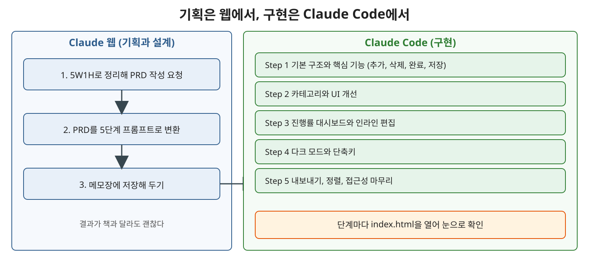

# 기획은 웹에서 구현은 Claude Code에서

이 문서는 4장의 첫 절 앞부분을 다룬다. 지금까지는 Claude 웹에서 프롬프트를 쓰는 일과 터미널에서 Claude Code로 프로그램을 만드는 일을 따로 연습했다. 4장은 이 둘을 한 흐름으로 묶는다. 웹에서 계획을 세우고, 그 계획을 Claude Code에서 실행한다.

건축에 비유하면 이렇다. 웹은 설계 사무소이고 Claude Code는 시공 현장이다. 설계 사무소에서 도면(PRD)과 공정표(단계별 프롬프트)를 만들어 현장에 넘기면, 현장은 공정표 순서대로 한 층씩 올린다.



---

## 1. 4장의 목표와 만들 앱

4장은 네 가지를 할 수 있게 하는 것이 목표다. Claude 웹과 Claude Code를 이어서 쓰기, 상황에 맞는 기본 명령 고르기, 체계적인 프롬프트 설계로 효율 높이기, 그리고 실용적인 할 일 관리 앱 완성하기다.

만들 앱은 개인용 할 일 관리 앱이다. 하루 할 일을 기록하고, 완료 여부를 체크하고, 업무와 개인과 공부 같은 카테고리로 나눠 볼 수 있다. 웹 브라우저에서 바로 돌아가고, 복잡한 프레임워크 없이 순수 HTML, CSS, JavaScript만 쓴다. 초보자가 따라 하기 쉽도록 고른 선택이다.

이 장에서는 일부러 여러 명령을 한꺼번에 익힌다. 어제 하던 세션 다시 열기, 매번 묻지 않고 일하게 하기, 긴 대화가 차지 않게 관리하기, 파일이나 스크린샷을 설명 대신 가리키기가 그것이다. 뒤 문서에서 하나씩 나온다.

## 2. 운영체제별 도구 대응

책의 화면은 Windows 기준이다. macOS나 Linux라면 아래 도구로 바꿔 읽으면 된다. 나머지 내용은 모두 같다.

| Windows | macOS | Linux |
|---|---|---|
| 파일 탐색기 | Finder | Files |
| 메모장 | TextEdit | gedit 또는 nano |
| 캡처 도구 | Shift + Command + 4 | 각 배포판의 캡처 도구 |

## 3. 작업 흐름: 기획과 구현을 나눈다

프로젝트는 두 단계로 나뉜다. 기획은 Claude 웹에서, 구현은 Claude Code에서 한다. 앞 장에서 배운 5W1H(누가, 언제, 어디서, 무엇을, 왜, 어떻게)로 요구사항을 정리해 PRD(Product Requirements Document, 제품 요구사항 문서)에 담는다. 이 PRD가 앱의 설계도 역할을 한다.

Claude가 만든 PRD와 단계별 프롬프트는 실행할 때마다 조금씩 다르다. 책의 예시와 똑같지 않아도 괜찮다. 중요한 것은 PRD 형식으로 요구사항을 정리하고, 그것을 단계별로 실행해 보는 경험이다. 내가 만든 결과물로 실습해도 된다.

## 4. PRD 작성 요청하기

브라우저에서 Claude(claude.ai)에 접속해 새 대화를 열고 아래처럼 요청한다. 앱의 성격, 하루 할 일 개수, 핵심 기능, 실행 환경, 데이터 유지 조건이 모두 들어 있다는 점을 눈여겨보자.

```text
I want to create a to-do management app. Please write a PRD for me.
It's a personal app to manage about 10-20 tasks per day. The main features are:
- Add, edit, and delete tasks
- Completion check feature
- Category classification (work/personal/study)
- View progress
I want it to run directly in the browser, and I'd like the data to persist
even after refreshing. I want to build it with pure JavaScript without
technical complexity.
```

Claude는 체계적인 PRD를 쓰기 시작한다. 구조와 핵심 요구사항이 제대로 들어갔는지 훑어본다. 요구사항이 구체적일수록 이어지는 단계 프롬프트도 구체적으로 나온다.

## 5. PRD를 단계별 프롬프트로 바꾸기

이제 PRD를 Claude Code에서 실행할 수 있는 프롬프트로 바꾼다. 웹과 달리 Claude Code의 프롬프트는 파일을 직접 만들고 고친다. 그래서 더 구체적이고 행동 중심이어야 한다. 다음처럼 요청하면 명확한 지시와 파일 작업 내용을 정리해 준다.

```text
Convert this PRD into step-by-step prompts for use in Claude Code.
Summarize it into 5 key steps and create clear instructions for each step.
```

이렇게 받은 프롬프트는 하나씩 Claude Code에 실행한다. 각 단계는 앞 단계의 결과 위에 새 기능을 얹는다. 생성형 AI의 특성상 표현과 구성은 매번 달라도 PRD 형식에 따라 정리하므로 핵심 내용은 비슷하다.

웹에서 만든 단계별 프롬프트는 메모장 같은 편집기에 저장해 두고 복사해서 쓴다. 웹은 기획과 설계를, Claude Code는 구현을 맡는 효율적인 분업이 된다. Claude 아티팩트에 있는 복사 아이콘을 눌러도 된다.

참고(노트 작성자): 6장에서는 PRD를 Claude Code 안에서 직접 쓰고, 단계별 프롬프트를 md 파일로 저장해 활용하는 방법을 배운다고 원서가 예고한다. 4장은 익숙한 웹 환경에서 기본 개념과 흐름을 먼저 익히는 데 초점을 둔다.

## 6. 실습 준비: 폴더 만들고 Claude Code 켜기

실습 폴더를 먼저 만든다. 바탕화면의 VibeCoding 폴더 안에 Study-02라는 새 폴더를 만들고 연다. 폴더의 빈 곳을 오른쪽 클릭해 터미널에서 열기를 고르면 터미널이 뜬다. 거기에 claude를 입력하면 Claude Code가 실행된다.

이제부터 내가 입력하는 프롬프트는 책의 예시와 다를 수 있다. 책에 쓰인 프롬프트가 궁금하면 책의 GitHub 저장소에서 전체 프롬프트 모음을 볼 수 있다. 장별로 정리되어 있고, 저장소 링크는 서문의 예제 코드 내려받기 부분에 나온다.

## 7. 복습 문제

초기 설정 명령(다음 문서에서 다룬다)을 확인하는 문제와 용어 문제로 구성되어 있다. 정답은 09장에 있다.

1. 프로젝트 구조를 분석해 CLAUDE.md를 자동으로 만들어 주는 명령, 현재 세션의 토큰 사용량과 남은 컨텍스트 용량을 보는 명령, 모델을 고르는 명령, 전체 명령 목록을 보는 명령을 각각 쓰시오.
2. 프로젝트 폴더 구조를 분석해 자동으로 생성되고 프로젝트의 맥락과 규칙을 담는 마크다운 파일의 이름을 쓰시오.
3. 제품의 목적, 대상 사용자, 주요 기능, 기술 사양 등을 체계적으로 정리한 문서를 무엇이라 하는가.
4. 할 일 앱이 데이터를 저장하고 다시 불러올 때 쓴 데이터 형식은 무엇인가.

<br>
<br>
<br>

[Build with Claude Code](../)
