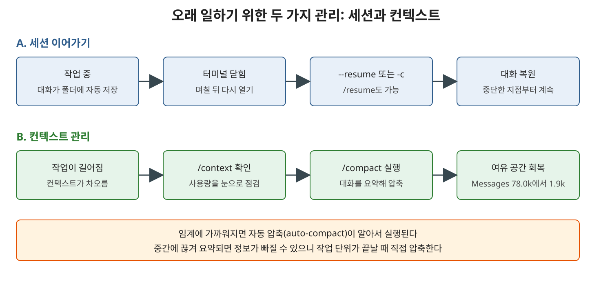

# 세션 재개와 자동 승인, 컨텍스트 관리

이 문서는 4장의 두 번째 절을 다룬다. 프로젝트는 한 번에 끝나지 않는다. 터미널을 닫았다가 며칠 뒤에 다시 열어 이어서 일해야 한다. 이때 필요한 것이 세션 이어가기, 반복 승인 줄이기, 컨텍스트 관리 세 가지다.

노트에 비유하면 이렇다. 세션은 어제 쓰던 노트를 다시 펼치는 일이고, 컨텍스트는 그 노트의 남은 쪽수다. 쪽이 다 차기 전에 앞 내용을 요약해 정리해 두면 계속 쓸 수 있다.



---

## 1. 세션이란

세션은 사용자와 프로그램이 상호작용하는 기간이다. Claude Code에서는 명령을 주고받는 동안 유지되는 대화 상태를 뜻한다. 터미널을 닫으면 이전 대화가 사라진 것처럼 보이지만, 실제로는 모든 대화 기록이 프로젝트 폴더에 자동으로 저장된다. 그래서 저장된 세션을 다시 불러와 하던 작업을 매끄럽게 이어갈 수 있다.

## 2. 세션 다시 열기: --resume

Study-02 폴더에서 터미널을 열고 아래 명령을 입력한다.

```bash
claude --resume
```

이 명령은 저장된 세션 파일을 읽어 이전 컨텍스트를 복원한다. 현재 프로젝트의 대화 목록이 뜨면 방향키로 원하는 대화를 찾아 Enter를 누른다. 할 일 앱을 만들던 대화를 골라 Enter를 누르면 멈춘 지점에서 이어서 작업할 수 있다.

세션을 이어가는 방법은 하나 더 있다. 작업이 끊겨도 걱정할 필요가 없다는 점이 요점이다.

- /resume: 먼저 claude로 실행한 뒤 이 슬래시 명령으로 이전 대화를 골라 이어간다.
- --continue 또는 -c: 가장 최근 대화를 자동으로 복원한다. 연결이 끊기거나 터미널이 닫혔을 때 편하다.

## 3. 자동 승인 모드: Shift + Tab

이어서 기능 하나를 더 추가해 본다. Claude Code에 "현재 할 일 앱에 키워드 기반 자동 카테고리 분류 기능을 추가해 줘"라고 요청한다. 그러면 Claude Code가 파일 수정 같은 작업을 하려고 허락을 구한다.

이때 Shift + Tab을 누르면 2번 Yes, allow all edits during this session을 고르는 것과 같다. 화면 아래에 자동 승인 표시가 떠 있는 동안에는 모든 수정이 자동으로 승인된다. Shift + Tab을 다시 누르면 일반 모드로 돌아간다. 반복되는 승인 요청을 건너뛰어 작업이 빨라진다. 작업이 끝나면 기능이 추가되었다는 메시지가 나온다.

참고(노트 작성자): 자동 승인은 편하지만 수정이 확인 없이 적용되므로, 어떤 작업을 맡겼는지 알고 쓰는 것이 좋다.

## 4. 기능 확인하기

요청한 대로 카테고리가 자동 분류되는지 본다. Claude Code가 추가하는 세부 기능은 사람마다 다를 수 있으니, 안내를 따라 확인하면 된다. 책에서는 스마트 키워드 분석과 자동 분류 시스템이 생겼다.

Study-02의 index.html을 열고 검색창 옆 입력칸에 "Go to the movies"를 쓴 뒤 카테고리를 업무로 두고 추가를 누른다. 앱이 이 일을 개인으로 분류하라고 추천하고, 확인을 누르면 개인 카테고리로 등록된다. 첫 화면에는 자동 재분류 버튼과 카테고리 설정 버튼이 생겨, 재분류 기능을 켜고 끄거나 세부 옵션을 고칠 수 있다.

## 5. 컨텍스트 관리

작업하다 보면 컨텍스트 사용량이 자동 압축 임계에 가까워졌다는 메시지가 종종 뜬다. 컨텍스트(context, 이 세션에서 Claude Code가 기억하는 대화와 작업 정보 전체)는 AI의 기억 공간이다. 이 공간이 부족해지면 오래된 대화를 압축해 토큰 사용량을 줄이고 작업을 계속한다.

문제는 자동 요약 때 일부 정보가 사라질 수 있다는 점이다. 작업 단위가 끝난 뒤 요약하지 않고 중간에 억지로 요약되는 일도 있다. 그래서 자주 상태를 확인하고, 자동 압축이 되기 전에 적당한 시점에 직접 압축하는 편이 좋다.

### 5-1. 상태 확인: /context

```text
/context
```

Enter를 누르면 컨텍스트 사용 현황이 시각적으로 나온다. 토큰 한도는 구독 요금제에 따라 다르다.

### 5-2. 압축: /compact

```text
/compact
/compact summarize focusing on code changes
```

/compact는 대화를 자동으로 요약해 공간을 비운다. 뒤에 압축 지침을 붙이면 그 기준으로 요약한다. 예를 들어 "코드 변경에 집중해 요약해 줘"처럼 쓴다.

압축이 끝나면 Compacted (ctrl+o to see full summary)라는 메시지가 뜨고 화면 아래 자동 압축 경고가 사라진다. Ctrl + O를 누르면 압축 때 만든 요약 전문을 볼 수 있어, 중요한 작업 내용이 잘 남았는지 점검할 수 있다. 다시 /context를 치면 책의 예에서 Messages가 78.0k에서 1.9k로 줄고, 여유 공간이 107.4k(53.7%)에서 183.4k(91.7%)로 늘었다.

압축해도 시스템 프롬프트와 도구, 프로젝트에 필요한 메모리 파일은 그대로 유지된다. 그래서 핵심 정보와 맥락을 지킨 채 일을 계속한다. 오래 개발할 때는 작업 단위가 끝날 때마다 적당히 압축하는 습관이 좋다.

## 6. 절 마무리: 네 개 키워드

- --resume 명령은 대화 목록에서 고른 세션을 복원한다.
- Shift + Tab은 자동 승인 모드로 바꿔 반복되는 권한 요청을 건너뛴다.
- 컨텍스트는 현재 대화와 작업 정보를 담아 보여 주는 기억 공간이다.
- /compact 명령은 대화 기록을 요약해 컨텍스트 공간을 비운다.

## 7. 복습 문제

1. 다음 중 틀린 설명을 고르시오. (1) /compact는 대화를 요약해 토큰을 아낀다. (2) 컨텍스트가 임계에 닿으면 자동 압축이 실행된다. (3) 압축 후에도 CLAUDE.md와 프로젝트 파일은 유지된다. (4) Ctrl + R이 /context 명령의 단축키다. (5) 자동 승인 모드는 Shift + Tab으로 켠다.
2. 다음 상황에 맞는 명령이나 옵션을 쓰시오. 여러 대화 중 하나를 골라 이어가고 싶을 때, 가장 최근 대화를 바로 이어가고 싶을 때, 컨텍스트 사용량을 눈으로 확인하고 싶을 때, 대화가 길어져 압축하고 싶을 때, 파일 수정을 매번 승인하기 번거로울 때.

<br>
<br>
<br>

[Build with Claude Code](../)
