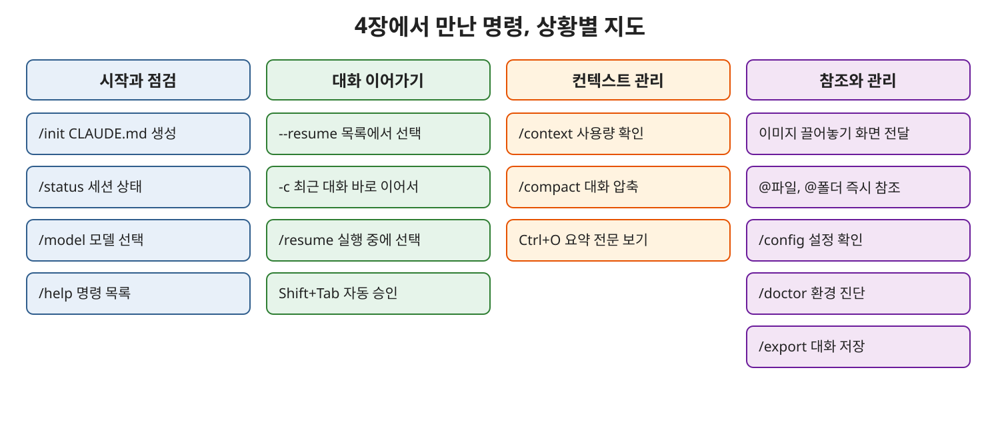

# 이미지 참조와 @ 기호, 프로젝트 관리 명령

이 문서는 4장의 마지막 절을 다룬다. 할 일 앱을 데스크톱 버전으로 확장하면서 Claude Code의 프로젝트 관리 기능을 익힌다. 스크린샷을 보내 요구사항을 전하고, @ 기호로 파일을 빠르게 분석하고, 설정과 진단 명령으로 작업 환경을 살피고, 마지막으로 전체 작업을 문서로 남긴다.

운전에 비유하면 이렇다. 길을 말로 길게 설명하는 대신 지도 화면을 보여 주는 것이 이미지 참조다. 목적지를 손가락으로 짚는 것이 @ 기호다. 출발 전 계기판과 정비 점검을 하는 것이 /config와 /doctor이고, 블랙박스 영상을 저장하는 것이 /export다.



---

## 1. 멀티모달 AI와 이미지 입력

멀티모달 AI는 텍스트뿐 아니라 이미지와 오디오 같은 여러 종류의 정보를 함께 이해하는 AI다. Claude Code 뒤에서는 Sonnet이나 Opus 같은 멀티모달 모델이 돌아간다. 명령줄로 쓰지만 모델은 이미지를 분석하고, 내용을 설명하고, 구조를 파악해 코드를 만드는 근거로 삼을 수 있다.

백문이 불여일견이라는 말이 Claude Code에도 맞다. 긴 설명보다 한 번 보여 주는 편이 훨씬 효과적이다. 화면을 캡처해 바로 보내면 요구사항이 더 정확하고 빠르게 전달된다.

## 2. 캡처 이미지로 데스크톱 UI 만들기

지금까지 만든 결과는 모바일에 맞춰져 있다. 이번에는 화면을 꽉 채우는 데스크톱 버전을 만들어 달라고 한다. 이전 결과를 지키려고 web_version이라는 새 폴더에 저장하게 한다.

먼저 현재 앱을 캡처한다. Windows는 시작 메뉴에서 캡처 도구(Snipping Tool)를 찾아 실행한다. macOS는 Shift + Command + 4나 스크린샷 앱, Linux는 배포판의 캡처 도구를 쓴다.

1. 캡처 도구에서 새로 만들기(+ New) 버튼을 눌러 캡처를 시작한다.
2. 할 일 앱을 실행해 둔 상태에서 사각형 옵션을 고르고, 앱의 메인 화면을 드래그해 캡처한다.
3. 저장 아이콘을 눌러 Study-02 폴더에 screenshot.png로 저장한다.
4. Claude Code가 실행 중인 명령창에 screenshot.png를 끌어다 놓는다. 입력창에 [Image #1]이 나타나면 성공이다.

그다음 같은 입력창에 요청을 쓴다.

```text
[Image #1] The current design seems optimized for mobile. Please modify the
design so that the UI can be viewed in full screen on a desktop
environment. Save the revised design in a new folder called 'web_version'.
```

mkdir 같은 권한 요청이 뜨면 2번 Yes, and don't ask again for mkdir를 골라 자동으로 이어가게 해도 된다. 실행이 끝나면 Study-02 안에 web_version 폴더가 생기고, 그 안의 index.html을 열면 데스크톱에 맞춘 할 일 앱이 나온다. 모든 기능을 확인해 보자. "Check tomorrow's work schedule"를 입력하면 자동으로 업무 카테고리로 분류된다.

## 3. @ 기호로 파일 분석하기

Claude Code에서 @ 기호를 쓰면 파일이나 폴더를 즉시 불러와 코드를 빠르게 살필 수 있다. 앞서 만든 script.js를 불러와 다크 모드가 잘 구현됐는지 보자.

1. Claude Code에서 @를 치면 불러올 수 있는 파일 목록이 뜬다. 여기서 script.js를 고른다.
2. 아래처럼 요청하면 Claude Code가 script.js 전체를 읽고 바로 분석한다.

```text
Find and explain the functions related to dark mode in the @script.js file.
```

분석이 끝나면 요청한 함수의 이름과 기능과 위치를 알려 주고, 단축키 같은 숨은 기능도 소개한다. 1,000줄이 넘는 코드에서 다크 모드 함수를 사람이 찾으려면 오래 걸리지만 Claude Code는 곧바로 찾는다. 특정 파일을 찾아 달라고 시킬 수도 있지만 검색에 시간이 걸려 작업이 늦어질 수 있다.

## 4. @ 기호로 폴더 구조 보기

폴더도 같은 방식으로 가리킨다. @web_version을 입력하면 폴더 전체를 불러오고 안에 든 파일 목록이 나온다. 이어서 이렇게 요청한다.

```text
Please analyze the files in the `@web_version` folder and check if the to-do app is optimized for the desktop environment.
```

Claude Code는 폴더의 모든 파일을 읽고 종합 분석 결과를 보여 준다. 파일을 하나씩 열지 않아도 전체 구조와 특징을 한눈에 알 수 있다. HTML, CSS, JavaScript가 서로 얽힌 웹 개발에서 특히 유용하다. Claude가 파일 사이의 관계까지 함께 보고 종합 평가를 내기 때문이다.

## 5. /config로 설정 확인하기

/config는 프로그램의 설정을 확인하고 바꾸는 명령이다. 프로젝트를 어떻게 다룰지에 대한 규칙을 관리하는 도구라고 보면 된다. 파일 저장 권한이나 출력 형식 같은 현재 설정을 보고 원하는 값으로 바꿀 수 있다. Enter를 누르면 아래 항목들이 나온다. 방향키로 항목을 고르고 Enter, Tab, Space로 값을 바꾸며, Esc로 닫는다. 기본값은 책이 쓰인 시점 기준이다.

| 항목 | 기본값 | 설명 |
|---|---|---|
| Auto-compact | TRUE | 컨텍스트가 일정 수준에 이르면 /compact를 자동 실행한다. false면 수동 압축만 가능하다 |
| Use todo list | TRUE | 작업을 할 일 목록으로 관리해 단계별 진행을 추적한다 |
| Verbose output | FALSE | TRUE면 자세한 디버그 정보를 보여 준다 |
| Auto-updates | TRUE | 새 버전이 나오면 자동으로 내려받아 설치한다 |
| Theme | Light mode | 터미널 테마를 라이트나 다크로 고른다 |
| Notifications | Auto | 작업 완료 알림 방식을 Auto, Bell, None 중에서 고른다 |
| Output style | default | 응답 스타일이다. default가 표준 형식이다 |
| Editor mode | normal | 편집 모드를 normal이나 vim으로 고른다 |
| Model | Default (recommended) | 사용할 모델을 고른다. Default는 작업에 맞춰 최적의 모델을 자동으로 고른다 |
| Auto-connect to IDE | FALSE | VS Code 같은 IDE와 자동으로 연결할지 정한다 |

## 6. /doctor로 환경 진단하기

이름처럼 /doctor는 의사가 환자를 보듯 Claude Code의 환경을 진단해 프로젝트가 제대로 돌아가는지 본다. 입력하고 Enter를 누르면 항목별 진단 결과가 나온다. 문제가 있는 항목은 해결 방법을 제안하고, 모두 정상이면 Enter를 눌러 진단을 끝낸다. 버전, 설치 방식, 자동 업데이트 권한 같은 정보를 확인할 수 있다.

## 7. /export로 대화 저장하기

/export는 지금까지의 작업 기록을 하나의 출력 파일로 저장한다. 소스 코드와 수정 이력이 담긴 대화를 파일로 남기면 작업 환경을 옮기거나 협업자와 공유할 때 참고 자료가 된다. 핵심 대화만 뽑아 다른 프로젝트의 CLAUDE.md에 추가할 수도 있다.

실습 순서는 이렇다. /export를 입력하고 Enter를 누르면 두 가지 선택지가 나온다. 클립보드에 복사하는 것과 파일로 저장하는 것이다. 2번 Save to file을 고르고 Enter를 누른 뒤, 파일 이름을 todo-app-conversation.txt로 바꾸고 다시 Enter를 누른다. 파일이 바탕화면 Study-02 폴더에 저장된다. 메모장으로 열면 Claude Code에서 일한 모든 대화 기록이 들어 있다.

## 8. 절 마무리: 다섯 키워드

- 스크린샷을 Claude Code에 보내면 긴 설명 없이 요구사항을 분명하고 빠르게 전할 수 있다.
- @ 기호로 파일과 폴더를 즉시 참조하고 분석한다.
- /config는 Claude Code의 프로젝트 환경 설정을 관리한다.
- /doctor는 시스템 상태를 진단하고 버전, 설치 방식, 업데이트 권한 등을 확인한다.
- /export는 작업 기록을 클립보드나 파일로 저장해 문서화한다.

이 장을 마치면 Claude Code의 여러 도구로 프로젝트를 관리할 수 있다. 다음 장에서는 더 복잡한 프로젝트에 도전한다.

## 9. 복습 문제

1. 다음 중 틀린 설명을 고르시오. (1) 캡처한 이미지는 끌어다 놓아 전달할 수 있다. (2) @ 기호를 쓰면 검색 시간 없이 파일이 곧바로 프롬프트에 포함된다. (3) /config는 Claude Code의 전역 설정만 바꿀 수 있다. (4) /doctor로 자동 업데이트 설정 상태를 확인할 수 있다. (5) /export로 저장한 파일은 CLAUDE.md를 쓸 때 참고할 수 있다.
2. 각 상황에 맞는 명령이나 기능을 쓰시오. web_version 폴더 구조를 확인하고 싶을 때, script.js에서 특정 함수를 찾고 싶을 때, Claude Code의 설치 상태를 확인하고 싶을 때, 대화 기록을 파일로 저장하고 싶을 때, 다크 모드로 바꾸고 싶을 때, 자동 압축 기능을 끄고 싶을 때.

참고(노트 작성자): 마지막 문제의 "다크 모드로 바꾸고 싶을 때"는 원문 표에서 /config 항목의 Theme 설정과 할 일 앱의 다크 모드 스위치 두 가지로 해석될 수 있다. 정답은 09장을 참고한다.

<br>
<br>
<br>

[Build with Claude Code](../)
