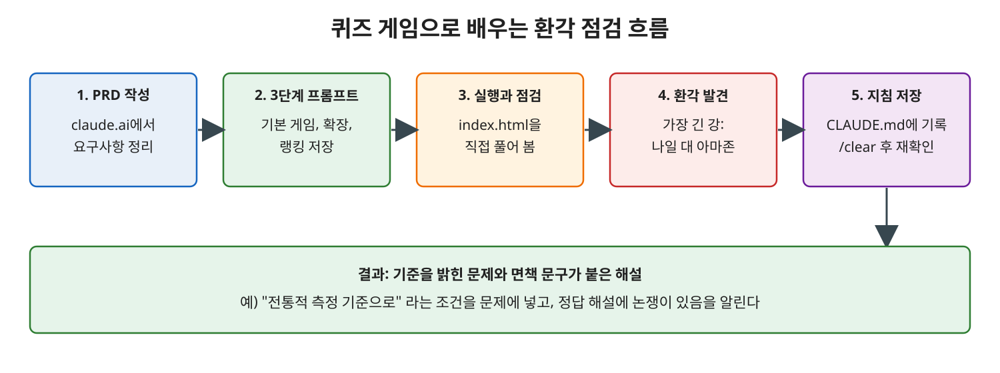

# 게임 제작으로 배우는 체계적 개발과 관리

5장은 4지선다 상식 퀴즈 게임을 만들면서 AI 결과물의 정확성을 검증하는 방법과 반복 작업을 자동화하는 방법을 배운다. PRD로 게임을 만들고, 환각이 생긴 문제를 CLAUDE.md의 검증 지침으로 고친 뒤, 커스텀 명령과 통합 명령으로 문제 추가, 검증, 통계, 보고서를 자동화한다. 마지막에는 필요한 부분만 골라 고치는 유지 보수 방식을 익힌다.

---

## 1. 핵심 요점

- 환각은 AI가 그럴듯하지만 거짓인 정보를 만드는 현상이므로, 중요한 내용은 믿을 만한 자료와 교차 확인해야 한다.
- "세계에서 가장 긴 강"처럼 기준에 따라 답이 갈리는 문제는 기준을 밝히고 검증 지침을 CLAUDE.md에 저장해 해결한다.
- `/memory`로 프로젝트 기억(CLAUDE.md)을 관리하고, `/clear`로 대화 문맥을 비운다. `/compact`는 요약해 남긴다는 점이 다르다.
- 커스텀 명령은 마크다운 파일이며, 전역은 홈의 `.claude/commands/`, 프로젝트용은 현재 폴더의 `.claude/commands/`에 둔다.
- `$ARGUMENTS`, `$1`, `$2` 같은 자리 표시자로 분야나 범위를 인수로 받는 명령을 만든다.
- 명령을 연결하거나 `/quiz-daily` 같은 통합 명령으로 묶으면 매일의 업데이트를 한 번에 처리하고, 실패하면 즉시 멈춘다.
- 교사 모드에서는 명령 설계까지 Claude Code에 맡기고, 명령 파일 하나만 고치거나 추가해 부분 수정한다.

---

## 2. 문서 목록

- [퀴즈 게임 만들기와 환각 점검](퀴즈 게임 만들기와 환각 점검.md): 환각이란 무엇인지, PRD로 1단계 게임을 만들고 직접 테스트하며 "가장 긴 강" 환각을 만난다.
- [CLAUDE.md 검증 지침과 컨텍스트 초기화](CLAUDE.md 검증 지침과 컨텍스트 초기화.md): `/memory`로 지침을 저장하고 `/clear`로 비운 뒤 적용을 확인한다. `/compact`와 비교한다.
- [커스텀 명령으로 반복 작업 자동화](커스텀 명령으로 반복 작업 자동화.md): 2단계 확장과 커스텀 명령의 종류, 인수, `/quiz-validate`, `/quiz-range`, `/quiz-add`를 만든다.
- [랭킹 시스템과 명령 연결 자동화](랭킹 시스템과 명령 연결 자동화.md): 3단계 랭킹 저장, 명령 연결, 통합 명령 `/quiz-daily`, Claude Code가 설계한 교사 모드를 다룬다.
- [필요한 부분만 고치는 유지 보수 워크플로](필요한 부분만 고치는 유지 보수 워크플로.md): 등급 상대 평가 수정과 `/export-report` 추가로 부분 수정을 익히고 복습 문제를 푼다.
- [요약과 핵심 개념](요약과 핵심 개념.md): 장 전체 흐름, 핵심 개념 표, 자주 놓치는 점

 
 
 

[Build with Claude Code](../)
