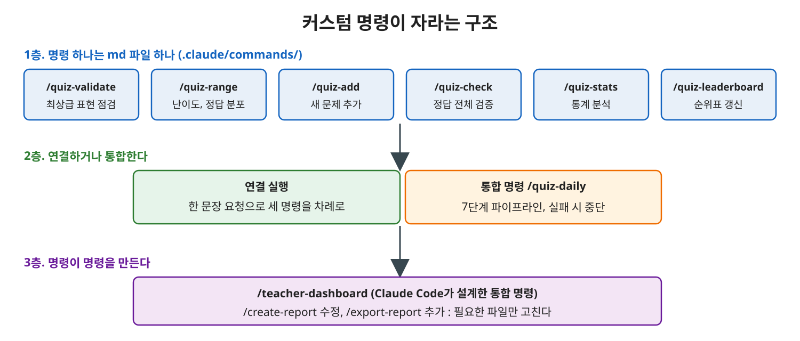

# 커스텀 명령으로 반복 작업 자동화

기본 퀴즈 게임이 완성되면 할 일은 문제를 점검하고, 난이도를 맞추고, 새 문제를 넣는 반복 작업이다. 매번 긴 프롬프트를 쓰면 번거롭고 실수도 잦다. 이 문서는 자주 쓰는 지시를 이름 하나로 불러내는 커스텀 명령(사용자가 직접 정의해 쓰는 슬래시 명령)을 만들어 본다.

비유하면 스마트폰의 단축키 설정과 같다. 길게 치던 문장을 `/quiz-validate` 한 단어에 묶어 두고, 필요할 때 호출한다. 1장에서 웹사이트 디자인을 내 취향대로 바꿨던 것처럼, 슬래시 명령도 사용자가 동작을 다시 정의할 수 있다.



---

## 1. 2단계: 점수 시스템과 게임 모드 확장

먼저 앞에서 만든 두 번째 프롬프트(2단계)를 Claude Code에 입력한다. 점수 체계와 다양한 게임 모드를 더해 게임을 재미있게 만드는 단계다. 실행이 끝나면 완료 메시지가 나오고, `index.html`을 다시 열면 게임 모드가 세 가지로 늘어 있다.

그중 스피드 퀴즈를 골라 본다. 문제당 제한 시간 15초 규칙이 적용된다. 힌트 보기 버튼을 누르면 힌트가 나오지만 점수가 깎인다. 정오답 판정은 여전히 정확하고, 끝까지 풀면 최종 점수가 나온다. 이 절의 주제는 이 확장된 게임을 점검하고 관리하는 도구를 만드는 것이다.

## 2. 반복 작업이 왜 문제인가

퀴즈 게임은 교육 콘텐츠나 학습 앱으로도 쓸 수 있다. 하지만 개발 중에는 비슷한 일이 반복된다. 문제 형식을 맞추려 복사해 붙이기, 검증할 때마다 지침 확인하기, 균형을 위해 난이도 조정하기 같은 일이다. 긴 프롬프트로 매번 처리하면 비효율적이고 실수도 늘어난다. 커스텀 명령은 이를 간단한 명령으로 자동화해, 빠르고 안정적으로 개발을 이어 가게 해 준다.

## 3. 커스텀 명령의 종류와 저장 위치

커스텀 명령은 마크다운(md) 파일로 정의하며, 적용 범위에 따라 둘로 나뉜다.

| 종류 | 저장 위치 | 쓰임 |
|---|---|---|
| 전역 명령(Global) | `~/.claude/commands/` | 모든 프로젝트에서 사용 |
| 프로젝트 명령(Project) | `.claude/commands/` | 현재 프로젝트에서만 사용 |

경로 표기에서 `~`는 홈 디렉터리, `.`은 현재 디렉터리를 뜻한다. 이번 명령은 퀴즈 게임에서만 쓰므로 `Study-03` 폴더 안에 프로젝트 명령 폴더를 만든다.

참고: 커스텀 명령은 8장에서 소개할 에이전트 스킬과 비슷한 개념이다. 커스텀 명령은 자주 하는 작업을 `/명령`으로 등록하고 직접 입력해야 실행된다. 스킬은 등록해 두면 요청의 성격을 보고 Claude Code가 자동으로 호출한다. 스킬은 `.claude/skills/` 폴더에 `SKILL.md` 파일로 저장하며, 명령처럼 마크다운으로 쓴다.

## 4. 첫 번째 명령: /quiz-validate

### 4-1. 폴더 만들기

`Study-03`에서 터미널을 열고 Claude Code를 실행한 뒤, 다음처럼 요청한다.

```text
현재 프로젝트에 커스텀 명령 폴더를 만들어 줘.
.claude/commands 디렉터리를 만들고 구조를 보여 줘.
```

폴더가 생기고 디렉터리 구조가 표시된다.

### 4-2. 명령 파일 만들기

앞서 CLAUDE.md에 넣은 교차 검증 지침 중 "최상급 표현에 근거가 밝혀져 있는가"를 자동으로 점검하는 명령이다. 이렇게 요청한다.

```text
.claude/commands/quiz-validate.md 파일을 만들어 줘.
퀴즈 문제에서 '가장', '최초', '최대' 같은 최상급 표현을 찾아 목록으로 보여 줘.
```

논쟁이 될 수 있는 정답을 미리 걸러 내는 명령 `/quiz-validate`가 만들어진다.

### 4-3. 실행하기

새 명령은 재시작해야 인식된다. `/exit`로 Claude Code를 나갔다가 `claude`로 다시 실행한 뒤 `/quiz-validate`를 입력한다. 퀴즈에서 최상급 표현을 찾아 개선안을 제안한다. 이 명령은 상식 퀴즈뿐 아니라 비슷한 프로젝트에서도 애매한 주장을 걸러 낸다.

## 5. 인수와 자리 표시자로 명령 키우기

인수(Argument)는 명령에 덧붙여 건네는 정보다. 명령이 "무엇을 할지"를 정한다면 인수는 "무엇에, 어떻게"를 정한다. 자리 표시자(Placeholder)는 나중에 실제 값이 들어갈 자리를 표시한 기호다. 웹사이트에서 "환영합니다, {name}"처럼 써 두면 실행할 때 이름이 들어가는 것과 같다. 실제로 Claude 시작 화면의 사용자 이름도 문서에서는 자리 표시자로 되어 있다.

책은 두 가지 방식을 만든다. 하나는 분야 이름을 인수로 받아 그 분야만 검증하는 것이고, 다른 하나는 숫자 두 개를 받아 그 범위만 분석하는 것이다.

### 5-1. 특정 분야만 검증: `$ARGUMENTS`

`/quiz-validate History`처럼 분야를 주면 그 분야만 검증한다. 인수를 안 주면 전체를 검증한다. `$ARGUMENTS`가 인수 전체를 받는 자리 표시자다. 파일을 이렇게 고치도록 요청한다.

```text
.claude/commands/quiz-validate.md를 다음과 같이 수정해 줘.
사용자가 분야를 지정하면 그 분야 문제만, 지정하지 않으면 전체 문제를 검증한다.
$ARGUMENTS에 입력된 값을 분야로 사용한다.
검증할 때 '가장', '최초', '최대' 같은 애매한 표현을 확인하고
어떤 기준을 밝혀야 하는지 알려 준다.
```

수정 후 `/exit`, `claude`로 재시작하고 `/quiz-validate History`를 실행한다. 중간 단계에서 묻는 화면은 1번 Yes를 눌러 끝까지 진행한다. 역사 분야 퀴즈 검증이 끝났다는 결과가 나온다.

### 5-2. 범위 분석: `$1`과 `$2`

`/quiz-range 1 20`은 1번부터 20번 문제를 검토한다. 이 명령은 난이도 분포와 정답 분포를 본다. 쉽거나 어려운 문제가 한 구간에 몰렸는지, 정답이 특정 번호에 치우쳤는지(예: 1번만 정답이거나 4번이 거의 정답이 아닌 경우) 찾아내고, 전체가 고르게 분포하도록 안내한다. 첫째 인수는 `$1`, 둘째 인수는 `$2`가 받는다.

```text
.claude/commands/quiz-range.md를 만들어 줘.
$1번부터 $2번까지 문제를 검토하는 기능을 만들어 줘.
문제의 난이도와 정답 분포를 확인할 수 있게 해 줘.
```

재시작한 뒤 `/quiz-range 1 20`을 입력하면 명령이 정상 작동해 1번부터 20번을 분석하고, 정답 위치를 더 고르게 나누라고 권고한다.

### 5-3. 새 문제 추가: `/quiz-add`

새 문제를 넣을 때도 형식과 지침을 지켜야 한다. 분야와 난이도를 인수로 받는 `/quiz-add`를 만든다. 예를 들어 `/quiz-add History medium`은 역사 분야에 중급 문제를 하나 넣는다. 첫째 인수 `$1`이 분야, 둘째 인수 `$2`가 난이도다.

```text
.claude/commands/quiz-add.md를 만들어 줘.
새 문제를 추가하는 명령이다. $1은 분야, $2는 난이도로 처리해 줘.
기존 문제와 같은 형식으로 만들고 검증 지침을 반드시 지켜 줘.
중간 단계를 확인하며 진행해 줘.
```

만들어지면 사용법과 예시가 나온다. 재시작해 `/quiz-add History medium`을 실행하면 역사 분야에 새 문제가 추가된다. `index.html`을 다시 열면 새 문제가 실제 게임에 나온다.

## 6. 이 절의 정리

세 명령이 각자 역할을 맡았다. `/quiz-validate`는 애매한 최상급 표현을 자동으로 점검하고, `/quiz-range`는 지정 범위의 난이도와 정답 분포를 분석하며, `/quiz-add`는 분야와 난이도에 맞춰 일관된 지침으로 새 문제를 추가한다. 인수를 쓰는 커스텀 명령은 반복 작업을 줄이는 강력한 도구다. 다음 절에서는 이 명령들을 프로젝트 업데이트와 자동화 흐름에 연결한다.

핵심 다섯 가지는 다음과 같다. 커스텀 명령은 사용자가 직접 정의해 반복 작업을 자동화한다. 전역 명령은 홈 디렉터리에, 프로젝트 명령은 작업 폴더의 `.claude/commands/`에 둔다. 인수는 작업의 대상이나 범위를 정한다. `$ARGUMENTS`, `$1`, `$2` 같은 자리 표시자는 실행할 때 실제 값으로 바뀐다.

---

## 7. 복습 문제

정답은 부록 [09. 복습 문제 정답](../09. 복습 문제 정답/복습 문제와 정답.md)에 있다.

- 틀린 설명을 고른다. 하나, 프로젝트 명령은 해당 프로젝트 안에서만 쓴다. 둘, 커스텀 명령은 자연어로 쓸 수 있다. 셋, 커스텀 명령은 파이썬 파일 형식으로 저장한다. 넷, 명령은 마크다운 파일 형식으로 저장한다. 다섯, 매개변수로 유연하게 운용할 수 있다.
- 빈칸을 채운다. 프로젝트 전용 커스텀 명령을 저장할 위치, 특정 번호 범위의 문제를 검토할 때 쓰는 자리 표시자 두 개, 사용자 입력값을 받을 때 쓰는 자리 표시자, `~/.claude/commands`에 만든 명령을 쓸 수 있는 범위를 각각 적는다.

<br>
<br>
<br>

[Build with Claude Code](../)
