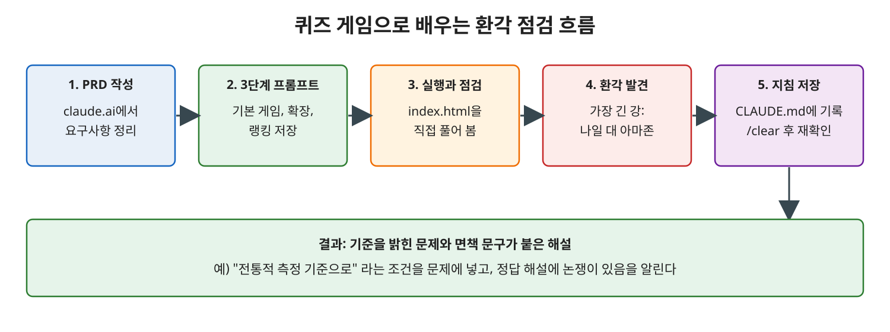

# 퀴즈 게임 만들기와 환각 점검

이 문서는 5장 첫 절의 앞부분이다. 4지선다 상식 퀴즈 게임을 PRD부터 시작해 Claude Code로 만들고, 직접 풀어 보며 AI가 만든 문제에 틀리기 쉬운 곳이 있는지 살핀다. 이 책은 비개발자도 따라 하는 실습서이므로, 어떤 프롬프트를 왜 쓰는지와 어떤 결과가 나오는지를 중심으로 설명한다.

비유하면 이렇다. 조수가 만든 시험지를 그대로 나눠 주지 않고, 출제자가 먼저 풀어 보며 애매한 문항을 찾는 과정이다. 이 장에서 게임은 완성이 목적이 아니라, AI 결과물을 검증하는 습관을 익히는 도구다. (가격, 화면 문구, 명령 이름은 책이 쓰인 시점 기준이다.)



---

## 1. 장의 목표와 환각이라는 문제

5장이 끝나면 할 수 있어야 하는 일은 네 가지다. AI가 만든 내용의 정확성을 확인해 환각을 막는 것, 반복 작업을 자동화하는 커스텀 명령을 만드는 것, 명령을 이어 붙여 여러 작업을 한 번에 처리하는 것, 완성된 프로젝트에서 필요한 부분만 골라 고치는 것이다.

환각(Hallucination, 생성형 AI가 그럴듯하지만 사실이 아닌 내용을 만들어 내는 현상)은 AI가 학습한 데이터의 패턴을 조합해 가장 그럴듯한 문장을 만들기 때문에 생긴다. 정보가 애매할 때 추론이 틀리는 경우도 있다. 그래서 AI가 낸 정보는 믿을 만한 문서나 공식 사이트와 교차 확인해야 한다. "출처 없는 정보는 만들지 마라" 같은 규칙을 미리 넣어 두는 것도 위험을 줄이는 방법이다.

이 절에서 새로 익힐 용어는 세 가지다. 환각, 프로젝트 기억을 관리하는 `/memory`, 대화 문맥을 지우는 `/clear`다.

## 2. 만들 게임의 모양

만들 게임은 4지선다 상식 퀴즈다. 분야는 역사, 과학, 지리, 예술과 문화 네 가지이고, 문제를 풀 때마다 정오답을 바로 알려 준다. 마지막에는 점수와 순위를 기록해 학습과 재미를 함께 얻는다. 책은 이 과정을 1단계 게임 구현, 2단계 확장, 3단계 저장과 랭킹 세 걸음으로 나눈다. 이 문서는 1단계까지 다룬다.

## 3. 1단계: PRD 작성부터 게임 실행까지

### 3-1. claude.ai에서 PRD 쓰기

먼저 claude.ai에 접속해 상식 퀴즈 게임의 PRD(제품 요구사항 문서, 무엇을 어떻게 만들지 적은 설계 문서)를 쓰게 한다. 결과는 아티팩트 창에 문서로 나온다. 프롬프트에 담는 게임 규칙은 다섯 가지다.

```text
상식 퀴즈 게임의 PRD를 작성해 줘.
게임 규칙:
1. 4지선다 객관식
2. 분야: 역사, 과학, 지리, 예술과 문화
3. 분야별 10문제, 총 40문제
4. 정답/오답 즉시 피드백
5. 최종 점수와 순위 기록
```

### 3-2. PRD를 3단계 구현 프롬프트로 바꾸기

PRD가 나오면 이어서 Claude Code용 프롬프트로 바꾼다. 요청은 "PRD를 바탕으로 상식 퀴즈 게임을 Claude Code로 구현할 수 있게 3단계 프로젝트로 요약해 줘"이다. 팁으로, 2장에서 배운 5W1H 원칙을 떠올리며 요구사항을 정리하라고 덧붙인다. 그러면 단계별 프롬프트 세 개가 만들어진다. 이후 2단계와 3단계에서 이 프롬프트를 그대로 쓴다.

### 3-3. Claude Code로 구현하기

작업 폴더는 바탕화면의 VibeCoding 폴더 안에 `Study-03`을 만들어 쓴다. 폴더에서 마우스 오른쪽 버튼으로 터미널을 열고 `claude`를 입력해 Claude Code를 실행한다(실행 방법은 3장 참고). 그런 다음 3단계 프롬프트 중 첫 번째를 붙여 넣는다.

프롬프트가 길면 화면에 `[Pasted text #1 +44 lines]`처럼 줄여 보인다. 그대로 Enter를 누르면 정상 실행된다. 전체 프롬프트는 책의 깃허브 저장소 `PROMPTS.md`에서 복사할 수 있다. 실행이 끝나면 "퀴즈 시스템이 구현되어 테스트할 수 있다"는 메시지가 나오고, `Study-03` 폴더에 `index.html`이 생긴다.

## 4. 게임 직접 테스트하기

`index.html`을 더블클릭해 브라우저에서 연다. 확인할 항목은 네 가지다. 네 분야 문제가 차례로 나오는지, 정답과 오답이 정확히 판정되는지, 피드백이 바로 표시되는지, 끝나면 결과가 보이는지다.

테스트 순서는 이렇다.

1. 시작 버튼을 눌러 첫 문제를 푼다.
2. 정답을 고르면 정답 팝업이, 오답을 고르면 오답 표시와 올바른 답이 나타난다.
3. 모든 문제를 풀면 최종 점수 카드가 나온다.

눈에 띄는 오류는 없었다. 하지만 "눈에 띄지 않는다"와 "정확하다"는 다르다. 애매한 문제가 숨어 있을 수 있다.

## 5. 환각 사례: 세계에서 가장 긴 강

책은 환각을 직접 보도록 저자가 일부러 문제를 넣은 예제(깃허브 저장소의 `Study-03` 안 `Study-03-basic`)를 내려받아 실행하게 한다. Claude Code에 "다운로드한 파일을 실행해 줘"라고 말하면 된다. AI의 출력은 매번 달라서 같은 오류를 만나지 못할 수 있기 때문에, 문제가 되는 문항이 들어 있는 라이브 데모를 따로 제공하는 것이다.

문제는 "세계에서 가장 긴 강은?"이다. 선택지에서 아마존강을 고르면 오답이라며 정답은 나일강이라고 나온다. 그런데 아마존의 발원지와 길이를 다르게 재면 아마존이 더 길다는 연구도 있다. 즉 답이 측정 기준에 따라 달라진다.

이런 논쟁거리는 문제를 만들 때 기준을 분명히 밝히고 교차 확인해야 한다. 가장 효과적인 방법은 검증 지침을 만들어 `CLAUDE.md` 파일에 영구 저장하는 것이다. 이 방법은 다음 문서에서 다룬다.

---

## 6. 복습 문제

장 말미의 복습 문제 중 이 문서와 관련된 항목이다(정답은 부록 [09. 복습 문제 정답](../09. 복습 문제 정답/복습 문제와 정답.md)에 있다).

- 다음 중 틀린 설명을 고른다. 하나, 패턴을 지나치게 일반화하면 환각이 생길 수 있다. 둘, `/memory`에서 Project memory를 고르면 `./CLAUDE.md`가 열린다. 셋, `/clear`는 문맥을 유지한 채 대화를 요약해 압축한다. 넷, `./CLAUDE.md`에 지침을 더할 때는 간결하고 명확한 자연어로 쓰면 된다.
- 표의 네 상황에 알맞은 명령이나 대응을 적는다. 상황은 퀴즈 검증 지침을 저장하고 싶을 때, 이전 대화가 새 작업에 영향을 줄 것 같을 때, 대화가 길어져 토큰을 아끼고 싶을 때, "세계에서 가장 긴 강"처럼 애매한 문제를 만났을 때다.

<br>
<br>
<br>

[Build with Claude Code](../)
