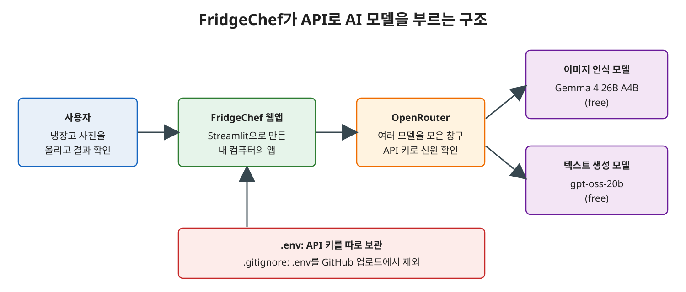

# API 개념과 AI 모델 고르기

지금까지 만든 웹 포트폴리오와 퀴즈 게임은 모두 미리 준비한 데이터만 보여 주었다. 하지만 사용자가 어떤 사진을 올릴지 모르는 앱은 그럴 수 없다. 이 문서는 6장의 앞부분으로, 외부 AI 모델을 내 프로그램에 붙이는 통로인 API가 무엇인지, 어떤 모델을 쓸지 어떻게 고르는지, API 키를 어떻게 발급받는지를 다룬다.

식당에 비유하면 쉽다. 손님은 주방장에게 직접 말하지 않고 종업원에게 주문한다. 프로그램도 복잡한 일을 직접 하지 않고 API라는 종업원에게 요청해 결과만 받는다. 이 장의 실습 앱 이름은 FridgeChef(냉장고 사진으로 재료를 알아보고 레시피를 추천하는 앱)다.

---

## 1. 왜 API가 필요한가

냉장고 사진을 올리면 재료를 알아보고 레시피를 추천하는 앱을 생각해 보자. 어떤 사진이 올라올지 알 수 없으므로 미리 준비한 정보로는 처리할 수 없다. 두 가지 AI가 필요하다.

- 사진을 읽고 해석하는 이미지 인식 모델
- 읽어 낸 재료로 레시피 문장을 쓰는 생성형 AI 모델(텍스트 생성 모델)

문제는 이 모델들을 앱에 어떻게 연결하느냐이다. 여기서 API(Application Programming Interface, 내 프로그램과 외부 서비스를 잇는 다리)가 쓰인다. 전화로 전문가에게 도움을 청하는 모습과 닮았다. 앱이 "이 사진을 분석해 줘"라고 요청하면 AI가 사진을 해석해 결과를 돌려준다. 앱은 그 결과를 화면에 보여 주거나 "이 재료로 레시피를 만들어 줘"라는 다음 요청을 보낸다.

그래서 웹 앱은 사용자와의 상호작용과 요청 조율에만 집중하고, 이미지 인식과 레시피 생성은 AI 모델이 맡는다. 이 구조는 아래 그림으로 정리된다.



참고(노트 작성자): 이 도식의 이미지 모델과 텍스트 모델은 이 장에서 고른 무료 모델이다. 모델은 책이 쓰인 시점 기준이며 자주 바뀐다.

**직접 AI 모델을 만들면 안 되나?** 앞서 필기 인식 모델을 직접 만들어 본 것처럼 만들 수는 있다. 그러나 이미지 인식이나 문장 생성처럼 복잡한 AI는 방대한 학습 데이터와 고성능 컴퓨터가 필요하다. 특히 생성형 언어 모델은 Claude나 ChatGPT를 만드는 것만큼 어렵고 비싸다. 시간과 자원이 한정된 프로젝트라면 이미 만들어진 모델을 API로 쓰는 편이 훨씬 효율적이다.

## 2. 모델 고르기: 유료, 무료, 그리고 OpenRouter

API는 목적에 따라 종류가 많다. 날씨, 뉴스 수집, 지도 서비스처럼 AI와 관계없는 API도 있다. 많은 AI 회사는 자사 모델을 API로 공개한다. 사용자 데이터를 다루고 비용이 들 수 있으므로 접근은 보통 API 키로 통제한다.

Claude API에 연결하면 사용자가 레시피를 요청할 때마다 Claude가 직접 답한 것과 같은 결과를 얻는다. 다만 Claude나 ChatGPT 같은 대형 서비스는 쓴 만큼 요금이 붙는다. 사용자가 갑자기 늘면 비용을 감당하기 어려울 수 있으니 어떤 API를 쓸지 신중히 정해야 한다. 다행히 학습과 실험용으로 쓸 수 있는 무료 또는 제한적 모델도 있다. 기능을 익히거나 첫 버전을 만들 때는 무료 API가 가장 좋은 출발점이다.

이 책은 OpenRouter(여러 회사의 AI 모델 API를 한곳에 모은 통합 플랫폼)를 쓴다. 유료와 무료 API를 한눈에 비교하고 인기 순위도 볼 수 있어서 프로젝트에 맞는 모델을 고르기 쉽다.

AI 모델을 쓰는 방법은 크게 두 가지다.

| 방법 | 비유 | 장단점 |
|---|---|---|
| 통합 플랫폼(OpenRouter) | 푸드코트에서 여러 식당 음식을 주문 | 키 하나로 Claude, GPT, Google Gemma 등 여러 모델을 바꿔 쓰고, 사용량을 한 대시보드에서 관리한다 |
| 회사 공식 API 직접 연결 | 식당마다 따로 가입해 주문 | 회사별로 가입하고 키를 따로 관리해야 번거롭지만 최신 기능을 가장 먼저 쓴다 |

초보자에게는 OpenRouter가 권장된다. 모델 비교가 쉽고 무료 모델이 많다. 단, 무료 사용에는 횟수 제한이 있고 그 한도는 수시로 바뀐다. 현재 수치는 OpenRouter의 한도 안내 페이지에서 확인하라고 책은 말한다. 특정 모델을 꾸준히 쓰게 되면 그때 공식 API로 옮기는 것도 방법이다.

## 3. API 키란 무엇인가

API 키는 이름 그대로 API를 쓸 때 사용자를 확인하는 비밀 열쇠다. 인증, 접근 통제, 사용량 추적, 요금 청구의 핵심 도구다. API를 제공하는 서버는 이 키로 요청자가 누구이고 허가된 사용자인지 확인한다.

인증이 없으면 허가받지 않은 사람이 API를 쓸 수 있고, 그러면 오남용, 예상치 못한 비용, 민감 정보 노출로 이어질 수 있다. 서버는 키로 사용자별 호출 횟수와 양을 추적해 과도한 요청을 막고 요금을 관리한다. OpenRouter를 쓰려면 이 키가 필요하다.

## 4. OpenRouter 가입과 API 키 발급

실습 순서는 다음과 같다. 책이 쓰인 시점의 화면 기준이므로 메뉴 이름은 달라질 수 있다.

1. VibeCoding 폴더 안에 Study-04 폴더를 새로 만든다.
2. 웹 브라우저에서 openrouter.ai에 접속해 첫 화면 위쪽의 Sign in을 눌러 가입을 시작한다.
3. 책은 구글 계정으로 가입한다. 가운데 구글 로고를 눌러 구글 ID를 입력하고 Continue를 누른다. 이용 약관에 동의하고 다시 Continue를 누르면 가입이 끝난다.
4. 메인 화면에서 오른쪽 위 프로필 아이콘을 누르고 Workspaces, API Keys 메뉴를 고른다.
5. + New Key 버튼을 누른다.
6. Name 칸에 키 이름(책은 HonGong-Vibe)을 쓰고 Create를 눌러 키를 발급한다.
7. 화면에 실제 키가 나타난다. 보안상 이 키는 한 번만 볼 수 있다. 페이지를 벗어나거나 새로고침하면 다시 볼 수 없으니 반드시 복사해 안전한 곳에 저장한다.
8. 복사 아이콘을 눌러 메모장 같은 텍스트 파일에 붙여 넣고 저장한다. 나중에 크레딧을 사서 유료 API를 쓸 때도 필요하므로 남에게 노출되지 않게 관리한다. 프로젝트가 여러 개면 필요할 때 키를 더 만들 수 있다.

## 5. .env 파일 직접 만들기

키를 받았으면 컴퓨터에 .env 파일로 저장한다. 메모장에서 아래처럼 쓴다.

```text
OPENROUTER_API_KEY=<YOUR_API_KEY>
```

여기서 등호 뒤에 OpenRouter에서 받은 키를 붙여 넣는다. 그다음 순서는 이렇다.

1. 메모장의 파일, 다른 이름으로 저장 메뉴를 연다.
2. Study-04 폴더로 이동해 파일 이름을 .env로 쓴다. 파일 형식은 모든 파일로 바꾸고, 인코딩은 UTF-8로 둔 뒤 저장한다.
3. Study-04 폴더에 OpenRouter 키가 든 .env 파일이 생겼는지 확인한다.

주의할 점이 하나 있다. API 키가 든 텍스트 파일은 공유 클라우드 저장소에 올리지 않는다. 자동 수집 봇이 훔쳐 악용할 수 있다. 공유 폴더가 아닌 내 컴퓨터에만 둔다.

## 6. 무료 모델 찾기

FridgeChef에는 이미지 인식 모델과 레시피 추천용 생성형 언어 모델이 필요하다. OpenRouter가 제공하는 모델 중 무료이면서 목적에 맞는 것을 골라 보자.

1. OpenRouter 첫 화면 위쪽의 Models 메뉴를 누른다.
2. 왼쪽의 Prompt pricing 필터에서 슬라이더 손잡이를 FREE로 끌어 무료 모델만 남긴다.

OpenRouter에서 free라고 표시된 모델은 무료지만 분당 요청 수와 하루 요청 수에 상한이 있다. 학습용으로는 대체로 충분하며 사용 내역은 OpenRouter의 Activity 메뉴에서 볼 수 있다. 여러 사용자가 동시에 쓰는 실제 서비스라면 유료 모델이나 크레딧 구매를 고려해야 한다.

팁으로, 위쪽의 Rankings 메뉴에서 모델 인기 순위와 사용량 그래프를 한눈에 볼 수 있다. 대부분 유료 API이지만 무료 모델도 가끔 들어 있다.

### 이미지 인식 모델

왼쪽 Input Modalities 필터에서 Image를 고르면 이미지 입력을 다루는 모델만 남는다. 목록에서 Google: Gemma 4 26B A4B (free)를 눌러 모델 페이지로 들어가 복사 아이콘으로 모델 이름을 복사해 텍스트 파일에 저장한다.

### 텍스트 생성 모델

Input Modalities 필터에서 Text를 고르고 OpenAI: gpt-oss-20b (free)를 찾아 선택한다. 이 모델 이름도 복사해 저장한다. 책은 무료 모델이 자주 바뀌므로 이 모델이 없으면 다른 무료 모델을 골라도 된다고 알려 준다.

### 무료 모델과 입력 데이터 정책

무료 모델은 한 가지를 알고 써야 한다. 일부 무료 모델은 내가 입력한 프롬프트와 생성된 응답을 저장하거나 모델 개선과 학습에 쓸 수 있다. 책은 구글 Gemma(free)를 그 예로 든다. 그래서 OpenRouter에서 무료 모델을 쓰려면 이 옵션을 켜야 한다. 프로필의 Settings, Privacy & Guardrails로 가서 Enable free endpoints that may train on inputs를 켠다. 자세한 정책은 모델 페이지에서 확인한다.

이렇게 해서 OpenRouter API 키와 쓸 모델 이름 두 개가 준비되었다. 다음 문서에서는 이것을 Claude Code에 연결한다.

<br>
<br>
<br>

[Build with Claude Code](../)
