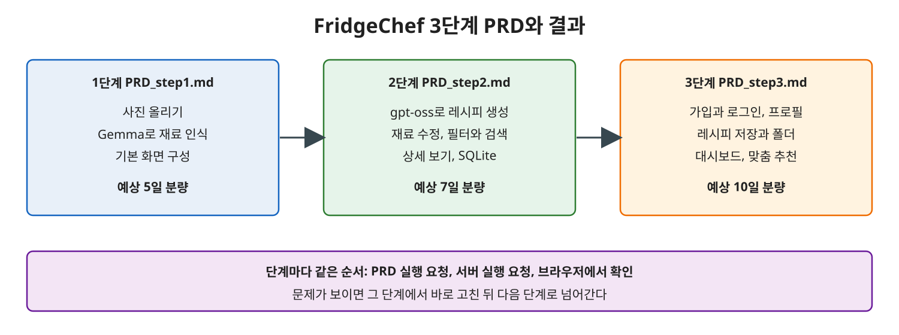

# FridgeChef 앱 단계별로 만들기

냉장고를 열고 "오늘 뭘 먹지?" 하고 고민해 본 적이 누구나 한 번쯤 있다. 이 문서는 6장의 두 번째 절로, 그 일상의 문제를 푸는 앱 FridgeChef를 Claude Code와 API로 만든다. 냉장고 속 사진을 올리면 재료를 알아보고, 가진 재료에 맞는 레시피를 추천하는 앱이다.

큰 요리를 만들 때 재료 손질, 조리, 담기를 나눠 하듯이, 이 앱도 세 단계로 쪼개 하나씩 만들고 확인한다. 문제가 생기면 그 단계에서 고치고 다음으로 간다.

---

## 1. 단계별 계획과 PRD 만들기

FridgeChef에는 AI 모델이 두 개 필요하다. 하나는 사진에서 재료를 분석하는 이미지 인식 모델, 다른 하나는 그 재료로 레시피를 제안하는 텍스트 생성 모델이다. 이처럼 여러 AI 모델을 엮는 복잡한 앱은 전체를 작은 단위로 나눠 조금씩 개발하는 편이 효율적이다. 핵심 기능을 먼저 만들어 제대로 되는지 보고, 세부 기능을 단계별로 더한다.

PRD(제품 요구사항 문서, 무엇을 만들지 적은 문서)를 단계마다 한 개씩 마크다운 파일로 만든다. 이전 장까지는 Claude 웹에서 프롬프트를 만들고 점검한 뒤 Claude Code에 붙여 넣었다. 이번에는 Claude Code 안에서 곧바로 진행한다. .md 파일을 쓰면 앞서 한 것처럼 자세한 실행 프롬프트를 PRD 형식으로 구조화할 수 있다.

| 단계 | 하는 일 |
|---|---|
| 1단계 | 이미지 인식 모델로 냉장고 사진에서 재료 알아보기 |
| 2단계 | 알아낸 재료로 텍스트 생성 모델이 레시피 만들기 |
| 3단계 | 만든 레시피 저장하기 |

Claude Code에 아래 프롬프트를 입력한다. 책은 영어 프롬프트를 쓰며, 뜻은 "앞서 만든 OpenRouter API로 냉장고 사진의 재료를 알아보고 레시피를 추천하는 웹 앱을 만들 건데, 세 단계로 나눈 PRD를 만들어 달라"이다.

```text
Using the previously created OpenRouter API, I want to build a web
application that recognizes ingredients from a refrigerator photo and
recommends recipes. Please create a PRD divided into three steps.
Step 1: Receive an image and use google/gemma-4-26b-a4b-it:free to recognize it.
Step 2: Use the Step 1 result and openai/gpt-oss-20b:free to generate recipes.
Step 3: Create a user profile and save the recipes.
Save each step as PRD_step1.md, PRD_step2.md, and PRD_step3.md.
```

참고(노트 작성자): 위 코드는 책의 프롬프트를 줄여 옮긴 것이다. 단계별 설명과 파일 이름 지시는 그대로다.

Study-04 폴더에 PRD 문서 세 개가 생긴다. 책이 보여 준 완성 PRD의 요약은 다음과 같다. 화면은 사람마다 조금 다를 수 있으니 자신의 PRD로 진행하면 된다.

- PRD_step1.md는 핵심 이미지 인식 기능으로 예상 5일 분량이다. Streamlit 기반 웹 화면, Gemma 4로 냉장고 재료 인식, 이미지 업로드와 처리, 기본 UI 구성이 들어간다.
- PRD_step2.md는 레시피 생성 시스템으로 예상 7일 분량이다. gpt-oss로 레시피 생성, 재료 편집, 필터와 검색, 레시피 상세 보기, SQLite 데이터베이스가 들어간다.
- PRD_step3.md는 사용자 프로필과 저장 기능으로 예상 10일 분량이다. 가입과 로그인, 프로필 관리와 개인 설정, 레시피 저장과 폴더 관리, 맞춤 추천 알고리즘, 대시보드와 통계, 소셜 공유가 들어간다.



## 2. 1단계: 냉장고 사진에서 재료 알아보기

첫 PRD를 실행시키는 프롬프트는 짧다.

```text
Run PRD_step1.md
```

Claude Code는 주어진 1단계 지시대로 이미지 인식 기능을 구현한다. 웹 화면은 파이썬 웹 프레임워크 Streamlit으로 만든다. 코드가 만들어지는 과정은 터미널에서 실시간으로 볼 수 있다.

**파이썬 웹 프레임워크란?** 웹 앱을 쉽게 만들게 해 주는 도구 모음이다. 보통 웹 앱을 만들려면 구조는 HTML, 디자인은 CSS, 동작은 JavaScript로 따로 프로그래밍해야 한다. 파이썬 웹 프레임워크를 쓰면 이 모두를 파이썬 파일 하나에서 다룰 수 있어 구조가 훨씬 단순해진다. 파이썬에서는 Streamlit, Gradio, Flask가 흔하다. 그중 Streamlit은 AI 모델을 시연하거나 데이터를 시각화할 때 특히 인기가 있고, 이미지 인식이나 텍스트 생성 같은 AI 기능을 웹에서 보여 주기에 좋다.

### 서버 실행하고 열어 보기

실제로 동작하는지 확인해야 한다. 웹 서버가 아직 안 켜졌다면 Claude Code에게 서버 실행도 시킨다.

```text
Run the main application and let me test the results of Step 1.
```

서버 실행 명령은 프레임워크마다 다르다. Streamlit이면 `streamlit run app.py`, Flask면 `python app.py`, Gradio면 `python gradio_app.py`다. 다만 Claude Code에게 직접 시키면 알맞은 명령을 알아서 쓴다.

서버가 켜지면 터미널에 접속 주소(URL)가 나온다. 그 localhost 주소를 복사해 브라우저에 붙여 넣으면 지금까지의 결과를 볼 수 있다. 터미널의 주소를 Ctrl 키를 누른 채 눌러도 열린다. 포트 번호(localhost 뒤 숫자)는 사람마다 다를 수 있다.

### 기능 시험

책의 GitHub 저장소(PacktPublishing/Build-with-Claude-Code)의 input-examples 폴더에서 fridge.jpg 파일을 미리 내려받는다. 화면에서 Browse files 버튼으로 이 파일을 고르고 Recognize ingredients 버튼을 누른다. 잠시 뒤 AI 모델의 분석 결과가 화면에 나타난다. 아직 1단계라 디자인은 단순하지만 실제 AI 모델이 API로 이미지를 분석하고 있음을 확인할 수 있다. 생성형 AI의 특성상 실행할 때마다 결과 화면의 세부 요소는 조금씩 달라질 수 있다.

## 3. 2단계: 레시피 만들기

이어서 알아낸 재료로 레시피를 만드는 2단계를 구현한다.

```text
Now run PRD_step2.md.
```

Claude Code는 PRD_step2.md를 읽고 레시피 생성 기능을 더한다. gpt-oss 모델을 연결하고, 재료 편집 기능과 레시피 표시 화면을 만드는 과정이 터미널에 보인다. 끝나면 1단계처럼 서버를 다시 실행시킨다.

```text
Run the main application and test the results of step 2.
```

서버가 켜지면 터미널의 주소로 접속한다. 이제 사이드바(화면 옆 메뉴)에 Generate Recipe 메뉴가 생겼고, 누르면 레시피 생성 옵션이 나온다. 인식된 재료를 고치거나 더할 수 있고, 요리 종류와 난이도를 고른 뒤 Generate Recipe 버튼을 누른다. gpt-oss 모델은 고른 재료와 조건에 맞는 레시피를 만든다. 레시피에는 요리 이름, 필요한 재료, 조리 순서, 예상 시간 등이 들어 있다. 이렇게 냉장고 재료를 알아보고 알맞은 레시피를 추천하는 앱이 동작하게 된다.

## 4. 3단계: 사용자 프로필과 레시피 저장

마지막으로 3단계에서 사용자 프로필과 레시피 저장 기능을 더한다.

```text
Now run PRD_step3.md.
```

Claude Code는 사용자 프로필, 로그인 시스템, 레시피 저장 기능을 추가한다. 끝나면 완성된 앱을 실행해 새 기능을 확인한다.

앱을 열면 로그인 화면이 나온다. 아직 실제 데이터베이스와 연결되지 않은 프로토타입(아이디어나 기능을 시험하려고 만든 초기 버전)이므로, 화면에 안내된 테스트 계정으로 로그인한다. Demo Account 버튼이 있으면 눌러 임시 데모 계정으로 시험하면 된다.

로그인에 성공하면 개인 대시보드가 나타난다. 저장한 레시피, 요리한 횟수, 사용 통계 등을 한눈에 볼 수 있다. 다음 순서로 확인해 본다.

1. 이미지를 올려 재료 인식과 레시피 생성을 해 본다. 생성된 레시피 옆에 Save 버튼이 나타난다.
2. 마음에 드는 레시피를 골라 저장한다.
3. My Recipes 탭에 저장되었는지 확인한다.
4. 대시보드로 돌아가면 통계가 갱신된 것을 볼 수 있다. 저장한 레시피 수가 늘고, 자주 쓰는 재료 분석도 반영된다.

### 로컬 개발 환경과 그 한계

지금까지 만든 앱은 사용자의 컴퓨터, 즉 로컬 환경에서만 돌아간다. 주소창의 localhost(포트 8501)는 "내 컴퓨터"라는 뜻이다. 즉 다른 사람은 이 앱에 접속할 수 없다. 그래서 3단계의 로그인과 레시피 저장도 임시다. 브라우저를 닫거나 서버를 다시 켜면 저장한 데이터가 사라질 수 있고, 여러 사용자가 동시에 접속하는 상황도 시험할 수 없다.

이것은 결함이 아니라 개발 과정의 자연스러운 단계다. 누구나 실제 웹 주소로 접속하고 데이터를 안전하게 저장하는 서비스를 만들려면, 먼저 로컬에서 기능을 시험하고 다듬은 뒤 실서비스로 넘어가야 한다. 이를 위해서는 웹 호스팅 서비스에 앱을 배포하고, 클라우드 데이터베이스를 연결하고, 도메인과 보안 인증서를 설정해야 한다. 지금은 로컬 개발과 시험에 집중하고 완성품을 실서비스로 넓힐 준비를 차근차근 하면 된다.

## 5. 장 마무리와 복습 문제

이렇게 FridgeChef가 완성되었다. 이미지 인식 AI로 사용자가 올린 사진의 재료를 알아내고, 텍스트 생성 AI로 인식된 재료와 선택한 취향에 맞는 레시피를 추천한다. Claude Code와 AI 모델을 API로 연결하고 앱이 잘 동작하는지 시험했다. 다음 장에서는 AI 서브에이전트로 결과를 검토하고 디자인을 다듬는다.

핵심 정리는 두 가지다.

- 이미지 인식과 텍스트 생성처럼 여러 AI 모델을 쓰는 앱은 단계별 계획에 따라 조금씩 완성도를 높인다.
- 웹 프레임워크는 웹 앱을 쉽게 만들게 해 주는 도구 모음이다.

**복습 문제**(정답은 09장)

1. OpenRouter 무료 모델 사용에 관한 설명으로 옳은 것을 고르시오. (1) 무료 모델은 하루 요청 한도가 없다 (2) 키 하나로 여러 회사의 AI 모델을 쓸 수 있다 (3) 무료 모델을 쓰려면 크레딧을 충전해야 한다 (4) 무료와 유료 모델의 요청 한도가 같다
2. PRD 3단계 개발에서 2단계의 모델 API 호출이 실패할 때 확인하지 않아도 되는 것을 고르시오. (1) .env 파일에 OPENROUTER_API_KEY가 있는지 (2) 모델 이름의 정확성 (3) 무료 모델의 일일 사용 한도 초과 여부 (4) .gitignore 파일이 있는지
3. 프로젝트에서 API 키가 GitHub에 올라가지 않게 하는 구체적인 방법을 설명하시오.

<br>
<br>
<br>

[Build with Claude Code](../)
