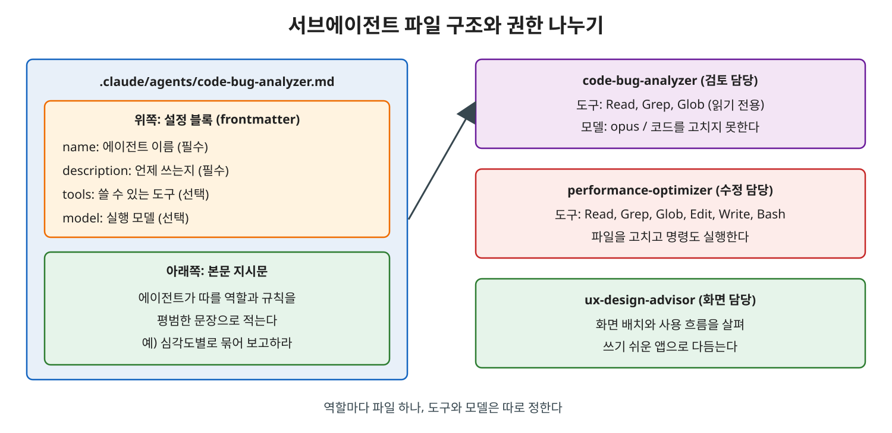

# 서브에이전트의 개념과 첫 코드 리뷰어

혼자서 큰 프로젝트를 하면 코딩, 디자인, 테스트를 모두 떠맡아 버겁다. 이 문서는 7장의 앞부분으로, Claude Code의 서브에이전트(특정 일을 전문으로 맡는 AI 보조 개발자)가 무엇인지 설명하고, 6장에서 만든 FridgeChef를 검토할 첫 에이전트인 코드 리뷰어를 직접 만든다.

작은 회사를 떠올리면 된다. 사장이 모든 일을 하지 않고 검토 담당, 성능 담당, 디자인 담당에게 일을 나눠 맡긴다. 서브에이전트가 바로 그 담당자들이다.

---

## 1. 에이전트란 무엇인가

에이전트(agent)는 영어로 대리인, 곧 나를 대신해 일하는 존재다. 에이전트는 미리 정해진 목표, 규칙, 쓸 도구, 필요한 맥락을 바탕으로 사용자가 매번 자세히 지시하지 않아도 스스로 판단해 일을 수행한다. 개발자는 "무엇을 이룰지"를 정하고, 에이전트가 "어떻게 할지"를 정한다.

Claude Code의 AI 서브에이전트를 쓰면 이 과정을 효율적으로 나눌 수 있다. 각 에이전트가 맡은 역할만 수행하므로 반복 작업이 줄고 혼자서는 놓치기 쉬운 부분도 챙겨진다. 이 절에서는 코드 리뷰, 최적화, UX 디자인 에이전트를 만들고, 권한과 모델을 정하고, 에이전트들이 차례로 또는 동시에 일하는 흐름을 체험한다.

서브에이전트는 시스템 프롬프트(에이전트의 역할과 행동 규칙을 적은 지시문)를 직접 정해서 맞춤 설정할 수 있다. 코드 리뷰어는 버그를 살피고, 최적화 에이전트는 성능을 높이고, UX 디자인 에이전트는 사용자 경험을 낫게 한다. 각 에이전트는 서로 다른 AI 모델을 고르고, 파일 접근 권한도 따로 정할 수 있어서 앞 작업의 맥락을 이어 가며 순서대로 협업할 수 있다.

### 서브에이전트와 커스텀 명령은 무엇이 다른가

5장에서 배운 커스텀 명령과 서브에이전트는 얼핏 비슷하지만 역할이 다르다. 커스텀 명령이 반복 작업을 빠르게 실행하는 단축키라면, 에이전트는 독립된 AI 전문가에 가깝다. 에이전트는 모델을 따로 고르고, 파일 접근 권한을 각각 정하고, 다른 에이전트와 협업한다. 예를 들어 코드 리뷰어는 읽기 전용으로, 수정 담당은 쓰기 권한이 있게 해서 역할을 분명히 나눌 수 있다.

## 2. 서브에이전트의 정체: 마크다운 파일 하나

서브에이전트는 마크다운 파일 하나다. 만들어지면 그 파일이 두 폴더 중 한 곳에 놓인다.

- 프로젝트 폴더 안의 .claude/agents/: 지금 쓰는 프로젝트에서만 동작하는 에이전트
- 사용자 홈 폴더 아래의 .claude/agents/: 내 모든 프로젝트에서 동작하는 에이전트

파일을 열면 대략 이런 모양이다.

```markdown
---
name: code-bug-analyzer
description: A professional code quality reviewer that reads code to check for bugs and suggest improvements.
tools: Read, Glob, Grep
model: opus
---
You are a professional code quality reviewer. When you are asked to review
code, report what you find grouped by severity.
```

두 부분으로 이뤄져 있다. 하이픈 세 개(---)만 적힌 두 줄 사이에 YAML로 쓴 설정 블록이 있고, 이것을 프런트매터(frontmatter, 파일 머리의 설정 칸)라 부른다. 그 아래는 에이전트 자신의 지시문이며 평범한 문장으로 쓴다. 프런트매터에는 네 개의 필드가 있다.

| 필드 | 필수 여부 | 설명 |
|---|---|---|
| name | 필수 | 에이전트의 이름. 다른 에이전트와 구별하려고 붙인다 |
| description | 필수 | 에이전트가 무엇을 위한 것인지. Claude Code가 어떤 에이전트를 쓸지 정할 때 읽는다 |
| tools | 선택 | 쓸 수 있는 도구. 적지 않으면 메인 세션의 모든 도구를 쓴다 |
| model | 선택 | 에이전트가 쓸 모델. 빼면 메인 세션이 쓰는 모델로 돈다 |



참고(노트 작성자): 그림 오른쪽의 세 에이전트 중 수정 담당과 화면 담당은 다음 문서에서 만든다. 실제 필드 값은 Claude Code가 쓴 파일에서 직접 확인해야 한다.

에이전트를 만드는 방법은 두 가지다. 권장 방식은 Claude Code에게 설명하는 것이다. Claude가 설명을 정의 파일로 바꾸고 프로젝트를 읽어 세부 내용을 채운다. 다른 방식은 .claude/agents/ 아래에 마크다운 파일을 직접 만들어 필드를 채우는 것이다.

참고로 책은 버전을 한 가지 밝힌다. 2.1.198 이전의 Claude Code에는 에이전트 만들기를 화면 하나씩 안내하는 /agents 내장 명령이 있었다. 그 버전부터는 만들고 싶은 에이전트를 도구와 모델까지 포함해 말로 설명하면 Claude Code가 파일을 써 준다. 이 내용은 책이 쓰인 시점 기준이다.

## 3. 코드 리뷰어 에이전트 만들기

실습 순서는 이렇다.

1. 6장에서 FridgeChef를 만든 Study-04 폴더에서 오른쪽 버튼 메뉴로 터미널을 열고 claude를 입력해 Claude Code를 시작한다.
2. 만들 에이전트를 한 번의 프롬프트로 설명한다. 이름, 목적, 쓸 도구, 실행할 모델, 저장 위치를 모두 한꺼번에 쓰고 엔터를 누른다.

```text
Create a subagent called code-bug-analyzer that works only in this project.
It is a code quality reviewer that checks for bugs, coding rule violations,
and performance problems. Give it read-only access, and run it on Opus.
Save it as .claude/agents/code-bug-analyzer.md
```

3. Claude Code가 프로젝트를 읽고 에이전트 정의를 쓰기 시작한다.
4. Claude Code가 초안을 보여 주고 만들지 묻는다. 내용을 확인하고 Yes를 고른다.
5. 에이전트는 바로 쓸 수 있다. Claude Code가 쓴 내용을 보고 싶으면 Study-04 폴더의 .claude/agents/code-bug-analyzer.md를 연다. 프롬프트에 쓴 설정이 두 대시 줄 사이에 있다. tools 줄과 model 줄이 요청대로인지 확인한다.

tools에 적힌 Read, Grep, Glob은 각각 파일 읽기, 파일 안에서 단어 찾기, 파일 이름으로 찾기를 뜻한다. 프롬프트가 읽기 전용을 요청했기에 Claude Code가 이 세 개를 골랐다.

### 모델 선택 가이드

Claude의 모델은 성능과 쓰임이 다르므로 일의 성격에 맞는 모델을 고르는 것이 중요하다. 선택 가능한 모델 종류는 구독 플랜에 따라 다르다. 아래 표는 책이 쓰인 시점의 모델 가이드다.

| 모델 | 장점과 단점 | 권장 용도 |
|---|---|---|
| Fable | 가장 유능하고 긴 에이전트 실행에 맞다. 가장 느리고 가장 비싸다 | 에이전트에게 통째로 맡길 가장 길고 어려운 작업 |
| Opus | 정확도가 높다. 느리고 비싸다 | 복잡한 코드 분석, 구조 설계처럼 깊은 사고가 필요한 일 |
| Sonnet | 속도와 성능의 균형이 좋다. 가장 어려운 추론에서는 Opus보다 깊이가 덜하다 | 대부분의 개발 작업 |
| Haiku | 빠르다. 복잡한 작업에는 맞지 않는다 | 코드 정리, 주석 달기 같은 단순 작업 |

비용이 걱정되면 Sonnet으로 시작해 필요할 때 조정하는 것이 좋다. 파일에서 모델은 fable, opus, sonnet, haiku처럼 소문자로 쓴다. 복잡한 분석이 필요한 에이전트는 opus로, 나머지는 sonnet으로 두거나 필드를 비워 메인 세션의 모델을 물려받게 한다.

## 4. 서브에이전트로 코드 리뷰하기

새로 만든 code-bug-analyzer에게 6장의 FridgeChef 코드를 검토시킨다. Claude Code에서는 이름만 불러도 서브에이전트를 부를 수 있다.

```text
Have code-bug-analyzer review the code of the FridgeChef application.
```

팁으로, 에이전트를 항상 정확한 명령으로 불러야 하는 것은 아니다. 프롬프트에 에이전트를 설명하거나 이름을 적어도 Claude Code가 알맞은 서브에이전트를 고른다. 한 프롬프트에 여러 에이전트를 넣으려면 각 이름을 쓰고 무엇을 시킬지 적는다.

잠시 기다리면 검토 결과가 나온다. 상세한 버그 보고서와 함께 개선할 점과 잠재 문제가 체계적으로 요약된다. Claude Code가 버그 패치를 바로 적용할지 물을 수도 있지만, 코드 리뷰어는 읽기 전용 권한뿐이라 코드를 직접 고칠 수 없다. 그래서 다음 문서에서 코드 수정을 전담하는 최적화 에이전트를 따로 만든다.

<br>
<br>
<br>

[Build with Claude Code](../)
