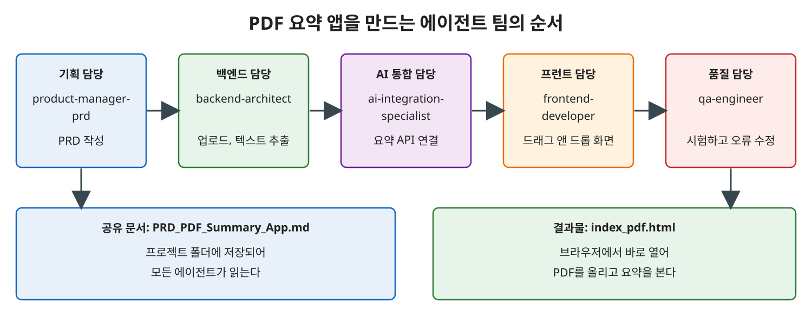

# 에이전트 팀으로 앱 만들기

앞 문서에서 기획, 백엔드, 프런트엔드, 품질 보증, AI 통합 담당 서브에이전트를 만들었다. 이 문서는 그 팀에게 실제 앱 두 개를 맡긴다. 하나는 일기를 쓰면 감정을 분석해 공감해 주는 AI 공감 일기이고, 다른 하나는 PDF를 올리면 요약해 주는 PDF 요약 AI다.

감독이 선수 이름을 불러 역할을 나눠 주듯이, 사용자는 프롬프트에서 에이전트 이름과 맡길 일을 적기만 하면 된다. 이제 사용자는 코드를 쓰는 개발자라기보다 여러 AI를 조율해 제품 하나를 완성하는 AI 제품 기획자가 된다.

---

## 1. AI 공감 일기: 5W1H로 요구사항 정리하기

실제 개발 팀에서 PM은 제품 기획 단계에서 5W1H(누가, 언제, 어디서, 무엇을, 왜, 어떻게)로 요구사항을 정해 팀이 같은 목표와 방향을 갖게 한다. 2장에서도 PRD를 쓸 때 5W1H를 바탕으로 했다. 여러 에이전트를 운영할 때는 각 역할(Who)과 작업 방식(How)을 분명히 정하는 일도 중요하다. 이 앱의 요구사항은 아래처럼 정리된다.

- What(무엇): AI 공감 일기. 사용자가 하루를 한 줄로 요약해 쓰면 AI가 감정을 분석하고 공감과 위로를 건네는 일기 앱
- Why(왜): 하루를 기록하고 정서적 지지를 받아 마음의 안정을 얻도록 돕기 위해
- When(언제): 지금 바로 개발을 시작해 곧장 쓸 수 있는 완성품을 만든다
- Where(어디서): 사용자 로컬 환경의 웹 브라우저에서 실행한다
- How(어떻게): OpenRouter API와 무료 모델 openai/gpt-oss-20b:free로 감정 분석과 공감 메시지를 만든다. 부드럽고 안정감 있는 UI를 쓴다. API 키는 현재 프로젝트 폴더의 .env 파일에서 읽는다. 최종 결과물은 index.html 한 파일이고 충분한 시험으로 안정된 버전을 만든다
- Who(누가): 백엔드 개발자는 API 연동과 감정 분석, 공감 메시지 생성을 구현한다. 프런트엔드 개발자는 아늑하고 차분한 일기 화면을 만든다. QA 엔지니어는 여러 시나리오를 시험하고 문제가 해결될 때까지 고친다

이 앱에는 백엔드, 프런트엔드, QA 에이전트가 필요하다. 다섯을 모두 쓰지는 않는다.

## 2. 실행 순서

1. 파일 탐색기에서 Study-04 폴더의 .env 파일(OpenRouter 키가 든 파일)을 복사해 Study-05 폴더에 붙여 넣는다. 나중에 Study-05를 Git 저장소로 만들 때는 .env를 먼저 .gitignore에 추가해 키가 올라가지 않게 한다. 안전한 키 설정은 6장에서 다뤘다.
2. Claude Code에서 앱의 기능을 설명하고, 필요한 서브에이전트와 각 역할, 구현 방법을 적는다.

```text
Please create an AI empathy diary application, where, if the user writes a
one-line summary of their day, the AI analyzes their emotions, offers
empathy, and provides words of comfort.
The backend architect should implement emotion analysis and empathetic
message generation by integrating the OpenRouter API, using the free
openai/gpt-oss-20b:free model and the key in the .env file.
The frontend developer should design a warm, comforting diary UI.
Finally, the QA engineer should test the application across various
scenarios, fix every issue, and deliver an index.html file.
```

참고(노트 작성자): 위 코드는 책의 프롬프트를 줄여 옮긴 것이다. 역할 배분과 결과 파일 이름은 원문과 같다.

3. Claude Code가 일을 서브에이전트에게 넘겨 백그라운드로 돌린다. 일하는 동안 터미널 아래쪽 한 줄이 백그라운드 에이전트 세 개가 끝나기를 기다린다고 알려 주고, 각 에이전트는 끝날 때 걸린 시간을 보고한다.
4. 최종 보고서에서 어떤 기능이 준비되었는지 확인한다.
5. Study-05 폴더의 index.html을 눌러 실행한다. 이것이 완성된 AI 공감 일기다.

**에이전트마다 실행 시간이 다른 이유.** 실행 시간은 매번 다르고 QA 엔지니어 에이전트가 보통 가장 늦게 끝난다. QA의 일은 다른 둘이 만든 결과에서 출발한다. 그 결과를 검토하고, 여러 시나리오로 시험하고, 찾은 문제를 고치므로 앞의 둘보다 먼저 끝날 수 없다. 실제 개발 팀에서도 QA가 가장 오래 걸리는 단계인 경우가 많다. 너무 길다 싶으면 Esc 키로 멈추거나 다음에는 더 작은 시험 범위를 요청한다.

6. 감정을 잘 분석하는지 시험한다. 화면의 입력칸에 글을 적고 Analyze Emotion 버튼을 누른다. 기쁨 같은 감정을 정확히 알아보고 공감 메시지를 덧붙인다.
7. 감정 분석 보고서가 나온다.
8. 쓴 일기와 감정 분석 결과가 시간순으로 저장된다. 팁으로, 여러 감정으로 일기를 써서 감정을 제대로 알아보는지 시험해 보자.

결과가 책과 다르면 원하는 앱의 요구를 더 구체적으로 Claude Code에 적어 고치면 된다.

## 3. PDF 요약 AI: 다섯 에이전트를 모두 동원하기

이번에는 다섯 서브에이전트를 모두 써서 PDF 파일을 받아 텍스트를 뽑고, 요약하고, 정리하고, 분석하는 앱을 만든다. 앞서 만든 에이전트를 그대로 쓴다. 각 에이전트의 역할, 이름, 맡은 일은 다음과 같다.

| 역할 | 에이전트 이름 | 맡은 일 |
|---|---|---|
| 제품 기획 담당 | product-manager-prd | PDF 요약 앱의 상세 PRD와 기능 명세 작성 |
| 백엔드 개발자 | backend-architect | PDF 업로드와 텍스트 추출 기능 구현 |
| AI 통합 전문가 | ai-integration-specialist | OpenRouter API로 추출한 텍스트 요약. 무료 gpt-oss-20b 모델과 .env의 키 사용 |
| 프런트엔드 개발자 | frontend-developer | 드래그 앤 드롭 업로드 화면과 깔끔한 요약 결과 화면 |
| 품질 보증 엔지니어 | qa-engineer | 여러 PDF 형식으로 전체 시스템을 시험하고 버그 수정 |



팁으로, Claude Code와 대화할 때는 원하는 서브에이전트의 이름을 프롬프트에 적는다. 특정 에이전트가 꼭 실행되게 하려면 @agent- 뒤에 이름을 붙여 쓴다(예: @agent-qa-engineer). 어떤 에이전트가 있는지는 .claude 폴더의 agents 폴더를 보면 된다.

### 프롬프트 흐름

Claude Code에서 PDF 요약 AI의 기능과 각 에이전트의 역할, 구현 방법을 적는다. 프롬프트의 줄거리는 이렇다. 먼저 product-manager-prd가 PRD와 기능 명세를 쓰고, backend-architect가 업로드와 텍스트 추출을 구현한다. ai-integration-specialist가 OpenRouter API로 추출한 텍스트를 요약하고, frontend-developer가 드래그 앤 드롭 화면과 결과 화면을 만든다. qa-engineer가 여러 시나리오로 시험하고 문제를 모두 고쳐, 브라우저에서 바로 열리는 index_pdf.html 파일로 최종본을 만든다.

AI 공감 일기와 파일 이름이 겹치지 않도록 이번 결과 파일은 index_pdf.html로 이름 붙인다. 파일 이름은 책과 다를 수 있다.

### 실행과 확인

1. 제품 기획 담당이 PRD부터 만든다. PRD에 문제가 없으면 "2. Yes, allow all edits during this session"을 골라 진행한다.
2. 프로젝트 폴더 Study-05에 PRD 문서 PRD_PDF_Summary_App.md가 만들어졌는지 확인한다. 다섯 에이전트가 차례로 일을 해 웹 앱이 완성된다.
3. 새로 생긴 index_pdf.html을 찾아 실행한다. PDF 문서 요약 서비스 앱이 화면에 뜨면 완성이다. 원하는 결과가 안 나오면 현재 문제를 Claude Code에게 설명해 고치게 한다.
4. 시험용으로 책의 GitHub 저장소 input-examples 폴더에서 ai-assistant-guide.pdf를 내려받는다. 앱에서 이 파일을 올리고 Standard Summary 모드를 고른 뒤 Generate Summary 버튼을 눌러 PDF 내용이 요약되어 나오는지 확인한다.
5. 이번에는 Brief Summary 모드를 고르고 Generate Summary를 누른다. 조금 다른 요약 결과가 나온다. 여러 요약 모드를 직접 써 보자.

## 4. 장 마무리와 복습 문제

다섯 AI 서브에이전트를 꾸려 실제 개발 팀처럼 협업시키는 과정을 살펴보았다. 각 에이전트가 맡은 역할에 따라 기획, 개발, 디자인, 검증을 알아서 처리했고, 혼자서도 팀 프로젝트를 완성할 수 있음을 보여 준다.

핵심 정리는 다섯 가지다.

- 제품 기획 담당은 제품의 목표, 기능, 사용자 요구를 정하고 전체 개발 일정을 관리한다.
- 백엔드 개발자는 서버와 데이터베이스 설계, API 연동처럼 앱의 핵심 로직을 구현하는 기술 전문가다.
- 프런트엔드 개발자는 사용자가 보는 화면과 인터페이스를 설계하고 구현하는 UI 개발자다.
- 품질 보증 엔지니어는 기능과 성능을 시험하고 버그를 고쳐 서비스를 안정시키는 검증 전문가다.
- AI를 쓰는 개발에서는 AI 모델을 연결하고 최적화하는 AI 통합 전문가가 필요하다.

**복습 문제**(정답은 09장)

1. AI 공감 일기를 만들 때 QA 시험이 백엔드와 프런트엔드 개발보다 보통 오래 걸리는 가장 알맞은 이유를 고르시오. (1) QA 에이전트가 더 느린 AI 모델을 써서 (2) QA 에이전트가 앞선 에이전트들의 작업 결과를 모두 검토해야 해서 (3) QA 에이전트만 인터넷 연결이 필요해서 (4) QA 에이전트에게 파일 읽기 권한이 없어서
2. PDF 요약 도구에서 제품 기획 에이전트가 만든 PRD를 다른 에이전트가 참조하는 올바른 방법이 아닌 것을 고르시오. (1) PRD는 프로젝트 폴더에 만들어지고 각 에이전트가 접근한다 (2) 에이전트들이 순서대로 또는 동시에 일하며 PRD를 참조한다 (3) 에이전트마다 PRD 파일 경로를 지정할 필요가 없다 (4) PRD가 .claude/agents/ 폴더로 자동 복사되어 공유된다

<br>
<br>
<br>

[Build with Claude Code](../)
