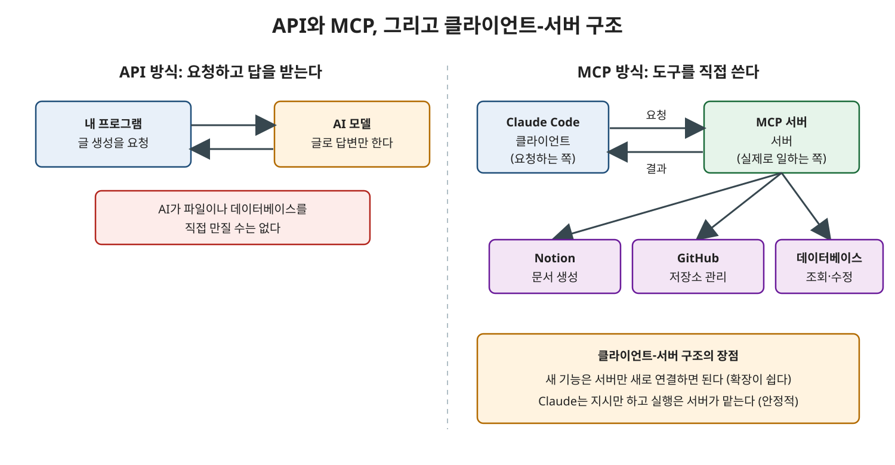

# MCP의 개념과 Notion 연결

8장은 지금까지 Claude Code의 기본 기능만으로 만들던 프로그램을 바깥 세상과 이어 주는 장이다. 그 첫 번째 도구가 MCP(Model Context Protocol, AI 모델이 외부 데이터와 도구, 서비스에 접속할 때 쓰는 표준 통신 약속)다. 이 문서는 MCP가 무엇인지 알아보고, 협업 도구 Notion을 Claude Code에 연결해 연구 노트를 자동으로 만들어 보는 실습까지 다룬다.

비유 하나로 시작하자. 레고 기본 세트로도 많이 만들 수 있지만 특수 부품을 끼우면 상상하는 것을 거의 다 만들 수 있다. MCP는 그 특수 부품을 Claude Code에 끼워 주는 연결 부품이다. Anthropic이 2024년 11월에 제안했고, 책이 쓰인 시점 기준으로 전 세계 AI 개발자가 쓰는 표준이 되었다고 한다.



---

## 1. 8장에서 배우는 것

8장은 다섯 가지 학습 목표를 내건다. 첫째, MCP 개념을 이해하고 Claude Code에 연결한다. 둘째, 원격 MCP와 로컬 MCP 서버를 구분해 필요에 맞게 설치한다. 셋째, Playwright로 웹 앱을 자동 테스트한다. 넷째, GitHub MCP로 프로젝트를 관리하고 올린다. 다섯째, Vercel과 Supabase로 진짜 서비스를 배포하고 운영한다.

장 전체의 결과물은 하나의 앱이다. 내 컴퓨터에서만 돌던 쇼핑 목록 앱이 인터넷에 올라가고 데이터베이스까지 붙어서, 누구나 접속해 쓰는 서비스가 된다. 이 문서는 그 첫걸음인 MCP 연결 부분이다.

## 2. MCP가 AI의 능력을 넓히는 방식

MCP는 AI 모델이 외부 데이터, 도구, 서비스와 같은 방식으로 대화하게 해 주는 표준 통신 규약이다. 서로 다른 시스템 사이에 놓인 다리라고 생각하면 쉽다.

API(Application Programming Interface, 프로그램끼리 데이터와 기능을 주고받는 창구)와는 역할이 다르다. FridgeChef 앱을 만들 때 OpenRouter의 API로 이미지 인식과 글 생성을 요청한 것이 API 사용의 예다. 이때 AI는 요청에 답할 뿐이다. 반면 MCP는 AI 애플리케이션이 파일, 데이터베이스, API 같은 도구와 데이터 원천에 직접 접속하는 규약이다.

구체적인 차이는 이렇다. API로는 AI 모델에게 글을 써 달라고 요청할 수는 있지만, AI가 직접 파일 시스템을 만지거나 데이터베이스를 고치게 할 수는 없다. MCP를 쓰면 AI가 파일 시스템에 접근하고 데이터베이스를 조회하거나 수정할 수 있다.

Claude Code에는 MCP 클라이언트 기능이 이미 들어 있다. 어떤 MCP 서버를 쓸지 설정해 두면 Claude Code가 그 설정대로 서버에 요청을 보내고, 실제 일은 MCP 서버가 한다. 예를 들어 '파일 탐색과 코드 분석'을 맡는 MCP 서버를 연결하면 Claude Code는 폴더 구조를 살피고 관련 코드를 분석해 보고서까지 자동으로 만들 수 있다.

## 3. 클라이언트-서버 모델

클라이언트-서버 모델(Client-Server Model)은 네트워크에서 요청하는 쪽과 응답하는 쪽을 나누는 구조다. 요청하는 쪽이 클라이언트, 서비스를 제공하는 쪽이 서버다. 식당에 비유하면 손님이 주문하고 주방이 요리해서 내보내는 관계다.

MCP도 이 모델을 따른다. Claude가 클라이언트로 요청을 보내고, MCP 서버가 실제 작업을 처리해 결과를 돌려준다. 이 구조에는 두 가지 장점이 있다. 새 기능이 필요하면 새 MCP 서버만 연결하면 되니 확장이 쉽다. 또 Claude는 지시만 하고 실행은 각 서버가 맡으니 안정성이 올라간다.

주의할 점도 있다. MCP 서버는 외부 파일이나 API에 실제로 접근한다. 그래서 보안, 인증, 접근 권한을 꼼꼼히 관리해야 한다.

## 4. 실습 준비: Notion 가입과 작업 폴더

연결 대상은 Notion이다. Notion은 문서와 프로젝트를 만들고 관리하고, 데이터베이스처럼도 쓰는 협업 도구다. 먼저 가입한다.

1. 웹 브라우저에서 Notion 홈페이지(https://www.notion.com)에 들어가 오른쪽 위의 무료 시작 버튼을 누른다.
2. 다른 서비스 계정을 연결하거나 새 이메일을 입력해 가입한다.
3. 계정이 만들어지면 워크스페이스를 만들고 쓰기 시작한다.

그다음 바탕화면의 VibeCoding 폴더 안에 `Study-06` 폴더를 새로 만들고, 그 위치에서 터미널을 열어 둔다. 이 단계에서는 아직 Claude를 실행하지 않는다.

## 5. MCP 서버를 붙이는 세 단계

원서는 MCP 서버 추가 과정을 세 단계로 요약한다.

| 단계 | 하는 일 | 어디서 |
|---|---|---|
| 1 | `claude mcp add` 명령으로 원하는 MCP 서버를 설치한다 | 터미널(Claude 실행 전) |
| 2 | Notion처럼 외부 서비스에 붙는 MCP는 계정을 연결하는 인증을 거친다 | Claude Code 안의 `/mcp` |
| 3 | 프롬프트를 써서 MCP 기능으로 실제 작업을 시킨다 | Claude Code 프롬프트 |

설치 명령은 MCP 서버를 내려받아 설정 파일에 등록한다. 명령을 어디서 찾을지가 문제인데, 이 장은 보조 사이트 Vibe Index(www.vibeindex.ai)를 소개한다. Claude Code에서 쓸 자원을 실시간으로 모아 정리한 디렉터리다. 가장 믿을 만한 길은 표시를 확인하는 것이다. 검색 결과에서 Official MCP 표시가 붙은 항목을 고른다.

Notion MCP를 설치하는 과정은 이렇다.

1. Vibe Index에서 notion을 검색한다.
2. 결과에서 공식 표시(Official MCP)가 붙은 Notion을 연다.
3. 상세 페이지의 설치(Installation) 부분에서 명령을 클립보드로 복사한다.
4. 열어 둔 터미널에 붙여 넣어 실행한다.

```bash
claude mcp add --transport http notion https://mcp.notion.com/mcp
```

이 명령은 `https://mcp.notion.com/mcp`라는 외부 서버를 `notion`이라는 이름으로 불러와 연결한다는 뜻이다. Claude Code를 시작하기 전에 터미널에서 실행해야 한다. 서버가 추가되었다는 메시지가 나오면 성공이다.

## 6. 인증으로 연결 완료하기

설치만으로는 끝이 아니다. 계정에 접근할 권한을 줘야 한다.

1. 터미널에서 `claude`를 실행해 Claude Code를 연다.
2. `/mcp`를 입력한다. 설정된 MCP 서버 목록과 상태가 보인다.
3. Notion MCP가 등록은 되어 있지만 로그인 전이라 연결되지 않은 상태로 나온다. Enter를 눌러 진행한다.
4. `1. Authenticate`를 고르고 Enter를 누른다.
5. 웹 브라우저에 새 창이 열린다. 'I know and trust this URL' 체크박스를 켜고 Continue를 누른다.
6. Authentication Successful 메시지가 나오면 인증이 끝난 것이다.
7. Claude Code로 돌아가 `/mcp`를 다시 입력하면 Notion이 연결(connected)된 상태로 보인다.
8. Enter를 누르면 상세 정보가 나오고, `1. View tools`를 고르면 이 서버가 Claude에 제공하는 작업 도구 목록을 볼 수 있다. Esc로 관리 창을 닫는다.

인증이 왜 필요한지는 로컬 MCP 문서에서 더 자세히 다룬다. 핵심은, 요청하는 사람이 진짜 권한을 가진 사용자임을 서버가 확인하는 절차라는 점이다.

## 7. Notion MCP로 연구 노트 자동 만들기

이제 실제 일을 시킨다. Claude Code의 최신 변경 사항을 찾아 요약하고 Notion에 저장하게 하는 실습이다.

```text
Summarize the latest changes in Claude Code and save them to 'Self-Study Vibe Notion Example' via Notion MCP.
```

프롬프트의 뜻은 'Claude Code의 최근 변경 내용을 요약해서 Notion MCP로 지정한 페이지에 저장하라'다. 도구를 쓸 때 Claude Code가 허락을 묻는데, `1. Yes`를 눌러 진행한다. 검색과 저장이 끝나면 성공 메시지가 나온다. 그다음 Notion에 들어가 보면 최신 업데이트를 정리한 문서가 실제로 만들어져 있다.

이 실습이 보여 주는 것은 분명하다. 이전에는 Claude Code가 로컬 파일에만 글을 썼다면, 이제는 외부 서비스에 직접 문서를 만든다. 결과를 복사해서 붙여 넣는 수고가 사라진다.

참고(노트 작성자): 화면의 버튼 이름과 메뉴 구성은 책이 쓰인 시점 기준이며 이후 바뀔 수 있다. Notion MCP 주소와 명령 형식도 최신 문서를 확인하는 것이 좋다.

<br>
<br>
<br>

[Build with Claude Code](../)
