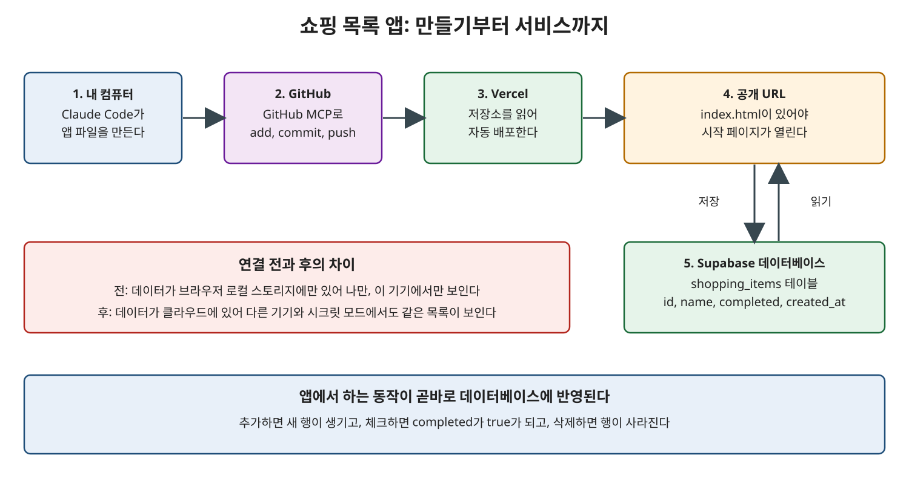

# Vercel 배포와 Supabase 데이터베이스 연결

8장의 마지막 실습이다. 지금까지 쇼핑 목록 앱은 내 컴퓨터에서만 돌았고 데이터도 내 브라우저 안에만 있었다. 이번에는 Vercel로 인터넷에 배포하고, Supabase 데이터베이스를 붙여 누구나 같은 목록을 보는 진짜 서비스로 바꾼다.

비유하면 지금까지는 집 거실에서 혼자 쓰던 메모장이다. 배포는 그 메모장을 24시간 열려 있는 공공 게시판에 걸어 두는 일이고, 데이터베이스는 게시판 뒤의 보관함이다. 게시판에서 글을 지워도, 다른 사람이 와도, 보관함 덕분에 같은 내용이 보인다.



---

## 1. 데이터베이스와 배포가 필요한 이유

데이터베이스(DB)는 많은 데이터를 체계적으로 저장하고 관리하는 시스템이다. 메모장이나 엑셀에도 정보를 적을 수 있지만 데이터가 늘어날수록 찾고 고치기 어렵다. 데이터베이스는 데이터를 표 형태로 구조화해서 필요한 정보를 빠르게 찾고 바꾸게 한다. 웹 앱에서 사용자가 입력하는 모든 정보는 데이터베이스에 저장된다. 앱을 닫았다 열어도 데이터가 남고, 여러 기기에서 같은 내용을 볼 수 있는 것도 그 덕분이다. 데이터베이스는 앱의 기억 저장소다.

배포(Deployment)는 앱을 인터넷에 연결된 제3의 서버에 올리는 과정이다. 사용자가 접속하려면 서버가 24시간 켜져 있어야 한다. 내 컴퓨터에서 돌리면 컴퓨터를 끌 때 서버도 꺼진다. 배포하면 항상 켜진 서버에서 앱이 돌아서 웹 주소(URL)로 언제 어디서든 접속할 수 있다.

## 2. Vercel 계정과 GitHub 연결

Vercel은 코드를 GitHub에 올리면 자동으로 빌드하고 배포해 주는 클라우드 플랫폼이다. 간단한 웹 앱은 GitHub에 올려 두고 Vercel로 무료 배포할 수 있다. 흐름은 네 단계다. GitHub 저장소를 준비하고, 로컬에서 만든 HTML 파일을 올리고, Vercel에서 GitHub 인증을 거쳐 배포할 저장소를 고르면, 곧바로 URL을 받는다.

가입 과정은 다음과 같다.

1. Vercel 홈페이지(https://www.vercel.com)에서 Sign Up 버튼을 눌러 가입을 시작한다.
2. Plan Type에서 'I'm working on personal projects'를 고르고, 이름 칸에 아이디를 쓴다. 책은 `hongongvibe`를 썼다. Continue를 누른다. 사용자 이름은 만들어서 기억해 둔다.
3. 계정 만들기 화면에서 Continue with GitHub를 골라 GitHub 계정을 연결한다. 열린 창에서 Authorize Vercel을 눌러 인증하면 계정이 만들어진다.
4. 로그인한 뒤 오른쪽 위 프로필을 눌러 Dashboard 메뉴를 고른다.
5. Projects 탭에서 오른쪽의 Add New 버튼을 누르고 드롭다운에서 Project를 고른다.
6. Import Git Repository 아래의 Continue with GitHub를 눌러 로그인하고, Select a Git Namespace 드롭다운에서 Add GitHub Account를 골라 계정 연결을 시작한다.
7. 선택한 저장소에만 접근을 허용하려면 Only select repositories에 체크한다. Select repositories 드롭다운에서 `shopping-list-app`을 고르고 Install을 눌러 Vercel을 설치한다.
8. GitHub 비밀번호로 인증하면 GitHub 저장소를 가져올 준비가 끝난다.

## 3. 프로젝트 배포와 404 오류 해결

Vercel로 돌아가 배포한다.

1. New Project 창의 Import Git Repository에서 `shopping-list-app` 저장소가 보이는지 확인하고 Import를 누른다.
2. 새 프로젝트가 만들어지고 배포 준비가 된다. Deploy를 누른다.
3. 배포가 진행되는 모습을 볼 수 있다. 잠시 기다리면 배포가 끝난다.

그런데 미리보기 창에 404 Not Found 오류가 뜰 수 있다. 책에서도 그랬다. 원인은 웹사이트의 기본 시작 페이지인 `index.html`이 저장소에 없기 때문이다. 쇼핑 목록 앱을 `index.html`이 아니라 `shopping-list.html`로 만들었으니 시작 페이지를 못 찾은 것이다.

해결은 Claude Code에게 맡긴다. 파일 이름을 바꾸고 GitHub에 올려 달라고 한다.

```text
Rename the shopping-list.html file of the shopping list app to index.html and upload it to GitHub.
```

완료 메시지를 확인한 뒤 GitHub로 가서 `shopping-list.html`이 `index.html`로 바뀌었는지 본다. 이 사례는 복습 문제의 정답과 이어진다. 404의 이유는 `index.html`이 없어서이고, 해법은 파일 이름을 바꾸는 것이다.

## 4. 배포된 사이트 확인

1. Vercel 대시보드에서 방금 만든 `shopping-list-app` 프로젝트를 누른다. 대시보드는 Vercel 오른쪽 위 프로필에서 Dashboard를 고르면 열린다.
2. 미리보기 창에 배포된 쇼핑 목록 앱이 보인다. 미리보기 오른쪽의 Domains 아래에 배포된 웹 페이지의 URL이 있다.
3. 공유 아이콘을 눌러 그 주소로 들어간다.

이제 쇼핑 목록 앱이 인터넷에 올라갔다. 전 세계 사용자가 내가 만든 웹 페이지에 접속할 수 있다. 책에서 배포한 완성 앱의 주소는 `https://shopping-list-app-chi-blush.vercel.app`라고 안내한다. 책이 쓰인 시점의 예시 주소다.

## 5. 로컬 저장소의 한계

배포된 앱을 시험해 보자. 로컬에서 시험할 때 넣은 사과(Apple) 항목이 제대로 보인다. 하지만 사실 이 앱은 아직 완성이 아니다. 지금 쇼핑 목록 앱은 데이터를 브라우저의 로컬 스토리지(Local Storage, 브라우저 안에 데이터를 저장하는 공간)에 저장한다. 그래서 저장된 데이터는 지금 쓰는 그 브라우저에서만 보인다.

한계는 분명하다. 데이터가 다른 컴퓨터나 브라우저와 공유되지 않는다. 브라우저 캐시를 지우거나 기기를 바꾸면 데이터가 사라진다. 다른 컴퓨터, 다른 브라우저, 로컬 스토리지를 쓰지 않는 시크릿 모드로 들어가면 빈 쇼핑 목록만 보인다. 나만, 이 기기에서만 볼 수 있는 데이터다.

여러 기기에서 저장된 데이터를 같이 보려면 인터넷에 연결된 외부 저장소, 즉 클라우드 스토리지(Cloud Storage)가 필요하다. 클라우드 스토리지는 중앙 서버 역할을 해서 어디서든 같은 데이터에 접근하게 한다. 예를 들어 쇼핑 목록을 데이터베이스에 두고, 앱이 실행될 때마다 클라우드에서 읽어 오게 하면 된다. 그러면 데스크톱, 노트북, 스마트폰에서 같은 목록을 보고 여러 사람이 공유하거나 협업할 수 있다.

전통적으로 웹 앱의 데이터를 저장하려면 Oracle이나 MySQL 같은 데이터베이스 프로그램을 설치하고 서버를 직접 운영해야 한다. 이 방식은 설정이 복잡하고 서버를 관리하고 유지하는 데 시간이 많이 든다.

## 6. Supabase 소개와 가입

Supabase는 이 과정을 자동화하고 단순화하는 클라우드 데이터베이스 플랫폼이다. 발음은 '슈퍼베이스'다. 가입하면 따로 설치하지 않고 데이터베이스를 만들 수 있고, API로 웹이나 모바일 앱과 데이터를 주고받는다. 개인 프로젝트나 학습에는 충분한 무료 요금제가 있다. 데이터를 저장하면 API가 자동으로 만들어져서 서버 코드를 직접 쓰지 않아도 된다. 또 데이터가 온라인 서버에 있으니 여러 사용자가 추가하거나 고친 내용이 실시간으로 반영된다.

가입 절차는 이렇다.

1. Supabase 홈페이지(www.supabase.com)에서 오른쪽 위 Sign in 버튼을 눌러 가입한다.
2. Continue with GitHub 버튼으로 GitHub 계정으로 가입한다.
3. New organization 창에서 조직(organization)을 만든다. 조직은 여러 프로젝트를 묶어 관리하는 폴더 같은 것이다. 이름은 자동 생성된 값(책에서는 HonGongVibeCoding's Org), 유형은 Personal, 요금제는 Free를 고르고 Create organization을 누른다.

무료 요금제에서는 프로젝트를 최대 2개까지 만들 수 있다. 프로젝트가 7일 동안 활동이 없으면 자동으로 일시 중지되지만, 대시보드의 Resume 버튼으로 다시 시작할 수 있다. 요금제 조건은 책이 쓰인 시점 기준이다.

## 7. Supabase MCP 서버 설치와 토큰

Supabase는 로컬과 원격 MCP 서버를 모두 지원한다. 이 장에서는 로컬 MCP 서버를 설치한다. 터미널에 설치 명령을 입력하고 인증을 거친다.

```bash
claude mcp add supabase -s local -e SUPABASE_ACCESS_TOKEN=<YOUR_SUPABASE_TOKEN> -- cmd /c npx -y @supabase/mcp-server-supabase@latest
```

이 명령은 Supabase(`@supabase`)가 만든 MCP 서버(`mcp-server-supabase`)를 최신 버전(`@latest`)으로 실행하라는 뜻이다. 새로 나온 `-e`는 `--env`의 줄임으로, MCP 서버에 넘길 환경 변수를 설정하는 옵션이다. Supabase로 인증하려면 API 토큰이 필요하므로 토큰을 넘기는 옵션이 붙었다. `cmd /c`는 책이 Windows 기준으로 쓴 부분이다.

참고(노트 작성자): macOS나 Linux에서는 `cmd /c` 없이 `npx` 부분부터 쓰는 경우가 많다. 이는 원서에 없는 일반 지식이므로 실제 환경에서 확인해야 한다.

토큰은 Supabase에서 발급한다.

1. Supabase 시작 페이지에서 오른쪽 위 프로필을 누르고 Account preferences 메뉴를 고른다.
2. 왼쪽 사이드바에서 Access Tokens를 눌러 토큰 관리 화면으로 간다. 오른쪽의 Generate new token 버튼으로 새 API 토큰을 만든다.
3. Generate New Token 창에서 Name에 `my_first_project`를 입력하고 Expires in(토큰 유효 기간)을 30일로 정한 뒤 Generate token을 누른다.
4. 토큰이 만들어지면 Copy 버튼으로 복사해 안전한 곳에 저장한다.
5. `Study-06` 폴더에서 터미널을 열고 위 명령의 `<YOUR_SUPABASE_TOKEN>` 자리에 방금 받은 토큰을 넣어 실행한다.
6. 설치가 끝나면 `claude mcp list`로 제대로 설치되었는지 본다. 목록에 supabase가 추가되어 있으면 성공이다.

## 8. 쇼핑 목록 앱을 진짜 서비스로 업그레이드

이제 Supabase MCP로 앱을 데이터베이스에 연결한다. Claude Code를 실행하고 프롬프트를 입력한다.

```text
Use Supabase MCP to connect our shopping list app to the database. Create a table called shopping_items, and modify the code so that the data previously stored in local storage is now saved to the Supabase database. Once the changes are complete, commit and push to GitHub.
```

프롬프트의 요청은 세 가지다. 데이터베이스에 `shopping_items`라는 테이블을 만들고, 로컬 스토리지에 저장하던 데이터를 Supabase에 저장하도록 코드를 고치고, 끝나면 GitHub에 commit과 push를 하라는 것이다.

여기서 데이터베이스 테이블(Table)이란 데이터를 표 형태로 저장하는 구조다. 데이터베이스가 여러 엑셀 파일을 관리하는 프로그램이라면, 테이블은 그 안의 엑셀 시트 한 장과 같다. `shopping_items` 테이블에서는 한 행(row)이 쇼핑 항목 하나를 저장하고, 열(column)은 속성을 저장한다. 고유 번호 `id`, 상품 이름 `name`, 구매 완료 여부 `completed`, 생성 시각 `created_at`이 그 예다.

| id | name | completed | created_at |
|---|---|---|---|
| 1 | Apple | false | 2025-10-29 15:30:00 |
| 2 | Milk | true | 2025-10-29 15:32:10 |
| 3 | Bread | false | 2025-10-29 15:35:22 |

진행 과정은 이렇다.

1. Supabase MCP가 실행되며 허락을 묻는다. `1. Yes`를 눌러 진행한다.
2. 잠시 뒤 Supabase에 새 프로젝트를 만들고 무료 요금제임을 확인하는 메시지가 나온다. 내용을 살펴보고 계속한다.
3. `index.html` 파일이 Supabase MCP와 연동되도록 자동으로 수정된다.
4. `shopping_items` 테이블이 만들어지고, `id`와 `name` 같은 필요한 필드를 포함해 데이터베이스 연결이 성공한다.

## 9. 테이블 생성 확인과 실시간 동기화 시험

Supabase 웹사이트에서 데이터베이스가 실제로 만들어졌는지 본다.

1. 대시보드에 `shopping-list-app`이라는 새 프로젝트가 생겼다. 눌러서 자세한 내용을 본다.
2. 오른쪽 위에 Tables 옆에 숫자 1이 보인다. 새 테이블이 하나 늘었다는 뜻이다. 왼쪽 사이드바의 Table Editor 메뉴를 누른다.
3. Table Editor 창에서 `shopping_items` 테이블을 누르면 `id`, `name`, `completed`, `created_at` 열이 만들어진 것이 보인다.

테이블이 확인되었으니 실제 앱에서 작동하는지 시험한다.

1. 쇼핑 목록 앱에 접속해 Apple을 입력하고 Add 버튼으로 목록에 추가한다.
2. Supabase의 Table Editor 창을 새로고침하면 Apple 행이 추가된 것이 보인다.
3. 앱에서 Apple 항목의 체크박스를 눌러 완료로 표시한다. 테이블의 `completed` 열이 `true`로 바뀐다.
4. 다른 항목을 몇 개 더 추가해 보고 테이블을 확인한다. 추가한 항목이 새 행으로 나타난다.
5. 항목을 삭제해 본다. 앱에서 Bread 항목을 지우면 테이블에서도 Bread 행이 삭제된다.
6. 다른 컴퓨터, 다른 브라우저, 시크릿 모드에서도 잘 되는 것을 확인할 수 있다.

쇼핑 목록 앱은 로컬에서만 돌던 간단한 연습 프로젝트에서 인터넷으로 누구나 접속하는 진짜 웹 서비스가 되었다. Vercel의 자동 배포와 Supabase의 데이터베이스 연동 덕분에 앱은 항상 최신 상태이고 여러 사용자가 실시간으로 데이터를 공유한다. 이 과정으로 AI가 만든 코드를 실제 서비스로 만드는 전체 여정을 마쳤다.

저자는 이렇게 덧붙인다. Claude Code는 계속 새 기능과 개선이 더해지고, 책이 나온 뒤의 변경은 책의 GitHub 저장소에 계속 갱신된다. 저장소 링크는 서문의 예제 코드 내려받기 안내를 따라 찾는다.

## 10. 핵심 정리와 복습 문제

책은 여섯 개 키워드로 정리한다.

- 배포는 앱을 인터넷에 연결된 제3의 서버에 올리는 과정이다.
- Vercel은 코드를 GitHub에 올리면 자동으로 빌드하고 배포하는 클라우드 플랫폼이다.
- 로컬 스토리지의 데이터는 다른 컴퓨터나 브라우저와 공유되지 않고, 브라우저 캐시를 지우거나 기기를 바꾸면 사라진다.
- 클라우드 스토리지는 중앙 서버 역할을 해서 어디서든 같은 데이터에 접근하게 한다.
- Supabase는 데이터베이스 설정을 자동화하는 클라우드 데이터베이스 플랫폼이다.
- 데이터베이스 테이블은 데이터를 표 형태로 저장하는 구조이며, 데이터베이스가 엑셀 파일 관리 프로그램이라면 테이블은 엑셀 시트 한 장이다.

복습 문제는 세 개다. 정답은 부록 장에 있다.

1. 로컬 스토리지와 클라우드 데이터베이스의 가장 큰 차이는 무엇인가. 보기는 (1) 로컬 스토리지가 더 빠르다, (2) 데이터베이스는 여러 기기에서 데이터를 공유하게 한다, (3) 로컬 스토리지가 더 안전하다, (4) 데이터베이스에는 무료 옵션이 없다.
2. Vercel 배포에서 404 오류가 난 이유와 해결책을 고르시오. 보기는 (1) 서버 오류, 재시작 필요, (2) `index.html` 파일 없음, 파일 이름을 바꿔야 함, (3) 인증 실패, 다시 로그인 필요, (4) 네트워크 오류, 연결 확인 필요다.
3. Supabase 테이블과 엑셀 시트의 공통점과 차이점을 설명하시오.

<br>
<br>
<br>

[Build with Claude Code](../)
