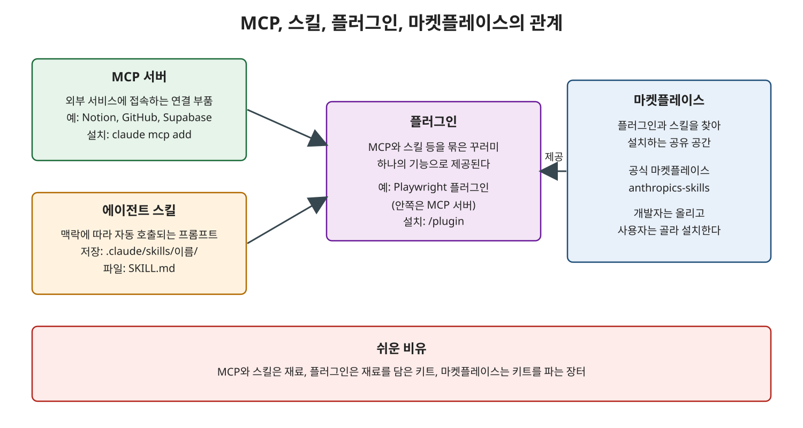

# 스킬과 플러그인, 마켓플레이스

8장의 두 번째 절은 테스트와 버전 관리를 자동화하는 환경을 만든다. 이 문서에서는 그중 에이전트 스킬(Agent Skill, 상황에 따라 Claude가 알아서 불러 쓰는 저장된 프롬프트), 플러그인(Plugin, MCP와 스킬 등을 묶어 하나의 기능으로 제공하는 꾸러미), 마켓플레이스(Marketplace, 플러그인과 스킬을 찾아 설치하는 공유 공간)를 다룬다.

비유하면 스킬은 요리사의 특기 레시피 카드, 플러그인은 레시피와 전용 도구를 한 상자에 담은 키트, 마켓플레이스는 그 키트를 파는 장터다. 먼저 레시피 카드를 직접 만들어 보고, 장터에서 키트를 사서 쓰는 순서로 진행한다.



---

## 1. 왜 테스트와 버전 관리인가

앱을 안정적으로 돌리려면 코드를 다 쓰는 것으로는 부족하다. 의도대로 돌고 오류가 없는지 확인하는 테스트가 필요하다. 테스트를 하면 기능을 검증하고 새 코드가 기존 기능을 깨뜨리지 않았는지 알 수 있다. Playwright 같은 자동화 도구를 쓰면 반복 검증을 AI가 맡아 개발자의 부담이 줄어든다.

버전 관리는 프로젝트의 안정성을 지킨다. 코드의 모든 변경을 기록해 두었다가 필요하면 이전 상태로 되돌릴 수 있다. GitHub를 쓰면 협업할 때 각자의 변경 이력을 체계적으로 관리하고, 여럿이 동시에 작업해도 안정성을 유지한다.

## 2. 스킬은 커스텀 명령의 확장

스킬은 앞에서 배운 커스텀 명령(Custom Command, 프롬프트를 md 파일로 저장해 두고 슬래시 명령으로 부르는 기능)의 확장판이다. 커스텀 명령은 `.claude/commands/` 폴더에 프롬프트를 md 파일로 저장하고 `/명령` 형식으로 실행했다. 이후 Claude가 이 기능을 발전시켜 스킬을 추가했다.

스킬도 md 파일에 저장한 프롬프트라는 점은 같다. 다른 점은 저장 위치가 `.claude/skills/스킬이름/`이고 파일 이름이 `SKILL.md`로 정해져 있다는 것이다. 가장 큰 차이는 호출 방식이다. 사용자가 `/명령`을 직접 입력하지 않아도, Claude가 대화 맥락을 보고 필요할 때 알아서 불러 쓴다.

| 구분 | 커스텀 명령 | 스킬 |
|---|---|---|
| 개념 | 사용자가 직접 부르는 프롬프트 명령 | 대화 맥락에 따라 자동 호출되는 프롬프트 기능 |
| 실행 방식 | `/명령` 형식으로 직접 입력 | 부르지 않아도 필요할 때 자동 실행 |
| 저장 위치와 파일 | `.claude/commands/`, `명령이름.md` | `.claude/skills/스킬이름/`, `SKILL.md` |

용도도 다르다. 커스텀 명령은 반복 작업을 빠르게 실행하려는 것이고, 스킬은 Claude에 특정 작업 능력을 더해 주려는 것이다.

`SKILL.md`는 맨 위에 스킬의 이름과 설명을 적고 그 아래에 스킬이 따라야 할 규칙 목록을 둔다. `name`은 설치하거나 부를 때 쓰는 식별자이고, `description`은 검색과 목록에 보이는 설명이다.

## 3. 스킬 직접 만들기

스킬은 Claude Code에게 "이런 스킬을 만들어 줘"라고 시키면 쉽게 만들어진다.

```text
Create a skill that automatically reviews code.
```

그러면 Claude Code가 코드 리뷰 스킬을 만든다. 현재 작업 폴더의 `.claude` 아래에 `skills` 폴더가 생기고, 그 안에 `code-review` 폴더, 다시 그 안에 `SKILL.md`가 만들어진다. 파일을 열면 이름과 설명, 그리고 사용 규칙이 보인다.

```markdown
---
name: code-review
description: Reviews code changes to identify bugs, security vulnerabilities, and code quality issues.
---
When this skill is invoked, immediately execute the steps below.
...(이하 생략)...
```

원서가 보여 준 파일은 중간이 줄임표로 생략되어 있다. 첫 부분의 내용은 '이 스킬이 불리면 아래 단계를 즉시 실행하라, 파일 내용을 보여 주거나 설명하지 말고 바로 분석을 시작하라, 대화에서 사용자 언어를 알아내 그 언어로 답하라'는 취지다. 이어서 '명령을 해석해 알맞은 동작으로 보낸다'는 라우팅 절이 나온다. 이렇게 만든 스킬은 코드를 테스트하거나 리뷰할 맥락이 생길 때마다 자동으로 실행되어, 파일에 저장된 프롬프트대로 코드 리뷰를 수행한다.

## 4. 남이 만든 스킬 쓰기

스킬의 장점은 다른 사람이 만든 노하우와 프롬프트를 내 프로젝트에 그대로 적용할 수 있다는 것이다. 외부 스킬 `vibeindex`를 설치해 보자. 내 프로젝트에 맞는 자원을 추천해 주는 스킬이다.

1. 웹 브라우저로 Vibe Index(https://www.vibeindex.ai/)에 들어가 검색창에 vibeindex를 입력한다.
2. 검색 결과에서 Skills 분류의 vibeindex를 고른다.
3. 상세 페이지의 설치(Install) 부분에서 명령을 복사한다.
4. Claude Code를 종료하고 터미널에 붙여 넣는다. 스킬이 설치된다.
5. Claude Code를 다시 실행해 프롬프트를 입력한다.

```bash
npx vibeindex add vibeindex/skills --skill vibeindex
```

```text
Recommend skills, MCP, or plugins needed for the current project.
```

이 명령은 Node.js가 설치되어 있어야 실행된다. 설치 방법은 앞 문서의 로컬 MCP 설치 부분에서 다뤘다. 프롬프트를 입력하면 vibeindex 스킬이 자동으로 불려 나오고, 잠시 뒤 Vibe Index 사이트 자원을 바탕으로 필요한 MCP와 스킬을 추천한다. 이번 실습에서는 데이터를 클라우드에 저장해 누구나 접근하게 하는 도구로 Supabase가 추천되었다. 이것은 뒤 문서의 주제로 이어진다.

## 5. 플러그인과 마켓플레이스

플러그인은 MCP와 스킬 등을 묶어 하나의 기능으로 제공하는 도구다. Claude Code가 외부 프로그램이나 서비스와 상호작용하고 새 기능을 수행하게 한다. 그런 플러그인이나 스킬을 찾고 설치하는 공유 공간이 마켓플레이스다. 개발자는 자기 플러그인과 스킬을 올려 남이 쓰게 하고, 사용자는 필요한 기능을 검색해 자기 프로젝트에 설치한다. 정리하면 MCP와 스킬이 재료이고, 플러그인이 그 재료를 묶은 꾸러미이며, 마켓플레이스가 그 꾸러미를 유통하는 장터다. 플러그인과 마켓플레이스는 Claude Code 안에서 `/plugin` 명령으로 다룬다.

## 6. 쇼핑 목록 앱 만들기

플러그인을 써 보려면 테스트할 대상이 필요하다. 쇼핑 목록 앱을 만든다. 터미널에서 Claude Code를 실행하고 프롬프트를 입력한다.

```text
Create a shopping list app. Make it a simple web UI that can add, delete, and check items, and runs locally in the browser.
```

완료 메시지가 나오면 `Study-06` 폴더에 만들어진 `shopping-list.html`을 더블클릭해 연다. 항목을 추가하고 삭제하고 체크할 수 있는 간단한 쇼핑 목록 앱이 보인다. 파일 이름은 책에 나온 것과 다를 수 있다. 이 앱은 8장 끝까지 계속 쓰이는 재료다.

## 7. Playwright 플러그인으로 자동 테스트

Playwright는 웹사이트 테스트와 자동화를 위한 개발 도구다. 이것을 플러그인으로 설치한다.

1. Claude Code에서 `/plugin`을 입력하고 Enter로 실행한다.
2. 지금 쓸 수 있는 플러그인 목록이 나온다.
3. 아래 방향키로 목록을 내려 Playwright를 찾아 Enter를 누른다.
4. 이 컴퓨터의 모든 프로젝트에 쓸지, 현재 프로젝트에만 쓸지 묻는다. 두 번째 항목인 'Install for all collaborators on this repository (project scope)'를 골라 현재 프로젝트 저장소에 설치한다.
5. `/plugin`을 다시 입력하고 오른쪽 방향키로 Installed를 선택하면 방금 설치한 Playwright 플러그인이 보인다.
6. 프롬프트로 테스트를 시킨다.

```text
Automatically test all the features of this shopping list app. Please check that adding, deleting, and checking all items work correctly.
```

Claude Code가 필요한 프로그램을 준비한 뒤 브라우저를 자동으로 열고 기능을 하나씩 확인한다. 모든 테스트를 통과했다는 메시지가 나오면 성공이다. 책의 실행에서는 테스트 9개가 모두 통과했다.

플러그인으로 설치했지만 Playwright는 내부적으로 MCP 서버로 이뤄져 있다. Claude Code를 종료하고 터미널에서 `claude mcp list`를 실행하면 playwright MCP가 설치된 것이 보인다. 이것이 앞서 말한 '플러그인은 MCP와 스킬의 꾸러미'라는 설명의 실제 사례다. 또 복습 문제에 나오듯 테스트가 끝나면 Playwright MCP가 `.playwright-mcp` 폴더를 만든다.

## 8. 마켓플레이스에서 설치하기

`/plugin`으로 보던 플러그인 목록은 마켓플레이스에서 가져온 것이다.

1. Claude Code를 실행하고 `/plugin`을 입력한다.
2. 방향키로 Marketplaces를 고르고 Enter를 누른다. Claude Code의 공식 마켓플레이스로 이동한다. 앞에서 본 목록의 플러그인이 모두 이곳 소속이다.

이번에는 새 마켓플레이스를 추가한다. 대상은 `anthropics-skills`로, Claude를 만든 Anthropic이 낸 공식 스킬 마켓플레이스다. Claude Code 스킬 꾸러미를 모아 놓았고 필요한 것을 명령으로 설치한다.

1. 웹 브라우저에서 Vibe Index로 가서 위쪽 메뉴의 Marketplace를 누르고 검색 결과에서 anthropics-skills를 고른다.
2. 상세 페이지에서 Add Marketplace 항목의 명령을 클립보드로 복사한다.
3. Claude Code에 붙여 넣고 Enter로 실행한다. 잠시 뒤 설치 완료 메시지가 나온다.
4. `/plugin`에서 Marketplaces를 고르면 새 마켓플레이스가 들어온 것을 확인할 수 있다.

참고(노트 작성자): 원서에는 복사할 명령 자체가 실려 있지 않다. 상세 페이지의 명령을 그대로 복사해 쓰라는 안내만 있으므로 여기서도 명령을 적지 않는다.

## 9. document-skills 플러그인 설치와 사용

`document-skills`는 PowerPoint, Word, Excel 파일을 만들 수 있게 해 주는 Claude Code 플러그인이다. 방금 추가한 마켓플레이스에서 찾아 쓴다.

1. `/plugin`을 실행하고 Marketplaces에서 방금 추가한 마켓플레이스를 골라 Enter를 누른다. 안에 플러그인 세 개가 들어 있는 것을 확인한다.
2. Browse plugins (3)를 선택해 쓸 수 있는 플러그인을 보고, document-skills로 이동해 Enter를 누른다.
3. 설치 범위(scope)에서 'Install for all collaborators on this repository (project scope)'를 골라 프로젝트 저장소에 설치한다. 이렇게 하면 GitHub를 통해 협업하게 된다.
4. Installed로 가서 document-skills가 설치되었는지 확인한다.

명령으로 바로 설치하는 방법도 있다. 웹 브라우저에서 Vibe Index의 anthropics-skills 페이지로 가서 Plugins in Marketplace 항목의 document-skills를 누른다. 상세 페이지에서 'Claude Code에서 Add Marketplace' 아래의 명령과 'Step 2. Install plugin' 아래의 명령을 차례로 복사해 Claude Code에 붙여 넣고 실행한다.

설치한 플러그인으로 PowerPoint 문서를 만든다.

```text
Create a one-page summary of AI technology trends in pptx format.
```

앞서 설치한 document-skills 플러그인이 활성화되어 이 프롬프트를 처리한다. 프로젝트 폴더에 `AI_Trends_2026.pptx` 같은 새 파일이 생긴다. 파일 이름은 사용자마다 다르게 만들어질 수 있다. 파일을 열면 AI 트렌드를 요약한 프레젠테이션이 만들어져 있다. 코드가 아니라 문서 파일도 한 줄 프롬프트로 만든다는 점이 이 실습의 요점이다.

참고(노트 작성자): 플러그인 이름, 마켓플레이스 이름, 메뉴 문구는 책이 쓰인 시점 기준이다. 책 안에서도 이름이 일부 다르게 표기된 곳이 있어, 실제 화면의 이름을 따라가는 것이 안전하다.

<br>
<br>
<br>

[Build with Claude Code](../)
