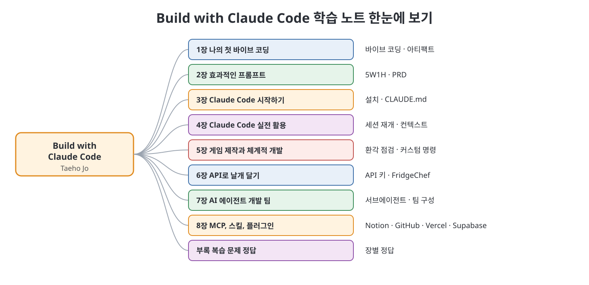

# **Build with Claude Code 학습 노트**
(Build with Claude Code: From zero to deployed apps with AI-assisted development, 장별 정리 노트)
<br>

<p align="center"></p>
<br>
<br>

이 문서는 Taeho Jo의 『Build with Claude Code: From zero to deployed apps with AI-assisted development』(Packt)를 장별로 정리한 한국어 학습 노트입니다. 원문을 번역한 것이 아니라 내용을 우리말로 풀어서 다시 설명했고, 처음 나오는 용어에는 쉬운 풀이를 붙였습니다. 책은 코딩을 몰라도 따라 할 수 있는 실습서로, 바이브 코딩으로 첫 웹페이지를 만드는 데서 출발해 효과적인 프롬프트, Claude Code 설치와 CLAUDE.md, 할 일 앱과 퀴즈 게임 제작, API를 붙인 FridgeChef 앱, 서브에이전트로 꾸리는 AI 개발 팀, MCP와 스킬과 플러그인으로 Notion, GitHub, Vercel, Supabase까지 연결해 실제 서비스를 배포하는 데까지 안내합니다. 이 노트는 책의 장 구성을 그대로 따라 장마다 폴더 하나로 정리했고, 이해를 돕기 위해 표와 직접 그린 그림을 넣었습니다.

<p align="center"></p>

> **이 노트를 읽을 때 유의할 점**
> - 이 노트는 원서의 **요약·해설본**이며 원서를 대신하지 않습니다. 명령, 설정, 코드, 가격처럼 정확성이 필요한 내용은 반드시 원서와 공식 문서에서 확인하세요.
> - 원서의 코드와 프롬프트는 핵심만 옮겼습니다. PDF 추출 과정에서 글자나 서식이 깨진 곳은 문맥으로 복원했고, 해당 문서에 그 사실을 적었습니다.
> - 책에 없는 보충 설명은 `참고(노트 작성자)`로 따로 표시했습니다.
> - 원서의 스크린샷은 싣지 않고 글과 표로 풀어 설명했습니다. 그림은 본문 내용을 바탕으로 새로 그렸고, 표지 이미지만 책 소개용으로 넣었습니다.
> - 책이 소개하는 요금제, 모델 이름, 메뉴 문구, 도구 버전은 책이 쓰인 시점 기준입니다. 지금과 다를 수 있습니다.
<br>

---

## 목차

- [00. 머리말과 이 책에 대하여](00.%20%EB%A8%B8%EB%A6%AC%EB%A7%90%EA%B3%BC%20%EC%9D%B4%20%EC%B1%85%EC%97%90%20%EB%8C%80%ED%95%98%EC%97%AC/Readme.md) — 추천사, 저자와 감수자, 서문, 장별 구성, 준비물

### 1부 바이브 코딩의 기초

- [01. 나의 첫 바이브 코딩](01.%20%EB%82%98%EC%9D%98%20%EC%B2%AB%20%EB%B0%94%EC%9D%B4%EB%B8%8C%20%EC%BD%94%EB%94%A9/Readme.md) — 바이브 코딩과 AI 코딩 도구 세 유형, 아티팩트로 만드는 첫 웹페이지, 요금제
  - [Claude 아티팩트로 첫 웹페이지 만들기](01.%20%EB%82%98%EC%9D%98%20%EC%B2%AB%20%EB%B0%94%EC%9D%B4%EB%B8%8C%20%EC%BD%94%EB%94%A9/Claude%20%EC%95%84%ED%8B%B0%ED%8C%A9%ED%8A%B8%EB%A1%9C%20%EC%B2%AB%20%EC%9B%B9%ED%8E%98%EC%9D%B4%EC%A7%80%20%EB%A7%8C%EB%93%A4%EA%B8%B0.md)
  - [Claude 요금제 비교와 복습 문제](01.%20%EB%82%98%EC%9D%98%20%EC%B2%AB%20%EB%B0%94%EC%9D%B4%EB%B8%8C%20%EC%BD%94%EB%94%A9/Claude%20%EC%9A%94%EA%B8%88%EC%A0%9C%20%EB%B9%84%EA%B5%90%EC%99%80%20%EB%B3%B5%EC%8A%B5%20%EB%AC%B8%EC%A0%9C.md)
  - [바이브 코딩과 AI 코딩 도구](01.%20%EB%82%98%EC%9D%98%20%EC%B2%AB%20%EB%B0%94%EC%9D%B4%EB%B8%8C%20%EC%BD%94%EB%94%A9/%EB%B0%94%EC%9D%B4%EB%B8%8C%20%EC%BD%94%EB%94%A9%EA%B3%BC%20AI%20%EC%BD%94%EB%94%A9%20%EB%8F%84%EA%B5%AC.md)
  - [요약과 핵심 개념](01.%20%EB%82%98%EC%9D%98%20%EC%B2%AB%20%EB%B0%94%EC%9D%B4%EB%B8%8C%20%EC%BD%94%EB%94%A9/%EC%9A%94%EC%95%BD%EA%B3%BC%20%ED%95%B5%EC%8B%AC%20%EA%B0%9C%EB%85%90.md)
- [02. 효과적인 프롬프트로 AI의 잠재력 끌어내기](02.%20%ED%9A%A8%EA%B3%BC%EC%A0%81%EC%9D%B8%20%ED%94%84%EB%A1%AC%ED%94%84%ED%8A%B8%EB%A1%9C%20AI%EC%9D%98%20%EC%9E%A0%EC%9E%AC%EB%A0%A5%20%EB%81%8C%EC%96%B4%EB%82%B4%EA%B8%B0/Readme.md) — 좋은 프롬프트의 조건, 5W1H 기획서, 마케팅 포트폴리오 실습
  - [마케팅 포트폴리오 1단계 프레임워크와 2단계 기능](02.%20%ED%9A%A8%EA%B3%BC%EC%A0%81%EC%9D%B8%20%ED%94%84%EB%A1%AC%ED%94%84%ED%8A%B8%EB%A1%9C%20AI%EC%9D%98%20%EC%9E%A0%EC%9E%AC%EB%A0%A5%20%EB%81%8C%EC%96%B4%EB%82%B4%EA%B8%B0/%EB%A7%88%EC%BC%80%ED%8C%85%20%ED%8F%AC%ED%8A%B8%ED%8F%B4%EB%A6%AC%EC%98%A4%201%EB%8B%A8%EA%B3%84%20%ED%94%84%EB%A0%88%EC%9E%84%EC%9B%8C%ED%81%AC%EC%99%80%202%EB%8B%A8%EA%B3%84%20%EA%B8%B0%EB%8A%A5.md)
  - [마케팅 포트폴리오 3단계 디자인과 4단계 검증](02.%20%ED%9A%A8%EA%B3%BC%EC%A0%81%EC%9D%B8%20%ED%94%84%EB%A1%AC%ED%94%84%ED%8A%B8%EB%A1%9C%20AI%EC%9D%98%20%EC%9E%A0%EC%9E%AC%EB%A0%A5%20%EB%81%8C%EC%96%B4%EB%82%B4%EA%B8%B0/%EB%A7%88%EC%BC%80%ED%8C%85%20%ED%8F%AC%ED%8A%B8%ED%8F%B4%EB%A6%AC%EC%98%A4%203%EB%8B%A8%EA%B3%84%20%EB%94%94%EC%9E%90%EC%9D%B8%EA%B3%BC%204%EB%8B%A8%EA%B3%84%20%EA%B2%80%EC%A6%9D.md)
  - [좋은 프롬프트의 조건과 5W1H 기획서](02.%20%ED%9A%A8%EA%B3%BC%EC%A0%81%EC%9D%B8%20%ED%94%84%EB%A1%AC%ED%94%84%ED%8A%B8%EB%A1%9C%20AI%EC%9D%98%20%EC%9E%A0%EC%9E%AC%EB%A0%A5%20%EB%81%8C%EC%96%B4%EB%82%B4%EA%B8%B0/%EC%A2%8B%EC%9D%80%20%ED%94%84%EB%A1%AC%ED%94%84%ED%8A%B8%EC%9D%98%20%EC%A1%B0%EA%B1%B4%EA%B3%BC%205W1H%20%EA%B8%B0%ED%9A%8D%EC%84%9C.md)
  - [요약과 핵심 개념](02.%20%ED%9A%A8%EA%B3%BC%EC%A0%81%EC%9D%B8%20%ED%94%84%EB%A1%AC%ED%94%84%ED%8A%B8%EB%A1%9C%20AI%EC%9D%98%20%EC%9E%A0%EC%9E%AC%EB%A0%A5%20%EB%81%8C%EC%96%B4%EB%82%B4%EA%B8%B0/%EC%9A%94%EC%95%BD%EA%B3%BC%20%ED%95%B5%EC%8B%AC%20%EA%B0%9C%EB%85%90.md)
- [03. Claude Code 시작하기](03.%20Claude%20Code%20%EC%8B%9C%EC%9E%91%ED%95%98%EA%B8%B0/Readme.md) — 터미널과 설치, 손글씨 인식 프로그램, CLAUDE.md 계층 구조
  - [CLAUDE.md와 계층 구조로 웹 버전 확장하기](03.%20Claude%20Code%20%EC%8B%9C%EC%9E%91%ED%95%98%EA%B8%B0/CLAUDE.md%EC%99%80%20%EA%B3%84%EC%B8%B5%20%EA%B5%AC%EC%A1%B0%EB%A1%9C%20%EC%9B%B9%20%EB%B2%84%EC%A0%84%20%ED%99%95%EC%9E%A5%ED%95%98%EA%B8%B0.md)
  - [손글씨 인식 프로그램 만들기](03.%20Claude%20Code%20%EC%8B%9C%EC%9E%91%ED%95%98%EA%B8%B0/%EC%86%90%EA%B8%80%EC%94%A8%20%EC%9D%B8%EC%8B%9D%20%ED%94%84%EB%A1%9C%EA%B7%B8%EB%9E%A8%20%EB%A7%8C%EB%93%A4%EA%B8%B0.md)
  - [터미널과 Claude Code 설치](03.%20Claude%20Code%20%EC%8B%9C%EC%9E%91%ED%95%98%EA%B8%B0/%ED%84%B0%EB%AF%B8%EB%84%90%EA%B3%BC%20Claude%20Code%20%EC%84%A4%EC%B9%98.md)
  - [요약과 핵심 개념](03.%20Claude%20Code%20%EC%8B%9C%EC%9E%91%ED%95%98%EA%B8%B0/%EC%9A%94%EC%95%BD%EA%B3%BC%20%ED%95%B5%EC%8B%AC%20%EA%B0%9C%EB%85%90.md)
- [04. Claude Code 실전 활용](04.%20Claude%20Code%20%EC%8B%A4%EC%A0%84%20%ED%99%9C%EC%9A%A9/Readme.md) — 웹 기획에서 Claude Code 구현까지, 세션 재개와 컨텍스트 관리, 이미지 참조
  - [기획은 웹에서 구현은 Claude Code에서](04.%20Claude%20Code%20%EC%8B%A4%EC%A0%84%20%ED%99%9C%EC%9A%A9/%EA%B8%B0%ED%9A%8D%EC%9D%80%20%EC%9B%B9%EC%97%90%EC%84%9C%20%EA%B5%AC%ED%98%84%EC%9D%80%20Claude%20Code%EC%97%90%EC%84%9C.md)
  - [다섯 단계로 할 일 앱 완성하기](04.%20Claude%20Code%20%EC%8B%A4%EC%A0%84%20%ED%99%9C%EC%9A%A9/%EB%8B%A4%EC%84%AF%20%EB%8B%A8%EA%B3%84%EB%A1%9C%20%ED%95%A0%20%EC%9D%BC%20%EC%95%B1%20%EC%99%84%EC%84%B1%ED%95%98%EA%B8%B0.md)
  - [세션 재개와 자동 승인, 컨텍스트 관리](04.%20Claude%20Code%20%EC%8B%A4%EC%A0%84%20%ED%99%9C%EC%9A%A9/%EC%84%B8%EC%85%98%20%EC%9E%AC%EA%B0%9C%EC%99%80%20%EC%9E%90%EB%8F%99%20%EC%8A%B9%EC%9D%B8%2C%20%EC%BB%A8%ED%85%8D%EC%8A%A4%ED%8A%B8%20%EA%B4%80%EB%A6%AC.md)
  - [이미지 참조와 @ 기호, 프로젝트 관리 명령](04.%20Claude%20Code%20%EC%8B%A4%EC%A0%84%20%ED%99%9C%EC%9A%A9/%EC%9D%B4%EB%AF%B8%EC%A7%80%20%EC%B0%B8%EC%A1%B0%EC%99%80%20%40%20%EA%B8%B0%ED%98%B8%2C%20%ED%94%84%EB%A1%9C%EC%A0%9D%ED%8A%B8%20%EA%B4%80%EB%A6%AC%20%EB%AA%85%EB%A0%B9.md)
  - [요약과 핵심 개념](04.%20Claude%20Code%20%EC%8B%A4%EC%A0%84%20%ED%99%9C%EC%9A%A9/%EC%9A%94%EC%95%BD%EA%B3%BC%20%ED%95%B5%EC%8B%AC%20%EA%B0%9C%EB%85%90.md)

### 2부 프로젝트에서 실제 서비스로

- [05. 게임 제작으로 배우는 체계적 개발과 관리](05.%20%EA%B2%8C%EC%9E%84%20%EC%A0%9C%EC%9E%91%EC%9C%BC%EB%A1%9C%20%EB%B0%B0%EC%9A%B0%EB%8A%94%20%EC%B2%B4%EA%B3%84%EC%A0%81%20%EA%B0%9C%EB%B0%9C%EA%B3%BC%20%EA%B4%80%EB%A6%AC/Readme.md) — 퀴즈 게임과 환각 점검, 검증 지침, 커스텀 명령, 유지 보수 워크플로
  - [CLAUDE.md 검증 지침과 컨텍스트 초기화](05.%20%EA%B2%8C%EC%9E%84%20%EC%A0%9C%EC%9E%91%EC%9C%BC%EB%A1%9C%20%EB%B0%B0%EC%9A%B0%EB%8A%94%20%EC%B2%B4%EA%B3%84%EC%A0%81%20%EA%B0%9C%EB%B0%9C%EA%B3%BC%20%EA%B4%80%EB%A6%AC/CLAUDE.md%20%EA%B2%80%EC%A6%9D%20%EC%A7%80%EC%B9%A8%EA%B3%BC%20%EC%BB%A8%ED%85%8D%EC%8A%A4%ED%8A%B8%20%EC%B4%88%EA%B8%B0%ED%99%94.md)
  - [랭킹 시스템과 명령 연결 자동화](05.%20%EA%B2%8C%EC%9E%84%20%EC%A0%9C%EC%9E%91%EC%9C%BC%EB%A1%9C%20%EB%B0%B0%EC%9A%B0%EB%8A%94%20%EC%B2%B4%EA%B3%84%EC%A0%81%20%EA%B0%9C%EB%B0%9C%EA%B3%BC%20%EA%B4%80%EB%A6%AC/%EB%9E%AD%ED%82%B9%20%EC%8B%9C%EC%8A%A4%ED%85%9C%EA%B3%BC%20%EB%AA%85%EB%A0%B9%20%EC%97%B0%EA%B2%B0%20%EC%9E%90%EB%8F%99%ED%99%94.md)
  - [커스텀 명령으로 반복 작업 자동화](05.%20%EA%B2%8C%EC%9E%84%20%EC%A0%9C%EC%9E%91%EC%9C%BC%EB%A1%9C%20%EB%B0%B0%EC%9A%B0%EB%8A%94%20%EC%B2%B4%EA%B3%84%EC%A0%81%20%EA%B0%9C%EB%B0%9C%EA%B3%BC%20%EA%B4%80%EB%A6%AC/%EC%BB%A4%EC%8A%A4%ED%85%80%20%EB%AA%85%EB%A0%B9%EC%9C%BC%EB%A1%9C%20%EB%B0%98%EB%B3%B5%20%EC%9E%91%EC%97%85%20%EC%9E%90%EB%8F%99%ED%99%94.md)
  - [퀴즈 게임 만들기와 환각 점검](05.%20%EA%B2%8C%EC%9E%84%20%EC%A0%9C%EC%9E%91%EC%9C%BC%EB%A1%9C%20%EB%B0%B0%EC%9A%B0%EB%8A%94%20%EC%B2%B4%EA%B3%84%EC%A0%81%20%EA%B0%9C%EB%B0%9C%EA%B3%BC%20%EA%B4%80%EB%A6%AC/%ED%80%B4%EC%A6%88%20%EA%B2%8C%EC%9E%84%20%EB%A7%8C%EB%93%A4%EA%B8%B0%EC%99%80%20%ED%99%98%EA%B0%81%20%EC%A0%90%EA%B2%80.md)
  - [필요한 부분만 고치는 유지 보수 워크플로](05.%20%EA%B2%8C%EC%9E%84%20%EC%A0%9C%EC%9E%91%EC%9C%BC%EB%A1%9C%20%EB%B0%B0%EC%9A%B0%EB%8A%94%20%EC%B2%B4%EA%B3%84%EC%A0%81%20%EA%B0%9C%EB%B0%9C%EA%B3%BC%20%EA%B4%80%EB%A6%AC/%ED%95%84%EC%9A%94%ED%95%9C%20%EB%B6%80%EB%B6%84%EB%A7%8C%20%EA%B3%A0%EC%B9%98%EB%8A%94%20%EC%9C%A0%EC%A7%80%20%EB%B3%B4%EC%88%98%20%EC%9B%8C%ED%81%AC%ED%94%8C%EB%A1%9C.md)
  - [요약과 핵심 개념](05.%20%EA%B2%8C%EC%9E%84%20%EC%A0%9C%EC%9E%91%EC%9C%BC%EB%A1%9C%20%EB%B0%B0%EC%9A%B0%EB%8A%94%20%EC%B2%B4%EA%B3%84%EC%A0%81%20%EA%B0%9C%EB%B0%9C%EA%B3%BC%20%EA%B4%80%EB%A6%AC/%EC%9A%94%EC%95%BD%EA%B3%BC%20%ED%95%B5%EC%8B%AC%20%EA%B0%9C%EB%85%90.md)
- [06. API로 Claude Code에 날개 달기](06.%20API%EB%A1%9C%20Claude%20Code%EC%97%90%20%EB%82%A0%EA%B0%9C%20%EB%8B%AC%EA%B8%B0/Readme.md) — API 개념과 모델 고르기, 키 등록, FridgeChef 앱 제작
  - [API 개념과 AI 모델 고르기](06.%20API%EB%A1%9C%20Claude%20Code%EC%97%90%20%EB%82%A0%EA%B0%9C%20%EB%8B%AC%EA%B8%B0/API%20%EA%B0%9C%EB%85%90%EA%B3%BC%20AI%20%EB%AA%A8%EB%8D%B8%20%EA%B3%A0%EB%A5%B4%EA%B8%B0.md)
  - [API 키 등록과 연동 테스트](06.%20API%EB%A1%9C%20Claude%20Code%EC%97%90%20%EB%82%A0%EA%B0%9C%20%EB%8B%AC%EA%B8%B0/API%20%ED%82%A4%20%EB%93%B1%EB%A1%9D%EA%B3%BC%20%EC%97%B0%EB%8F%99%20%ED%85%8C%EC%8A%A4%ED%8A%B8.md)
  - [FridgeChef 앱 단계별로 만들기](06.%20API%EB%A1%9C%20Claude%20Code%EC%97%90%20%EB%82%A0%EA%B0%9C%20%EB%8B%AC%EA%B8%B0/FridgeChef%20%EC%95%B1%20%EB%8B%A8%EA%B3%84%EB%B3%84%EB%A1%9C%20%EB%A7%8C%EB%93%A4%EA%B8%B0.md)
  - [요약과 핵심 개념](06.%20API%EB%A1%9C%20Claude%20Code%EC%97%90%20%EB%82%A0%EA%B0%9C%20%EB%8B%AC%EA%B8%B0/%EC%9A%94%EC%95%BD%EA%B3%BC%20%ED%95%B5%EC%8B%AC%20%EA%B0%9C%EB%85%90.md)
- [07. Claude Code AI 에이전트로 개발 팀 꾸리기](07.%20Claude%20Code%20AI%20%EC%97%90%EC%9D%B4%EC%A0%84%ED%8A%B8%EB%A1%9C%20%EA%B0%9C%EB%B0%9C%20%ED%8C%80%20%EA%BE%B8%EB%A6%AC%EA%B8%B0/Readme.md) — 서브에이전트, 코드 리뷰어, AI 개발 팀 구성, 에이전트 팀으로 앱 만들기
  - [AI 개발 팀 구성하기](07.%20Claude%20Code%20AI%20%EC%97%90%EC%9D%B4%EC%A0%84%ED%8A%B8%EB%A1%9C%20%EA%B0%9C%EB%B0%9C%20%ED%8C%80%20%EA%BE%B8%EB%A6%AC%EA%B8%B0/AI%20%EA%B0%9C%EB%B0%9C%20%ED%8C%80%20%EA%B5%AC%EC%84%B1%ED%95%98%EA%B8%B0.md)
  - [서브에이전트의 개념과 첫 코드 리뷰어](07.%20Claude%20Code%20AI%20%EC%97%90%EC%9D%B4%EC%A0%84%ED%8A%B8%EB%A1%9C%20%EA%B0%9C%EB%B0%9C%20%ED%8C%80%20%EA%BE%B8%EB%A6%AC%EA%B8%B0/%EC%84%9C%EB%B8%8C%EC%97%90%EC%9D%B4%EC%A0%84%ED%8A%B8%EC%9D%98%20%EA%B0%9C%EB%85%90%EA%B3%BC%20%EC%B2%AB%20%EC%BD%94%EB%93%9C%20%EB%A6%AC%EB%B7%B0%EC%96%B4.md)
  - [에이전트 팀으로 앱 만들기](07.%20Claude%20Code%20AI%20%EC%97%90%EC%9D%B4%EC%A0%84%ED%8A%B8%EB%A1%9C%20%EA%B0%9C%EB%B0%9C%20%ED%8C%80%20%EA%BE%B8%EB%A6%AC%EA%B8%B0/%EC%97%90%EC%9D%B4%EC%A0%84%ED%8A%B8%20%ED%8C%80%EC%9C%BC%EB%A1%9C%20%EC%95%B1%20%EB%A7%8C%EB%93%A4%EA%B8%B0.md)
  - [최적화·UX 에이전트와 협업 시험](07.%20Claude%20Code%20AI%20%EC%97%90%EC%9D%B4%EC%A0%84%ED%8A%B8%EB%A1%9C%20%EA%B0%9C%EB%B0%9C%20%ED%8C%80%20%EA%BE%B8%EB%A6%AC%EA%B8%B0/%EC%B5%9C%EC%A0%81%ED%99%94%C2%B7UX%20%EC%97%90%EC%9D%B4%EC%A0%84%ED%8A%B8%EC%99%80%20%ED%98%91%EC%97%85%20%EC%8B%9C%ED%97%98.md)
  - [요약과 핵심 개념](07.%20Claude%20Code%20AI%20%EC%97%90%EC%9D%B4%EC%A0%84%ED%8A%B8%EB%A1%9C%20%EA%B0%9C%EB%B0%9C%20%ED%8C%80%20%EA%BE%B8%EB%A6%AC%EA%B8%B0/%EC%9A%94%EC%95%BD%EA%B3%BC%20%ED%95%B5%EC%8B%AC%20%EA%B0%9C%EB%85%90.md)
- [08. MCP, 스킬, 플러그인으로 Claude Code 확장하기](08.%20MCP%2C%20%EC%8A%A4%ED%82%AC%2C%20%ED%94%8C%EB%9F%AC%EA%B7%B8%EC%9D%B8%EC%9C%BC%EB%A1%9C%20Claude%20Code%20%ED%99%95%EC%9E%A5%ED%95%98%EA%B8%B0/Readme.md) — MCP, 스킬, 플러그인, Notion과 GitHub와 Vercel과 Supabase 연결
  - [GitHub MCP로 프로젝트 보관하기](08.%20MCP%2C%20%EC%8A%A4%ED%82%AC%2C%20%ED%94%8C%EB%9F%AC%EA%B7%B8%EC%9D%B8%EC%9C%BC%EB%A1%9C%20Claude%20Code%20%ED%99%95%EC%9E%A5%ED%95%98%EA%B8%B0/GitHub%20MCP%EB%A1%9C%20%ED%94%84%EB%A1%9C%EC%A0%9D%ED%8A%B8%20%EB%B3%B4%EA%B4%80%ED%95%98%EA%B8%B0.md)
  - [MCP의 개념과 Notion 연결](08.%20MCP%2C%20%EC%8A%A4%ED%82%AC%2C%20%ED%94%8C%EB%9F%AC%EA%B7%B8%EC%9D%B8%EC%9C%BC%EB%A1%9C%20Claude%20Code%20%ED%99%95%EC%9E%A5%ED%95%98%EA%B8%B0/MCP%EC%9D%98%20%EA%B0%9C%EB%85%90%EA%B3%BC%20Notion%20%EC%97%B0%EA%B2%B0.md)
  - [Vercel 배포와 Supabase 데이터베이스 연결](08.%20MCP%2C%20%EC%8A%A4%ED%82%AC%2C%20%ED%94%8C%EB%9F%AC%EA%B7%B8%EC%9D%B8%EC%9C%BC%EB%A1%9C%20Claude%20Code%20%ED%99%95%EC%9E%A5%ED%95%98%EA%B8%B0/Vercel%20%EB%B0%B0%ED%8F%AC%EC%99%80%20Supabase%20%EB%8D%B0%EC%9D%B4%ED%84%B0%EB%B2%A0%EC%9D%B4%EC%8A%A4%20%EC%97%B0%EA%B2%B0.md)
  - [로컬 MCP와 Sequential Thinking](08.%20MCP%2C%20%EC%8A%A4%ED%82%AC%2C%20%ED%94%8C%EB%9F%AC%EA%B7%B8%EC%9D%B8%EC%9C%BC%EB%A1%9C%20Claude%20Code%20%ED%99%95%EC%9E%A5%ED%95%98%EA%B8%B0/%EB%A1%9C%EC%BB%AC%20MCP%EC%99%80%20Sequential%20Thinking.md)
  - [스킬과 플러그인, 마켓플레이스](08.%20MCP%2C%20%EC%8A%A4%ED%82%AC%2C%20%ED%94%8C%EB%9F%AC%EA%B7%B8%EC%9D%B8%EC%9C%BC%EB%A1%9C%20Claude%20Code%20%ED%99%95%EC%9E%A5%ED%95%98%EA%B8%B0/%EC%8A%A4%ED%82%AC%EA%B3%BC%20%ED%94%8C%EB%9F%AC%EA%B7%B8%EC%9D%B8%2C%20%EB%A7%88%EC%BC%93%ED%94%8C%EB%A0%88%EC%9D%B4%EC%8A%A4.md)
  - [요약과 핵심 개념](08.%20MCP%2C%20%EC%8A%A4%ED%82%AC%2C%20%ED%94%8C%EB%9F%AC%EA%B7%B8%EC%9D%B8%EC%9C%BC%EB%A1%9C%20Claude%20Code%20%ED%99%95%EC%9E%A5%ED%95%98%EA%B8%B0/%EC%9A%94%EC%95%BD%EA%B3%BC%20%ED%95%B5%EC%8B%AC%20%EA%B0%9C%EB%85%90.md)

### 부록 복습 문제 정답

- [09. 복습 문제 정답](09.%20%EB%B3%B5%EC%8A%B5%20%EB%AC%B8%EC%A0%9C%20%EC%A0%95%EB%8B%B5/Readme.md) — 1장부터 8장까지 복습 문제의 정답
  - [복습 문제와 정답](09.%20%EB%B3%B5%EC%8A%B5%20%EB%AC%B8%EC%A0%9C%20%EC%A0%95%EB%8B%B5/%EB%B3%B5%EC%8A%B5%20%EB%AC%B8%EC%A0%9C%EC%99%80%20%EC%A0%95%EB%8B%B5.md)

---

## 읽는 순서 제안

| 목적 | 추천 경로 |
|------|-----------|
| 코딩 경험 없이 AI로 첫 결과물을 만들고 싶다 | 1장 → 2장 |
| Claude Code를 설치하고 쓰기 시작하고 싶다 | 3장 → 4장 |
| 작은 앱과 게임을 만들며 개발 습관을 익히고 싶다 | 5장 |
| AI API를 붙인 앱을 만들고 싶다 | 6장 |
| 서브에이전트로 AI 개발 팀을 꾸리고 싶다 | 7장 |
| 외부 서비스와 연결해 배포까지 하고 싶다 | 8장 |
| 복습 문제의 정답을 확인하고 싶다 | 09 복습 문제 정답 |

## 용어 몇 가지

| 용어 | 쉬운 설명 |
|------|-----------|
| 바이브 코딩 | 코드를 직접 쓰기보다 AI와 대화하며 원하는 결과를 만들어 가는 방식. |
| 프롬프트 | AI에게 주는 지시문. |
| CLAUDE.md | Claude Code가 먼저 읽는 프로젝트 지침 파일. |
| 커스텀 명령 | 자주 하는 일을 슬래시 명령으로 만들어 둔 것. |
| API 키 | 외부 AI 서비스를 호출할 때 쓰는 열쇠 문자열. 코드에 직접 적지 않는다. |
| 서브에이전트 | 독립된 역할과 컨텍스트로 일을 맡는 하위 에이전트. |
| MCP | AI와 외부 도구를 잇는 표준 연결 방식. |

---

## 이 노트를 만든 방법과 사용한 프롬프트

이 노트는 AI 코딩 도구(Claude Code)에 원서 PDF와 기존 노트 형식을 주고 작성하게 한 결과물입니다. 작성에 쓴 지시문을 아래에 정리합니다. 원문 텍스트는 PDF에서 추출했고, 장 단위로 나눠 작성한 뒤 파일명과 링크, 그림 파일, 코드 블록, 비밀 값 유무를 기계적으로 점검했습니다.

### 1. 최초 요청

> 'Build with Claude Code From zero to deployed apps with AI-assisted development (Taeho Jo)' PDF를 'ideaic-alex/Repo-books' 저장소의 다른 작성된 폴더와 md 파일들을 참고해서 'tech' 폴더에 문서를 작성합니다. 이해를 위해 표, 그림, 다이어그램을 넣습니다. 책 표지도 넣습니다.

### 2. 표지

최초 요청에 "책 표지도 넣습니다"가 포함되어 있었습니다.

같은 저장소의 다른 책 폴더가 `images/cover.jpg`를 책 소개 맨 위에 두는 관례를 따라, PDF 1쪽을 이미지로 변환해 `images/cover.jpg`로 넣었습니다.

### 3. 작업 방식

| 단계 | 내용 |
|---|---|
| 형식 조사 | 같은 저장소의 기존 책 폴더(머리말, 장 폴더, 장 Readme, 요약과 핵심 개념, 표지 이미지)를 견본으로 삼았다. |
| 원문 추출 | PDF 408쪽의 텍스트와 목차(북마크)를 추출해 장별 쪽 범위를 정했다. |
| 장별 작성 | 장을 6개 묶음으로 나눠 각각 별도 작성자(에이전트)가 같은 규격서에 따라 동시에 작성했다. |
| 그림 | 장마다 본문 내용을 근거로 구조도와 흐름도를 SVG로 새로 그리고, 헤드리스 브라우저로 렌더링해 글자 겹침을 확인했다. |
| 점검 | 문서 링크와 실제 파일명 일치, 그림 파일 존재, 금지 문자, 코드 블록 짝, 비밀 값을 점검했다. |

| 담당 묶음 | 장 | PDF 쪽 범위 |
|---|---|---|
| 1 | 머리말, 1장, 2장 | 5-85쪽 |
| 2 | 3장, 09장 정답 | 86-127쪽, 388-395쪽 |
| 3 | 4장 | 128-181쪽 |
| 4 | 5장 | 184-243쪽 |
| 5 | 6장, 7장 | 244-321쪽 |
| 6 | 8장 | 322-387쪽 |

### 4. 공통 작성 프롬프트(요지)

```text
역할: 영문 기술서 한 권을 한국어 학습 노트(마크다운 문서 묶음)로 정리하는 작성자다.
      담당 범위만 작성하고 저장소에는 올리지 않는다. 모든 문장은 한국어로 쓴다.
입력: 책 정보, PDF 추출 텍스트(쪽 구분), 담당 장과 쪽 범위, 출력 폴더명, 견본 문서.
      담당 쪽 범위를 처음부터 끝까지 읽는다.
형식: 장 폴더 = Readme.md(소개, 핵심 요점, 문서 목록) + 주제 문서 + 요약과 핵심 개념.md.
      견본 문서의 형식과 어조(평서문, 쉬운 설명)를 따른다.
내용 규칙:
  1. 번역이 아니라 이해한 뒤 우리말로 다시 설명한다. 개념, 절차, 수치, 사례, 주의점의
     정보량은 줄이지 않는다.
  2. 실습은 단계별로 무엇을 만들고 어떤 결과가 나오는지 설명한다.
     코드와 명령은 핵심만 문서당 25줄 이내로 싣는다.
  3. 영어 용어는 처음 나올 때 한국어 풀이를 붙이고, 제품명, 명령, 경로는 영어 그대로 둔다.
  4. 원문에 없는 보충은 참고(노트 작성자)로 표시하고, 없는 사실을 지어내지 않는다.
     가격, 모델명, 메뉴 문구는 책이 쓰인 시점 기준임을 밝힌다.
  5. 비밀 값은 자리표시자만 쓰고, 원서 스크린샷은 싣지 않는다.
  6. 표는 문서당 1~3개, 틸드 범위 표기와 금지 파일명 문자를 쓰지 않는다.
그림: 장마다 1개 이상의 구조도나 흐름도를 SVG로 새로 그린다(폭 1500, 흰 배경, 글자 19px 이상).
      본문에 이미지로 삽입하고, 렌더링해서 글자 겹침과 넘침을 확인한다.
보고: 작성 파일 목록과 글자 수, 복원한 부분, 다루지 못한 부분만 간결히 보고한다.
```

### 5. 이 프롬프트로 작성할 때의 한계

- 일부 절은 원서 분량이 짧아 문서가 짧습니다. 원문에 없는 내용을 채우지 않았습니다.
- PDF 텍스트 추출본은 코드의 들여쓰기, 표의 열, 목록 기호가 깨져 있어 문맥으로 복원한 부분이 있습니다.
- 정확한 명령과 설정은 원서와 공식 문서에서 대조하세요.

---

## 이 노트에 대하여

- 각 장 폴더는 Readme.md, 주제별 문서, 요약과 핵심 개념으로 구성됩니다.
- 같은 저장소의 다른 학습 노트와 같은 형식을 따릅니다.
