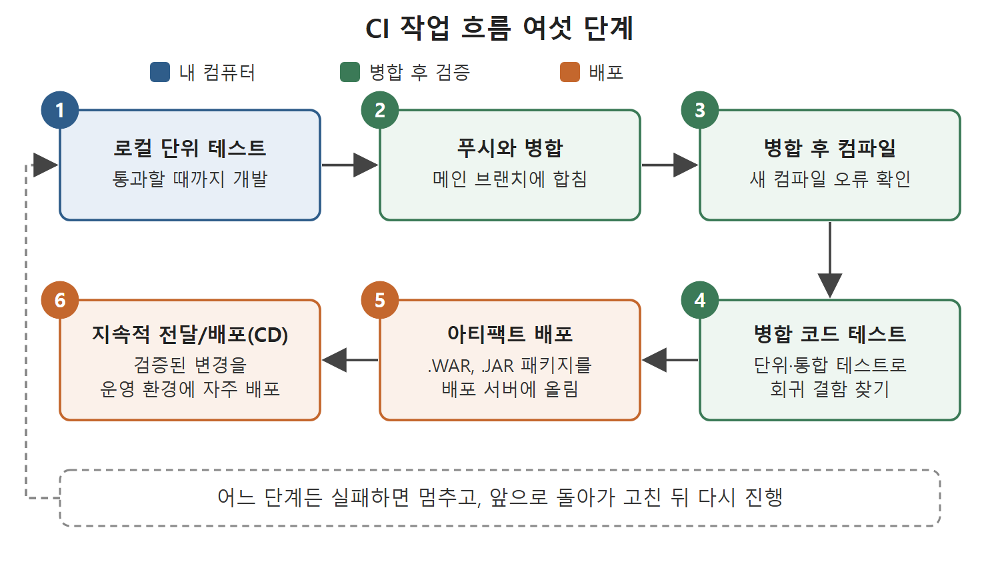

# CI 작업 흐름 여섯 단계

CI를 실제로 하면 개발자의 하루는 어떤 순서로 흘러갈까. 이 문서는 원서가 설명한 개발 작업 흐름을 로컬에서 단위 테스트를 돌리는 것부터 아티팩트(artifact, 빌드 결과물)를 배포하는 것까지 여섯 단계로 나눠 정리한다. 이어서 지속적 전달/배포(CD)가 왜 필요한지도 함께 다룬다.

공장 조립 라인에 비유하면 이해하기 쉽다. 부품을 만들고(코딩), 내 책상에서 먼저 검사하고(로컬 테스트), 조립 라인에 올리고(병합), 조립한 뒤 다시 검사하고(컴파일과 테스트), 합격품만 출하한다(배포). 각 단계가 앞 단계를 통과해야 다음으로 넘어간다.

---

## 1. 여섯 단계 한눈에 보기

| 순서 | 단계 | 하는 일 |
|---|---|---|
| 1 | 로컬에서 단위 테스트 실행 | 최신 코드를 받아 구현하고 단위 테스트가 모두 통과할 때까지 개발한다 |
| 2 | 중앙 저장소에 푸시하고 병합 | 로컬 작업을 중앙 저장소에 올려 메인 브랜치에 합친다 |
| 3 | 병합 후 컴파일 | 합쳐진 코드를 컴파일해서 새 컴파일 오류가 없는지 본다 |
| 4 | 병합된 코드에 테스트 실행 | 단위 테스트와 통합 테스트를 돌리고, 경우에 따라 정적 분석도 한다 |
| 5 | 아티팩트 배포 | 품질 검사를 통과한 코드를 패키지로 만들어 배포 서버에 올린다 |
| 6 | 지속적 전달/배포(CD) | 검증된 변경을 정기 빌드에 넣어 운영 환경에 자주 배포한다 |

원서는 앞의 다섯 가지를 소제목으로 나눠 설명하고, 여섯째인 CD는 별도 절에서 다룬다. 표의 요점은 각 단계가 이전 단계의 결과를 검증한다는 것이다. 문제가 생기면 그 단계에서 멈추고 앞으로 돌아가 고친다.

위 그림은 로컬 단위 테스트에서 지속적 전달/배포(CD)까지 여섯 단계가 이어지는 순서를 색으로 나눠 보여 준다. 점선은 어느 단계에서든 실패하면 앞으로 돌아가 고친다는 뜻이다.

## 2. 로컬에서 단위 테스트 돌리기

개발자는 중앙 저장소(central repository)에서 최신 코드를 자기 컴퓨터로 받아 온다. 이것이 자기만의 작업 복사본이다. 여기서 필요한 변경을 구현한다.

변경은 보통 테스트 주도 개발(TDD, Test-Driven Development) 방식으로 한다. 원서의 Note에 따르면 TDD는 코드를 만들기 전에 테스트 케이스부터 쓰는 방법이다. 쓴 테스트를 실행하면 기대하는 코드가 아직 없으니 당연히 실패한다. 그다음 테스트가 요구하는 대로 코드를 만들어 테스트를 통과시킨다. 작성해 둔 단위 테스트가 모두 통과할 때까지 개발과 수정이 이어진다.

## 3. 중앙 저장소에 푸시하고 병합하기

로컬에서 개발을 끝내면 코드를 중앙 저장소에 푸시(push)한다. 이 코드는 메인 브랜치에 병합(merge)된다. 이때부터 내 코드가 팀의 코드와 한 덩어리가 된다.

## 4. 병합 후 컴파일

병합이 끝난 코드는 반드시 컴파일해야 한다. 새로 개발한 코드가 기존 코드와 섞이면서 새 컴파일 오류가 생길 수 있고, 이 단계에서 그것이 드러난다. 내 컴퓨터에서는 잘 컴파일되던 코드도 다른 사람의 변경과 합쳐지면 깨질 수 있기 때문이다.

## 5. 병합된 코드에 테스트 실행

병합에 성공하면 단위 테스트와 통합 테스트를 실행한다. 목적은 회귀 결함을 찾는 것이다. 일부 CI 과정에서는 여기에 정적 분석(static analysis)도 권장한다. 정적 분석은 코드를 실행하지 않고 읽어서 검사하는 방법으로, 원서는 두 가지를 예로 든다.

| 정적 분석이 확인하는 것 | 의미 |
|---|---|
| 코딩 표준 준수 | 팀이 정한 코드 작성 규칙을 지켰는지 |
| 죽은 코드(dead code) 존재 | 어디서도 쓰이지 않는 코드가 남아 있는지 |

원서는 "등"이라고 덧붙여 이 두 가지가 전부는 아님을 시사한다.

## 6. 아티팩트 배포

코드가 여러 품질 기준을 통과하면 아티팩트를 만들어 배포 서버에 올린다. 안정적인 코드는 패키지로 묶여서 서버에 올라가고, 최종 사용자가 쓰게 된다. 아티팩트의 예로 원서는 .WAR 파일과 .JAR 파일을 든다.

## 7. 지속적 전달/배포(CD)가 필요한 이유

CI에서는 작은 변경이 개발 환경에서 테스트되고, 실패가 있으면 드러난다. 개발 환경에서 테스트하고 확인한 변경은 정기적인 빌드에 포함시키는 일이 매우 중요하다고 원서는 말한다.

그 이유는 개발 환경과 운영 환경이 다르기 때문이다. 애플리케이션이 개발 환경에서는 잘 돌아가도 운영 환경에서는 문제가 날 수 있다. 새 변경이 운영 환경의 하드웨어나 소프트웨어와 맞지 않는 경우가 대표적이다. 운영 환경에 자주 배포하지 않으면 이런 문제를 디버깅하고 해결하는 일이 악몽이 될 수 있다.

이사에 비유하면, 한 달 치 짐을 한 번에 옮기다 문제가 생기면 어느 짐 때문인지 알기 어렵다. 날마다 조금씩 옮기면 문제가 생긴 짐이 바로 보인다. 자주 배포하면 변경이 작고, 작아서 원인이 분명하다.

원서는 Continuous Delivery와 Continuous Deployment를 하나의 소제목 "Continuous Delivery/Continuous Deployment"로 함께 다룬다. 두 용어의 차이는 이 장에서 구분해 설명하지 않는다. 그래서 이 노트도 지속적 전달/배포(CD)로 묶어 부른다.

## 8. 이 문서에서 기억할 점

- 개발 흐름은 로컬 테스트, 푸시와 병합, 컴파일, 테스트, 아티팩트 배포 순서로 이어진다.
- 로컬 개발은 보통 TDD로 한다. 테스트를 먼저 쓰고, 실패를 확인한 뒤, 통과하도록 코드를 만든다.
- 병합 후에는 반드시 컴파일하고, 단위 테스트와 통합 테스트로 회귀 결함을 찾는다. 정적 분석을 더하기도 한다.
- 아티팩트는 .WAR나 .JAR 같은 배포용 결과물이다.
- 개발 환경에서 되던 것이 운영 환경에서 안 될 수 있으므로 자주 배포해야 한다.

 
 
 

[CICD Pipeline Using Jenkins Unleashed](../)
