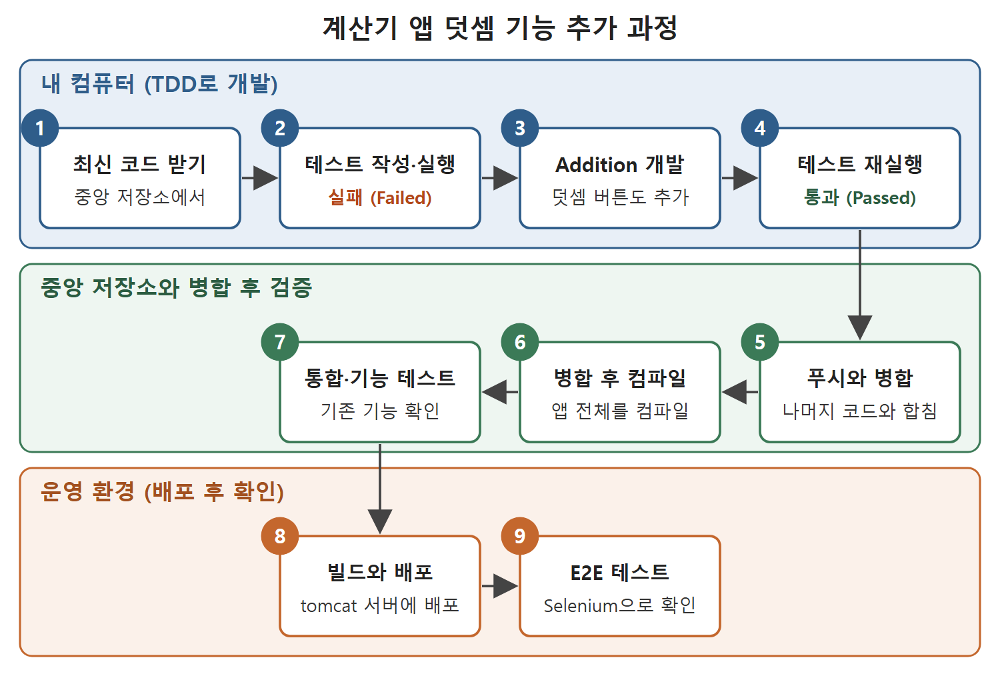

# 계산기 앱으로 보는 CI-CD 사례

앞 문서에서 본 CI/CD 작업 흐름을 구체적인 예로 따라가 보는 문서이다. 원서는 덧셈, 뺄셈, 곱셈, 나눗셈 기능이 있는 계산기 웹 애플리케이션(Calculator Web application)을 만든다고 가정한다. 그중 덧셈 기능을 새로 추가하는 과정을 처음부터 끝까지 따라간다.

원서는 이 사례에서 특정 프로그래밍 언어나 단위 테스트 도구를 가정하지 않는다고 밝힌다. 언어와 도구의 세부 사항보다 CI/CD의 개념과 흐름을 이해하는 데 집중하라는 뜻이다. 그래서 아래 코드는 어느 언어의 문법과도 정확히 일치하지 않는 설명용 의사 코드이다.

---

## 1. 사례 전체 흐름

| 순서 | 사례의 단계 | 이 단계에서 하는 일 |
|---|---|---|
| 1 | 최신 코드 받기 | 중앙 저장소에서 최신 코드를 내 컴퓨터로 받는다 |
| 2 | 단위 테스트 작성과 실행 | 덧셈 테스트를 먼저 쓰고 실행한다. 실패한다 |
| 3 | 코드 개발 | 테스트를 통과시킬 Addition 함수를 만든다 |
| 4 | 단위 테스트 재실행 | 이번에는 통과한다 |
| 5 | 푸시와 병합 | 중앙 저장소로 올려 나머지 코드와 합친다 |
| 6 | 병합 후 컴파일 | 애플리케이션 전체를 컴파일한다 |
| 7 | 병합된 코드 테스트 | 통합 테스트와 다른 기능 테스트를 돌린다 |
| 8 | 아티팩트 배포 | 웹 애플리케이션을 빌드해 운영 환경에 올린다 |
| 9 | 배포된 앱에 E2E 테스트 | UI 자동화 도구로 전체 흐름을 확인한다 |

앞 문서의 흐름에 비해 마지막에 E2E 테스트가 하나 더 붙은 것이 눈에 띈다.



위 그림은 아홉 단계가 내 컴퓨터, 중앙 저장소와 병합 후 검증, 운영 환경 중 어디에서 일어나는지 보여 준다. 처음에 실패하던 테스트가 코드를 만든 뒤 통과하는 과정도 함께 나타난다.

## 2. 최신 코드 받기

덧셈 기능을 만들려면 먼저 중앙 코드 저장소에서 최신 애플리케이션 코드를 내 컴퓨터로 받는다. 만들 기능은 두 숫자를 더해서 결과를 돌려주는 것이다.

## 3. 테스트를 먼저 쓴다

코드를 쓰기 전에 단위 테스트부터 작성한다. 이것이 TDD 방식이다. 예를 들어 Addition(10,20)을 호출하고 그 반환값이 30인지 비교하면 덧셈 기능이 제대로 동작하는지 알 수 있다. 원서의 Listing 1-1은 다음과 같다.

```
{
    Result=Addition(10,20);
    Assert.assertEquals(Result,30,"Addition functionality does not work fine with positive numbers");
}
```

이 테스트는 양수 10과 20으로 Addition 함수를 호출하고, 결과를 Result 변수에 받아서 30과 비교한다. Result가 30이면 테스트는 통과(Passed)로, 아니면 실패(Failed)로 표시된다. 코드 속 문자열은 양수로 덧셈할 때 기능이 제대로 동작하지 않는다는 실패 메시지이다.

지금은 Addition()이라는 함수가 아직 없으므로 이 테스트는 Addition(10,20) 함수가 존재하지 않는다는 오류로 실패한다. TDD에서는 기능을 구현하기 전에 테스트가 먼저 실패해야 한다. 개발자는 그 실패한 테스트를 통과시키려고 기능을 만든다. 실패하는 테스트가 있다는 것은 아직 할 일이 남았다는 신호이다.

## 4. 코드를 만들어 테스트를 통과시킨다

실패한 테스트를 통과시키려면 Addition 함수를 구현해야 한다. 원서의 Listing 1-2는 다음과 같다.

```
Addition(a,b)
{
     Result=a+b;
     return Result;
}
```

두 값 a와 b를 더한 결과를 Result에 담아 돌려주는 함수이다. 백엔드 코드와 함께 프런트엔드 코드도 바뀐다. 예를 들어 이 함수를 실행시키는 덧셈 버튼(Addition pushbutton)을 화면에 추가한다. 이제 단위 테스트를 다시 실행하면 통과한다.

## 5. 푸시, 병합, 컴파일, 테스트

| 단계 | 내용 |
|---|---|
| 푸시와 병합 | Addition 함수 코드를 중앙 저장소에 푸시해서 나머지 애플리케이션 코드와 합친다 |
| 병합 후 컴파일 | Addition() 코드가 합쳐진 뒤 애플리케이션 전체를 컴파일한다 |
| 테스트 | 통합 테스트 몇 개와 뺄셈, 곱셈 같은 다른 기능의 테스트를 돌려 새 덧셈 기능이 기존 기능을 망가뜨리지 않았는지 확인한다 |

세 번째 줄이 중요하다. 새 기능만 확인하는 것으로는 부족하고, 이미 있던 기능이 그대로 동작하는지도 함께 확인해야 한다. 이것이 회귀 결함을 잡는 과정이다.

## 6. 배포와 E2E 테스트

테스트까지 통과하면 웹 애플리케이션을 빌드해서 운영 환경의 애플리케이션 서버에 배포한다. 원서가 든 서버의 예는 tomcat이다.

배포가 끝나면 마지막으로 E2E(end-to-end, 처음부터 끝까지) 테스트를 돌린다. Selenium 같은 UI 자동화 도구로 애플리케이션의 처음부터 끝까지 흐름이 잘 동작하는지 확인한다. 사용자가 화면에서 버튼을 눌러 보는 과정을 도구가 대신해 주는 셈이다.

## 7. 테스트 종류 정리

이 사례에 나온 테스트를 종류별로 모으면 다음과 같다.

| 테스트 | 실행 시점 | 확인하는 것 |
|---|---|---|
| 단위 테스트 | 로컬 개발 중과 병합 후 | 함수 하나가 기대한 값을 돌려주는지 |
| 통합 테스트 | 병합 후 | 새 코드가 다른 부분과 함께 잘 동작하는지 |
| 다른 기능 테스트 | 병합 후 | 뺄셈, 곱셈 같은 기존 기능이 그대로인지 |
| E2E 테스트 | 배포 후 | 배포된 앱의 전체 사용 흐름이 정상인지 |

단위 테스트는 가장 작은 단위를, E2E 테스트는 가장 큰 단위를 확인한다. 뒤로 갈수록 실제 사용 환경에 가까워진다.

## 8. 이 문서에서 기억할 점

- 사례는 계산기 웹 앱에 덧셈 기능을 추가하는 과정이다.
- 테스트를 먼저 쓰면 처음엔 실패한다. 함수를 구현하면 통과한다.
- 병합 뒤에는 컴파일과 함께 기존 기능의 테스트까지 돌려 회귀를 막는다.
- 배포 후에는 Selenium 같은 도구로 E2E 테스트를 한 번 더 한다.
- 이 장은 특정 언어나 도구를 가정하지 않고 흐름만 설명한다.

<br>
<br>
<br>

[CICD Pipeline Using Jenkins Unleashed](../)
