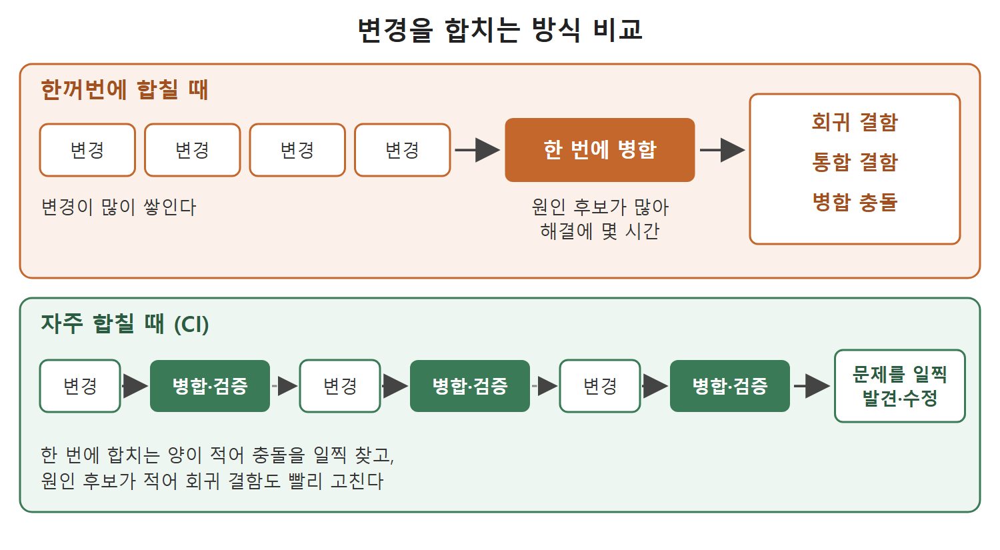

# 애자일과 CI가 필요한 이유

CI/CD를 이해하려면 먼저 CI/CD가 왜 생겼는지 알아야 한다. 이 문서는 애자일(Agile, 요구사항을 작게 나눠 짧은 주기로 반복 개발하는 방식) 개발에서 코드 변경이 얼마나 자주, 얼마나 많이 생기는지, 그 변경을 한꺼번에 합치면 어떤 문제가 생기는지, 그래서 지속적 통합(CI)이 어떤 방식으로 문제를 줄이는지를 정리한다.

비유부터 들어 보자. 여러 사람이 한 문서를 같이 쓰는 상황을 떠올려 본다. 각자 자기 파일로 일주일 동안 쓰다가 마지막 날 한꺼번에 합치면 문단이 겹치고 표현이 충돌해서 합치는 데만 한나절이 걸린다. 반대로 하루에도 몇 번씩 조금씩 합치면 충돌이 생겨도 그 자리에서 바로 고칠 수 있다. CI는 후자의 방식을 코드에 적용한 것이다.

---

## 1. 애자일 개발과 스프린트

원서는 CI/CD가 현실의 소프트웨어 개발에 어떤 영향을 줬는지 설명하면서 시작한다. 요즘 애플리케이션 개발은 대부분 애자일 개발 주기를 쓰고, 그래서 애플리케이션 코드가 자주 바뀌는 것이 보통이다.

애자일에서는 전체 요구사항을 우선순위가 매겨진 여러 묶음으로 나눈다. 그리고 한 번에 한 묶음씩 구현한다. 한 묶음을 작업하는 기간을 스프린트(sprint)라고 한다. 스프린트는 요구사항을 검토하는 단계부터 애플리케이션에 최종 반영하는 단계까지를 한 번에 돌린다. 보통 1~3주 길이이고, 애플리케이션은 스프린트가 끝날 때마다 조금씩 자란다. 짧은 기간에 기능이 꽤 많이 늘어난다는 점이 중요하다.

원서는 애자일과 다른 개발 방식을 비교하는 Note를 붙여 두었다. 핵심만 표로 정리하면 다음과 같다.

| 구분 | 애자일 | RAD 같은 다른 모델 |
|---|---|---|
| 작업 방식 | 개발자, 테스터, 비즈니스 분석가가 같은 요구사항 묶음을 동시에 작업한다 | 사람마다 서로 다른 요구사항을 맡는다 |
| 작업 순서 | 한 묶음을 모두가 함께 끝낸다 | 앞사람이 끝낸 결과를 뒷사람이 이어받는다 |
| 예시 | 같은 스프린트 안에서 분석, 개발, 테스트가 함께 진행된다 | 테스터는 개발자가 끝낸 기능을 테스트하고, 개발자는 분석가가 끝낸 요구사항을 개발한다 |

표를 읽는 법은 간단하다. 애자일은 모두가 같은 묶음을 동시에 다루는 방식이고, RAD는 릴레이처럼 사람마다 다른 것을 맡는 방식이다. RAD는 Rapid Application Development의 약자이며, 원서는 다른 모델의 예로 이것만 든다.

## 2. 한꺼번에 합칠 때 생기는 문제

스프린트 동안 여러 개발자가 같은 애플리케이션을 만진다. 하루 사이에도 여러 개발자가 맡은 기능을 끝내고 변경 내용을 메인 브랜치(main branch)에 커밋한다. 메인 브랜치는 빌드를 만들 때 기준이 되는 코드 줄기이다. GitLab에서는 보통 master 브랜치, GitHub에서는 main 브랜치라고 부른다.

문제는 이 변경을 한꺼번에 합칠 때 생긴다. 원서가 꼽은 문제는 세 가지이고, 이를 찾아서 고치는 데 몇 시간씩 걸릴 수 있다고 한다.

| 문제 | 쉬운 설명 |
|---|---|
| 회귀 결함(regression defect) | 새 코드를 넣었더니 잘 되던 기존 기능이 망가지는 문제 |
| 통합 결함(integration defect) | 각자 만든 부분은 멀쩡한데 서로 합치면 맞물리지 않는 문제 |
| 병합 충돌(merge conflict) | 둘 이상이 같은 부분을 고쳐서 버전 관리 도구가 자동으로 합치지 못하는 문제 |

한꺼번에 합칠수록 변경이 많이 쌓이고, 변경이 많을수록 어디서 문제가 시작됐는지 찾기가 어려워진다는 것이 이 표의 요점이다.

## 3. 지속적 통합(CI)이라는 해법

이 문제를 피하려고 애자일에서는 지속적 통합(Continuous Integration, CI)을 한다. CI에서는 개발자가 끝낸 작업을 하루가 끝날 때나 스프린트가 끝날 때까지 기다리지 않고 메인 브랜치에 자주 합친다.

한 번에 합치는 변경이 적으면 두 가지 이점이 생긴다.

- 병합 충돌을 더 일찍 발견해서 해결할 수 있다.
- 회귀 결함을 더 빠르고 효율적으로 찾아 고칠 수 있다.

변경이 작으면 원인이 될 만한 후보도 적다. 그래서 같은 문제라도 고치는 데 드는 시간이 크게 줄어든다.

| 비교 항목 | 한꺼번에 합칠 때 | 자주 합칠 때(CI) |
|---|---|---|
| 한 번에 합치는 양 | 많다 | 적다 |
| 병합 충돌 발견 시점 | 늦다 | 이르다 |
| 문제 원인 찾기 | 후보가 많아 오래 걸린다 | 후보가 적어 빠르다 |

위 그림은 변경을 한꺼번에 합치면 회귀 결함, 통합 결함, 병합 충돌이 한 번에 터지고, 변경을 자주 합치면 문제를 그때그때 발견해 고칠 수 있음을 나란히 보여 준다.

## 4. 이 문서에서 기억할 점

- 애자일은 스프린트 단위로 기능을 조금씩 쌓기 때문에 코드 변경이 잦다.
- 변경을 한꺼번에 합치면 회귀 결함, 통합 결함, 병합 충돌이 생기고 해결에 몇 시간이 걸린다.
- CI는 변경을 적게, 자주 합쳐서 문제를 일찍 발견하고 빨리 고치는 방식이다.
- 메인 브랜치는 빌드의 기준이 되는 브랜치이며 GitLab에서는 master, GitHub에서는 main이라는 이름을 주로 쓴다.

 
 
 

[CICD Pipeline Using Jenkins Unleashed](../)
