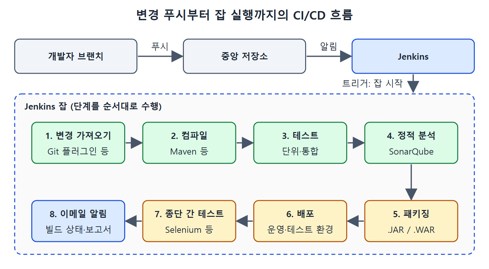

# 젠킨스 아키텍처와 잡의 흐름

이 문서는 개발자와 테스터가 Jenkins를 쓰는 전형적인 CI/CD 흐름을 따라간다. 변경이 저장소에 올라온 순간부터 Jenkins가 잡(작업)을 실행하고 이메일로 결과를 알리기까지의 과정이다. 또 Jenkins를 쓰기 전과 쓴 후에 문제를 찾는 방식이 어떻게 달라지는지도 비교한다.

택배 물류에 빗대면, 개발자가 물건(변경)을 집하장(중앙 저장소)에 맡기면 알림이 가고, 분류 라인(잡)이 검수·포장·발송을 차례로 처리한 뒤 담당자에게 결과를 알려 주는 모양이다.

---

## 1. 전형적인 CI/CD 흐름

원문은 이 흐름을 세 토막으로 나눈다. 앞의 두 토막은 Jenkins가 일을 시작하는 계기이고, 세 번째가 잡 실행이다.

1. 여러 개발자가 각자 브랜치(작업 갈래)에 변경을 담아 중앙 저장소에 푸시(올리기)한다. 코드 리뷰를 거친 뒤 이 브랜치들은 보통 개발용 브랜치 같은 다른 브랜치에 합쳐진다.
2. 브랜치에 변경이 생겼다는 알림이 Jenkins에 도착한다.
3. 알림을 받은 Jenkins가 잡을 시작한다(트리거).

잡은 빌드 릴리스 생명주기의 여러 단계를 순서대로 수행하도록 엮은 작업과 하위 작업의 묶음이다. 파이프라인이 "설계도"라면, 잡은 그 설계도를 따라 실제로 도는 "한 번의 가동"에 가깝다.

### 잡이 하는 여덟 단계

원문이 예로 드는 전형적인 잡은 다음 순서를 따른다.

| 순서 | 하는 일 | 쓰는 도구(원문 예) |
| --- | --- | --- |
| 1 | 저장소에서 변경을 가져온다 | Git 플러그인 같은 SCM 연동 플러그인 |
| 2 | 변경을 컴파일한다 | Maven 같은 빌드 도구와 Maven 플러그인 |
| 3 | 컴파일한 코드로 단위·통합 테스트를 돌린다 | 같은 빌드 도구 |
| 4 | 정적 분석으로 코딩 표준 위반과 쓰이지 않는 코드(데드 코드)를 검사한다 | SonarQube, Jenkins 플러그인으로 실행 |
| 5 | 컴파일하고 테스트한 파일을 .JAR이나 .WAR 같은 라이브러리 파일로 묶는다 | 빌드 도구, Jenkins 플러그인으로 실행 |
| 6 | 만들어진 라이브러리 파일을 운영 또는 테스트 환경에 배포한다 | 원문에 도구 언급 없음 |
| 7 | 배포된 애플리케이션에 종단 간(End-to-End) 테스트를 돌린다 | Selenium, Protractor 같은 UI 자동화 도구 |
| 8 | 새로 만든 빌드의 상태를 팀원에게 이메일로 알린다. 종단 간 테스트 보고서를 포함한다 | 이메일 알림 |

표를 읽을 때 유의할 점이 있다. 1~5번은 도구마다 맞는 플러그인을 거쳐 Jenkins가 호출한다. 6번 배포는 원문에서 구체적인 도구를 꼽지 않았다. 7번의 종단 간 테스트는 사용자가 화면에서 하는 동작을 처음부터 끝까지 흉내 내는 테스트다.

.JAR은 Java 클래스를 묶은 파일이고, .WAR는 웹 애플리케이션을 묶은 파일이다. 둘 다 뒤 단계에서 배포하는 아티팩트가 된다.

위 그림은 개발자 브랜치의 변경이 중앙 저장소를 거쳐 Jenkins에 알림으로 전달되고, 트리거된 잡이 여덟 단계를 순서대로 수행한 뒤 이메일로 결과를 알리는 과정을 보여 준다.

---

## 2. Jenkins 이전과 이후

Jenkins가 나오기 전에는 통합 테스트를 늦게 했다. 모든 개발자의 변경이 받아들여져 브랜치에 합쳐지고 빌드가 만들어진 뒤에야 했다. 통합 테스트와 종단 간 테스트도 아티팩트로 만들 전체 애플리케이션 코드를 대상으로 했다. 이때 회귀 테스트(고친 뒤에 예전 기능이 멀쩡한지 보는 테스트)에서 버그가 나오면 근본 원인을 찾기가 쉽지 않았다. 빌드 오류의 위치를 찾고 고치는 일도 시간이 많이 걸려 소프트웨어 전달이 늦어졌다.

Jenkins를 쓰면 모든 변경이 구현되는 대로 단위 테스트를 거치고, 성공했을 때 브랜치에 합쳐진다. 합쳐진 뒤에는 통합 결함이 있는지 테스트한다.

| 구분 | Jenkins 이전 | Jenkins 이후 |
| --- | --- | --- |
| 통합 테스트 시점 | 모든 변경이 합쳐지고 빌드가 만들어진 뒤 | 변경이 합쳐질 때마다 |
| 테스트 대상 범위 | 아티팩트가 될 전체 애플리케이션 코드 | 마지막 성공 빌드 이후 추가된 변경 |
| 버그 원인 찾기 | 근본 원인을 찾기 어려움 | 현재 빌드에 합쳐진 변경을 의심 |
| 빌드 오류 수정 | 위치를 찾고 고치는 데 시간이 걸려 전달이 지연 | 마지막 성공 빌드 이후 추가된 파일만 확인 |

이 표의 마지막 행은 원문이 직접 하나하나 적은 문장이 아니라, 앞 문장들을 정리한 해석이다. 원문이 말한 것은 두 가지다. 배포 단계에서 오류가 나면 마지막 성공 빌드 이후 모든 개발자가 추가한 파일만 확인하면 된다. 마찬가지로 통합 테스트에서 새 빌드의 버그가 나오면, 그 빌드에 구현되어 합쳐진 변경이 원인 후보가 된다.

Jenkins가 테스트, 컴파일, 배포 같은 생명주기 단계를 자주 실행하기 때문에, 이렇게 조금씩 쌓는 변경이 하나의 정해진 절차로 자리 잡았다. 한 번에 몰아서 확인하던 방식에서, 범위가 좁은 작은 확인을 자주 하는 방식으로 바뀐 것이다.

 
 
 

[CICD Pipeline Using Jenkins Unleashed](../)
