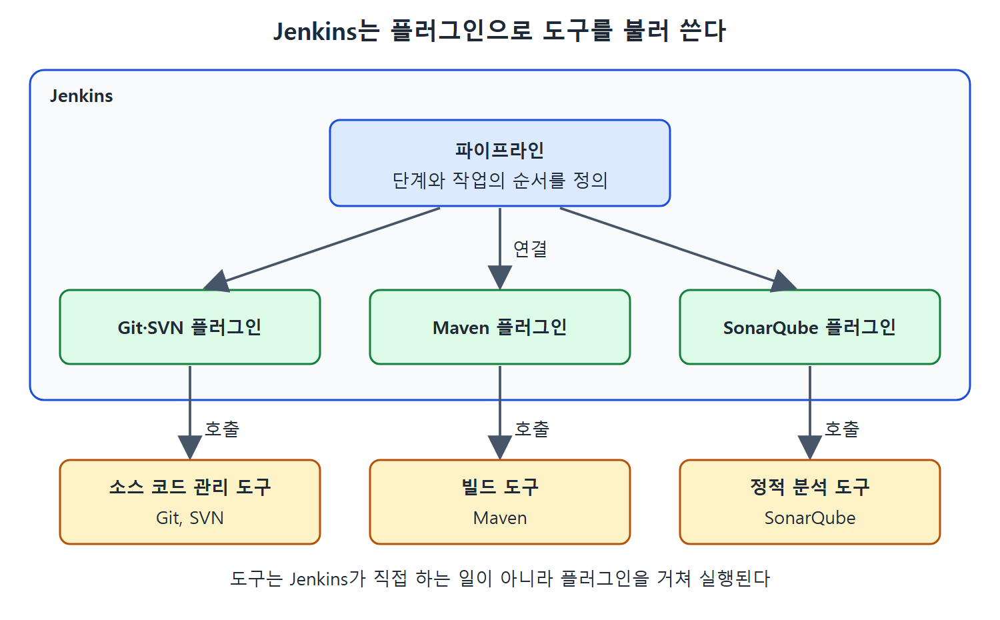
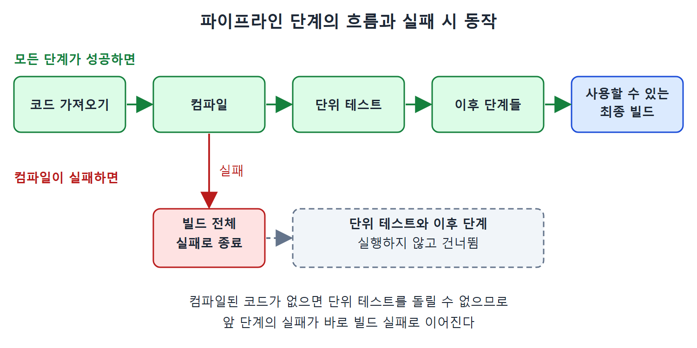

# 젠킨스로 CI/CD 구현하기

이 문서는 Jenkins가 CI/CD를 어떻게 실제 작업으로 옮기는지 정리한다. 핵심 개념은 빌드 생명주기 단계, 플러그인, 그리고 파이프라인이다. 마지막에는 앞 단계가 실패하면 뒤 단계가 어떻게 되는지도 다룬다.

공장의 조립 라인을 떠올리면 이해가 빠르다. 부품이 1번 공정에서 2번 공정으로, 다시 3번 공정으로 넘어가며 완제품이 된다. 1번 공정에서 불량이 나면 2번 공정은 돌릴 이유가 없다. Jenkins가 하는 일이 바로 이 라인을 설계하고 가동하는 일이다.

---

## 1. CI/CD가 하는 일

CI/CD는 애플리케이션 코드의 변경을 코드 수준에서부터 끝까지 검증하는 과정이다. 아무리 작은 변경이라도 빌드 생명주기 전체를 거친다. 그리고 실행 파일이나 라이브러리 형태로 만들어져 운영(프로덕션) 환경에 배포될 때까지 이어진다.

이 과정은 서로 의존하는 여러 생명주기 단계로 이루어진다. 정해진 순서대로 밟아 가면 날것의 소스 코드가 실제로 쓸 수 있는 애플리케이션으로 바뀐다. 순서가 중요한 이유는 각 단계가 앞 단계의 결과를 받아야 하기 때문이다.

---

## 2. DSL과 플러그인

Jenkins는 이 빌드 생명주기 단계를 DSL(Domain Specific Language, 특정 분야 전용 언어)로 구현하도록 지원한다. DSL은 범용 프로그래밍 언어와 달리, 빌드 자동화처럼 한 분야의 일을 표현하는 데 맞춘 언어다.

애플리케이션을 여러 빌드 단계에 태우려면 서로 다른 종류의 도구가 필요하다.

| 도구 종류 | 이 책에 나온 예 |
| --- | --- |
| 소스 코드 관리 도구 | Git, SVN |
| 빌드 도구 | Maven |
| 정적 분석 도구 | SonarQube |

Jenkins는 플러그인(기능을 덧붙이는 확장 모듈)을 아주 많이 제공한다. 덕분에 어떤 애플리케이션이든 처음부터 끝까지 빌드 생명주기 단계를 구현할 수 있다. 도구마다 맞는 플러그인을 꽂아 Jenkins와 연결하는 방식이다.

위 표의 도구들은 모두 Jenkins가 직접 하는 일이 아니다. Jenkins는 플러그인을 통해 이 도구들을 불러서 쓴다는 점을 기억해 두면 좋다.

위 그림은 Jenkins 안의 파이프라인이 플러그인을 통해 소스 코드 관리 도구, 빌드 도구, 정적 분석 도구를 각각 호출하는 구조를 보여 준다.

---

## 3. 파이프라인

Jenkins 스크립트를 쓰면 빌드의 각 단계에서 Jenkins가 수행할 작업과 하위 작업의 순서를 정의할 수 있다. 이 스크립트를 파이프라인이라고 부른다.

파이프라인에서 각 단계는 순서대로 실행된다. 앞 단계가 낸 결과물을 받아 자기 몫의 처리를 하고, 그 결과를 다음 단계로 넘긴다. 이 의존 단계들이 처음부터 끝까지 다 돌면 최종 사용자가 쓸 수 있는 빌드가 만들어진다.

### 단계가 실패하면

어느 한 단계가 실패하면, 그 단계의 결과에 기대는 뒤 단계는 실행되지 않고 빌드 전체가 실패로 끝난다.

예를 들어 Git 같은 SCM(소스 코드 관리 도구)에서 합쳐진 최신 코드를 받아 왔는데 컴파일이 실패했다고 하자. 단위 테스트는 컴파일에 성공한 코드가 있어야 돌릴 수 있다. 그러므로 다음 단계인 단위 테스트로 넘어가 봐야 의미가 없다.

| 상황 | 결과 |
| --- | --- |
| 모든 단계가 성공 | 최종 사용자가 쓸 수 있는 빌드가 생성됨 |
| 중간 단계가 실패 | 그 결과에 의존하는 뒤 단계는 건너뛰고 빌드 전체가 실패 |
| 컴파일 실패 예 | 컴파일된 코드가 필요한 단위 테스트는 실행하지 않음 |

이 표의 핵심은 "실패는 앞에서 빨리 알려 준다"이다. 쓸모없는 뒤 단계를 돌리느라 시간을 쓰지 않는다. 그래서 문제를 일찍 발견하고 원인도 가까운 곳에서 찾을 수 있다.

위 그림은 모든 단계가 성공하면 최종 빌드가 만들어지고, 컴파일이 실패하면 단위 테스트와 이후 단계를 건너뛴 채 빌드 전체가 실패로 끝나는 흐름을 보여 준다.

 
 
 

[CICD Pipeline Using Jenkins Unleashed](../)
