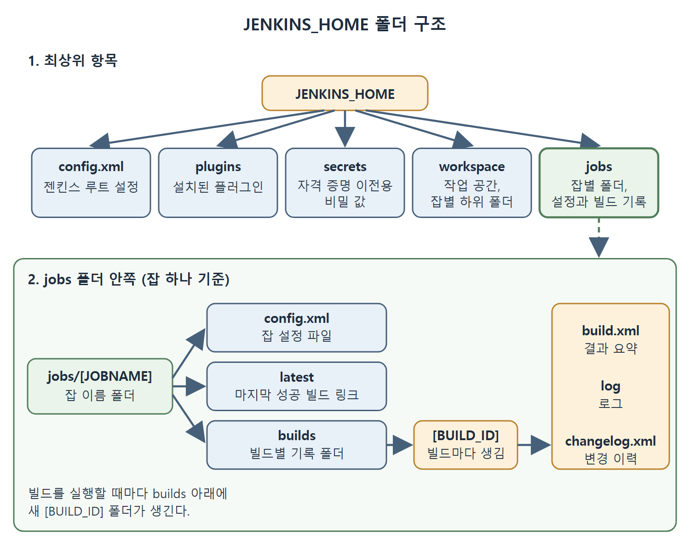

# JENKINS_HOME 디렉터리 구조

젠킨스를 설치하고 나면 설정, 플러그인, 잡, 빌드 기록이 모두 한 폴더 아래에 쌓인다. 이 폴더를 JENKINS_HOME이라고 부른다. 이 문서는 원서가 보여 주는 JENKINS_HOME의 기본 위치와 폴더 구조를 항목별로 풀어 쓴다.

JENKINS_HOME은 집으로 치면 서랍장 전체와 같다. 어느 서랍에 무엇이 들어 있는지 알아 두면 설정을 옮기거나 문제를 찾을 때 훨씬 수월하다.

---

## 1. 기본 설치 위치

젠킨스는 기본적으로 현재 사용자의 홈 디렉터리($user.home) 안에 있는 .jenkins 폴더에 설치된다. 원서는 이 위치를 아래처럼 정리한다.

| 설치 방식 | 설치되는 위치 |
|-----------|---------------|
| 기본값 | 현재 사용자 홈 디렉터리 안의 .jenkins 폴더 |
| .msi 파일로 설치 | 설치할 때 직접 고른 설치 디렉터리 |

표를 읽는 법은 간단하다. 아무 설정도 하지 않았다면 사용자 홈 아래 .jenkins를 찾으면 되고, MSI 마법사에서 경로를 골랐다면 그 경로가 곧 설치 위치다. 원서는 이 설치 디렉터리를 JENKINS_HOME이라고도 부른다고 밝힌다.

---

## 2. 폴더 구조 한눈에 보기

원서의 Listing 3-1은 JENKINS_HOME 아래의 구조를 나뭇가지 모양으로 보여 준다. 먼저 최상위 항목이다.

```text
JENKINS_HOME
 +- config.xml
 +- *.xml
 +- userContent
 +- fingerprints
 +- nodes
 +- plugins
 +- secrets
 +- workspace
 +- jobs
```

그리고 workspace와 jobs 안쪽은 아래처럼 이어진다.

```text
workspace
 +- [JOBNAME]
jobs
 +- [JOBNAME]
     +- config.xml
     +- latest
     +- builds
         +- [BUILD_ID]
             +- build.xml
             +- log
             +- changelog.xml
```

위 코드는 원서 목록의 핵심 줄만 옮긴 것이다. [JOBNAME]은 잡 이름이 들어가는 자리이고 [BUILD_ID]는 빌드마다 붙는 번호 자리다.

### 최상위 항목의 역할

| 항목 | 들어 있는 것 |
|------|--------------|
| config.xml | 젠킨스 루트 설정 |
| *.xml | 그 밖의 사이트 전체 설정 파일 |
| userContent | 이 폴더의 파일은 http://server/userContent/ 주소로 제공됨 |
| fingerprints | 핑거프린트(fingerprint) 기록 |
| nodes | 에이전트(노드) 설정. 원서는 slave 설정이라고 표기 |
| plugins | 설치된 플러그인 |
| secrets | 자격 증명을 다른 서버로 옮길 때 필요한 비밀 값 |
| workspace | 버전 관리 시스템용 작업 디렉터리. 잡별 하위 폴더가 있음 |
| jobs | 잡별 폴더. 설정과 빌드 기록이 들어 있음 |

표를 보면 설정 파일(config.xml 등), 확장 기능(plugins), 보안 값(secrets), 실행 공간(workspace), 이력(jobs)이 폴더 단위로 나뉘어 있음을 알 수 있다. 다른 서버로 젠킨스를 옮길 때 자격 증명을 쓰려면 secrets가 필요하다는 점이 눈에 띈다.

`workspace`는 소스 코드를 받아 와 빌드하는 작업 공간(워크스페이스)이다. 그 안에 잡 이름마다 하위 폴더가 따로 만들어진다.



그림은 JENKINS_HOME 아래 최상위 항목과, 그중 jobs 폴더 안에서 잡 설정, 마지막 성공 빌드 링크, 빌드별 기록이 이어지는 구조를 보여 준다.

---

## 3. jobs 폴더 안쪽

jobs 아래에는 잡마다 폴더가 하나씩 있고, 그 안에 다시 아래 항목이 있다.

| 경로 | 설명 |
|------|------|
| config.xml | 해당 잡의 설정 파일 |
| latest | 마지막으로 성공한 빌드를 가리키는 심볼릭 링크 |
| builds | 빌드별 기록을 담는 폴더 |
| builds/[BUILD_ID]/build.xml | 빌드 결과 요약 |
| builds/[BUILD_ID]/log | 로그 파일 |
| builds/[BUILD_ID]/changelog.xml | 변경 이력 |

심볼릭 링크(symbolic link)는 다른 파일이나 폴더를 가리키는 바로가기다. latest는 바탕화면 바로가기처럼 가장 최근에 성공한 빌드 폴더로 연결된다고 이해하면 된다.

빌드가 실행될 때마다 builds 아래에 새 [BUILD_ID] 폴더가 생기고, 그 안에 결과 요약, 로그, 변경 이력이 남는다. 빌드가 왜 실패했는지 확인하려면 해당 빌드의 log를 보면 된다는 의미다.

---

## 4. 이 문서의 핵심

- 기본 설치 위치는 사용자 홈의 .jenkins 폴더이고, MSI 설치는 직접 고른 폴더다.
- 이 설치 디렉터리를 JENKINS_HOME이라 부른다.
- 최상위에는 설정(config.xml), 플러그인(plugins), 비밀 값(secrets), 작업 공간(workspace), 잡 기록(jobs) 등이 있다.
- 잡 폴더에는 잡 설정(config.xml), 마지막 성공 빌드 링크(latest), 빌드별 기록(builds)이 있다.

<br>
<br>
<br>

[CICD Pipeline Using Jenkins Unleashed](../)
