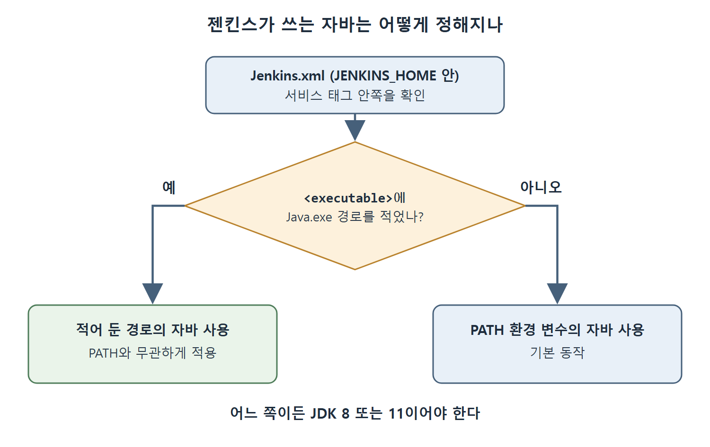

# Jenkins.xml과 자바 지정

윈도에서 젠킨스를 서비스로 설치하면 Jenkins.xml이라는 설정 파일이 함께 생긴다. 이 파일에는 젠킨스가 어떤 자바로 실행될지를 비롯한 중요한 값이 들어 있다. 이 문서는 원서가 설명하는 Jenkins.xml의 위치와 역할, 그리고 사용할 자바 버전을 바꾸는 방법을 정리한다.

자바가 여러 개 깔린 컴퓨터에서는 젠킨스가 어느 자바를 잡느냐가 곧 동작 여부를 좌우한다. 앞 문서에서 본 대로 젠킨스는 JDK 8과 11만 지원하므로, 이 파일에서 자바를 지정하는 방법을 알아 두면 유용하다.

---

## 1. Jenkins.xml의 위치와 핵심 태그

원서는 Jenkins.xml이 JENKINS_HOME 디렉터리 안에 있다고 설명한다. 파일을 열면 서비스 정의 태그가 보이는데, 이 태그에 젠킨스가 쓰는 중요한 설정이 모여 있다. 대표 항목이 Java.exe의 위치다.

| 항목 | 내용 |
|------|------|
| 파일 이름 | Jenkins.xml |
| 위치 | JENKINS_HOME 디렉터리 안 |
| 살펴볼 태그 | 서비스 태그(원서 표기는 Service) |
| 대표 설정 | 젠킨스가 사용하는 Java.exe의 위치 |

표처럼 이 파일은 "젠킨스가 어떤 java.exe를 실행하는가"를 알려 주는 곳이다. 참고로 원서는 본문에서 `<Service>`와 `<service>`로 대소문자를 섞어 쓴다. XML 태그는 대소문자를 구분하는 것이 일반적이므로 실제 파일을 열어 정확한 표기를 확인하는 편이 안전하다. 원서는 이 점을 따로 설명하지 않는다.

---

## 2. 기본 동작과 자바 바꾸기

### 2-1. 기본값은 PATH의 자바

기본적으로 젠킨스는 PATH 환경 변수에 적힌 자바를 가져다 쓴다. PATH는 윈도가 실행 파일을 찾을 때 훑어보는 폴더 목록이다. 원서의 Figure 3-1은 환경 변수 편집 창에서 PATH에 자바 경로가 추가된 모습을 보여 준다.

즉 별도 지정이 없으면 PATH에서 먼저 발견되는 자바가 쓰인다고 이해하면 된다(어느 항목이 우선하는지는 원서에 자세한 설명이 없다).

### 2-2. 원하는 자바로 바꾸는 방법

젠킨스가 다른 버전의 자바를 쓰게 하고 싶다면 아래 순서로 한다.

1. JENKINS_HOME 안의 Jenkins.xml 파일을 연다.
2. 서비스 태그 안쪽의 `<executable>` 태그를 찾는다.
3. 원하는 자바 설치 폴더에 있는 Java.exe의 전체 경로를 이 태그에 적는다.

원서의 Figure 3-2는 이 `<executable>` 태그에 자바 경로를 적은 모습을 보여 준다. 그림의 구체적인 경로 값은 추출본에 담겨 있지 않아 여기서는 옮기지 않는다.

```xml
<service>
  <executable>자바 전체 경로\Java.exe</executable>
</service>
```

위 코드는 구조만 보여 주는 개념 예시이며 원서의 코드를 그대로 옮긴 것이 아니다. `<executable>` 안에는 실제 설치된 Java.exe의 전체 경로를 적는다.

| 상황 | 젠킨스가 쓰는 자바 |
|------|--------------------|
| `<executable>`에 경로를 적지 않음 | PATH 환경 변수에 등록된 자바 |
| `<executable>`에 Java.exe 전체 경로를 적음 | 그 경로의 자바 |

표에서 보듯 경로를 명시하면 PATH와 무관하게 지정한 자바가 쓰인다. 여러 JDK를 함께 설치한 머신에서 JDK 8이나 11을 확실히 쓰게 하고 싶을 때 이 방법이 쓸모 있다.



그림은 Jenkins.xml의 `<executable>`에 경로를 적었으면 그 자바를, 적지 않았으면 PATH 환경 변수의 자바를 쓴다는 판단 흐름을 보여 준다.

---

## 3. 이 문서의 핵심

- Jenkins.xml은 JENKINS_HOME 안에 있으며, 서비스 태그에 Java.exe 위치 같은 핵심 설정이 있다.
- 기본값은 PATH 환경 변수에 등록된 자바다.
- 다른 자바를 쓰려면 서비스 태그 안의 `<executable>`에 원하는 Java.exe의 전체 경로를 적는다.

<br>
<br>
<br>

[CICD Pipeline Using Jenkins Unleashed](../)
