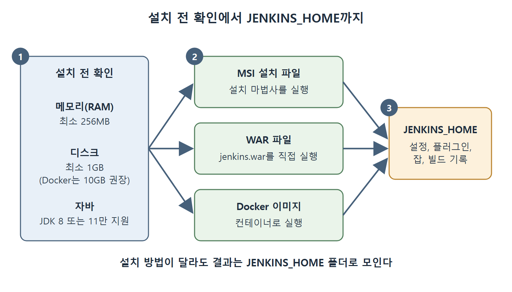

# 설치 요구 사항과 세 가지 방법

젠킨스(Jenkins)를 설치하기 전에는 컴퓨터가 최소 사양을 갖췄는지, 자바(Java) 버전이 맞는지 먼저 확인해야 한다. 이 문서는 원서가 제시하는 하드웨어와 소프트웨어 요구 사항, 그리고 윈도(Windows)에서 젠킨스를 설치하는 세 가지 방법을 정리한다.

비유하자면 새 가전제품을 들이기 전에 콘센트 규격과 놓을 자리를 확인하는 일과 같다. 사양이 맞지 않으면 설치 단계에서 막히고, 그러면 이후 장의 실습도 따라갈 수 없다.

---

## 1. 설치 전에 확인할 요구 사항

원서는 젠킨스를 설치할 머신에 필요한 최소 조건을 아래처럼 제시한다.

| 구분 | 항목 | 원서가 말하는 기준 |
|------|------|--------------------|
| 하드웨어 | 메모리(RAM) | 최소 256MB |
| 하드웨어 | 디스크 | 최소 1GB (Docker 컨테이너로 돌릴 때는 10GB 권장) |
| 소프트웨어 | 자바 | JDK 8과 JDK 11만 지원 |

표를 읽는 법은 단순하다. 하드웨어는 어디까지나 "최소" 기준이라 실제 작업을 많이 돌리면 더 필요할 수 있다. 다만 원서는 최소치 외의 권장 수치를 따로 제시하지 않는다. 디스크만은 Docker로 돌릴 때 10GB를 권한다.

### 자바 버전 주의점

젠킨스는 자바로 만든 프로그램이라 자바 개발 키트(JDK, Java Development Kit)가 먼저 깔려 있어야 한다. 원서가 강조하는 내용은 다음과 같다.

- 지원하는 버전은 JDK 8과 JDK 11뿐이다.
- JDK 11은 젠킨스 2.164, 2.164.1 버전부터 지원된다.
- 그보다 오래된 자바 버전은 지원하지 않는다.

즉 JDK 8이나 11이 아니면 젠킨스가 제대로 동작하리라고 기대하면 안 된다. 원서는 이후 장의 실습을 따라가려면 여기서 말한 버전의 자바와 다른 소프트웨어를 반드시 갖추라고 당부한다.

그림은 요구 사항을 확인한 뒤 MSI, WAR, Docker 중 한 방법을 골라 설치하면 어느 쪽이든 결과가 JENKINS_HOME 폴더로 모인다는 흐름을 보여 준다.

---

## 2. 윈도에서 설치하는 세 가지 방법

원서는 윈도에서 젠킨스를 설치하는 방법을 세 가지로 나눈다. 각 방법의 설치 절차는 원서가 공식 문서 링크로 안내하며, 본문에서 세부 단계를 풀어 쓰지는 않는다.

| 방법 | 형태 | 안내 주소 |
|------|------|-----------|
| MSI 설치 파일 | 설치 마법사를 실행해 설치 | www.jenkins.io/doc/book/installing/windows/ |
| WAR 파일 | 자바 웹 애플리케이션 묶음을 직접 실행 | www.jenkins.io/doc/book/installing/war-file/ |
| Docker 이미지 | 컨테이너로 실행 | www.jenkins.io/doc/book/installing/docker/ |

표를 보면 세 방법 모두 공식 사이트(jenkins.io)의 설치 안내를 따르라는 구조다. 어떤 방법을 고르느냐는 환경에 달렸다. 윈도에서 가장 익숙한 방식은 MSI이고, 자바만 있으면 바로 띄울 수 있는 방식은 WAR이며, 환경을 통째로 격리하고 싶으면 Docker가 맞다는 식으로 이해하면 된다(이 선택 기준은 이해를 돕기 위한 정리이며 원서의 표현은 아니다).

### 2-1. MSI 설치 파일로 설치

MSI는 윈도용 설치 프로그램 형식이다. 설치 과정을 마법사가 안내하므로 처음 시작하는 사람에게 가장 무난하다.

1. 젠킨스 공식 사이트에서 MSI 설치 파일(www.jenkins.io/download/thank-you-downloading-windows-installer)을 내려받는다.
2. 파일을 실행해 설치 마법사를 시작한다.
3. 공식 문서(www.jenkins.io/doc/book/installing/windows/)에 적힌 단계를 따라 진행한다.

원서의 요약 부분은 MSI로 설치한 뒤 젠킨스를 윈도 서비스로 시작하는 흐름도 함께 언급한다. 서비스 방식과 WAR 방식으로 서버를 띄우는 방법은 다음 장에서 이어진다.

### 2-2. WAR 파일로 설치

WAR(Web Application Archive)는 자바로 만든 웹 애플리케이션을 하나로 묶은 파일이다. 젠킨스도 자바로 작성되어 있으므로 이 묶음 파일을 통해 서버를 실행할 수 있다.

1. 젠킨스 WAR 파일을 내려받는다. 원서가 예로 든 주소는 get.jenkins.io/war/2.290/jenkins.war 이다.
2. 공식 문서(www.jenkins.io/doc/book/installing/war-file/)의 절차대로 실행한다.

참고로 원서가 예로 든 주소의 버전은 2.290이다. 내려받을 때는 그 시점의 버전을 확인하는 편이 좋다.

### 2-3. Docker 이미지로 설치

원서는 Docker 개념 전체를 설명하는 것은 이 책의 범위를 벗어난다고 선을 긋고, 쉬운 말로만 소개한다.

- Docker는 애플리케이션을 빌드하고 배포하는 도구다.
- 코드와 그 코드가 필요로 하는 의존성(함께 있어야 돌아가는 것들)을 컨테이너라는 배포 단위로 묶는 발상에 기반한다.
- 물리적인 머신 대신, 소프트웨어로 운영체제를 흉내 낸 가상 시스템을 쓰는 방식과 닿아 있으며 아주 가벼운 개념이다.
- 애플리케이션 설정을 코드로 적어 둘 수도 있다. 이를 코드형 인프라(Infrastructure as Code)라고 한다.

도시락통에 반찬과 밥을 한꺼번에 담아 어디서든 같은 상태로 열어 먹는 모습을 떠올리면 컨테이너를 이해하기 쉽다. 젠킨스 서버를 Docker로 설치하는 단계는 www.jenkins.io/doc/book/installing/docker/ 의 안내를 따르면 된다.

---

## 3. 이 문서의 핵심

- 최소 사양은 RAM 256MB, 디스크 1GB이며, Docker로 돌리면 디스크 10GB를 권장한다.
- 자바는 JDK 8 또는 11만 지원한다. JDK 11 지원은 젠킨스 2.164 계열부터다.
- 윈도에서는 MSI 설치 파일, WAR 파일, Docker 이미지의 세 방법이 있고, 세부 절차는 공식 문서 링크가 안내한다.

 
 
 

[CICD Pipeline Using Jenkins Unleashed](../)
