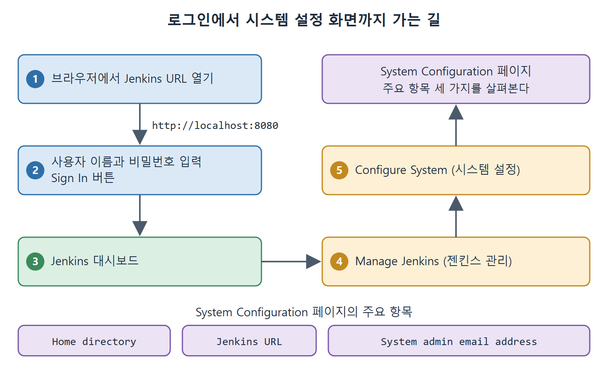

# 로그인과 시스템 설정 페이지

서버가 떴다면 브라우저로 접속해 로그인하고, 전역 설정 화면을 살펴볼 차례다. 전역 설정은 건물 전체에 적용되는 관리 규칙과 같다. 개별 방(잡)마다 따로 정하는 설정과 달리, 모든 잡이 함께 영향을 받는다. 이 문서는 로그인 방법, Manage Jenkins 메뉴, System Configuration 화면의 핵심 항목 세 가지를 설명한다.

원서는 이 절에서 Maven, JDK 같은 도구 경로도 전역에서 설정한다고 예고하지만, 이 장에서 실제로 다루는 항목은 Home directory, Jenkins URL, System admin email address 세 가지다.

---

## 1. 브라우저로 접속해 로그인하기

로그인 절차는 단순하다.

1. 브라우저를 연다.
2. 서버를 시작할 때 쓴 IP 주소와 포트로 URL을 만든다. 기본값이면 `http://localhost:8080`이다.
3. 초기 설정 때 만든 사용자 이름과 비밀번호를 입력한다.
4. Sign In 버튼을 누른다.

Docker 컨테이너로 띄웠다면 포트 포워딩 옵션에서 콜론 오른쪽에 적은 포트를 URL에 쓴다고 원서는 안내한다. 예를 들어 `docker run -p 8080:8081 --name=Jenkins-server jenkins/jenkins`로 시작했다면 URL에는 8081을 쓴다는 설명이다. 앞 문서에서 짚었듯이 일반적인 Docker 규칙과는 방향이 반대로 읽히므로, 접속이 안 되면 반대쪽 포트도 확인해 본다.

---

## 2. System Configuration 화면 들어가기

로그인하면 Jenkins 대시보드(전체 현황 첫 화면)가 나온다. 거기서 설정 화면까지 가는 길은 다음과 같다.

| 순서 | 누르는 곳 | 열리는 화면 |
|---|---|---|
| 1 | 대시보드의 Manage Jenkins (젠킨스 관리) | Manage Jenkins 페이지 |
| 2 | Configure System (시스템 설정) | System Configuration 페이지 |

원서의 Figure 4-2가 이 화면이다. 이 페이지에는 설정 항목이 많지만 원서는 자주 쓰는 중요한 항목만 골라 설명한다.

그림은 브라우저 접속과 로그인을 거쳐 대시보드에서 Manage Jenkins, Configure System으로 들어가는 순서와, 그 페이지의 주요 항목 세 가지를 보여 준다.

---

## 3. 주요 설정 항목

| 항목 | 한 줄 의미 | UI에서 수정 |
|---|---|---|
| Home directory | Jenkins 관련 파일이 모이는 폴더 | 불가 |
| Jenkins URL | Jenkins 서버에 접속하는 주소 | 가능 |
| System admin email address | 알림 메일의 보낸 사람 주소 | 가능 |

세 항목은 성격이 다르다. 첫 번째는 화면에 보여 주기만 하고, 나머지 둘은 값을 직접 고칠 수 있다.

### 3.1 Home directory

Jenkins의 잡, 설정 파일 같은 파일과 폴더가 모두 이 위치에 들어 있다. 화면에서는 편집할 수 없지만 JENKINS_HOME의 위치 자체는 바꿀 수 있다. 디스크 공간이 모자라거나 필요한 폴더 권한이 없을 때가 대표적인 이유다. 위치를 옮겼다면 예전 위치에 남은 파일을 정리해야 한다. 원서가 꼭 하라고 당부하는 부분이다.

위치를 바꾸는 방법은 다섯 가지다.

| 방법 | 설명 | 비고 |
|---|---|---|
| Jenkins 설정 파일 수정 | 설정 파일의 JENKINS_HOME 변수를 고친다. Red Hat Linux라면 `/etc/sysconfig/jenkins` | 원서의 첫 번째 방법 |
| 웹 컨테이너 관리 도구 | 관리 도구로 JENKINS_HOME 환경 변수를 설정한다 | 웹 컨테이너에 올린 경우 |
| OS 환경 변수 | 시스템 환경 변수에 JENKINS_HOME을 지정한 뒤 .WAR로 실행한다 | 실행 전에 설정해야 한다 |
| Java 시스템 속성 | 웹 컨테이너나 .WAR를 실행할 때 JENKINS_HOME 속성을 준다 | 실행 시점에 지정 |
| jenkins.war의 web.xml 수정 | 압축 해제된 이미지의 `web.xml`을 고친다 | 권장하지 않음 |

표에서 마지막 방법만 원서가 명시적으로 권하지 않는다. 설치 파일 내부를 건드리면 업그레이드할 때 설정이 사라지기 쉽기 때문이라고 짐작할 수 있지만, 이유는 원서에 적혀 있지 않다.

### 3.2 Jenkins URL

Jenkins 서버에 접속하는 주소로, 서버를 시작할 때 쓴 IP 주소와 포트가 들어간다. localhost에서 기본 포트로 띄웠다면 `http://localhost:8080`이다.

다른 컴퓨터에서도 이 Jenkins에 접속하게 하려면 localhost 대신 이 컴퓨터의 IP 주소로 바꿔 둔다. localhost는 "나 자신"을 뜻하므로, 다른 사람이 이 주소를 받아도 자기 컴퓨터로 접속하게 되기 때문이다.

### 3.3 System admin email address

Jenkins가 잡 실행 결과를 알리는 메일을 보낼 때, 메일 헤더의 보낸 사람(From) 자리에 들어가는 주소다. 메일 알림 설정은 이후 장에서 다룬다고 원서가 밝히므로, 여기서는 이 주소가 발신자 표시용이라는 점만 알면 된다.

 
 
 

[CICD Pipeline Using Jenkins Unleashed](../)
