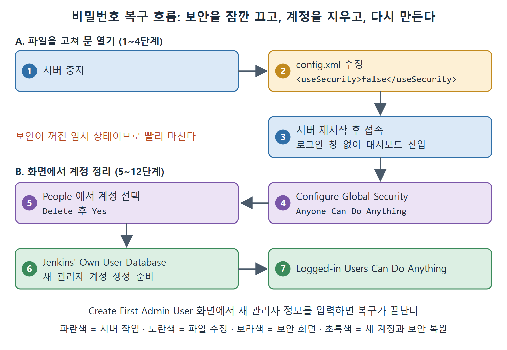

# 비밀번호 복구와 사용자 추가

Jenkins 사용자가 가장 자주 겪는 문제 하나가 비밀번호 분실이다. 원서도 이를 아주 흔한 문제로 꼽는다. 비유하면 집 열쇠를 잃어버렸을 때 문 잠금 장치를 잠시 풀고 들어가 열쇠를 새로 만드는 과정과 같다. 보안 설정을 잠깐 끄고 들어간 뒤, 예전 계정을 지우고 새 관리자 계정을 만든다.

이 문서는 Windows 환경에서 서버를 멈추고 설정을 고쳐 다시 들어가는 12단계와, 새 관리자 계정을 만드는 절차를 정리한다.

---

## 1. 복구 절차 전체 지도

| 단계 | 한 일 | 목적 |
|---|---|---|
| 1 | 서버 중지 | 설정 파일을 안전하게 고치려고 |
| 2 | config.xml에서 보안 끄기 | 로그인 없이 들어가려고 |
| 3 | 서버 재시작 | 바뀐 설정을 적용하려고 |
| 4 | 브라우저로 접속 | 로그인 창 없이 들어가는지 확인 |
| 5~8 | 전역 보안 화면에서 권한 열기 | 사용자 관리 권한을 확보하려고 |
| 9~12 | 잊어버린 사용자 삭제 | 새 계정을 만들 자리를 비우려고 |

앞부분(1~4단계)은 파일을 고쳐 문을 여는 일이고, 뒷부분(5~12단계)은 화면에서 계정을 정리하는 일이다.



그림은 서버를 멈추고 보안을 끈 뒤 계정을 지우고, 새 관리자 계정을 만들어 로그인한 사용자만 허용하는 상태로 되돌리는 흐름을 보여 준다. 그림의 번호는 큰 덩어리의 순서이며 위 표의 단계 번호와는 다르다.

---

## 2. 단계별 실습

### 2.1 서버 멈추기와 config.xml 수정 (1~2단계)

1. 실행 중인 Jenkins 서버를 멈춘다. .WAR 파일로 실행했다면 서버를 돌리던 명령 프롬프트 창을 닫는다. 서비스로 실행 중이라면 Services에서 Jenkins를 오른쪽 클릭하고 Stop을 선택한다.
2. `$(JENKINS_HOME)` 폴더, 즉 Jenkins 설치 폴더에서 `config.xml`을 연다. 파일 안에서 `useSecurity` 태그를 찾는다. 기본값은 `true`인데 이것을 `false`로 바꾸고 저장한다.

```
<useSecurity>false</useSecurity>
```

원서 본문에는 `</useSecurity>`처럼 닫는 태그로 적혀 있다. 값을 바꾸는 대상은 여는 태그와 닫는 태그 사이의 값이므로 위 형태로 정리했다. 원서의 Figure 4-3은 이 변경 화면이다.

.MSI 설치 파일로 설치한 경우 JENKINS_HOME 위치가 다르다. 원서는 `C:\System32\Config\SystemProfile\AppData\Local\Jenkins\.jenkins`라고 적었다. 실제 Windows에서는 System32 앞에 Windows 폴더가 붙는 경우가 일반적이지만, 원서 표기를 그대로 옮긴다. 폴더를 찾지 못하면 Windows 폴더 아래에서 확인해 본다.

### 2.2 재시작과 접속 (3~4단계)

3. 서버를 다시 시작한다. .WAR로 실행했다면 명령 프롬프트에서 다시 실행하고, 서비스라면 Services에서 시작한다.
4. 브라우저로 Jenkins URL을 연다. 이제 사용자 이름과 비밀번호를 묻지 않고 대시보드로 바로 들어간다. 처음 여는 것이 아니라면 이전에 만든 잡들이 목록에 보일 수 있다.

보안 기능이 꺼졌기 때문에 이런 현상이 생긴다. 이 상태는 누구나 들어올 수 있는 임시 상태이므로, 작업을 빨리 마치고 보안을 되돌려야 한다.

### 2.3 전역 보안 화면 설정 (5~8단계)

5. Manage Jenkins를 눌러 관리 페이지를 연다.
6. Configure Global Security (전역 보안 설정) 링크를 눌러 해당 화면을 연다.
7. Authorization(권한 부여) 구역에서 Anyone Can Do Anything 라디오 버튼을 선택한다.
8. Save 버튼을 누른다.

Anyone Can Do Anything은 "누구든 무엇이든 할 수 있다"는 뜻이다. 계정 삭제 같은 관리 작업을 로그인 없이 할 수 있게 해 준다.

### 2.4 잊어버린 사용자 삭제 (9~12단계)

9. 왼쪽 메뉴에서 People 링크를 누른다(Figure 4-4에서 상자로 강조된 메뉴).
10. 표에서 잊어버린 계정의 항목을 누른다. 원서 예시에서는 사용자 ID가 `pranodayd`다(Figure 4-5).
11. 왼쪽의 Delete 링크를 누른다(Figure 4-6).
12. 삭제를 확인하는 창에서 Yes 버튼을 누른다.

---

## 3. 새 관리자 사용자 추가하기

계정을 지웠으니 새 관리자를 만들 차례다. 먼저 Manage Jenkins에서 Configure Global Security로 들어가 Security Realm(사용자 인증 방식) 구역의 Jenkins' Own User Database 옵션을 선택한다. 이것은 Jenkins가 사용자 정보를 자기 안에 직접 저장한다는 뜻이다. 그다음 순서는 다음과 같다.

1. Authorization 구역에서 Logged-in Users Can Do Anything을 선택하고, Allow Anonymous Read Access 체크박스는 해제한다(Figure 4-7).
2. Save 버튼을 누른다.
3. Create First Admin User 화면이 나오면 관리자 정보를 입력하고 Create First Admin User 버튼을 누른다.

이렇게 하면 새 관리자 계정이 만들어진다.

| 권한 옵션 | 의미 | 쓰는 때 |
|---|---|---|
| Anyone Can Do Anything | 로그인하지 않아도 모든 작업 가능 | 복구 중 임시로 |
| Logged-in Users Can Do Anything | 로그인한 사용자만 모든 작업 가능 | 새 계정을 만든 뒤 |
| Allow Anonymous Read Access | 로그인하지 않은 사람도 읽기 가능 | 여기서는 체크 해제 |

표처럼 복구 중에는 가장 느슨한 옵션을 쓰고, 계정을 만들 때는 로그인한 사용자만 허용하도록 조인다. 원서가 직접 설명하지는 않지만, 두 번째 설정이 다시 로그인을 요구하는 상태로 되돌리는 효과가 있다고 읽을 수 있다. 복구 후 다른 사람이 임의로 들어오지 못하는지 한 번 더 확인하는 것이 좋다.

<br>
<br>
<br>

[CICD Pipeline Using Jenkins Unleashed](../)
