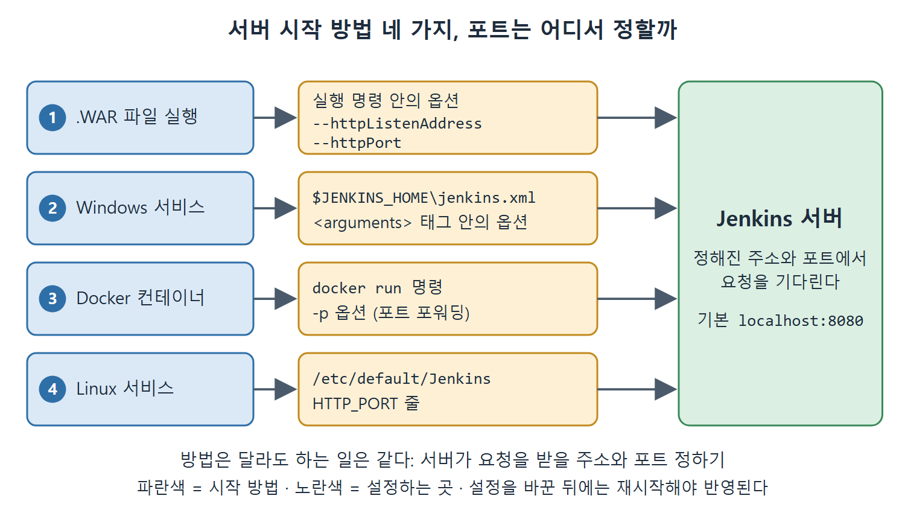

# 젠킨스 서버 시작하기

Jenkins를 설치했다면 다음 할 일은 서버를 띄우는 것이다. 집에 새 가전제품을 들여놓고 전원 코드를 꽂는 순서와 비슷하다. 설치는 물건을 들여놓는 일이고, 시작은 전원을 켜는 일이다. 이 문서는 Windows와 Linux에서 Jenkins 서버를 켜는 방법과, 포트가 겹칠 때 바꾸는 방법을 정리한다.

Jenkins 서버를 켜는 방법은 크게 네 가지다. .WAR 파일(자바 웹 애플리케이션을 하나로 묶은 파일)로 직접 실행하기, Windows 서비스로 실행하기, Docker 컨테이너로 실행하기, Linux 서비스로 실행하기다. 책은 Windows 기준으로 설명하고, 버전은 2.289를 쓴다.

---

## 1. 시작 방법 한눈에 보기

| 시작 방법 | 쓰는 상황 | 기본 접속 주소 |
|---|---|---|
| .WAR 파일 실행 | Jenkins를 서비스로 설치하지 않았을 때, 잠깐 띄워 볼 때 | 직접 지정한 IP와 포트 |
| Windows 서비스 시작 | 설치 시 서비스로 등록했을 때 | localhost:8080 |
| Docker 컨테이너 | Docker 이미지로 바로 띄우고 싶을 때 | 포트 포워딩 설정에 따름 |
| Linux 서비스(systemctl) | Linux에 서비스로 설치했을 때 | 설정 파일의 포트(기본 8080) |

표를 보면 서비스로 설치한 경우는 "시작" 버튼이나 명령 한 줄이면 되고, 서비스가 아닌 경우는 실행 명령에 주소와 포트를 직접 적는다는 차이가 있다.

---

## 2. .WAR 파일로 시작하기

.WAR 파일은 Jenkins 서버 프로그램 자체가 들어 있는 파일이다. 명령 프롬프트에서 자바로 이 파일을 실행하면 서버가 뜬다.

```
java -jar <war 파일 경로> --httpListenAddress=<컴퓨터 IP 주소> --httpPort=<사용 가능한 포트>
```

위 코드의 꺾쇠 부분은 실제 값으로 바꿔 넣는 자리다. 원서에는 명령이 `Java –jar ... -- httpListenAddress=...`처럼 대문자와 긴 대시, 공백이 섞여 인쇄되어 있는데, PDF 추출 과정에서 깨진 것으로 보고 실제로 입력하는 형태로 복원했다.

각 옵션의 뜻은 다음과 같다.

| 옵션 | 의미 | 주의할 점 |
|---|---|---|
| `--httpListenAddress` | 서버가 요청을 받을 IP 주소 | 이 컴퓨터의 IP를 적는다 |
| `--httpPort` | 서버가 요청을 받을 포트 번호 | 다른 프로세스가 쓰지 않는 포트여야 한다 |

명령을 실행한 뒤에는 서버가 완전히 뜰 때까지 기다려야 한다. 이 방식에서 서버를 끄려면 명령 프롬프트 창을 닫으면 된다.

---

## 3. Windows 서비스로 시작하기

서비스는 사용자가 로그인해 있지 않아도 백그라운드에서 도는 프로그램이다. Jenkins를 서비스로 설치했다면 다음 순서로 켠다.

1. 시작 메뉴에서 `Services`를 입력한다.
2. 검색된 Services를 선택해 서비스 창을 연다.
3. 목록에서 Jenkins 항목을 오른쪽 클릭하고 Start를 누른다.

Start 메뉴가 회색으로 비활성화되어 있다면 이미 서비스가 실행 중이라는 뜻이다. 시작하면 서버는 `localhost:8080`에서 열린다.

### 3.1 서비스의 주소와 포트 바꾸기

기본값 대신 특정 IP와 다른 포트에서 열고 싶다면 `$JENKINS_HOME\jenkins.xml` 파일을 고친다. JENKINS_HOME은 Jenkins 관련 파일이 모이는 폴더로, 기본적으로 시스템 드라이브의 현재 사용자 폴더 안에 만들어진다. 책의 예시 컴퓨터에서는 `C:\magicuser\.jenkins`였다.

파일의 `<arguments>` 태그 안에 다음 두 옵션을 추가한다. 원서의 Figure 4-1은 이 모습을 보여 주는 화면이다.

```
--httpListenAddress=<컴퓨터 IP 주소>
--httpPort=<원하는 포트 번호>
```

수정을 저장한 뒤에는 Services 목록에서 Jenkins를 오른쪽 클릭해 Restart를 눌러야 바뀐 값이 적용된다. 재시작하기 전에는 바뀐 값이 적용되지 않는다.

---

## 4. Docker 컨테이너로 시작하기

Docker는 프로그램을 컨테이너라는 격리된 상자에 담아 실행하는 도구다. Jenkins 이미지(실행에 필요한 것을 모두 담은 설치본)가 Docker Hub에 올라와 있어서 명령 한 줄로 서버를 띄울 수 있다.

```
docker run -p 8080:8080 --name=Jenkins-server jenkins/jenkins
```

원서에는 `–p`와 `Jenkins/jenkins`로 인쇄되어 있다. 대시는 일반 하이픈으로 복원했고, 이미지 이름은 Docker 이미지 이름이 소문자여야 하므로 소문자로 적었다. 이 부분은 추정이므로 원문 표기와 다를 수 있다.

여기서 `-p 8080:8080`은 포트 포워딩(한쪽 포트로 들어온 요청을 다른 쪽 포트로 넘겨 주는 것)이다. 우체국에 비유하면, 건물 대표 번지로 온 편지를 안쪽 사무실 번지로 전달해 주는 규칙이다. 콜론 양쪽의 번호가 서로 연결된다.

원서는 콜론의 오른쪽 포트를 Jenkins URL에 쓰라고 설명한다. 그래서 `-p 8080:8081`로 띄웠다면 브라우저 주소에 8081을 쓴다는 예를 든다. 다만 일반적인 Docker 규칙은 `호스트 포트:컨테이너 포트`이고 브라우저에서는 왼쪽 값을 쓰므로, 원서의 이 설명은 일반 규칙과 반대로 읽힌다. 이 노트에서는 원서의 서술을 그대로 전하되, 실제로 접속이 안 되면 두 번호를 서로 바꿔서 시도해 보는 것이 좋다.

---

## 5. Linux에서 서비스 시작하기

Linux에서는 Jenkins를 서비스로 먼저 설치해 둔 뒤 다음 명령으로 시작한다.

```
sudo systemctl start jenkins
```

원서에는 `sudosystemctl start Jenkins`로 공백이 빠지고 대문자로 인쇄되어 있다. 명령은 공백을 넣은 형태로 복원했다. 서비스 이름의 대소문자는 원서 표기와 다를 수 있다.

실행 상태는 아래 명령으로 확인한다.

```
sudo systemctl status jenkins
```

### 5.1 포트 8080이 이미 쓰이고 있을 때

8080 포트를 다른 프로그램이 쓰고 있으면 Jenkins가 시작되지 못한다. 이때는 `/etc/default/Jenkins` 파일에서 `HTTP_PORT=8080` 줄을 원하는 번호로 바꾼다. 예를 들어 8081로 올리고 싶다면 `HTTP_PORT=8081`로 적는다. 파일을 저장하고 Jenkins를 다시 시작하면 적용된다.

Linux에서 .WAR 파일로 직접 실행하는 방법은 Windows와 같아서 원서도 따로 설명하지 않는다.

---

## 6. 방법별 포트 바꾸기 정리

| 환경 | 고치는 곳 | 바꾸는 값 |
|---|---|---|
| .WAR 직접 실행 | 실행 명령 | `--httpPort`, `--httpListenAddress` |
| Windows 서비스 | `$JENKINS_HOME\jenkins.xml`의 `<arguments>` | `--httpPort`, `--httpListenAddress` |
| Docker | `docker run`의 `-p` 옵션 | 포트 포워딩 번호 |
| Linux 서비스 | `/etc/default/Jenkins` | `HTTP_PORT` |



그림은 네 가지 시작 방법이 각각 다른 곳에서 주소와 포트를 정하지만, 결국 하나의 Jenkins 서버가 요청을 받을 자리를 정한다는 것을 보여 준다.

환경마다 설정 위치만 다를 뿐, 하는 일은 "서버가 어느 주소와 포트에서 요청을 받을지 정하는 것"으로 같다. 설정을 바꾼 뒤에는 서비스를 재시작해야 반영된다는 점도 공통이다.

<br>
<br>
<br>

[CICD Pipeline Using Jenkins Unleashed](../)
