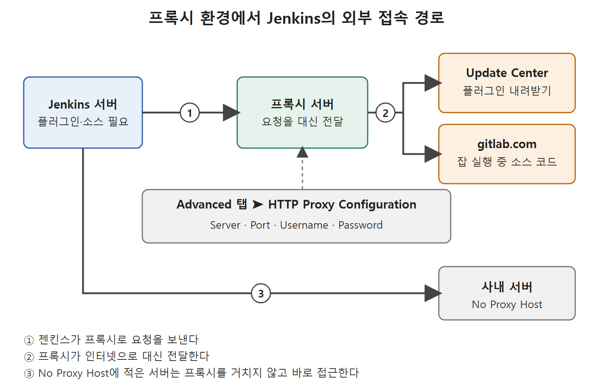

# Advanced 탭과 프록시 설정

회사 네트워크 안에서 젠킨스를 돌리면 인터넷으로 나가는 길이 프록시 서버(proxy server, 인터넷 요청을 대신 전달하는 중간 서버)로 막혀 있는 경우가 많다. 이때 프록시를 설정하지 않으면 젠킨스는 플러그인을 내려받을 수 없다. Advanced 탭은 이 설정과 플러그인 수동 설치를 맡는다.

회사 건물의 우편물 접수실을 떠올리면 된다. 직원이 밖으로 편지를 직접 부치지 못하고 접수실에 맡기면 접수실이 대신 보낸다. 프록시가 접수실이고, 젠킨스는 편지를 맡기는 직원이다. 접수실 위치를 모르면 편지를 보낼 수 없다.

---

## 1. 프록시가 왜 문제가 되는가

프록시가 설정된 환경에서는 기계가 인터넷에 직접 요청을 보낼 수 없다. 요청은 먼저 프록시 서버로 가고, 그곳에서 인터넷으로 나간다. 조직에 이런 프록시가 있으면 젠킨스에 두 가지 문제가 생긴다.

| 막히는 일 | 예 |
| --- | --- |
| 잡 실행 중의 외부 접속 | gitlab.com에서 소스 코드를 받아 오는 일이 허용되지 않는다 |
| 플러그인 내려받기 | Update Center(플러그인을 배포하는 서버)에 접근하지 못한다 |

그래서 프록시 뒤에서 젠킨스를 쓰려면 프록시 정보를 젠킨스에 알려 줘야 한다. 프록시 서버의 세부 정보는 조직의 IT 부서에 문의해서 받는다. 젠킨스의 잡은 뒤쪽 장에서 다룬다.

그림은 Jenkins 서버의 요청이 프록시 서버를 거쳐 Update Center와 gitlab.com으로 전달되는 흐름을 보여 준다. No Proxy Host에 적은 사내 서버는 프록시를 거치지 않고 바로 접근한다.

## 2. HTTP Proxy Configuration 항목

Advanced 탭의 HTTP Proxy Configuration 영역에 프록시 정보를 입력한다(Figure 5-4).

| 항목 | 입력할 내용 |
| --- | --- |
| Server | 프록시 서버의 IP 주소 |
| Port | 프록시 서버 장비의 포트 번호 |
| Username | 프록시에 인증이 걸려 있으면 그 사용자 이름, 없으면 비워 둔다 |
| Password | 프록시에 인증이 걸려 있으면 그 비밀번호, 없으면 비워 둔다 |
| No Proxy Host | 프록시를 거치지 않고 바로 접근할 서버의 IP나 호스트 이름 패턴 |

Username과 Password는 세트로 생각하면 된다. 인증이 없는 프록시라면 둘 다 비운다. No Proxy Host는 사내 서버처럼 프록시를 거칠 필요가 없는 곳을 적는 칸이다.

모두 입력했으면 Submit 버튼을 누른다.

## 3. 특정 버전의 플러그인 직접 올리기

Update Center로는 플러그인의 최신 릴리스만 설치할 수 있다. 예전 버전이나 특정 버전이 필요하면 .HPI 파일을 직접 받아서 올려야 한다. Advanced 탭의 Upload Plugin 영역을 쓴다.

1. 필요한 버전의 .HPI 파일을 내려받는다.
2. Choose File 버튼을 눌러 내려받은 .HPI 파일을 고른다.
3. Upload 버튼을 누른다.

| 상황 | 쓸 방법 |
| --- | --- |
| 최신 버전이면 충분하다 | Available 탭에서 설치 |
| 특정 버전이 필요하다 | .HPI를 내려받아 Upload Plugin으로 설치 |

## 4. 업데이트 센터 URL

젠킨스는 플러그인을 Update Center URL에서 내려받는다. 이 주소는 Advanced 탭의 URL 칸에 표시된다. 뒤에 나오는 문제 해결에서 이 URL을 바꾸는 방법이 쓰이므로 위치를 기억해 두자. 원서가 보여 주는 기본 주소는 `https://updates.jenkins.io/update-center.json`이다.

 
 
 

[CICD Pipeline Using Jenkins Unleashed](../)
