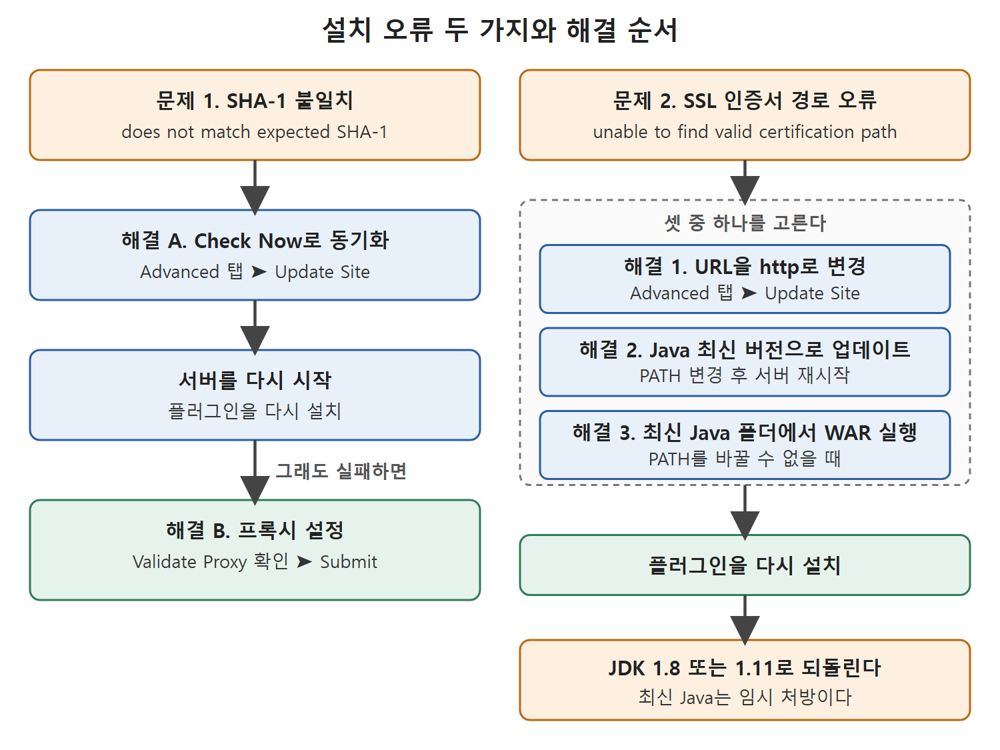

# 설치 오류와 해결 방법

플러그인을 설치하다 보면 오류가 나는 경우가 있다. 원서는 흔한 문제 두 가지를 골라 원인과 해결책을 정리한다. 하나는 내려받은 파일의 SHA-1 값이 맞지 않는다는 오류이고, 다른 하나는 SSL 인증서 경로를 찾지 못한다는 오류다.

오류 메시지는 영어 그대로 나오므로 메시지의 핵심 단어를 알아 두면 검색하기 쉽다. 이 문서는 문제별로 증상, 원인, 해결 순서를 차례로 정리한다.

---

## 1. 문제 한눈에 보기

| 구분 | 오류 메시지의 핵심 | 원인 |
| --- | --- | --- |
| 문제 1 | does not match expected SHA-1 | Update Center와 젠킨스가 동기화되지 않았거나, 젠킨스가 프록시 뒤의 장비에서 돈다 |
| 문제 2 | unable to find valid certification path | Update Center의 HTTPS 인증서를 JDK가 믿지 못한다 |



그림은 SHA-1 불일치는 동기화, 재시작, 프록시 설정 순으로, SSL 인증서 경로 오류는 세 가지 해결책 중 하나를 고른 뒤 재설치하고 JDK 1.8 또는 1.11로 되돌리는 순서로 푼다는 것을 보여 준다.

## 2. 문제 1. SHA-1 불일치

### 2.1 증상

플러그인을 설치하다가 아래와 같은 SHA-1 오류가 난다. 내려받은 임시 파일이 기대한 SHA-1 값과 다르다는 뜻이다. SHA-1은 파일이 온전한지 확인하는 지문 같은 값이다.

```text
java.io.IOException: Downloaded file
/var/lib/jenkins/plugins/*.tmp does not match expected
SHA-1, expected 'f2ncNlydUUSPrk6SoG255v+2kQU=', actual
'lZRJco4Ouv1j0AG4Aet7HadHg/Q='
```

### 2.2 원인

원서가 드는 원인은 둘이다. 하나는 Update Center와 젠킨스의 정보가 맞지 않는 것이다. 다른 하나는 프록시 뒤에 있는 장비에서 젠킨스를 돌리는 것이다.

### 2.3 해결 A. Update Center와 동기화하기

1. Manage Jenkins → Manage Plugins로 가서 Advanced 탭을 연다.
2. 아래로 스크롤해서 Update Site 영역을 찾는다.
3. Check Now 버튼을 누른다. 젠킨스 서버가 Update Center와 동기화된다.
4. 젠킨스 서버를 다시 시작하고 플러그인을 다시 설치한다.

### 2.4 해결 B. 프록시 설정하기

1. Manage Jenkins → Manage Plugins의 Advanced 탭으로 간다. 프록시 값을 입력하되, 프록시에 인증이 없으면 사용자 이름과 비밀번호는 비워 둔다.
2. Advanced 버튼을 눌러 Test URL 칸에 Jenkins Update Center의 URL을 넣고 Validate Proxy 버튼을 누른다.
3. 프록시 검증이 성공하면 Submit 버튼을 누른다.
4. 플러그인을 다시 설치한다. 그래도 실패하면 젠킨스를 다시 시작한 뒤 다시 시도한다.

## 3. 문제 2. SSL 인증서 경로 오류

### 3.1 증상

설치 중 아래 오류가 난다.

```text
javax.net.ssl.SSLHandshakeException: PKIX path building failed:
sun.security.provider.certpath.SunCertPathBuilderException:
unable to find valid certification path to requested target
```

### 3.2 원인

Manage Jenkins → Manage Plugins의 Update Center URL은 기본이 HTTPS 주소다. HTTPS는 보안 인증서 같은 추가 장치가 필요하다. 젠킨스를 실행하는 JDK에는 신뢰할 수 있는 CA(인증 기관) 인증서가 많이 들어 있고, 이 인증서들은 Java 설치 디렉터리의 lib\security 폴더 안 cacerts 파일에 있다. 그런데 이 cacerts에 Update Center 사이트를 믿어 줄 인증서가 없다. 최신 보안 인증서가 없기 때문이며, 오래된 Java 버전으로 젠킨스를 시작했을 때 생길 수 있다.

### 3.3 해결 방법 세 가지 비교

| 해결책 | 하는 일 | 알맞은 경우 |
| --- | --- | --- |
| 1. URL을 http로 변경 | Update Center 주소의 https를 http로 바꾼다 | 가장 빠르게 시도하고 싶을 때 |
| 2. Java 최신 버전으로 업데이트 | 최신 Java를 설치하고 PATH를 바꾼다 | 장비의 기본 Java를 올려도 될 때 |
| 3. 최신 Java의 lib\security 폴더에서 WAR 실행 | 최신 Java 폴더에서 Jenkins.war를 실행한다 | 다른 앱 때문에 PATH를 못 바꿀 때 |

### 3.4 해결 1. http로 바꾸기

1. Manage Jenkins → Manage Plugins로 간다.
2. Advanced 탭으로 간다.
3. 페이지 맨 아래의 Update Site 영역으로 간다.
4. URL을 아래와 같이 바꾸고 Submit 버튼을 누른다.
5. 플러그인을 다시 설치한다.

```text
https://updates.jenkins.io/update-center.json
http://updates.jenkins.io/update-center.json
```

위 줄이 바꾸기 전 주소이고 아래 줄이 바꾼 뒤 주소다. 차이는 https가 http로 바뀐 것뿐이다.

### 3.5 해결 2. Java 최신 버전으로 올리기

1. 사용할 수 있는 최신 Java를 내려받아 설치한다.
2. 새로 설치한 Java의 bin 폴더 경로를 PATH 환경 변수에 추가한다.
3. 환경 변수 변경을 저장하고 젠킨스 서버를 다시 시작한다.
4. 플러그인을 다시 설치한다.

Java 1.8이나 1.11이 아닌 버전으로 올렸다면 .WAR 파일로 젠킨스를 시작할 때 `--enable-future-java` 플래그를 붙여야 한다. 원서가 보여 주는 예는 다음과 같다.

```text
java -jar D:\Jenkins\Jenkins.war --enable-future-java
```

### 3.6 해결 3. 최신 Java 폴더에서 WAR 실행하기

1. 최신 Java를 설치한다.
2. 명령 프롬프트를 열고 작업 디렉터리를 Java 설치 폴더의 lib\security로 옮긴다.
3. 그곳에서 Jenkins.war를 실행한다.
4. 플러그인을 다시 설치한다.

예를 들어 JDK 15가 D:\JDK15\jdk-15.0.2에 설치되어 있다면 작업 디렉터리는 D:\JDK15\jdk-15.0.2\lib\security가 된다. 원서는 Jenkins.war도 이 경로에서 실행한다고 적는다.

이 방법은 다른 애플리케이션이 특정 Java 버전을 요구해서 PATH를 최신 Java로 돌릴 수 없을 때 쓴다.

## 4. 문제 2를 해결한 뒤 꼭 할 일

해결을 위해 최신 Java로 젠킨스를 시작했다면, 플러그인 설치가 끝난 뒤 젠킨스가 지원하는 Java 버전(JDK 1.8 또는 JDK 1.11)으로 되돌려야 한다. 지원하지 않는 버전을 계속 쓰면 파이프라인 잡을 실행할 때 오류가 난다. 파이프라인 잡은 뒤쪽 장에서 다룬다.

| 시점 | 쓰는 Java |
| --- | --- |
| 플러그인 설치 문제를 풀 때 | 최신 Java(임시) |
| 설치가 끝난 뒤 | JDK 1.8 또는 JDK 1.11로 복귀 |

최신 Java는 설치 문제를 풀기 위한 임시 처방이라고 보면 된다.

<br>
<br>
<br>

[CICD Pipeline Using Jenkins Unleashed](../)
