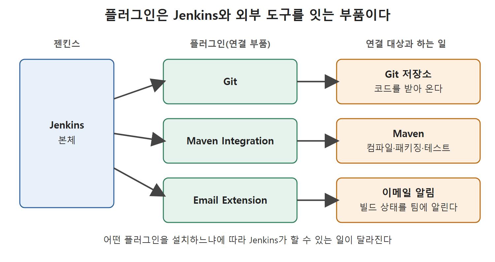

# 플러그인이란과 대표 플러그인

젠킨스는 혼자서 모든 일을 하는 도구가 아니다. 소스 코드를 받아 오고, 컴파일하고, 테스트하고, 라이브러리로 묶어 내보내는 빌드 과정에는 저마다 다른 도구가 끼어든다. 젠킨스는 이 도구들과 대화할 때 플러그인(plugin, 기능을 덧붙이는 확장 부품)을 쓴다.

이 문서는 플러그인이 무엇인지, 책에서 소개하는 대표 플러그인 세 가지가 각각 어떤 도구와 이어 주는지, 그리고 플러그인을 설치하려고 Plugin Manager 화면에 들어가는 길을 정리한다.

---

## 1. 왜 플러그인이 필요한가

빌드 과정을 한 줄로 늘어놓으면 대략 이렇다. 소스 코드 관리 도구에서 코드를 가져오고, 컴파일하고, 단위 테스트와 통합 테스트를 돌리고, 결과물을 라이브러리로 만들어 배포한다. 단계마다 쓰는 도구의 종류가 다르다.

| 단계 | 필요한 도구 종류 |
| --- | --- |
| 코드 가져오기 | 소스 코드 관리(SCM) 도구 |
| 컴파일, 패키징 | 빌드 도구 |
| 단위·통합 테스트 | 테스트 도구 |

젠킨스가 이 처음부터 끝까지의 흐름을 실행하려면 위 도구들과 연결되어야 한다. 그 연결을 맡는 것이 플러그인이다. 전동 드릴에 끼우는 드릴 비트를 떠올리면 쉽다. 드릴 본체는 같아도 어떤 비트를 끼우느냐에 따라 나무도 뚫고 벽도 뚫는다. 젠킨스 본체도 마찬가지로, 어떤 플러그인을 설치하느냐에 따라 할 수 있는 일이 달라진다.

정확한 정의는 이렇다. 플러그인은 이미 있는 프로그램에 특정 기능을 더해 주는 소프트웨어 부품이다. 젠킨스 쪽에는 사용 방식을 입맛에 맞게 바꿀 수 있도록 젠킨스 팀이 만든 여러 플러그인이 있다.

## 2. 책에서 소개하는 대표 플러그인

원서는 자주 쓰는 플러그인 세 가지를 예로 든다.

| 플러그인 | 연결 대상 | 하는 일 |
| --- | --- | --- |
| Git | Git(분산 버전 관리 시스템) | 젠킨스가 Git 저장소의 코드를 다룰 수 있게 한다 |
| Maven Integration | Maven(빌드 도구) | 컴파일, 패키징, 테스트 같은 빌드 단계를 자동화하는 Maven과 이어 준다 |
| Email Extension | 이메일 알림 | 빌드 상태를 팀에 알리는 메일의 내용을 꾸미고 정보를 더 담는다 |

그림은 Jenkins 본체가 플러그인 세 개를 통해 각각 Git 저장소, Maven, 이메일 알림과 연결되는 구조를 보여 준다. 플러그인을 설치해야 해당 도구와의 연결이 생긴다.

### 2.1 Git 플러그인

Git은 여러 개발자가 같은 애플리케이션 코드를 함께 다루게 해 주는 분산 버전 관리 시스템이다. Git 플러그인이 있어야 젠킨스가 이 시스템에서 코드를 받아 올 수 있다. 원서는 Git을 이후 10장과 12장에서 더 자세히 다룬다고 안내한다.

### 2.2 Maven Integration 플러그인

Maven은 컴파일, 패키징, 테스트 같은 중요한 빌드 단계를 자동으로 처리해 주는 빌드 도구다. Maven Integration 플러그인은 젠킨스가 이 도구를 부를 수 있게 이어 준다. Maven은 뒤쪽 장에서 더 다룬다.

### 2.3 Email Extension 플러그인

젠킨스는 현재 빌드가 어떻게 끝났는지 팀에 메일로 알려 주도록 설정할 수 있다. Email Extension 플러그인을 쓰면 이 알림 메일을 원하는 모양으로 바꾸고 더 많은 정보를 담을 수 있다. 실제 사용법은 뒤쪽 장에서 나온다.

## 3. Plugin Manager 화면까지 가는 길

이제 플러그인이 무엇이고 왜 필요한지 알았으니 설치 화면으로 들어가 보자. 순서는 아래와 같다.

1. 젠킨스에 로그인한다. 로그인하면 젠킨스 대시보드가 보인다.
2. 대시보드의 Manage Jenkins(젠킨스 관리) 링크를 눌러 Manage Jenkins 페이지로 간다.
3. 그 페이지에서 Manage Plugins(플러그인 관리) 링크를 누른다.
4. Plugin Manager 페이지가 열린다.

| 단계 | 누르는 곳 | 도착하는 곳 |
| --- | --- | --- |
| 1 | 로그인 | 대시보드 |
| 2 | Manage Jenkins | Manage Jenkins 페이지 |
| 3 | Manage Plugins | Plugin Manager 페이지 |

원서의 Figure 5-1은 이 Plugin Manager 화면을 보여 준다. 화면 위쪽에 탭이 줄지어 있고, 탭에 따라 플러그인을 갱신하고 설치하고 지우는 일을 한다. 탭 네 개는 다음 문서에서 하나씩 살펴본다.

 
 
 

[CICD Pipeline Using Jenkins Unleashed](../)
