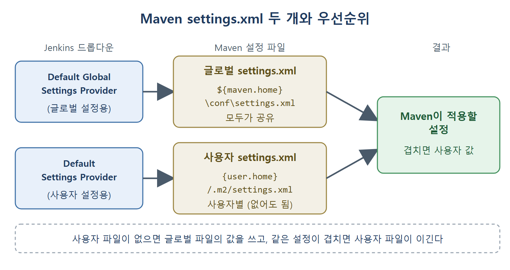
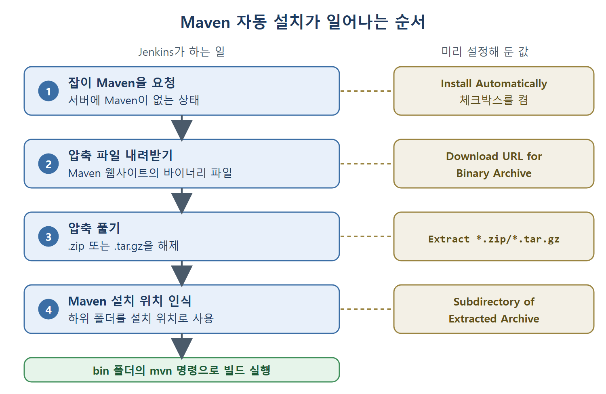

# Maven 설정 파일과 설치 구성

Jenkins에서 Maven을 쓰려면 두 가지를 알려 줘야 한다. 하나는 Maven이 참고하는 설정 파일 settings.xml이 어디 있는지, 다른 하나는 Maven 자체가 어디에 설치되어 있는지다. 이 문서는 두 가지를 차례로 설명하고, 서버에 Maven이 없을 때 Jenkins가 자동으로 설치하게 하는 방법까지 정리한다.

Maven은 Java 애플리케이션의 컴파일, 패키징, 배포 같은 빌드 단계를 자동화해 주는 도구다. 명령줄(CLI)로 쓰는 빌드 도구이며, 실제 작업은 여러 플러그인이 나눠 맡는다. Maven 자체는 11장에서 따로 자세히 다룬다.

---

## 1. Maven의 두 가지 설정 파일

Maven은 settings.xml이라는 같은 이름의 파일 두 개로 설정한다. 비유하자면 회사 공통 규정집과 개인 메모장 같은 관계다. 공통 규정은 모두에게 적용하고, 개인 메모는 내 일에만 적용한다.

| 구분 | 부르는 이름 | 기본 위치 | 쓰임새 |
|---|---|---|---|
| Maven install | 글로벌 설정(global settings) | `${maven.home}\conf\settings.xml` | 같은 머신의 모든 사용자 프로필이 공유하는 공통 설정 |
| 사용자 install | 사용자 설정(user settings) | `{user.home}/.m2/settings.xml` | 사용자마다 따로 두고 싶은 개별 설정 |

여기서 `maven.home`은 Maven을 설치한 디렉터리이고, `user.home`은 현재 사용자의 홈 디렉터리다. 원문은 사용자 설정 경로를 `{user.home}/.m2`로 적고, 앞쪽 글로벌 설정과 달리 `$`를 빼 표기한다. 의미는 같은 홈 디렉터리 기준 경로로 읽으면 된다.

같은 머신을 여러 사람이 쓰면서 각자 다른 Maven 설정을 갖고 싶다면 사용자 설정 파일에 넣는다. 모두가 함께 써야 하는 설정은 글로벌 설정 파일에 넣는다.

### 우선순위 규칙

- 사용자 설정 파일(`${user.home}/.m2/settings.xml`)은 꼭 있어야 하는 파일이 아니다.
- 이 파일이 없으면 Maven은 필요한 설정을 Maven 설치 디렉터리의 settings.xml에서 가져온다.
- 같은 설정이 두 파일에 모두 있으면 사용자 설정 파일의 값이 이긴다.

| 경우 | 적용되는 값 |
|---|---|
| 사용자 설정 파일이 없음 | 글로벌 설정 파일의 값 |
| 두 파일에 같은 설정이 있음 | 사용자 설정 파일의 값 |
| 한쪽에만 있는 설정 | 있는 쪽의 값 |

세 번째 줄은 원문에 명시된 규칙은 아니고 위 두 규칙에서 자연스럽게 따라오는 해석이다. 핵심은 더 구체적인 쪽, 즉 사용자 설정이 우선한다는 점이다.

Jenkins의 두 드롭다운이 각각 글로벌 settings.xml과 사용자 settings.xml을 가리키고, Maven이 두 파일을 합쳐 쓰되 겹치는 설정은 사용자 파일의 값을 따른다는 관계를 보여 준다.

## 2. Jenkins에 settings.xml 위치 알리기

Jenkins에서 Maven을 설정할 때는 두 settings.xml의 위치를 Jenkins가 알아야 한다. Global Tool Configuration 페이지의 Maven Configuration 구역에 두 개의 드롭다운이 있다.

| 드롭다운 | 파일이 기본 위치에 있을 때 | 파일이 다른 위치에 있을 때 |
|---|---|---|
| Default Settings Provider (사용자 설정용) | Use Default Maven Settings | Settings File in Filesystem |
| Default Global Settings Provider (글로벌 설정용) | Use Default Maven Global Settings | Global Settings File on Filesystem |

파일이 기본 위치에 있다면 기본 옵션을 그대로 두면 된다. 다른 위치에 있다면 위 표의 두 번째 옵션을 고르고, 나타나는 입력칸에 각 파일의 경로를 적는다.

### 설정 절차 요약

1. Global Tool Configuration 페이지의 Maven Configuration 구역으로 간다.
2. 두 파일이 기본 위치에 있으면 두 드롭다운의 기본 옵션을 그대로 둔다.
3. 다른 위치에 있으면 Default Settings Provider에서 Settings File in Filesystem을, Default Global Settings Provider에서 Global Settings File on Filesystem을 고른다.
4. 새로 나타난 입력칸에 각 settings.xml 파일의 경로를 적는다.

## 3. Maven 설치 구성하기 (이미 설치된 경우)

두 번째로 설정할 것은 Maven 설치 정보다. 빌드 서버에 Maven이 이미 깔려 있다면 그 위치만 알려 주면 된다.

1. Add Maven 버튼을 누른다. Maven Installations 구역이 열린다.
2. Name 칸에 이 Maven 설정의 이름을 적는다.
3. 서버에 이미 Maven이 있으므로 Install Automatically 체크박스를 해제한다. 책은 이 체크박스가 Maven Installation 구역의 고급 설정에 있다고 보여 준다.
4. MAVEN_HOME 칸에 Maven 설치 디렉터리의 위치를 적는다.
5. Save 버튼을 눌러 저장한다.

### 이름을 지을 때 주의할 점

Name에는 숫자, 공백, 특수문자를 쓰지 않는다. 파이프라인에서 Maven을 쓰려면 이 이름으로 설정을 가리키기 때문이다. 이 이름은 나중에 파이프라인 코드에서 도구를 부를 때 열쇠 역할을 한다. 파이프라인은 14장에서 다룬다.

| 입력칸 | 넣는 값 | 주의 |
|---|---|---|
| Name | Maven 설정의 이름 | 숫자, 공백, 특수문자 금지. 파이프라인이 이 이름으로 가리킨다 |
| Install Automatically | 이미 설치되어 있으면 해제 | 해제해야 MAVEN_HOME 입력칸을 쓴다 |
| MAVEN_HOME | Maven 설치 디렉터리 위치 | 설치 디렉터리를 가리킨다 |

## 4. Maven 자동 설치 구성하기

빌드 서버에 Maven이 없는데 잡이 실행될 때 Jenkins가 설치해 주길 원하면 Install Automatically 체크박스를 켜고 설치 방법(installer)을 설정한다. 이 설치는 Maven이 없는 머신에서 잡을 처음 돌릴 때 한 번만 일어난다.

책이 보여 주는 방식은 Maven의 .zip 또는 .tar.gz 파일을 내려받아 압축을 푸는 방법이다.

1. Install Automatically 체크박스를 켠다.
2. Add Installer 드롭다운을 눌러 Extract *.zip/*.tar.gz 옵션을 고른다.
3. Download URL for Binary Archive 칸에 Maven 웹사이트의 바이너리 압축 파일 URL을 적는다.
4. Subdirectory of Extracted Archive 칸에 압축을 풀었을 때 Maven이 들어 있는 디렉터리 이름을 적는다.
5. 페이지 아래의 Save 버튼을 눌러 저장한다.

| 입력칸 | 의미 | 예 |
|---|---|---|
| Download URL for Binary Archive | Maven 바이너리 압축 파일을 내려받을 주소 | 원문 예시는 `https://dlcdn.apache.org/maven/maven-3/3.8.2/binaries/apache-maven-3.8.2-bin.zip` |
| Subdirectory of Extracted Archive | 압축을 푼 뒤 Maven이 들어 있는 폴더 이름 | `apache-maven-3.8.1` |

### 하위 디렉터리 값이 필요한 이유

Jenkins는 잡이 Maven을 필요로 하면 위 URL의 압축 파일을 내려받아 풀고, 그 결과로 만들어진 디렉터리 구조 안에서 Maven을 사용한다. 원문 그림은 Maven 도구가 `apache-maven-3.8.1`이라는 폴더 안에 들어 있는 모습을 보여 준다. 그래서 Subdirectory of Extracted Archive에는 `apache-maven-3.8.1`을 적는다.

이 값을 맞게 적어야 Jenkins가 그 폴더를 Maven 설치 위치로 인식하고, 그 안의 bin 폴더에 있는 `mvn` 명령으로 Maven을 실행할 수 있다. 풀었을 때 Maven이 들어 있는 폴더 이름을 그대로 적어야 한다는 것이 요점이다.

잡이 Maven을 요청한 뒤 내려받기, 압축 풀기, 설치 위치 인식, mvn 실행으로 이어지는 순서와, 각 단계에 대응하는 설정 항목을 나란히 보여 준다.

### 버전 표기에 대한 참고

원문은 본문에서 `apache-maven-3.8.1-bin.zip` URL을 입력하라고 설명하면서 예시 URL에는 3.8.2 버전을 적었다. 버전이 어긋난 것은 원서 표기이므로, 실습할 때는 다운로드 URL의 버전과 하위 디렉터리 이름(`apache-maven-버전`)의 버전을 반드시 같게 맞춘다.

## 5. 두 가지 방식 비교

| 구분 | 이미 설치된 Maven 사용 | 자동 설치 |
|---|---|---|
| Install Automatically | 해제 | 체크 |
| 알려 줄 것 | MAVEN_HOME(설치 디렉터리) | 다운로드 URL, 압축 해제 후 하위 디렉터리 |
| 적합한 상황 | 빌드 서버에 Maven이 깔려 있음 | 빌드 서버에 Maven이 없음 |
| 설치 시점 | 해당 없음 | 설치되지 않은 머신에서 처음 잡을 돌릴 때 한 번 |

서버를 직접 관리해서 Maven을 미리 깔아 두었다면 왼쪽 방식이 간단하다. 빌드를 실행할 서버가 여러 대이고 모두에 Maven을 깔기 번거롭다면 오른쪽 자동 설치가 편하다.

 
 
 

[CICD Pipeline Using Jenkins Unleashed](../)
