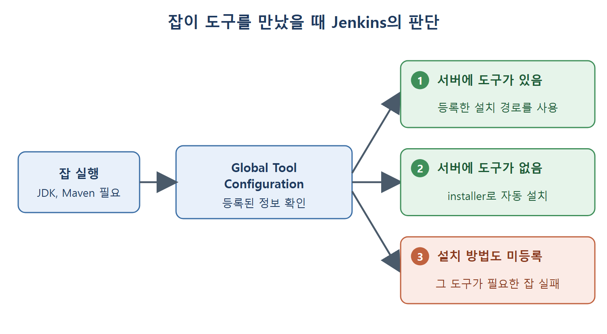

# 글로벌 도구 설정 페이지 찾아가기

잡(작업)을 돌리다 보면 Java, Maven 같은 도구가 필요해진다. 빌드를 실행하는 서버에 이런 도구가 어디에 있는지 Jenkins가 알아야 잡이 제대로 돌아간다. 이 정보를 한곳에 모아 두는 화면이 Global Tool Configuration(글로벌 도구 설정) 페이지다.

이 문서는 그 페이지로 들어가는 길과 페이지가 어떤 역할을 하는지 정리한다. 책은 이 페이지에서 JDK와 Maven을 설정하는 방법을 다루며, 실제 설정 방법은 이어지는 문서에서 설명한다.

---

## 1. 이 페이지가 필요한 이유

집에 공구함이 있다고 생각해 보자. 망치와 드라이버가 어디 있는지 알려 주는 목록을 공구함 문에 붙여 두면 누가 와도 바로 찾아 쓴다. Global Tool Configuration 페이지가 바로 이 목록이다. 어떤 도구가 어떤 이름으로, 어느 경로에 있는지, 또는 없으면 어떻게 받아 올지를 Jenkins에 알려 준다.

정확히 말하면 이 페이지는 Jenkins에서 쓸 도구(JDK, Maven 등)의 위치와 설치 방법을 등록하는 곳이다. 한 번 등록해 두면 여러 잡이 같은 이름으로 그 도구를 가져다 쓴다.

| 상황 | Jenkins가 하는 일 |
|---|---|
| 빌드 서버에 도구가 이미 설치되어 있음 | 등록해 둔 설치 경로를 그대로 사용한다 |
| 빌드 서버에 도구가 없음 | 등록해 둔 설치 방법(installer)으로 자동 설치한다 |
| 도구가 없는데 설치 방법도 등록하지 않음 | 그 도구가 필요한 잡이 실패한다 |

표를 보면 도구가 없는 상황 자체가 문제가 아니라, 대비책을 등록해 두지 않은 상황이 문제라는 점을 알 수 있다.

잡이 JDK나 Maven을 필요로 할 때 Jenkins가 Global Tool Configuration의 등록 정보를 확인하고, 서버에 도구가 있는지와 설치 방법이 등록됐는지에 따라 세 갈래로 나뉘는 흐름을 보여 준다.

## 2. 페이지로 들어가는 순서

1. Jenkins에 로그인한다. 로그인하면 Jenkins 대시보드(첫 화면)가 보인다.
2. 대시보드에서 Manage Jenkins 링크(Jenkins 관리 메뉴)를 눌러 Manage Jenkins 페이지를 연다.
3. Manage Jenkins 페이지에서 Global Tool Configuration 링크를 눌러 Global Tool Configuration 페이지를 연다.

책은 3단계의 링크 위치를 그림으로 강조해 보여 준다.

| 단계 | 위치 | 누르는 곳 |
|---|---|---|
| 1 | 로그인 화면 | 로그인 후 대시보드 확인 |
| 2 | 대시보드 | Manage Jenkins |
| 3 | Manage Jenkins 페이지 | Global Tool Configuration |

## 3. 페이지에 나타나는 항목

Global Tool Configuration 페이지에는 설치된 플러그인에 따라 도구별 설정 구역이 나타난다. 이 장은 JDK와 Maven 설정을 설명한다. 그런데 Gradle이나 Git처럼 다른 서드파티(외부 회사·단체가 만든) 도구와 연결된 플러그인이 Jenkins에 설치되어 있으면, 그 도구에 해당하는 설정도 이 페이지에 함께 나타난다.

즉 이 페이지의 구성은 고정되어 있지 않다. 플러그인을 더 설치할수록 설정 항목이 늘어난다고 이해하면 된다.

## 4. 이 장에서 다루는 범위

| 도구 | 설정하는 내용 | 다루는 문서 |
|---|---|---|
| Maven | settings.xml 위치, Maven 설치 구성, 자동 설치 | Maven 설정 파일과 설치 구성 |
| JDK | 이름, JAVA_HOME, 자동 설치 | JDK 설정과 자동 설치 |

다음 문서부터 Maven을 먼저, JDK를 나중에 살펴본다. JDK 설정은 Maven 설정과 방식이 거의 같아서 Maven을 이해하면 JDK는 금방 따라온다.

 
 
 

[CICD Pipeline Using Jenkins Unleashed](../)
