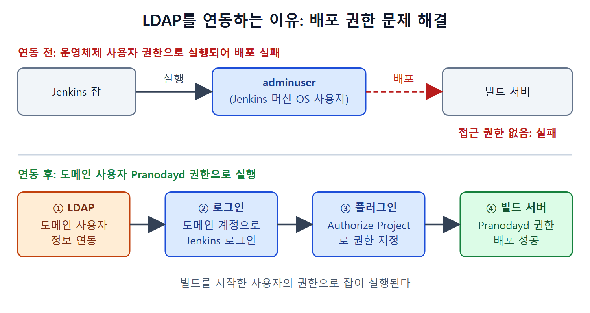

# LDAP 연동

회사에서는 보통 직원 계정을 한곳에서 관리한다. Jenkins가 자체 사용자 데이터베이스만 쓰면 직원은 Jenkins용 계정을 따로 만들어야 하고, Jenkins가 회사 서버에 접근하는 일도 꼬이기 쉽다. LDAP를 연동하면 회사 계정으로 Jenkins에 로그인할 수 있다. 이 문서는 LDAP가 무엇인지, 왜 필요한지, Jenkins에 어떻게 붙이는지를 정리한다.

LDAP는 사내 전화번호부 같은 것이다. 직원 이름과 인증 정보가 한 장부에 모여 있고, Jenkins는 로그인할 때마다 그 장부에 물어본다.

---

## 1. LDAP란

LDAP(Lightweight Directory Access Protocol)는 조직, 개인, 파일 같은 자원의 정보를 인터넷이나 인트라넷에서 찾을 수 있게 해 주는 프로토콜(통신 규약)이다. 흔한 쓰임은 인증을 한곳에서 처리하는 것이다. 사용자 이름과 비밀번호를 저장해 두고, Docker나 Jenkins 같은 도구가 이 정보로 로그인을 확인하게 한다.

| 구분 | Jenkins' own user database | LDAP |
|---|---|---|
| 사용자 목록 위치 | Jenkins 내부 | 회사의 디렉터리 서버 |
| 계정 관리 | Jenkins에서 직접 만든다 | 기존 회사 계정을 그대로 쓴다 |
| 필요한 준비 | 없음 | LDAP 플러그인과 서버 정보 |

이 표는 두 방식의 차이를 요약한 것이다. 사용자가 많고 계정이 이미 중앙에서 관리된다면 LDAP가 편하다.

---

## 2. LDAP를 연동해야 하는 이유

원서는 하나의 사례로 설명한다. 필자가 ABC라는 회사의 직원이고 회사 도메인 사용자 이름이 `Pranodayd`라고 하자. 이 사용자는 빌드가 만들어지는 빌드 서버에 접근할 권한이 있다. 반면 Jenkins가 설치된 머신의 운영체제 사용자는 `adminuser`이고, 이 사용자에게는 빌드 서버 접근 권한이 없다.

Jenkins 잡이 빌드 서버에 애플리케이션을 배포하려 하면 어떻게 될까. Jenkins는 잡을 운영체제에 로그인된 사용자 권한으로 실행하기 때문에, 권한이 없는 `adminuser`로는 배포가 실패한다.

해결 방법은 잡을 다른 사용자, 즉 `Pranodayd`로 실행하는 것이다. 도메인 사용자의 이름과 비밀번호 정보가 담긴 LDAP를 Jenkins에 연동하면 자기 도메인 계정으로 Jenkins에 로그인할 수 있다. 로그인한 뒤에는 Authorize Project 플러그인으로 빌드를 실행시킨 사용자의 권한으로 잡을 돌리게 설정할 수 있다.

| 단계 | 내용 |
|---|---|
| 1 | LDAP에 도메인 사용자 정보를 연동한다 |
| 2 | 사용자가 자기 도메인 계정으로 Jenkins에 로그인한다 |
| 3 | Authorize Project 플러그인으로 빌드를 시작한 사용자 권한으로 잡이 실행되게 한다 |

위쪽은 잡이 adminuser 권한으로 실행되어 빌드 서버 배포에 실패하는 모습이고, 아래쪽은 LDAP 연동 후 Pranodayd 권한으로 배포에 성공하는 흐름이다.

원서는 Authorize Project 플러그인의 사용법을 이 책에서 다루지 않는다고 밝힌다. 이 사례는 Jenkins가 자체 사용자 데이터베이스 대신 Active Directory(LDAP) 사용자를 써야 하는 상황이 있다는 점을 보여 주려는 예다.

---

## 3. Jenkins에 LDAP 설정하기

먼저 LDAP 플러그인을 설치한다.

1. Dashboard → Manage Jenkins → Manage Plugins로 간다.
2. Available 탭을 열고 검색창에 `LDAP`를 입력한다.
3. LDAP 플러그인 체크박스를 선택하고 Install Without Restart(재시작 없이 설치) 버튼을 누른다.
4. 설치 상태가 성공으로 바뀔 때까지 기다린다.
5. Back to Dashboard 링크로 대시보드에 돌아온다.

다음으로 플러그인을 켠다.

1. Manage Jenkins → Configure Global Security로 이동한다.
2. Security Realm 영역에 LDAP 라디오 버튼이 생겨 있다. 이를 선택한다.
3. 나타나는 LDAP 설정 항목을 채운다.

LDAP 서버 주소처럼 채울 값은 조직마다 다르다. 원서는 설정을 마무리하려면 회사 IT 부서에 문의하라고만 안내하고 세부 항목은 설명하지 않는다.

---

## 4. 정리

- LDAP는 사용자 이름과 비밀번호 같은 인증 정보를 중앙에서 관리하는 프로토콜이다.
- Jenkins 머신의 운영체제 사용자에게 권한이 없는 서버에 배포해야 할 때, 도메인 사용자로 로그인해서 그 권한으로 잡을 실행할 수 있다.
- 설정은 LDAP 플러그인 설치, Configure Global Security의 Security Realm에서 LDAP 선택 순서로 한다. 서버 정보는 IT 부서와 맞춘다.

 
 
 

[CICD Pipeline Using Jenkins Unleashed](../)
