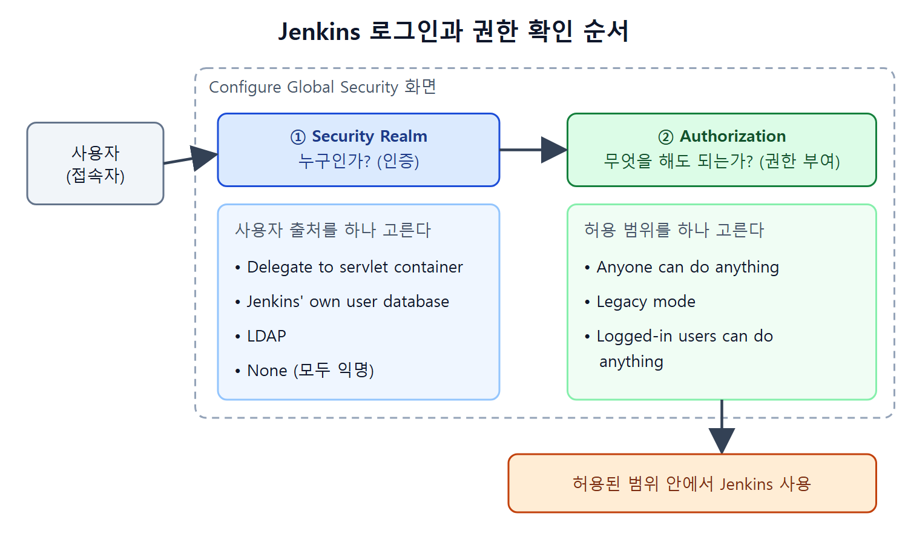

# 보안 설정 화면과 인증

Jenkins는 빌드와 배포를 자동으로 돌려 주는 서버라서, 아무나 들어와 잡(작업)을 고치거나 실행하면 곤란하다. 그래서 Jenkins에는 "누가 들어올 수 있는가"를 정하는 인증과 "들어온 사람이 무엇을 할 수 있는가"를 정하는 권한 부여 설정이 따로 있다. 이 문서는 그중 인증, 즉 로그인 쪽 설정을 다룬다.

인증(Authentication)은 정상 사용자만 로그인하게 하는 일이고, 권한 부여(Authorization)는 관리자와 일반 사용자처럼 사용자 종류별로 허용 범위를 나누는 일이다. 건물에 비유하면 인증은 출입증을 확인하는 경비실이고, 권한 부여는 출입증마다 열리는 방을 정해 둔 설정이다.

---

## 1. 보안 설정 화면 찾아가기

모든 보안 설정은 Configure Global Security(전역 보안 설정) 화면에 모여 있다. 원서의 흐름은 다음과 같다.

1. Jenkins에 로그인해서 대시보드를 연다.
2. 대시보드의 Security 영역에 있는 Configure Global Security 링크를 클릭한다.
3. 열린 화면에서 아래 항목들을 위에서부터 차례로 살핀다.

이 화면의 항목은 성격에 따라 크게 나뉜다. 아래 표는 이 장에서 다루는 항목을 화면 영역별로 묶은 것이다.

| 화면 영역 | 주요 항목 | 하는 일 |
|---|---|---|
| Security Realm(보안 영역) | Delegate to servlet container, Jenkins' own user database, LDAP, None | 사용자를 어디서 확인할지 정한다 |
| Authorization(권한 부여) | Anyone can do anything, Legacy mode, Logged-in users can do anything | 로그인한 뒤 무엇을 허용할지 정한다 |
| Agents(에이전트) | TCP port for inbound agents | 에이전트 서버와 통신할 포트를 정한다 |
| 그 밖의 항목 | CSRF Protection, API Token, SSH Server | 요청 위조 방지, API 접근, CLI 접근을 정한다 |

표처럼 Security Realm은 "누구인가"를, Authorization은 "무엇을 해도 되는가"를 정한다. 이 문서는 첫 번째 줄을, 다음 문서는 두 번째 줄을 다룬다.


그림은 접속자가 Security Realm에서 먼저 누구인지 확인받고, Authorization에서 허용 범위가 정해진 뒤에 Jenkins를 쓰는 순서를 보여 준다.

---

## 2. 로그인 화면의 기억 옵션

### Disable remember me

기본값은 체크 해제 상태다. 이때 로그인 화면에는 Keep Me Signed In(로그인 상태 유지) 체크박스가 보인다. 사용자가 이 박스를 체크하고 로그인하면, 로그아웃하지 않고 브라우저를 닫아도 다음에 다시 로그인하라고 묻지 않는다.

Disable Remember Me를 체크하면 로그인 화면에서 Keep Me Signed In 박스 자체가 사라진다.
---

## 3. Security Realm 선택지

Security Realm은 "사용자 목록을 어디서 가져올지"를 고르는 라디오 버튼이다. 원서가 설명하는 선택지를 표로 정리하면 다음과 같다.

| 선택지 | 사용자 정보의 출처 | 특징 |
|---|---|---|
| Delegate to servlet container | Jenkins가 올라간 서블릿 컨테이너에 설정된 사용자 | Jetty(기본), Tomcat 등의 사용자를 그대로 쓴다 |
| Jenkins' own user database | Jenkins 자체 데이터베이스 | 외부 시스템 없이 Jenkins 안에서 사용자를 만들고 관리한다 |
| LDAP | 회사의 LDAP 서버 | 별도 플러그인이 필요하다. 자세한 내용은 LDAP 문서에서 다룬다 |
| None | 없음 | 인증을 묻지 않고 모두 anonymous(익명) 사용자로 본다 |

처음 시작하는 환경에서는 Jenkins' own user database가 가장 단순하다. 회사 계정과 연동해야 한다면 LDAP로 간다.

### Delegate to servlet container

Jenkins는 Java 서블릿 컨테이너 안에서 돌아가는 자동화 서버다. 서블릿 컨테이너는 Java 웹 애플리케이션을 실행해 주는 틀이고, Jenkins가 기본으로 쓰는 것은 Jetty이며 Tomcat 같은 것도 쓸 수 있다. 이 옵션을 고르면 그 컨테이너에 이미 설정된 사용자를 Jenkins 로그인에 그대로 쓴다.

### Jenkins' own user database

외부 시스템에 사용자 목록을 맡기고 싶지 않을 때 쓴다. Jenkins가 사용자를 직접 만들고 자기 데이터베이스에 보관한다. 사용자는 다음 순서로 만든다.

1. 대시보드로 이동한다.
2. Manage Jenkins → Manage Users(사용자 관리)를 선택한다.
3. Create User 링크를 클릭한다.
4. Create User 화면에 사용자 이름, 비밀번호, 비밀번호 확인, 전체 이름, 이메일 주소를 입력하고 Create User 버튼을 누른다.

이렇게 만든 사용자는 곧바로 Jenkins에 로그인할 수 있다.

### Allow users to sign up

이 체크박스는 Jenkins' own user database 옵션 아래에 있고, 기본값은 체크 해제다. 체크하면 Jenkins 로그인 화면에 Create an Account(계정 만들기) 링크가 나타난다. 이 링크로 들어가 필요한 정보를 입력하면 누구나 인증된 사용자가 될 수 있다.

원서는 이 옵션을 켜 두지 않기를 권한다. 켜 두면 Jenkins 서버가 속한 도메인 안의 누구든 스스로 계정을 만들어 인증된 사용자가 되기 때문이다. 사용자는 관리자가 직접 만드는 쪽이 안전하다.

### None

None을 고르면 인증을 전혀 묻지 않고 접속자를 모두 anonymous로 취급한다. 그런데 이 상태로 접속하면 기본 설정에서는 Jenkins 서버 로그에 다음과 같은 오류가 남는다.

```text
anonymous is missing the Overall/Read permission
```

익명 사용자는 기본적으로 Overall/Read 권한이 없다는 뜻이다. 익명 접속을 허용하려면 아래처럼 설정 파일을 고친다.

1. `$Jenkins_Home\config.xml` 파일을 연다.
2. `<denyAnonymousReadAccess>` 태그의 값을 `true`에서 `false`로 바꾼다.
3. 서버를 재시작하고 Jenkins 주소로 접속한다.

```xml
<denyAnonymousReadAccess>false</denyAnonymousReadAccess>
```

이렇게 하면 인증을 묻지 않고 곧바로 대시보드로 들어가지만, 접근은 읽기 전용이다. 원서는 설정 파일의 한 줄을 바꾼다고만 설명하며, 태그가 파일의 어느 위치에 있는지는 화면 그림으로만 보여 준다.

---

## 4. 정리

- 보안 설정은 Configure Global Security 화면 한 곳에서 한다.
- 사용자 출처는 Security Realm에서 고른다. 단순하게는 Jenkins 자체 데이터베이스, 회사 계정과 연동하려면 LDAP를 쓴다.
- Allow users to sign up은 켜지 않는 편이 안전하다.
- None은 익명 접속이 되며, 읽기 전용으로 열려면 `config.xml`의 `denyAnonymousReadAccess`를 `false`로 바꾸고 재시작해야 한다.

<br>
<br>
<br>

[CICD Pipeline Using Jenkins Unleashed](../)
