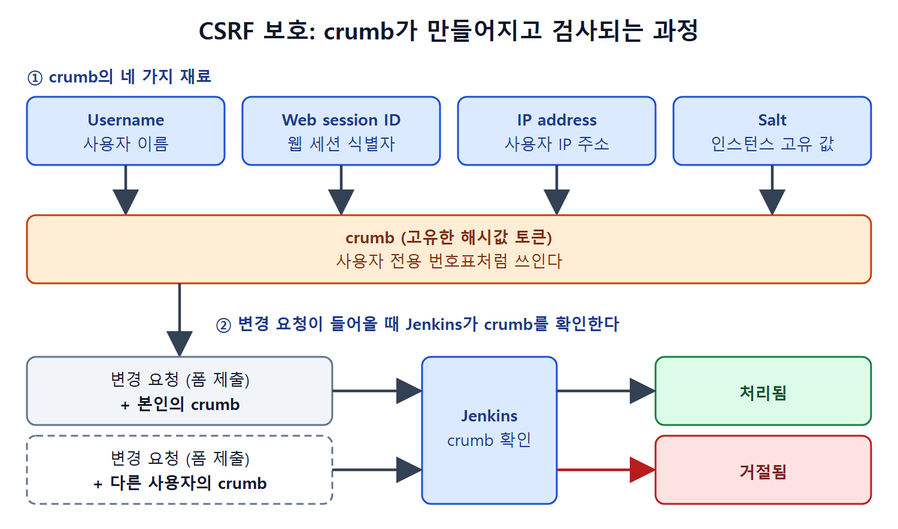

# 에이전트 포트와 CSRF와 API 토큰

Configure Global Security 화면에는 로그인과 권한 말고도 네트워크와 외부 접근에 관한 항목이 있다. 빌드 서버를 여러 대 둘 때 쓰는 에이전트 포트, 위조된 요청을 막는 CSRF 보호, 프로그램이 Jenkins를 호출할 때 쓰는 API 토큰, 명령줄(CLI)로 접속할 때 쓰는 SSH 서버가 그것이다. 이 문서는 네 가지를 차례로 정리한다.

각 항목은 "열어 둘수록 편하지만 위험도 커지는" 성격이라, 쓰지 않는 기능은 끄는 쪽이 원서의 일관된 조언이다.

---

## 1. TCP port for inbound agents

이 항목은 Agents 영역에 있다. 분산 빌드(distributed build, 빌드를 여러 서버에 나눠 맡기는 방식)에서는 에이전트(노드, 빌드를 실행하는 서버) 머신을 여러 대 설정한다. 컨트롤러(마스터)는 여기서 정한 포트 번호로 에이전트와 통신한다. 분산 빌드는 원서의 17장에서 자세히 다룬다.

| 선택지 | 동작 | 방화벽 규칙 | 어울리는 상황 |
|---|---|---|---|
| Random | 다른 프로세스가 쓰지 않는 포트를 동적으로 고른다 | 포트가 계속 바뀌어 인바운드 규칙을 만들 수 없다 | 방화벽 제한이 없을 때 |
| Fixed | 머신에서 비어 있는 포트를 직접 확인해 입력한다 | 포트가 고정이라 인바운드 규칙을 만들기 쉽다 | 방화벽이 있을 때. 보통 이쪽을 선호한다 |
| Disable | 에이전트 접속을 받지 않는다 | 필요 없음 | 분산 빌드를 쓰지 않을 때 |

방화벽은 인바운드 규칙(들어오는 연결을 허용하는 규칙)에 포트 번호를 넣어야 그 포트로 들어오는 요청을 통과시킨다. 포트를 매번 바꾸는 Random으로는 규칙을 미리 만들 수 없으므로, 사실상 방화벽이 있다면 Fixed가 현실적인 선택이다. Windows 방화벽에서 인바운드 규칙을 만드는 절차는 17장에서 다룬다고 원서가 안내한다.

---

## 2. CSRF protection

CSRF(Cross-Site Request Forgery, 사이트 간 요청 위조)는 로그인된 사용자의 브라우저를 이용해 공격자가 가짜 요청을 보내는 공격이다. 이를 막기 위해 Jenkins는 사용자 정보를 바탕으로 토큰을 만들어 사용자에게 보내 둔다. Jenkins에서는 이 토큰을 crumb(부스러기)이라고 부른다.

빌드 설정을 바꾸는 것처럼 변경을 일으키는 폼 제출이나 동작에는 이 crumb가 반드시 따라가야 한다. crumb에는 특정 사용자를 식별하는 정보가 들어 있어서, 다른 사용자의 토큰으로 제출한 요청은 거절된다. 은행 창구에 비유하면 본인 이름이 찍힌 번호표가 있어야 업무를 볼 수 있고, 남의 번호표는 받아 주지 않는 것과 같다.

crumb는 다음 정보를 바탕으로 만들어지는 고유한 해시값이다.

| 재료 | 의미 |
|---|---|
| Username | 사용자 이름 |
| Web session ID | 웹 세션 식별자 |
| IP address | 사용자 머신의 IP 주소 |
| Salt | 이 Jenkins 인스턴스에만 있는 고유한 값 |

crumb가 만들어지면 사용자는 이를 이용해 인증을 거친다. 네 가지 재료가 모두 사용자나 서버에 고유하므로, 다른 사람이나 다른 서버의 crumb는 통하지 않는다.

그림은 네 가지 재료로 crumb가 만들어지고, 변경 요청이 들어오면 Jenkins가 본인의 crumb는 처리하고 다른 사용자의 crumb는 거절하는 과정을 보여 준다.

---

## 3. API Token

이 항목은 REST API, Jenkins CLI 명령, 그 밖의 애플리케이션으로 Jenkins에 접근할 때의 인증을 설정한다. Jenkins는 새 빌드 실행, 잡 생성과 복사 같은 일을 하는 REST API 엔드포인트(호출 주소)와 CLI 명령을 제공한다. 자세한 사용법은 원서의 19장과 20장에서 다룬다.

| 체크박스 | 효과 |
|---|---|
| Generate a Legacy API Token for Each Newly Created User | Jenkins 데이터베이스나 LDAP로 만들어지는 모든 사용자에게 API 토큰을 자동으로 만든다. REST API로 접근할 때 이 토큰으로 사용자를 인증한다 |
| Allow Users to Manually Create a Legacy API Token | 사용자가 직접 Legacy API 토큰을 만들 수 있게 한다 |

두 옵션 모두 Jenkins 2.129 이상에서는 deprecated(앞으로 쓰지 말라고 표시된 상태)다. Jenkins는 사용자가 새 방식의 API 토큰을 직접 만들어 쓰기를 권한다. 새 토큰을 만드는 방법은 19장과 20장에 나온다.

원서는 Agent → Controller security 항목도 이 화면에 있다고 짚고, 설명은 17장으로 미룬다.

---

## 4. SSH Server

Jenkins에는 셸 프로그램으로 접근할 수 있는 명령(Jenkins CLI)이 내장되어 있다. Windows에서는 배치 파일, Linux에서는 셸 스크립트를 만들어 잡 생성이나 빌드 실행 같은 일을 자동화할 수 있다. CLI는 원서의 20장에서 다룬다. 이런 접근을 받을 때 Jenkins가 SSH 서버 역할을 하며, SSH 클라이언트가 CLI 명령으로 접근하도록 허용한다.

선택지는 에이전트 포트와 같은 구조다.

| 선택지 | 동작 | 비고 |
|---|---|---|
| Random | 사용 중이지 않은 포트를 동적으로 골라 SSH 클라이언트의 연결을 기다린다 | 방화벽에서 모든 포트를 열어야 해서 어렵다 |
| Fixed | 비어 있는 포트를 확인해 직접 입력하고, 그 포트로 연결을 받는다 | Windows 방화벽 인바운드 규칙을 만들기 쉬워 보통 선호한다 |
| Disable | SSH로 CLI 접근을 받지 않는다 | CLI 명령으로 접속하지 않으면 이쪽이 낫다 |

CLI로 Jenkins에 접속할 일이 없다면 Disable을 선택하는 편이 좋다. 쓰지 않는 문은 닫아 두는 쪽이 안전하기 때문이다. 인바운드 규칙 작성 절차는 17장에서 다룬다.

---

## 5. 정리

- 분산 빌드를 안 쓰면 에이전트 포트는 Disable, 쓰면서 방화벽이 있으면 Fixed를 고른다.
- CSRF 보호는 사용자, 세션, IP, 솔트로 만든 crumb로 위조 요청을 걸러 낸다.
- Legacy API 토큰 옵션은 2.129 이상에서 권장되지 않으며, 사용자가 직접 새 API 토큰을 만드는 방식을 쓴다.
- SSH 서버는 CLI 접근을 쓸 때만 켜고, 포트는 Fixed가 다루기 쉽다.

 
 
 

[CICD Pipeline Using Jenkins Unleashed](../)
