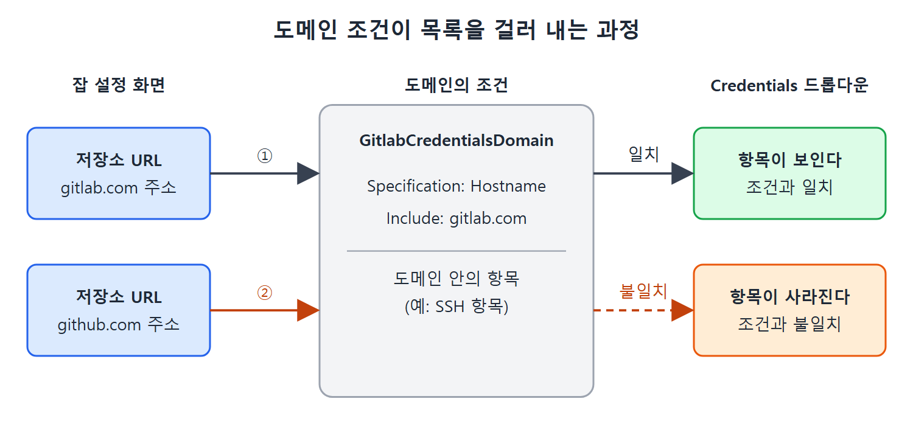

# 도메인으로 자격 증명 묶기

자격 증명이 몇 개 안 될 때는 목록에서 고르는 일이 어렵지 않다. 하지만 GitLab, GitHub, AWS, Nexus 등 연결할 곳이 늘어나면 목록이 길어져서 엉뚱한 항목을 고르기 쉽다. 도메인은 이 문제를 풀어 준다.

이 문서는 도메인을 만들 때 조건(Specification)을 거는 방법과 그 도메인 안에 SSH 항목을 만드는 절차를 설명한다. 마지막에는 저장소 URL을 바꾸면 항목이 목록에서 사라지는 현상을 통해 도메인이 어떻게 동작하는지 확인한다.

---

## 1. 도메인 만들기

1. Manage Jenkins에서 Manage Credentials 링크를 누른다. 처음 항목을 만드는 경우라면 목록은 비어 있다.
2. Stores Scoped to Jenkins 영역의 Store 열에서 Jenkins 드롭다운을 열고 Add Domain을 누른다. Domain 페이지가 열린다.
3. Domain Name 필드에 이 도메인을 알아볼 짧은 이름을 넣는다.
4. Description 필드에 도메인에 무엇을 담을지 짧게 적는다. 선택 사항이다.
5. Specification 필드에서 Jenkins가 항목을 걸러 낼 조건을 설정한다.
6. OK 버튼을 누른다. 페이지가 다시 열리면 새 도메인이 보인다.

### 조건 설정 예

Jenkins 잡이 GitLab.com에 접속할 때만 보이는 자격 증명을 담는 도메인을 만든다고 하자. Specification 드롭다운에서 Hostname 옵션을 고르고, Include 필드에 gitlab.com을 입력한다.

| 입력 위치 | 값 | 의미 |
|---|---|---|
| Domain Name | 짧은 식별 이름 | 책의 예에서는 GitlabCredentialsDomain 이름이 쓰인다 |
| Specification | Hostname | 접속 대상 호스트 이름으로 걸러 낸다 |
| Include | gitlab.com | 이 호스트에 접속할 때만 이 도메인의 항목을 보여 준다 |

이 도메인에는 호스트 이름이 gitlab.com인 접속에서만 쓸 수 있는 항목들이 들어간다는 선언을 한 셈이다. 책은 이 도메인을 본문에서 "GitLab Credentials" 또는 "GitlabCredentialsDomain"이라 부르는데, 같은 도메인이다.

## 2. 도메인 안에 SSH 항목 만들기

이번에는 SSH 방식 항목을 새 도메인 안에 만든다.

1. 도메인 페이지 왼쪽의 Add Credentials 링크를 누른다.
2. Kind 필드에서 SSH Username with private key를 고른다.
3. Scope는 Global을 그대로 둔다.
4. ID 필드에 아무 문자열이나 넣는다. Description은 비워도 된다.
5. Username 필드에 접속할 시스템에서 인증에 쓰는 사용자 이름을 넣는다. 예를 들어 GitLab 사용자 이름이다.
6. Private Key 영역에서 Enter Directly 라디오 버튼을 고르고, 미리 만들어 둔 개인 키를 붙여 넣는다.
7. 키에 암호(passphrase)를 걸었다면 Passphrase 필드에 넣는다.
8. OK 버튼을 누른다.

저장하면 항목이 도메인 안에 만들어진다.

| 필드 | 넣는 값 |
|---|---|
| Kind | SSH Username with private key |
| Username | 접속 대상 시스템의 사용자 이름 |
| Private Key | Enter Directly를 고르고 개인 키 내용을 붙여 넣음 |
| Passphrase | 개인 키에 암호가 있으면 입력 |

참고로 SSH 인증용 항목을 만들려면 먼저 ssh-keygen 명령으로 공개 키와 개인 키를 만들어 두어야 한다. 책은 키 생성을 이후 장에서 다룬다고 하며, 이 장의 초점은 특정 도메인에 항목을 만드는 방법을 이해하는 데 있다고 밝힌다.

이 장에는 ssh-keygen의 옵션이나 사용법이 나오지 않는다.

## 3. 도메인이 실제로 걸러 내는 모습

잡 설정 화면에서 소스 코드 관리 쪽 저장소 URL에 GitLab.com 주소를 넣으면, Credentials 드롭다운에 방금 만든 도메인의 항목이 나타난다. 도메인의 Hostname 조건이 gitlab.com이니 조건에 맞는 접속이기 때문이다.

그런데 저장소 URL을 GitHub.com 주소로 바꾸면 같은 드롭다운에서 그 항목이 목록에서 사라진다. 이 항목이 속한 도메인이 gitlab.com 호스트용으로 만들어졌고 GitHub.com은 조건에 해당하지 않기 때문이다. 책은 이 장면에서 URL 입력에 오류 표시가 뜨지만 Git 연동을 다루는 뒤쪽 장에서 설명한다며 지금은 무시하라고 한다.

| 저장소 URL의 호스트 | 도메인 항목이 목록에 보이는가 | 이유 |
|---|---|---|
| gitlab.com | 보인다 | 도메인 조건(Include)과 일치 |
| github.com | 안 보인다 | 도메인 조건과 불일치 |

저장소 URL이 gitlab.com이면 도메인의 Hostname 조건과 일치해 항목이 보이고, github.com이면 일치하지 않아 항목이 목록에서 사라진다.

이 동작은 실수를 줄여 준다. GitHub용 잡을 설정하다가 GitLab 비밀번호나 키를 잘못 고를 일이 없고, 다른 사이트로 인증 정보가 잘못 넘어갈 가능성도 줄어든다. 이 장점은 노트의 해석이고, 책은 목록에서 빠진다는 사실과 "아주 좋은 기능"이라는 평가만 말한다.

 
 
 

[CICD Pipeline Using Jenkins Unleashed](../)
