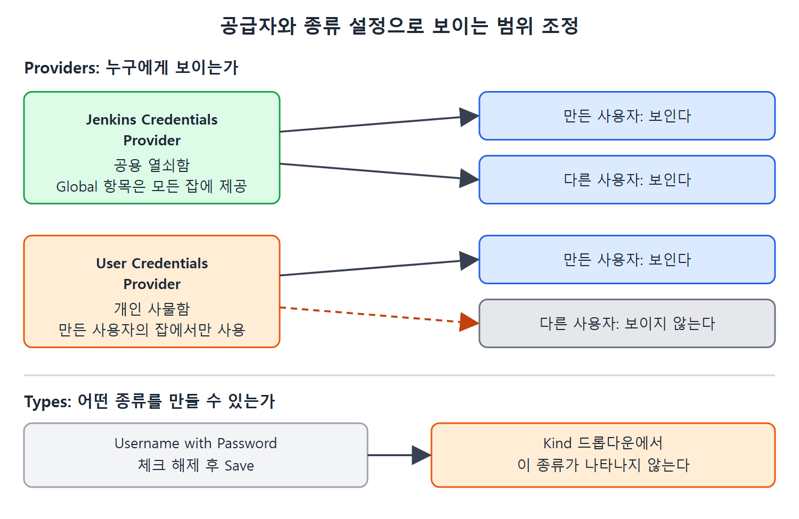

# 자격 증명 공급자 설정

지금까지는 자격 증명을 Jenkins 전체가 공유하는 곳에 만들었다. 그런데 Jenkins에는 "누가 만든 자격 증명을 누구에게 보여 줄 것인가"와 "어떤 종류의 항목을 만들게 할 것인가"를 조정하는 설정이 따로 있다. 이 문서는 Configure Credential Providers 화면에서 공급자(Provider)와 종류(Types)를 조정하는 방법을 다룬다.

---

## 1. 설정 화면 열기

1. Manage Jenkins 아래의 Configure Credential Providers 링크를 누른다.
2. Configure Credentials Provider 페이지가 열린다. 여기에 Providers와 Types 두 개의 드롭다운이 있고, 기본값은 둘 다 All available이다.

## 2. Providers 설정

Providers 드롭다운에서 Only Selected를 고르면 두 가지 공급자가 나타난다.

| 공급자 | 보여 주는 자격 증명 | 사용 범위 |
|---|---|---|
| Jenkins Credentials Provider | Jenkins 루트에서 제공. Global과 System 스코프 항목을 기본 도메인과 특정(비기본) 도메인에 만들 수 있다 | Global 항목은 모든 사용자의 모든 잡에 제공된다 |
| User Credentials Provider | 사용자 개인 저장소에서 제공 | 그 항목을 만든 사용자가 만들고 실행한 잡에서만 쓸 수 있다 |

읽는 법은 이렇다. 앞의 공급자는 공용 열쇠함이고, 뒤의 공급자는 개인 사물함이다. 팀 전체가 쓸 인증 정보는 공용 열쇠함에, 내가 개인 계정으로만 쓸 인증 정보는 개인 사물함에 둔다는 식으로 구분하면 된다. 이 비유는 이해를 돕기 위한 것이다.

## 3. 사용자 자격 증명 만들기

User Credentials Provider에 항목을 만드는 절차는 다음과 같다.

1. 화면 위쪽의 사용자 이름을 눌러 나오는 메뉴에서 Credentials 링크를 누른다. 책의 예에서는 PranodayDingare → Credentials 순으로 눌렀다.
2. Stores Scoped to 사용자 이름 표의 Store 열에 있는 링크를 누른다. 책의 예에서는 User:PranodayDingare 링크이며, 사용자 페이지가 열린다.
3. Global Credentials (Unrestricted) 링크를 눌러 해당 페이지를 연다.
4. Add Credentials 링크를 누른다.

이후 입력 절차는 앞에서 한 것과 같다. 책 저자는 같은 방식으로 새 항목을 하나 만들었다.

## 4. 사용자별로 보이는 범위 확인

저자가 로그아웃한 뒤 다른 사용자로 로그인해 확인했더니, 방금 만든 사용자 전용 항목은 보이지 않았다. 반면 앞에서 Jenkins Credentials Provider에 만든 항목은 그대로 보였다.

| 항목을 만든 곳 | 만든 사용자 | 다른 사용자 |
|---|---|---|
| Jenkins Credentials Provider | 보인다 | 보인다 |
| User Credentials Provider | 보인다 | 보이지 않는다 |

공용 공급자의 항목은 누구에게나 보이고, 사용자 공급자의 항목은 만든 사람만 쓸 수 있다는 의미다.

위쪽은 두 공급자에 만든 항목이 만든 사용자와 다른 사용자에게 보이는지를, 아래쪽은 Types에서 종류를 해제하면 Kind 드롭다운에서 사라지는 흐름을 보여 준다.

## 5. Types 설정

Types 드롭다운에서 Only Selected를 고르면 자격 증명 종류의 체크박스 목록이 나타난다. 여기서 만들 수 있게 허용할 종류를 정한다. 예를 들어 Username with Password 체크를 해제하고 Save를 누르면, 항목을 만들 때 Kind 드롭다운에 이 옵션이 나타나지 않는다. 원문은 이 종류가 아예 쓸 수 없게 된다고 덧붙인다.

| 설정 | 하는 일 | 예 |
|---|---|---|
| Providers | 어떤 공급자를 켜 둘지 정한다 | Jenkins Credentials Provider와 User Credentials Provider 중 선택 |
| Types | 어떤 종류의 항목을 허용할지 정한다 | Username with Password를 해제하면 Kind에서 사라진다 |

이 설정은 조직에서 특정 인증 방식은 쓰지 못하게 막고 싶을 때 유용하다. 예컨대 비밀번호 방식을 허용하고 싶지 않다면 해당 종류를 꺼 두면 된다. 이 활용 예는 해설자의 해석이다.

 
 
 

[CICD Pipeline Using Jenkins Unleashed](../)
