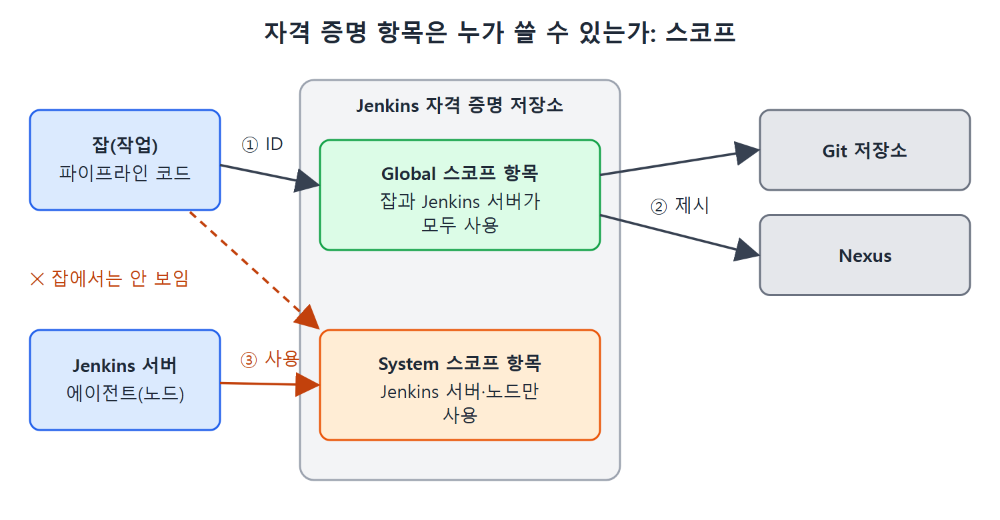

# 자격 증명의 개념과 종류

Jenkins는 빌드와 배포를 자동으로 돌리는 서버라서 혼자 일하지 못한다. 소스를 받으려면 Git 저장소에 들어가야 하고, 빌드 결과물을 올리려면 Nexus 같은 아티팩트(빌드 결과물) 저장소에 접근해야 한다. 이런 외부 도구는 아무나 들여보내 주지 않기 때문에 Jenkins가 "나는 허락받은 사용자다"라고 증명할 정보를 내밀어야 한다.

이 문서는 그 정보를 Jenkins 안에서 어떻게 부르고 어떻게 보관하는지, 그리고 자격 증명을 나누는 두 가지 기준인 스코프(Scope)와 도메인(Domain)이 무엇인지 설명한다.

---

## 1. 자격 증명이란 무엇인가

회사 건물을 떠올려 보자. 정문을 지나려면 사원증이 필요하고, 서버실 문 앞에서는 별도의 보안 카드나 지문이 필요하다. 출입 수단은 문마다 다르지만 "나를 증명하는 물건"이라는 점은 같다. Jenkins에서 이 물건에 해당하는 것이 자격 증명(credential)이다.

정확히 말하면 자격 증명은 외부 도구에 접속할 때 필요한 인증 정보이며, Jenkins 안에 항목(entry) 단위로 저장해 둔다. 항목을 만들어 두면 얻는 이점이 두 가지다.

- 인증 정보를 Jenkins가 따로 보관하므로, 파이프라인 코드에 사용자 이름과 비밀번호나 개인 키를 사람이 읽을 수 있는 글자로 적지 않아도 된다.
- 한 번 만든 항목을 여러 잡(작업)에서 함께 쓸 수 있다.

모든 자격 증명 항목에는 고유한 Credentials ID가 붙는다. 잡이나 파이프라인에서는 이 ID로 저장된 인증 정보를 불러온다. 파이프라인 코드에는 비밀번호 대신 ID만 남는 셈이다.

## 2. 도구가 요구하는 인증 방식

Git이나 Nexus 같은 도구는 사용자를 확인하는 방식이 제각각이다. 책은 주로 쓰이는 방식을 네 가지로 꼽는다. 아래 표의 앞 세 줄은 책이 본문에서 풀어 준 내용이고, 인증서(Certificate)는 이름만 나열되어 있다.

| 인증 방식 | 확인하는 방법 | Jenkins가 내밀어야 하는 것 |
|---|---|---|
| 기본 인증(Basic authentication) | 사용자 이름과 비밀번호를 대조한다 | 사용자 이름, 비밀번호 |
| SSH 인증 | 개인 키와 공개 키가 짝이 맞는지 본다 | 개인 키 |
| API 토큰 | 접근 요청에 함께 보낸 토큰을 본다 | API 토큰 |
| 인증서(Certificate) | 책에서는 이름만 언급한다 | 원문에 설명 없음 |

읽는 법은 단순하다. 접속하려는 도구가 어떤 방식을 쓰는지 먼저 확인하고, 그 방식에 맞는 종류의 자격 증명 항목을 만들면 된다. 기본 인증을 쓰는 도구에는 사용자 이름과 비밀번호 항목을, SSH를 쓰는 도구에는 개인 키 항목을 만든다.

## 3. 관련 플러그인과 앞으로의 연결

자격 증명 항목을 만드는 기능은 Credentials 플러그인이 제공한다. 이 플러그인 덕분에 여러 종류의 인증 정보를 저장할 수 있다. 항목을 만든 뒤 잡이나 파이프라인에서 ID로 꺼내 쓸 때는 Credentials Binding 플러그인이 도와준다. 책은 이 플러그인을 14장에서 다룬다고 안내한다.

이 장에서는 항목을 만드는 쪽에 집중한다. 잡을 만드는 방법은 10장에서 나오지만, 항목이 잡 설정 화면의 목록에 보이는지 확인하려고 이 장에서도 잡 설정 화면을 잠깐 열어 본다.

## 4. 스코프: 어디에서 쓸 수 있는가

자격 증명 항목을 만들 때는 반드시 스코프를 고른다. 스코프는 그 항목을 어디에서 쓸 수 있는지를 정하는 범위다. 선택지는 두 가지다.

| 스코프 | 쓸 수 있는 곳 | 대표 용도 |
|---|---|---|
| Global | Jenkins 서버 자체와, 만들어진 모든 Jenkins 잡 | 잡이 Git이나 Nexus에 접속할 때 |
| System | Jenkins 인스턴스(서버와 에이전트 노드)만. 잡에서는 쓸 수 없다 | 이메일 인증, 에이전트 연결 같은 시스템 관리 기능 |

핵심은 System 스코프 항목이 잡 설정 화면의 자격 증명 목록에 나타나지 않는다는 점이다. 잡 쪽에서 쓸 항목은 Global로 만들어야 한다. 원문은 잡을 "빌드 수명 주기를 자동화하기 위해 구현한 일련의 단계"라고 짧게 풀어 둔다.

잡은 Global 스코프 항목을 ID로 불러 Git 저장소나 Nexus에 인증 정보를 내밀고, System 스코프 항목은 Jenkins 서버와 에이전트(노드)만 쓰므로 잡에서는 보이지 않는다.

## 5. 도메인: 비슷한 것끼리 묶는 폴더

도메인은 비슷한 시스템에 접속할 때 쓰는 자격 증명을 한데 묶는 방법이다. 항목을 따로 지정하지 않으면 기본(default) 도메인에 만들어진다.

책의 예를 보자. 자격 증명이 열 개 있고, 그중 세 개는 GitLab 코드 저장소용이며 나머지 일곱 개는 AWS 같은 다른 시스템용이다. 잡에서 GitLab 접근을 설정하면 열 개가 전부 목록에 뜨기 때문에 알맞은 것을 고르기 어렵다. 이때 "GitLab Credentials"라는 도메인을 만들고 세 항목을 그 안에 넣으면, GitLab 접근을 설정할 때 세 개만 보인다.

서랍장에 비유하면 이해가 쉽다. 양말, 셔츠, 속옷을 한 칸에 섞어 두면 매번 뒤져야 하지만, 칸을 나눠 두면 필요한 칸만 열면 된다. 도메인이 그 칸 구분이다. 도메인에는 조건을 걸 수도 있는데, 이 방법은 도메인 문서에서 따로 다룬다.

## 6. 정리

| 개념 | 역할 | 기억할 점 |
|---|---|---|
| 자격 증명 항목 | 외부 도구 접속에 쓰는 인증 정보 저장 | 코드에 비밀번호를 적지 않아도 된다 |
| Credentials ID | 항목의 고유 이름 | 잡에서 이 ID로 불러 쓴다 |
| 스코프 | 어디에서 쓸 수 있는지 | Global은 잡까지, System은 Jenkins 시스템만 |
| 도메인 | 비슷한 항목을 묶는 그룹 | 잡 설정 화면의 목록을 짧게 만든다 |

 
 
 

[CICD Pipeline Using Jenkins Unleashed](../)
