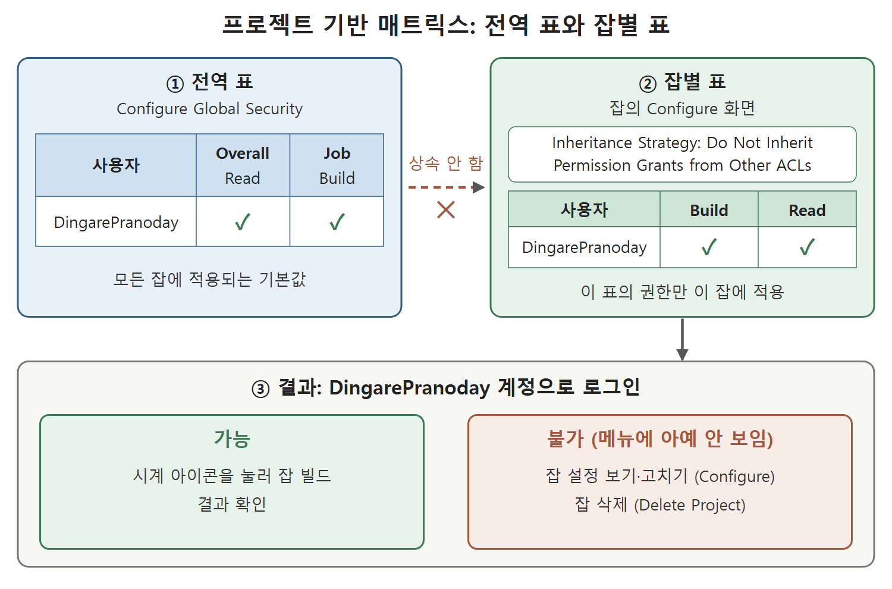

# 매트릭스 기반 보안

역할을 만들어 붙이는 방식 말고도 Jenkins에는 표(매트릭스) 하나에 사용자와 권한을 직접 체크하는 방식이 있다. 이 문서는 Configure Global Security의 Authorization 섹션에 있는 두 가지 옵션, 곧 Matrix-based security(매트릭스 기반 보안)와 Project-based Matrix Authorization Strategy(프로젝트 기반 매트릭스 권한 전략)를 정리한다.

역할 방식이 "직책별 출입증"이라면 매트릭스 방식은 "이름이 적힌 출입 명부"에 가깝다. 사람마다 가로줄을 하나 만들고 열마다 허용 여부를 체크하는 간단한 구조라서 소규모 팀에서 직관적으로 쓸 수 있다.

---

## 1. 매트릭스 기반 보안

Manage Jenkins → Configure Global Security 화면의 Authorization 섹션에서 Matrix-based security 옵션을 고르면 권한 표가 나타난다. 앞 문서의 역할 방식은 잡 단위, 노드 단위 등으로 접근을 관리하는 방법이었고, 이 옵션은 그와 다른 방식이다.

표에는 처음부터 두 개의 그룹이 있다.

| 그룹 | 의미 |
|---|---|
| Anonymous Users | 인증되지 않은 특별한 사용자, 즉 로그인하지 않은 방문자 |
| Authenticated Users | Jenkins 시스템에서 인증된 모든 사용자 |

원서는 이 두 그룹을 이 섹션의 주요 그룹으로 소개한다.

---

## 2. 사용자 추가와 권한 체크

특정 사용자나 그룹에 권한을 주려면 표에 행을 추가해야 한다.

1. Add User or Group(사용자 또는 그룹 추가) 버튼을 누른다. 브라우저에 입력 창이 열린다.
2. 사용자 ID를 입력하고 OK 버튼을 누른다.
3. 표에 생긴 사용자 행에서 원하는 섹션의 체크박스를 선택한다.
4. 페이지 아래로 내려가 Save 버튼을 누른다.

원서에서는 DingarePranoday 사용자에게 Job 섹션의 모든 체크박스와 Overall 섹션의 Read 체크박스를 선택했다.

이후 DingarePranoday 계정으로 로그인하면 화면 왼쪽에 보이는 메뉴가 몇 개 안 된다. Manage Jenkins 같은 관리 메뉴는 이 사용자에게 나타나지 않는다. 권한을 준 항목만 화면에 드러나고, 주지 않은 항목은 아예 숨겨지는 것이다.

| 체크한 항목 | 의미 |
|---|---|
| Overall의 Read | 기본적으로 Jenkins 화면을 볼 수 있는 권한 |
| Job 섹션 전체 | 잡에 대한 모든 작업 권한 |

원서는 Job 권한과 함께 Overall의 Read도 체크했다. 앞 문서에서 본 것처럼 Overall 권한이 없으면 대시보드에서 아무것도 볼 수 없다고 원서가 설명했으므로, 같은 맥락으로 이해하면 된다.

---

## 3. 프로젝트 기반 매트릭스 권한 전략

이 방식은 매트릭스 기반 보안을 확장한 것이다. 전체에 적용하는 표를 두고, 추가로 프로젝트(잡)마다 별도의 표를 정의할 수 있다. 전역 표가 기본값이고 잡별 표가 그 위에 덧붙는 모양새다.

### 3-1. 전역 표 설정

Authorization 섹션에서 Project-based Matrix Authorization Strategy를 선택한다.

1. Add User or Group 버튼을 눌러 브라우저 입력 창을 연다.
2. 사용자 ID를 입력한다. 원서에서는 DingarePranoday를 입력했다.
3. OK 버튼을 누르면 사용자 행이 추가된다.
4. 원하는 권한의 체크박스를 선택한다. 원서에서는 잡을 빌드할 수 있게 Job 섹션의 Build와 Overall 섹션의 Read를 선택했다.
5. 페이지의 Save 버튼을 누른다.

### 3-2. 잡별 보안 설정

이제 특정 잡의 설정으로 들어간다.

1. Jenkins 대시보드에서 잡 목록을 연다.
2. 잡 옆 드롭다운 메뉴에서 Configure(설정)를 선택한다.
3. 프로젝트 기반 보안 설정 체크박스를 선택해 켠다. 이 설정은 Configure Global Security에서 Project-based Matrix Authorization Strategy를 켜 둔 경우에만 모든 잡에 나타난다.
4. Add User or Group 버튼으로 사용자를 추가한다. 원서에서는 DingarePranoday를 입력하고 OK를 눌렀다.
5. Inheritance Strategy(상속 전략) 드롭다운에서 Do Not Inherit Permission Grants from Other ACLs를 선택한다. 다른 접근 제어 목록(ACL)의 허용 권한을 물려받지 않는다는 뜻이며, 여기서 지정한 권한만 이 잡에서 사용자에게 주어진다.
6. 원서의 목표는 Build와 Read만 주는 것이어서 그 두 체크박스를 선택했다.

| 설정 | 선택값 | 효과 |
|---|---|---|
| 프로젝트 기반 보안 체크박스 | 켬 | 이 잡에 전용 권한 표가 생김 |
| Inheritance Strategy | Do Not Inherit Permission Grants from Other ACLs | 전역에서 받은 권한을 가져오지 않고 이 표의 권한만 적용 |
| 사용자 권한 | Build, Read | 읽고 빌드만 가능 |

그림은 전역 표와 잡별 표의 관계, 그리고 상속하지 않도록 설정했을 때 사용자가 할 수 있는 일과 할 수 없는 일을 보여 준다. 잡별 표에서 Build와 Read만 준 사용자는 잡을 빌드할 수 있지만, Configure와 Delete Project 메뉴는 보지 못한다.

---

## 4. 결과 확인

설정을 마치고 DingarePranoday 계정으로 로그인한다. 이 사용자는 Read와 Build 권한만 가진다.

- 시계 모양 아이콘을 눌러 잡을 빌드할 수 있다.
- 잡의 설정을 보거나 고칠 수 없다.
- 잡을 삭제할 수 없다.
- 잡 옆 드롭다운에서 Configure와 Delete Project 메뉴가 나타나지 않는다.

즉 권한이 없는 기능은 눌러서 거절당하는 것이 아니라 메뉴에서 아예 보이지 않는다. 사용자는 잡을 실행해 결과를 확인할 수 있지만 잡의 설정이나 삭제 같은 위험한 동작은 할 수 없다.

---

## 5. 세 가지 방식 비교

| 구분 | 역할 기반 전략 | 매트릭스 기반 보안 | 프로젝트 기반 매트릭스 |
|---|---|---|---|
| 필요한 준비 | Role-Based Authorization Strategy 플러그인 | Authorization 섹션의 기본 옵션 | Authorization 섹션의 기본 옵션 |
| 권한을 정하는 방식 | 역할을 만들어 사용자에게 붙임 | 사용자 행에 권한 직접 체크 | 전역 표와 잡별 표를 함께 사용 |
| 잡 단위 제한 | 이름 패턴으로 구분 | 전역 표에서 설정 | 잡 설정 화면에서 잡마다 지정 |

원서가 이 방식들 중 무엇이 더 낫다고 비교하지는 않는다. 표는 설정 위치와 방법의 차이를 정리한 것이다. 잡 이름에 규칙이 있다면 패턴 기반 역할이, 몇몇 잡만 예외적으로 다르게 다루고 싶다면 잡별 표가 어울린다는 선택 기준은 이 책의 설명에서 읽어 낸 참고용 해석이다.

 
 
 

[CICD Pipeline Using Jenkins Unleashed](../)
