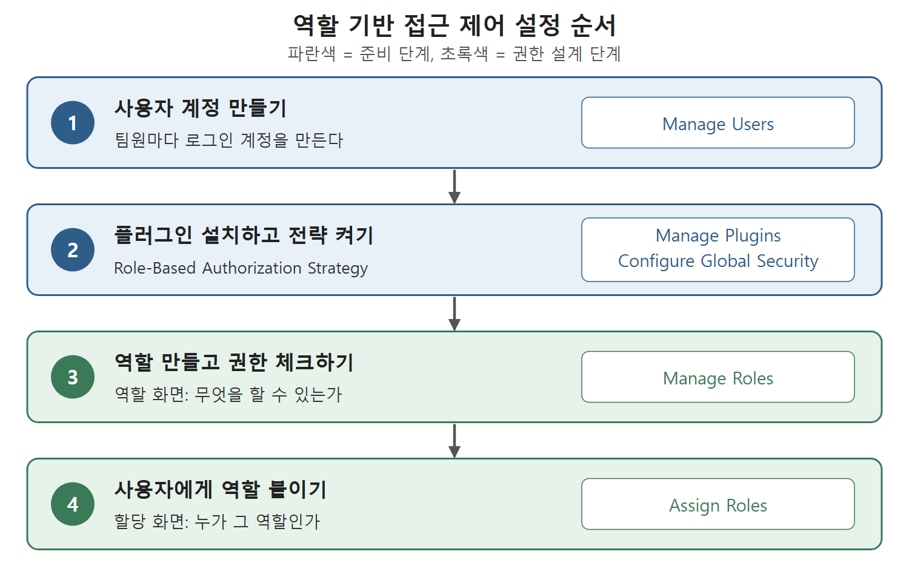

# 사용자 만들기와 플러그인 준비

Jenkins는 한 사람이 혼자 쓰는 도구가 아니다. 팀원 중 일부는 시스템 전체를 관리하는 관리자이고, 나머지는 잡(작업)을 보고 실행하는 정도의 최소한 권한만 가진다. 이 문서는 그 출발점으로, 사용자 계정을 만드는 방법과 역할을 나눠 줄 때 필요한 Role-Based Authorization Strategy 플러그인을 설치하고 켜는 과정을 정리한다.

비유하자면 사무실 출입증 발급과 같다. 먼저 직원 한 명 한 명에게 출입증(계정)을 만들어 주고, 그다음 "이 출입증으로는 어느 층까지 들어갈 수 있는지"를 정하는 규칙(역할)을 만든다. 이 문서는 앞의 출입증 발급과, 규칙을 만들 도구를 갖추는 단계까지 다룬다.

---

## 1. 사용자 만들기

Jenkins 화면에서 사용자를 만드는 방법은 다음과 같다. 원서의 예시 환경에는 이미 사용자가 두 명 만들어져 있는 상태였다.

1. Jenkins 대시보드에서 Manage Jenkins(젠킨스 관리) 페이지로 간 뒤 Manage Users(사용자 관리) 링크를 누른다.
2. 화면 왼쪽에 있는 Create User(사용자 만들기) 링크를 누른다.
3. Username, Password, Confirm Password, Full Name, E-mail Address 입력란을 채운다.
4. Create User 버튼을 누른다.

버튼을 누르면 새 사용자가 전체 사용자 목록에 나타난다.

| 입력란 | 넣는 내용 |
|---|---|
| Username | 로그인할 때 쓰는 사용자 ID |
| Password | 로그인 비밀번호 |
| Confirm Password | 비밀번호를 한 번 더 입력해 오타를 막는 칸 |
| Full Name | 화면에 보이는 사용자 이름 |
| E-mail Address | 사용자의 이메일 주소 |

원서는 다섯 칸을 모두 채우라고 안내한다. 뒤에서 역할을 붙이는 화면에서는 사용자 ID를 입력하는데, 로그인할 때 쓰는 Username이 그 ID다.

---

## 2. 왜 역할 플러그인이 필요한가

계정을 만들었다고 해서 사용자별로 권한을 세밀하게 나눌 수 있는 것은 아니다. 역할을 먼저 만들고, 그 역할에 권한(접근 권리)을 담고, 마지막으로 사용자에게 역할을 붙이는 순서가 필요하다. Jenkins 기본 상태에는 이 역할을 만드는 기능이 없어서 Role-Based Authorization Strategy 플러그인(역할 기반 접근 제어를 제공하는 플러그인)을 설치해야 한다.

역할 기반 접근 제어(role-based access)는 사용자에게 권한을 하나하나 직접 주는 대신 "개발자", "조회 전용" 같은 역할에 권한을 묶어 두고 사람에게 역할을 붙이는 방식이다. 팀원이 늘어도 역할만 붙이면 되므로 관리가 쉽다.

| 단계 | 하는 일 | 사용하는 화면 |
|---|---|---|
| 1 | 사용자 계정을 만든다 | Manage Users |
| 2 | 플러그인을 설치하고 켠다 | Manage Plugins, Configure Global Security |
| 3 | 역할을 만들고 권한을 체크한다 | Manage Roles |
| 4 | 사용자에게 역할을 붙인다 | Assign Roles |

위 표의 순서를 거꾸로 할 수는 없다. 역할이 있어야 사용자에게 붙일 수 있고, 플러그인이 있어야 역할 화면 자체가 나타난다.

그림은 사용자 계정 만들기에서 역할 붙이기까지 네 단계의 순서와 각 단계에서 쓰는 화면을 보여 준다. 앞의 두 단계는 준비이고, 뒤의 두 단계에서 권한을 설계한다.

---

## 3. Role-Based Authorization Strategy 플러그인 설치

관리자 계정으로 로그인한 상태에서 다음 순서로 진행한다.

1. Jenkins 관리자 자격 증명으로 로그인해 대시보드를 연다.
2. 대시보드에서 Manage Jenkins를 누른 뒤 Manage Plugins(플러그인 관리) 링크를 눌러 Plugin Installation Manager(플러그인 설치 관리자) 화면으로 간다.
3. Available(설치 가능) 탭으로 가서 검색창에 Role-based Authorization Strategy plugin을 입력한다. 다른 항목이 걸러지고 이 플러그인이 목록 맨 위에 나온다.
4. 해당 플러그인의 체크박스를 선택한다.
5. Install without Restart(재시작 없이 설치) 버튼을 눌러 설치를 시작한다.
6. 설치가 끝나 Success(성공) 상태가 표시될 때까지 기다린다.

재시작 없이 설치하는 버튼을 쓰기 때문에, 설치 후 Jenkins를 껐다 켤 필요 없이 바로 다음 단계로 넘어갈 수 있다.

---

## 4. 역할 기반 전략 켜기

플러그인을 설치했다고 바로 적용되지는 않는다. 접근 제어 방식을 명시적으로 바꿔야 한다.

1. Manage Jenkins → Configure Global Security(전역 보안 설정) 메뉴로 간다.
2. Authorization(권한 부여) 섹션에 Role-Based Strategy 옵션이 새로 생겨 있다. 이것을 선택한다.
3. Save 버튼을 누른다.

이렇게 하면 Manage Jenkins 화면의 Security 섹션에 Manage and Assign Roles(역할 관리 및 할당) 링크가 새로 나타난다. 이 링크가 다음 문서에서 쓸 역할 설정의 입구다.

| 설정 위치 | 바뀌는 것 |
|---|---|
| Configure Global Security의 Authorization | Role-Based Strategy를 선택해 접근 제어 방식을 바꾼다 |
| Manage Jenkins의 Security 섹션 | Manage and Assign Roles 링크가 생긴다 |

 
 
 

[CICD Pipeline Using Jenkins Unleashed](../)
