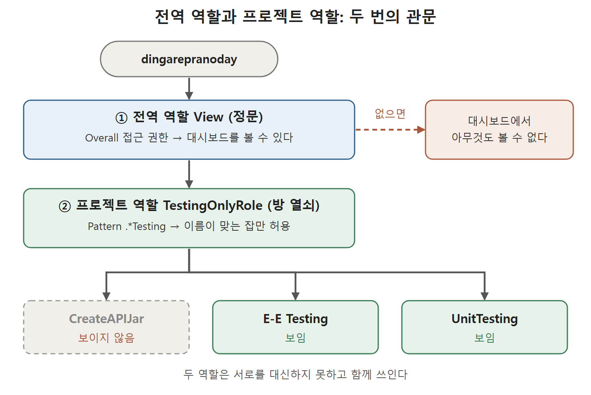

# 전역 역할과 프로젝트 역할

역할 기반 접근 제어를 켰다면 이제 실제로 역할을 만들고 사용자에게 붙일 차례다. 역할에는 두 종류가 있다. 하나는 Jenkins 전체에 적용되는 전역 역할(Global Roles)이고, 다른 하나는 이름 패턴에 맞는 잡에만 적용되는 프로젝트 기반 역할(Item Roles)이다.

건물 비유로 풀면 이해가 쉽다. 전역 역할은 "건물 정문을 통과할 수 있는 출입증"이고, 프로젝트 역할은 "특정 방 문을 열 수 있는 열쇠"다. 정문을 못 통과하면 방 열쇠가 있어도 소용이 없다. 이 문서의 뒷부분에서 이 관계가 실제 화면에서 어떻게 드러나는지 본다.

---

## 1. 전역 역할 만들기

Manage Jenkins로 가면 Security 섹션에 Manage and Assign Roles 링크가 있다. 이 링크를 누르면 Manage and Assign Roles 화면이 열리고, 여기서 Manage Roles(역할 관리)와 Assign Roles(역할 할당)로 들어갈 수 있다.

1. Manage and Assign Roles 화면에서 Manage Roles 링크를 누른다.
2. Role to Add(추가할 역할) 입력란에 역할 이름을 넣고 Add 버튼을 누른다. 원서에서는 View라는 이름을 썼다.
3. 새 역할이 Global Roles 표에 한 줄로 생긴다.
4. 이 역할에 줄 권리를 열마다 체크박스로 선택한다. 원서는 조회 전용 사용자를 만들려고 View 섹션의 체크박스를 모두 선택했다.
5. 페이지 아래로 내려가 Save 버튼을 누른다.

Global Roles 표는 행이 역할, 열이 권한 항목인 격자 모양이다. 체크한 칸이 그 역할에 허용된 권한이다.

---

## 2. 사용자에게 전역 역할 붙이기

만든 역할은 사용자에게 붙여야 의미가 생긴다.

1. Manage and Assign Roles 화면에서 Assign Roles 링크를 누른다.
2. User/Group to Add(추가할 사용자 또는 그룹) 입력란에 사용자 ID를 넣고 Add 버튼을 누른다.
3. 원서의 예시에서는 Jenkins에 사용자가 세 명 있었고, 그중 pd 사용자에게 새 역할을 주려고 pd를 입력했다. 그러면 Global Roles 표에 pd 행이 생긴다.
4. pd 행에서 View 열의 체크박스를 선택한다.
5. 페이지 아래의 Save 버튼을 누른다.

저장이 끝나면 정말 적용됐는지 확인한다. 가장 확실한 방법은 해당 사용자의 계정으로 직접 로그인해 보는 것이다. 원서에서는 pd 계정으로 로그인했더니 Access Denied(접근 거부) 메시지가 나왔다. 원서는 이 결과의 원인을 따로 풀어 쓰지 않는다. 다만 뒤에서 "Overall 접근 권한이 없으면 대시보드에서 아무것도 볼 수 없다"고 설명하므로, 이 View 역할에 Overall 권한이 들어 있지 않았던 것과 관련이 있어 보인다. 이 해석은 원서가 직접 밝힌 내용이 아니라 문맥에서 짐작한 것이다.

| 순서 | 화면 | 입력 또는 선택 | 결과 |
|---|---|---|---|
| 1 | Manage Roles | Role to Add에 역할 이름, Add | Global Roles 표에 역할 행이 생김 |
| 2 | Manage Roles | 체크박스 선택, Save | 역할에 권한이 담김 |
| 3 | Assign Roles | User/Group to Add에 ID, Add | 사용자 행이 생김 |
| 4 | Assign Roles | 역할 열 체크, Save | 사용자에게 역할이 붙음 |

역할을 만드는 화면과 붙이는 화면이 다르다는 점이 핵심이다. 역할 화면은 "무엇을 할 수 있는가"를, 할당 화면은 "누가 그 역할인가"를 정한다.

---

## 3. 프로젝트 기반 역할 만들기

Jenkins에는 CI/CD 작업별로 여러 잡이 만들어진다. 어떤 사용자에게 일부 잡만 보여 주고 싶다면 프로젝트 기반 역할을 만들어 붙이면 된다. 원서의 예는 단위 테스트와 e2e(end-to-end, 처음부터 끝까지 이어서 하는) 테스트를 도는 테스트 잡에만 접근하게 하는 역할이다.

1. Manage Jenkins → Manage and Assign Roles → Manage Roles로 이동한다.
2. 아래쪽 Item Roles 섹션에서 Role to Add에 역할 이름을 넣는다. 원서의 이름은 TestingOnlyRole이다.
3. Pattern(패턴) 입력란에 아래 값을 넣는다.

```text
.*Testing
```

4. Add 버튼을 누르면 Item Roles 표에 항목이 추가된다.
5. 새 역할 행에서 Job 열의 체크박스를 모두 선택해 잡에 대한 모든 권한을 준다.
6. 페이지 아래의 Save 버튼을 누른다.

이 패턴은 정규 표현식이다. 점과 별표가 합쳐진 .*는 "아무 글자가 몇 개든 앞에 와도 된다"는 뜻이어서, 이름이 Testing으로 끝나는 잡이 모두 걸린다. 원서는 이 패턴이 unittesting, e-e testing처럼 testing이라는 단어가 들어 있는 잡에 적용된다고 설명한다. 대소문자 구분 여부는 원서가 다루지 않으므로 여기서는 단정하지 않는다.

---

## 4. 프로젝트 기반 역할을 사용자에게 붙이기

원서에서는 TestingOnlyRole을 dingarepranoday 사용자에게 붙인다. 이때 Item Roles와 Global Roles 두 군데에 모두 등록해야 한다.

1. Manage Jenkins → Manage and Assign Roles → Assign Roles 화면을 연다.
2. Item Roles 섹션의 User/Group to Add에 dingarepranoday를 입력하고 Add 버튼을 누른다. Item Roles 표에 이 사용자의 행이 생긴다.
3. 그 행에서 TestingOnlyRole 체크박스를 선택한다.
4. Global Roles 섹션의 User/Group to Add에도 dingarepranoday를 입력하고 Add 버튼을 누른다.
5. 이 사용자에게 View 역할을 준다. View 역할의 정의에 Overall 유형의 접근 권한이 들어 있기 때문이다.
6. 결과적으로 이 사용자는 Global Roles의 View와 Item Roles의 TestingOnlyRole, 두 역할을 가진다.
7. 페이지 아래로 내려가 Save 버튼을 누른다.

원서가 특히 강조하는 부분은 Overall 접근 권한이다. 이 권한이 없으면 사용자는 대시보드에서 아무것도 볼 수 없다. 그래서 프로젝트 역할만 주는 것으로는 부족하고, 정문을 통과하게 해 주는 전역 역할이 반드시 함께 있어야 한다.

| 역할 종류 | 등록 위치 | 적용 범위 | 원서 예시 |
|---|---|---|---|
| 전역 역할 | Global Roles 표 | Jenkins 전체, 대시보드 접근 포함 | View |
| 프로젝트 기반 역할 | Item Roles 표 | 패턴에 이름이 맞는 잡 | TestingOnlyRole, 패턴 .*Testing |

두 역할은 서로를 대신하지 못하고 함께 쓰인다. 전역 역할로 Jenkins에 들어올 자격을 주고, 프로젝트 역할로 볼 수 있는 잡의 범위를 좁힌다.



그림은 사용자가 전역 역할 View로 대시보드에 들어선 뒤, 프로젝트 역할의 패턴에 맞는 잡만 보게 되는 흐름을 보여 준다. 전역 역할이 없으면 대시보드에서 아무것도 보이지 않고, CreateAPIJar는 패턴에 맞지 않아 보이지 않는다.

---

## 5. 결과 확인

원서의 환경에는 CreateAPIJar, E-E Testing, UnitTesting 세 개의 잡이 있었다. 이 목록은 PranodayDingare 사용자로 로그인했을 때 모두 보이는 상태였다.

이제 dingarepranoday 계정으로 로그인하면 이름이 testing으로 끝나는 잡만 대시보드에 나타난다. 즉 E-E Testing과 UnitTesting만 보이고 CreateAPIJar는 보이지 않는다.

| 잡 이름 | PranodayDingare로 로그인 | dingarepranoday로 로그인 |
|---|---|---|
| CreateAPIJar | 보임 | 보이지 않음 |
| E-E Testing | 보임 | 보임 |
| UnitTesting | 보임 | 보임 |

패턴 하나로 보이는 잡 목록이 갈린다는 사실이 이 기능의 핵심이다.

<br>
<br>
<br>

[CICD Pipeline Using Jenkins Unleashed](../)
