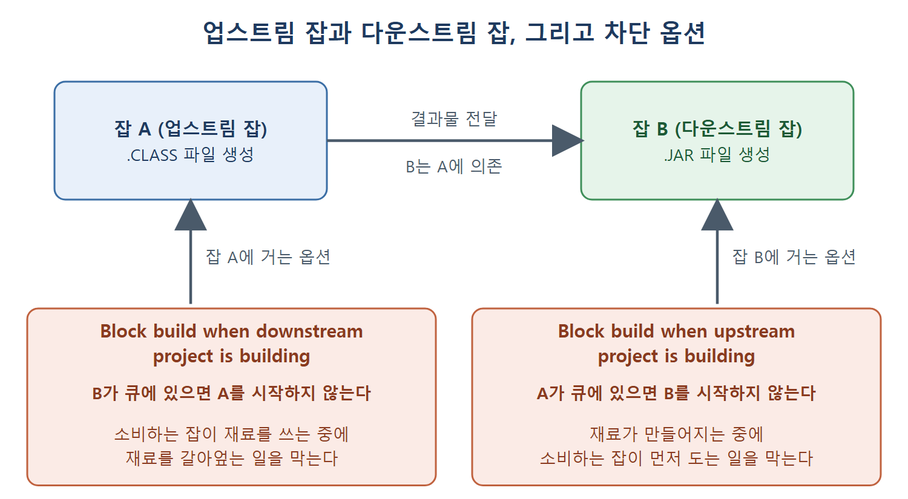

# General 섹션 설정

잡 설정 페이지는 여러 섹션으로 나뉘어 있고, 맨 위가 General 섹션이다. 이 문서는 설명, 오래된 빌드 삭제, 매개변수, 비활성화, 동시 빌드, 대기 시간, 재시도, 업스트림·다운스트림 차단, 사용자 지정 작업 공간, 표시 이름까지 General 섹션의 옵션을 하나씩 풀어 쓴다.

디스크는 한정된 서랍과 같다. 빌드를 돌릴 때마다 로그와 결과물이 서랍에 쌓이므로, 무엇을 얼마나 보관할지 정해 두지 않으면 어느 날 서랍이 터진다. General 섹션의 첫 번째 핵심 설정이 바로 그 정리 규칙이다.

---

## 1. 설정 항목 한눈에 보기

| 옵션 | 한 줄 의미 |
|---|---|
| Description | 잡의 목적을 적는 설명란 |
| Discard old builds | 오래된 빌드 기록을 자동으로 지운다 |
| This project is parameterized | 잡이 외부 입력(매개변수)을 받게 한다 |
| Disable this project | 잡을 일시적으로 실행되지 않게 한다 |
| Execute concurrent builds if necessary | 같은 잡의 빌드를 동시에 여러 개 돌린다 |
| Quiet Period | 트리거 후 정해진 초만큼 기다렸다가 시작한다 |
| Retry Count (SCM Checkout Retry Count) | 소스 체크아웃 실패 시 재시도 횟수 |
| Block build when upstream/downstream project is building | 관련 잡이 빌드 중이면 시작하지 않는다 |
| Use custom workspace | 작업 공간 위치를 직접 지정한다 |
| Display Name | 웹 화면에 보일 이름 |

앞의 몇 개는 기본 화면에 보이고, 나머지는 Advanced 버튼을 눌러야 나타난다. 뒤 절들이 각 옵션을 자세히 설명한다.

## 2. Description

잡이 무엇을 하는지 적는 칸이다. 예를 들어 "자바 라이브러리 프로젝트 컴파일"처럼 목적을 써 두면 잡이 많아졌을 때 구분하기 쉽다.

## 3. Discard old builds: 오래된 빌드 삭제

빌드는 특정 실행에 관련된 데이터, 즉 콘솔 출력과 실행 후 생긴 아티팩트 같은 것을 말한다. 이 데이터는 계속 쌓이므로 언제 지울지 정해야 하고, 원서는 이 설정이 디스크 공간을 아끼는 데 매우 중요하다고 강조한다.

기준은 두 가지다.

| 기준 | 의미 | 예시 |
|---|---|---|
| Build Age | 정해진 일수보다 오래된 빌드를 지운다 | 7일이 지난 빌드 삭제 |
| Build Count | 빌드가 정해진 개수를 넘으면 가장 오래된 것부터 지운다 | 최근 몇 개만 유지 |

원서는 기본값을 "빌드 하나를 최대 14일, 전체로는 최대 50개까지 보관"한다고 설명한다. 둘 중 하나라도 넘으면 가장 오래된 빌드가 삭제된다. 이 수치가 입력칸의 초기값인지 옵션을 켜지 않았을 때의 동작인지는 원서 문장만으로 분명하지 않다. 체크박스를 켜면 아래 입력칸이 나온다.

| 입력칸 | 의미 | 원서 예시 |
|---|---|---|
| Days to Keep Builds | 빌드를 보관할 최대 일수 | 5를 넣으면 최대 5일 보관 |
| Max # of Builds to Keep | 보관할 최대 빌드 개수 | 10을 넣으면 빌드 번호가 11이 될 때 가장 오래된 것이 삭제 |

Advanced 버튼을 누르면 칸이 두 개 더 나온다. 아티팩트만 따로 짧게 보관하고 싶을 때 쓴다.

| 입력칸 | 의미 | 원서 예시 |
|---|---|---|
| Days to Keep Artifacts | 아티팩트를 보관할 일수 | 3이면 3일 뒤 아티팩트만 삭제 |
| Max # of Builds to Keep with Artifacts | 아티팩트를 남겨 둘 최근 빌드 개수 | 5이면 최근 5개 빌드의 아티팩트만 유지 |

아티팩트는 잡을 실행해서 나온 모든 산출물이다. 예를 들어 자바 애플리케이션을 컴파일해 .JAR 파일을 만들었다면 그 .JAR 파일이 아티팩트다.

아티팩트가 지워져도 콘솔 로그 같은 다른 정보는 남는다. 로그는 Days to Keep Builds에 정한 일수가 지나야 비로소 삭제된다. 용량이 큰 결과물은 짧게, 가벼운 로그는 길게 두는 식으로 쓸 수 있다.

## 4. This project is parameterized: 매개변수 받기

잡이 외부에서 값을 받아야 한다면 이 체크박스를 켜고 드롭다운에서 입력 종류를 고른다. 불리언(참/거짓), 문자열 등 여러 종류가 있다. 문자열을 넘기려면 String Parameter를 고르며, 그러면 다음 입력칸이 나온다.

| 입력칸 | 의미 |
|---|---|
| Parameter Name | 매개변수 이름 |
| Default Value | 값을 주지 않았을 때 쓸 기본값 |
| Description | 매개변수의 용도 설명 |

원서의 예는 자기 이름(firstname)을 매개변수로 넘기고 콘솔에 출력하는 것이다. 빌드 스텝에서 이 값을 꺼내 쓰는 방법과 실제 활용은 이후 장에서 다룬다.

## 5. Disable this project: 잡 비활성화

이 옵션을 켜면 잡이 실행되지 않고 새 빌드도 만들어지지 않는다. 필요한 인프라를 잠시 쓸 수 없을 때처럼, 한동안 그 잡을 쓰고 싶지 않을 때 유용하다. 지우지 않고 잠깐 꺼 두는 스위치라고 보면 된다.

## 6. 동시 빌드와 Advanced 옵션

### 동시 빌드

기본값은 한 잡당 한 번에 빌드 하나만 실행하는 것이다. 이미 돌고 있는데 또 실행하면, 뒤의 실행은 앞의 실행이 끝날 때까지 대기열(큐)에서 기다린다. 이 기본값은 잡이 디렉터리나 파일을 단독으로 써야 할 때 중요하다. 두 빌드가 같은 파일을 동시에 건드리면 꼬이기 때문이다.

병렬 실행을 원하면 동시 빌드 옵션을 켠다. 긴 빌드가 여러 단계로 나뉘고 단계끼리 서로 의존하지 않을 때, 병렬로 시작하면 전체 시간이 크게 줄어든다. 실제 사용은 17장에서 다룬다고 원서가 밝힌다.

### Quiet Period: 대기 시간

이 옵션을 켜면 새 빌드가 곧바로 시작되지 않고 빌드 큐에서 정해진 시간 동안 기다린다. 비슷한 시각에 들어온 커밋을 한 번에 담기 위한 것이다.

옵션이 꺼져 있으면, 여러 개발자가 거의 동시에 커밋했을 때 첫 커밋이 도착하는 순간 빌드가 시작되고 나머지 커밋은 그 빌드에 들어가지 못한다. 옵션을 켜면 빌드가 큐에서 기다리는 동안 몇 초 안에 도착한 커밋들을 함께 받아 간다. 켜면 대기 시간을 초 단위로 적는 칸이 나오며, 5초를 넣으면 5초 기다렸다가 실행을 시작한다.

### SCM Checkout Retry Count: 체크아웃 재시도

이 옵션이 꺼진 상태에서 잡이 Git 같은 소스 코드 관리 시스템(SCM)을 쓰면, 첫 체크아웃이 실패하는 순간 잡이 실패로 표시된다. 이 옵션으로 실패 처리 전에 몇 번 더 시도할지 정한다. 3을 넣으면 최대 3번 체크아웃을 시도하고, 시도 사이에 10초씩 기다린다.

### 업스트림과 다운스트림

젠킨스에서는 두 잡이 의존 관계를 가질 수 있다. 잡 A가 자바 애플리케이션을 컴파일해서 .CLASS 파일을 만들고, 잡 B가 그 클래스 파일로 .JAR 파일을 만든다면, 잡 B가 잡 A에 의존한다.

| 용어 | 의미 | 위 예시 |
|---|---|---|
| 업스트림(upstream) 잡 | 내가 의존하는 잡 | A는 B의 업스트림 |
| 다운스트림(downstream) 잡 | 나에게 의존하는 잡 | B는 A의 다운스트림 |

이 관계를 이용한 차단 옵션이 둘 있다.

| 옵션 | 동작 | 위 예시 |
|---|---|---|
| Block build when upstream project is building | 의존하는 프로젝트가 빌드 큐에 있으면 이 잡을 실행하지 않는다 | A가 큐에 있으면 B를 시작하지 않는다 |
| Block build when downstream project is building | 이 잡에 의존하는 자식 잡이 빌드 큐에 있으면 이 잡을 실행하지 않는다 | B가 큐에 있으면 A를 시작하지 않는다 |

업스트림 차단은 아직 재료가 만들어지는 중인데 소비하는 잡이 먼저 도는 일을 막고, 다운스트림 차단은 소비하는 잡이 아직 재료를 쓰고 있을 때 재료를 새로 갈아엎는 일을 막는다. 원서 문장은 "큐에 있는 경우"라고 표현한다.

위 그림은 잡 B가 잡 A의 결과물에 의존하는 관계와, 그 관계에 따라 A와 B에 각각 거는 두 차단 옵션이 어느 쪽 잡의 시작을 막는지 보여 준다.

## 7. Use custom workspace: 사용자 지정 작업 공간

먼저 작업 공간(workspace)이 무엇인지 알아야 한다. 빌드가 실행되는 디렉터리다. 잡이 소스 코드 저장소를 체크아웃하면 이 디렉터리에 내려받는다.

빌드가 시작되면 기본적으로 `${JENKINS_HOME}\workspace` 폴더 아래에 잡 이름과 같은 디렉터리가 만들어진다. `${JENKINS_HOME}`은 보통 `${CurrentUser}\.Jenkins`에 있다. 이 칸에 경로를 적으면 작업 공간 위치를 바꿀 수 있다. 예를 들어 다른 잡이 이 잡의 아티팩트를 쓰는데 그 경로가 코드에 고정되어 있을 때, 위치를 바꿔서 맞추면 도움이 된다.

원서 예시는 작업 공간을 `D:\MyFirstJenkinsJob`으로 지정한 경우다. 잡을 실행하면 D 드라이브에 MyFirstJenkinsJob 디렉터리가 만들어져 작업 공간으로 쓰인다.

## 8. Display Name과 로그 보호

Display Name에 적은 이름은 젠킨스 웹 화면 어디서나 프로젝트 이름으로 보인다. 원서는 표시 이름을 MyJob으로 정해서 대시보드에 MyJob으로 나오게 했다.

주의할 점은 표시 이름이 웹 화면에만 적용된다는 것이다. 작업 공간 폴더는 표시 이름이 아니라 잡 이름으로 만들어진다. 원서의 잡 이름은 MyFirstJenkinsJob이고 표시 이름은 MyJob이므로, 작업 공간 폴더는 MyFirstJenkinsJob이다. 원격 트리거 URL에도 표시 이름이 아닌 잡 이름을 써야 한다(트리거 문서 참고).

| 구분 | 잡 이름 | 표시 이름 |
|---|---|---|
| 예시 | MyFirstJenkinsJob | MyJob |
| 웹 화면 | 표시 이름이 없을 때 쓰인다 | 대시보드 등 웹 화면 전체 |
| 작업 공간 폴더 | 이 이름으로 생성 | 사용되지 않음 |

### Keep the Build Logs of Dependencies

원서는 이 설정이 Display Name 항목 쪽 Advanced 설정에서 나온다고 적는다. 켜면 여기에 지정한 빌드는 로그 회전(log rotation)으로부터 보호된다. 로그 회전은 젠킨스 빌드 로그를 자동으로 압축, 삭제, 메일 발송하는 처리다. 이 옵션이 정확히 어떻게 지정되는지는 원서에 더 설명이 없다.

 
 
 

[CICD Pipeline Using Jenkins Unleashed](../)
