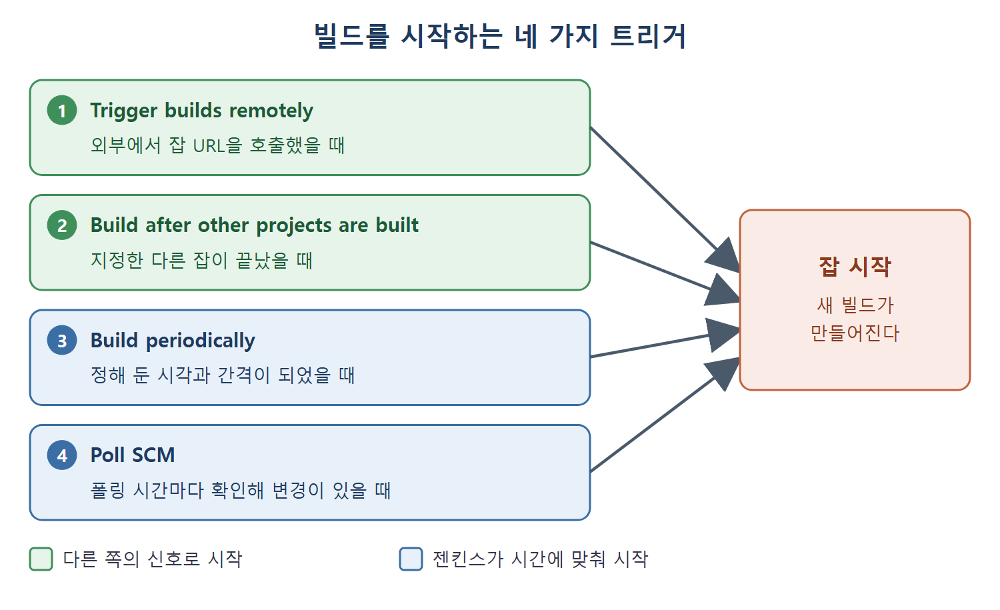

# 빌드 트리거 설정

트리거(trigger, 실행 조건)는 젠킨스가 잡을 언제 시작할지 정하는 설정이다. 이 문서는 Build Triggers 섹션의 네 가지 옵션, 곧 원격 트리거, 다른 프로젝트 빌드 후 실행, 주기적 빌드, SCM 폴링을 설명하고 cron 식 읽는 법을 정리한다.

알람 시계에 비유하면 이해가 쉽다. 정해진 시각에 울리는 알람(주기적 빌드), 현관 벨이 울릴 때 움직이는 것(원격 트리거), 5분마다 우편함을 열어 보는 것(SCM 폴링), 앞 사람이 끝나면 바통을 받는 것(다른 프로젝트 후 실행)이 모두 트리거다.

---

## 1. 네 가지 트리거 비교

| 옵션 | 시작되는 때 | 알맞은 상황 |
|---|---|---|
| Trigger builds remotely | 외부에서 잡 URL을 호출했을 때 | SCM이 병합 같은 사건을 알려 줄 때 |
| Build after other projects are built | 지정한 다른 잡이 끝났을 때 | 앞 잡의 아티팩트를 쓰는 잡 |
| Build periodically | 정해 둔 시각과 간격 | 매일 도는 e2e 테스트 |
| Poll SCM | 폴링 시간마다 저장소 변경을 확인해 변경이 있을 때 | 코드 변경에 맞춘 빌드 |



위 그림은 네 가지 트리거가 모두 같은 잡을 시작시키되, 외부 호출과 앞 잡의 종료는 다른 쪽의 신호로, 주기적 빌드와 폴링은 젠킨스가 시간에 맞춰 시작한다는 점을 구분해 보여 준다.

## 2. Trigger builds remotely

개발자가 코드를 master 브랜치에 병합할 때 잡을 돌리고 싶다고 하자. 원서는 두 가지 방법을 소개한다.

| 방법 | 동작 |
|---|---|
| 소스 코드 저장소 폴링 | 젠킨스가 정해진 간격(폴링 시간)으로 저장소 변경을 확인하고, 변경이 있으면 곧바로 잡을 시작한다 |
| SCM이 특정 이벤트에서 잡을 트리거 | 젠킨스가 살펴보는 대신, SCM 쪽이 병합 같은 사건이 생길 때 잡을 호출한다 |

폴링은 뒤의 Poll SCM 절에서 자세히 본다. 두 번째 방법을 쓰려면 Trigger builds remotely (e.g., from scripts) 옵션을 켠다. 모든 젠킨스 잡에는 원격에서 호출할 수 있는 URL이 있으며 형식은 다음과 같다.

```
JENKINS_URL/job/<Job Name>/build?token=TOKEN_NAME
```

| 부분 | 의미 |
|---|---|
| JENKINS_URL | 젠킨스에 접속하는 주소(예: http://localhost:8080) |
| Job Name | 잡 이름. 표시 이름(Display Name)이 아니다 |
| TOKEN_NAME | 이 잡을 트리거할 때 쓰는 접근 토큰 |

원서의 예시는 다음과 같다.

```
http://localhost:8080/job/MyFirstJenkinsJob/build?token=abcd123456890
```

잡 이름 자리에는 표시 이름 MyJob이 아니라 잡 이름 MyFirstJenkinsJob을 쓴 것에 주목한다. 실제 사용 예는 이후 장에서 나온다.

## 3. Build after other projects are built

다른 잡이 끝난 뒤에 이 잡을 실행하고 싶을 때 켠다. 앞 문서의 의존 관계가 여기서 쓰인다. 예를 들어 이 잡이 CompileJavaApplication이라는 잡의 아티팩트를 쓴다면, 이 옵션을 켜고 Projects to Watch 칸에 CompileJavaApplication을 적는다. 그러면 그 잡이 끝나 필요한 아티팩트를 넘겨주는 시점에 이 잡이 시작된다.

앞 잡의 결과 상태에 따라 실행할지도 세 가지 중에서 고른다.

| 옵션 | 이 잡이 실행되는 조건 |
|---|---|
| Trigger only if build is stable | 앞 잡이 안정(stable), 곧 성공적으로 실행되었을 때만 |
| Trigger even if the build is unstable | 앞 잡이 불안정(unstable)해도 |
| Trigger even if the build fails | 앞 잡이 실패해도 |

상태 용어는 다음과 같이 구분한다.

| 상태 | 뜻 |
|---|---|
| 안정(stable) | 빌드가 성공적으로 실행되었다 |
| 불안정(unstable) | 작업은 끝났지만 일부 퍼블리셔가 불안정하다고 보고했다 |
| 실패(failed/broken) | 빌드 스텝 하나 이상이 실패해서 작업을 끝내지 못했다 |

불안정의 예는 이렇다. 애플리케이션을 컴파일하고 JUnit 퍼블리셔로 단위 테스트 리포트를 게시하는 잡이 있다고 하자. 컴파일은 성공했는데 단위 테스트가 실패하면 JUnit 퍼블리셔가 이 빌드를 불안정으로 표시한다.

## 4. Build periodically

특정 시각이나 간격으로 빌드를 시작한다. 매일, 매월, 매주 같은 식이고, 윈도우의 작업 스케줄러나 유닉스의 cron 작업과 비슷하다. 일정을 적는 곳은 Schedule 칸이다.

원서 저자는 주기적 트리거가 CI/CD 원칙에 맞지 않는다고 본다. CI/CD는 코드가 바뀌자마자 피드백을 주는 것을 기대하는데 주기적 빌드는 일주일이나 한 달 뒤에야 알려 주기 때문이다. 쓸모 있는 예로는, 애플리케이션을 빌드해서 테스트 환경에 배포한 뒤 하루에 한 번 e2e 테스트(처음부터 끝까지 전체 흐름을 확인하는 테스트)를 돌리는 잡을 든다.

### cron 식 읽는 법

원서는 "chron"으로 적지만 실제 이름은 cron이다. 형식은 다섯 개 필드를 탭이나 공백으로 구분한다.

```
MINUTE HOUR DOM MONTH DOW
```

| 필드 | 의미 | 범위 |
|---|---|---|
| MINUTE | 시간 안의 분 | 0-59 |
| HOUR | 하루 중 시 | 0-24 (원서 표기) |
| DOM | 한 달 중 날짜 | 1-31 |
| MONTH | 한 해 중 월 | 1-12 |
| DOW | 요일 | 0-7 (0과 7이 일요일) |

매일, 매월, 모든 요일의 오전 8시 45분에 실행하려면 다음과 같이 쓴다.

```
45 8 * * *
```

`*`는 "모든 값"이라는 뜻이다. 분은 45, 시는 8로 고정하고 날짜, 월, 요일은 모두 열어 둔 것이다. 이 식을 Schedule 칸에 입력한다. cron 형식을 더 알고 싶으면 원서는 위키백과의 Cron 문서를 안내한다.

## 5. Poll SCM

폴링 시간(polling time)을 설정해 두면 젠킨스가 그 간격마다 SCM의 코드 변경을 계속 확인한다. 확인할 저장소는 Source Code Management 섹션에 적힌 URL이다. 5분마다 폴링하고 싶다면 Schedule 칸에 다음 식을 적는다.

```
H/5 * * * *
```

그러면 젠킨스가 5분마다 SCM을 살펴보고, 마지막 폴링 이후 변경이 있을 때 빌드를 시작한다. `H/5`의 `H`는 원서가 풀이하지 않은 젠킨스 고유 표기라서 여기서는 "5분 간격"이라는 원서의 설명만 따른다.

| 비교 | Build periodically | Poll SCM |
|---|---|---|
| 시작 기준 | 시간만 본다 | 시간마다 확인하되 변경이 있을 때만 빌드 |
| 예시 식 | `45 8 * * *` | `H/5 * * * *` |
| CI 취지와 맞는 정도 | 원서 저자는 맞지 않는다고 본다 | 변경에 반응하므로 가깝다 |

읽는 법은 간단하다. 주기적 빌드는 변화가 없어도 시간이 되면 돌고, 폴링은 변화가 있어야 돈다. 원서의 폴링은 변경이 있을 때만 빌드한다고 설명하므로 이 표의 마지막 행은 그 설명에서 이어 본 해석이다.

<br>
<br>
<br>

[CICD Pipeline Using Jenkins Unleashed](../)
