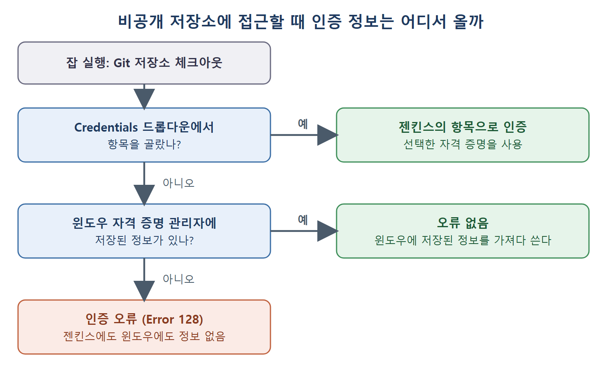

# 소스 코드 관리와 자격 증명

빌드는 대개 중앙 저장소에 있는 최신 코드를 내려받는 것으로 시작한다. 이 문서는 Source Code Management 섹션에서 Git 저장소를 연결하는 방법, 비공개 저장소에 접근할 때 필요한 자격 증명, 윈도우 자격 증명 관리자 때문에 생기는 헷갈리는 문제, 그리고 빌드할 브랜치를 정하는 방법을 다룬다.

도서관 비유가 맞다. 공개 서가는 누구나 책을 빌리지만, 비공개 서고에는 출입증이 있어야 들어간다. 젠킨스에 출입증을 쥐여 주는 것이 자격 증명이다.

---

## 1. 저장소 URL 연결

잡 설정 페이지의 Source Code Management 섹션에 Git 옵션이 보이려면 Git 플러그인이 설치되어 있어야 한다. 설치 방법은 6장에 있다. 새 소프트웨어 빌드를 만드는 잡은 보통 중앙 저장소에 마지막으로 커밋된 코드를 먼저 내려받아 작업한다. 그래서 Repository URL 칸에 Git 저장소 주소를 적어 두면, 잡이 실행될 때마다 최신 코드를 가져온다.

원서의 예는 본인의 공개 저장소 URL을 넣은 경우다. 공개 저장소는 인증이 필요 없다.

## 2. 비공개 저장소와 자격 증명

현실의 저장소는 대부분 비공개다. 이때는 저장소에 설정된 인증 방식에 맞는 정보를 줘야 한다.

| 인증 방식 | 필요한 정보 |
|---|---|
| 사용자 이름과 비밀번호 | 사용자 이름, 비밀번호 |
| SSH | SSH 개인 키 |
| API 토큰 | 토큰 |

정보를 주지 않으면 Repository URL 칸 아래에 인증 오류가 표시된다. 해결 방법은 다음과 같다.

1. 필요한 인증 정보를 담은 자격 증명(Credentials) 항목을 Global 유형으로 만든다. 자격 증명을 만드는 자세한 방법은 8장에 있다.
2. 잡 설정 페이지의 Credentials 드롭다운에서 그 항목을 고른다.
3. 페이지의 Apply 버튼을 누른다.
4. 오류 표시가 사라지고 젠킨스가 비공개 저장소에 접근하게 된다.

### 이 화면에서 바로 자격 증명 만들기

잡 설정을 벗어나지 않고 새 자격 증명을 만들 수도 있다.

1. Credentials 드롭다운에서 Jenkins 옵션을 클릭한다.
2. Jenkins Credentials Provider: Jenkins 창이 열린다.
3. 필요한 정보를 입력한다. 각 입력칸의 의미는 8장에서 설명한다.
4. 아래로 조금 스크롤해서 Add 버튼을 누른다.
5. 새로 만든 항목이 Credentials 드롭다운에 나타난다.

| 단계 | 화면 | 하는 일 |
|---|---|---|
| 오류 확인 | Repository URL 칸 | 인증 정보가 없다는 오류가 보인다 |
| 항목 선택 | Credentials 드롭다운 | 만들어 둔 Global 자격 증명을 고른다 |
| 적용 | 잡 설정 페이지 | Apply를 누르면 오류가 사라진다 |
| 즉석 생성 | 드롭다운의 Jenkins 옵션 | Credentials Provider 창에서 Add로 추가한다 |

## 3. 윈도우 자격 증명 관리자라는 함정

원서는 비공개 저장소 접근에서 디버깅하기 어려운 중요한 사례 하나를 소개한다. 윈도우의 자격 증명 관리자(Credential Manager)와 관련된 것이다.

Git 사용자 이름과 비밀번호가 이미 윈도우 자격 증명에 저장되어 있을 수 있다. 경로는 제어판 → 모든 제어판 항목 → 자격 증명 관리자다. 원서에서 저자는 Windows 자격 증명 추가(Add a Windows Credential) 링크로 GitLab 자격 증명을 저장해 두었다.

이 상태에서는 젠킨스의 Credentials 드롭다운에서 항목을 고르지 않았는데도 Repository URL 칸에 인증 오류가 나타나지 않는다. 젠킨스가 윈도우에 저장된 자격 증명을 가져다 쓰기 때문이다.

반대로 저자가 `https://gitlab.com` 주소로 저장했던 자격 증명을 윈도우 자격 증명 관리자에서 지우면, 이번에는 젠킨스에서 인증 오류(Error 128)가 난다. 젠킨스의 Credentials 드롭다운에서도 항목을 고르지 않았고 윈도우에도 정보가 없기 때문이다.

| 젠킨스 드롭다운 선택 | 윈도우 자격 증명 저장 | 결과 |
|---|---|---|
| 선택 안 함 | 있음 | 오류 없음(윈도우 것을 사용) |
| 선택 안 함 | 없음 | 인증 오류(Error 128) |
| 항목 선택 | 상관없음(원서는 이 경우를 직접 비교하지 않는다) | 젠킨스의 항목으로 인증 |

위 그림은 Credentials 드롭다운 선택 여부와 윈도우 자격 증명 저장 여부에 따라 인증이 어떻게 결정되고, 어느 경우에 Error 128이 나는지를 순서대로 보여 준다.

핵심은 원인을 찾기 어려운 상황을 조심하라는 것이다. 윈도우에 저장된 로그인 정보가 몰래 도와주고 있으면 젠킨스 설정이 비어 있어도 잘 되는 것처럼 보이고, 그 정보가 사라지는 순간 갑자기 실패한다. 이는 원서 사례를 바탕으로 한 필자의 해석이며, 인증이 안 될 때는 윈도우 자격 증명 관리자도 함께 확인해 보라는 뜻이다.

## 4. Branches to Build: 빌드할 브랜치

잡은 기본적으로 master 브랜치의 변경을 살피고, 원격 저장소의 그 브랜치에서 코드를 내려받는다. 다른 브랜치를 보게 하려면 Branches to Build 칸에 그 브랜치 이름을 적는다.

| 상황 | 설정 |
|---|---|
| master 브랜치를 빌드 | 기본값 그대로 둔다 |
| 다른 브랜치를 빌드 | Branches to Build 칸에 브랜치 이름을 적는다 |

저장소 주소, 자격 증명, 브랜치 이 세 가지만 맞으면 젠킨스는 어디서 어떤 코드를 가져올지 알게 된다.

 
 
 

[CICD Pipeline Using Jenkins Unleashed](../)
