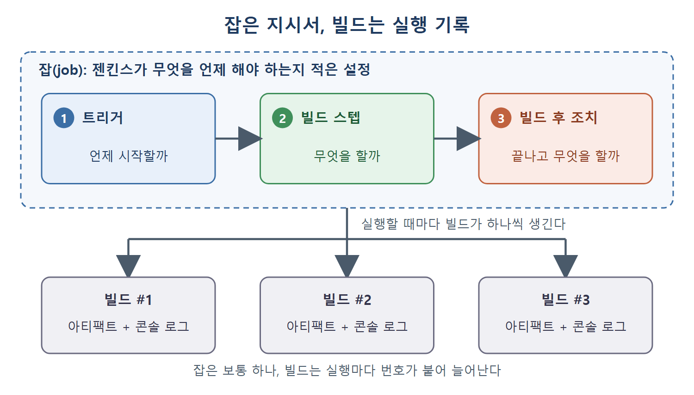

# 잡과 빌드의 기본 개념

젠킨스에서 실제로 일을 시키는 단위는 잡(작업)이다. 이 문서는 잡이 무엇이고 빌드와 어떻게 다른지, 프리스타일 잡은 어떤 잡인지, 그리고 새 잡을 만드는 절차를 정리한다.

식당에 비유하면 잡은 주방에 붙여 둔 조리 지시서이고, 빌드는 그 지시서대로 실제로 요리를 한 번 해 낸 기록이다. 지시서는 하나지만 요리는 여러 번 할 수 있고, 요리할 때마다 번호가 붙는다.

---

## 1. 잡이란 무엇인가

잡(job)은 "젠킨스가 무엇을 언제 해야 하는지"를 적어 둔 지시 묶음이다. 젠킨스에서는 프로젝트(Project)라고도 부른다. 어떤 종류의 잡이든 설정할 수 있는 지시는 세 가지다.

| 질문 | 젠킨스 용어 | 설명 | 예시 |
|---|---|---|---|
| 언제 시작할까 | 트리거(trigger, 실행 조건) | 잡이 시작되는 시점을 정한다 | 코드가 바뀌면, 매일 아침 8시 45분에 |
| 무엇을 할까 | 빌드 스텝(build step) | 목적을 이루기 위해 실행할 단계들이다 | 간단한 배치 명령 실행 |
| 끝나고 무엇을 할까 | 빌드 후 조치(post build action) | 작업이 끝난 뒤 할 일이다 | 성공·실패를 사용자에게 알림, 컴파일된 클래스 파일을 원하는 위치로 복사 |

세 가지는 시간 순서와도 맞는다. 트리거가 잡을 깨우고, 빌드 스텝이 일을 하고, 빌드 후 조치가 마무리를 한다. 이후 장에서 만나는 거의 모든 설정이 이 세 칸 중 어딘가에 들어간다.

## 2. 빌드란 무엇인가

빌드(build)는 잡을 한 번 실행한 결과다. 같은 잡을 여러 번 돌릴 수 있고, 실행마다 고유한 빌드 번호가 붙는다. 그 실행에서 만들어진 아티팩트(빌드 결과물), 콘솔 로그 같은 모든 상세 정보는 이 빌드 번호에 묶여 저장된다.

| 구분 | 잡 | 빌드 |
|---|---|---|
| 정체 | 설정(지시서) | 실행 1회(기록) |
| 개수 | 보통 하나 | 실행할 때마다 하나씩 늘어난다 |
| 식별자 | 잡 이름 | 빌드 번호(#1, #2 ...) |
| 담는 것 | 트리거, 빌드 스텝, 빌드 후 조치 | 아티팩트, 콘솔 로그 등 실행 결과 |

위 그림은 트리거, 빌드 스텝, 빌드 후 조치가 하나의 잡 설정에 담기고, 잡을 실행할 때마다 번호가 붙은 빌드가 하나씩 생기는 관계를 보여 준다.

잡을 고치면 이후의 빌드부터 바뀐 설정이 적용되고, 지난 빌드의 기록은 그대로 남는다. 다만 오래된 빌드는 다음 문서에서 설명하는 "오래된 빌드 삭제" 설정에 따라 지워질 수 있다.

## 3. 프리스타일 잡이란 무엇인가

젠킨스는 필요에 따라 여러 종류의 잡을 만들 수 있다. 대표적인 것이 파이프라인 잡과 프리스타일 잡(free-style job)이다. 프리스타일 잡은 가장 전형적인 빌드 잡으로, 테스트 실행, 애플리케이션 빌드와 패키징, 리포트 발송처럼 단순한 작업에 알맞다.

원서가 이 장에서 프리스타일 잡을 쓰는 이유는 하나다. 잡 설정 화면에 어떤 항목이 있는지 직접 만들어 보면서 살펴보기 위해서다. 프리스타일 잡을 자세히 쓰는 방법은 이후 장에서 다룬다.

## 4. 새 잡 만들기

잡은 대시보드에서 만든다. 절차는 다음과 같다.

1. 젠킨스에 로그인해서 대시보드로 간다.
2. 잡이 하나도 없는 빈 대시보드라면 Create a Job 링크를 누른다.
3. 잡이 이미 하나 이상 있으면 그 링크는 보이지 않는다. 이때는 대시보드 왼쪽에 있는 New Item 링크를 누른다.
4. 어느 쪽이든 잡 이름을 입력하는 화면으로 이동한다.
5. 알맞은 이름을 넣고 Freestyle Project 항목을 고른 뒤 OK 버튼을 누른다.
6. 그러면 잡 설정 페이지(Job Configuration)가 열린다.

| 상황 | 눌러야 할 곳 |
|---|---|
| 잡이 하나도 없다 | 빈 대시보드의 Create a Job |
| 잡이 이미 있다 | 대시보드 왼쪽의 New Item |

잡 이름은 나중에 URL과 작업 공간(워크스페이스) 폴더 이름에 쓰이므로(뒤 문서에서 다룬다) 처음부터 알아보기 쉽게 짓는 것이 좋다.

 
 
 

[CICD Pipeline Using Jenkins Unleashed](../)
