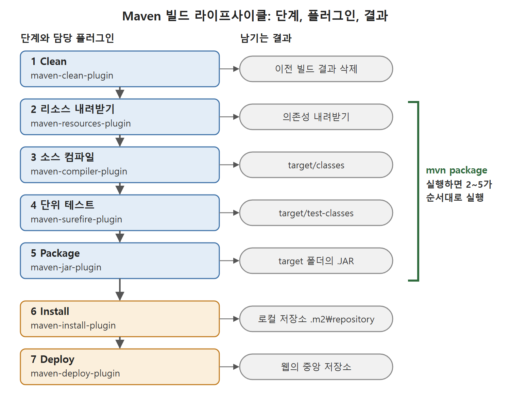

# 빌드 라이프사이클 단계

pom.xml의 build 섹션이 정의하는 빌드 라이프사이클(생명주기)은 소스 코드가 JAR 파일이 되어 저장소에 올라가기까지의 단계 순서다. 이 문서는 각 단계에서 어떤 Maven 플러그인이 무엇을 입력받아 무엇을 만들어 내는지 정리한다.

공장 컨베이어 벨트를 떠올리면 쉽다. 세척, 부품 준비, 조립, 검사, 포장, 출고 순서로 이어지고, 각 칸마다 담당 기계(플러그인)가 있다.

---

## 1. 단계와 순서

| 순서 | 단계 | 담당 플러그인 | 하는 일 |
|---|---|---|---|
| 1 | Clean | maven-clean-plugin | 이전에 만든 컴파일 파일과 패키지 파일을 지우고 깨끗한 상태에서 다시 시작 |
| 2 | 리소스 내려받기 | maven-resources-plugin | 프로젝트 의존성을 아티팩트 저장소에서 내려받음 |
| 3 | 소스 컴파일 | maven-compiler-plugin | 애플리케이션 .java 파일을 .class 파일로 컴파일 |
| 4 | 단위 테스트 | maven-surefire-plugin | 테스트 코드를 컴파일하고 JUnit 또는 TestNG로 실행 |
| 5 | Package | maven-jar-plugin | 컴파일된 파일을 .JAR 하나로 묶음 |
| 6 | Install | maven-install-plugin | JAR를 Maven 로컬 저장소에 설치 |
| 7 | Deploy | maven-deploy-plugin | JAR를 웹의 중앙 저장소에 배포 |

표의 순서가 곧 실행 순서다. 뒤쪽 단계를 실행하면 앞 단계가 먼저 돈다는 점이 중요하고, 이는 다음 문서의 명령 실행 부분에서 다시 나온다.

일곱 단계가 위에서 아래로 이어지며, 각 단계의 담당 플러그인과 남기는 결과(target 폴더, 로컬 저장소, 중앙 저장소)를 한눈에 보여 준다. mvn package를 실행하면 2~5번 단계가 순서대로 실행된다.

## 2. 단계별 설명

### 2.1 Clean

maven-clean-plugin이 이전에 생성된 컴파일 파일과 패키지 파일을 모두 지운다. 그 뒤에 새 빌드 라이프사이클을 돌린다. 오래된 결과물이 섞여 들어가지 않게 하는 목적이다.

### 2.2 리소스 내려받기

이 단계에서 프로젝트의 의존성을 mvnrepository.com 같은 아티팩트 저장소에서 내려받는다. 플러그인은 의존성뿐 아니라 그 의존성이 다시 필요로 하는 의존성(원서 표현으로는 circular dependencies)까지 함께 내려받는다.

### 2.3 소스 컴파일

maven-compiler-plugin은 내부적으로 javac(자바 컴파일러)를 써서 소스를 컴파일한다. 기본 소스 위치인 src/main/java의 모든 .java 파일을 입력으로 받아 .class 파일을 출력한다. 결과는 프로젝트 디렉터리 아래 target/classes 폴더에 생긴다.

### 2.4 단위 테스트

먼저 mvn compile:test-compile 단계가 src/test/java의 단위 테스트 코드를 컴파일해 target/test-classes 폴더에 클래스 파일을 둔다. 이어서 maven-surefire 플러그인이 JUnit 또는 TestNG 프레임워크를 호출해 테스트 케이스를 실행한다.

### 2.5 Package

maven-jar-plugin이 target/classes에 만들어진 .class 파일을 .JAR 파일로 묶는다. JAR 파일은 프로젝트 디렉터리 아래 target 폴더에 만들어진다.

### 2.6 릴리스 단계

Maven에는 install 단계가 있어서 maven-install-plugin으로 JAR 파일을 Maven의 로컬 저장소에 설치한다. 이 JAR를 쓰는 사용자가 원격에 있다면 웹에 있는 중앙 저장소(예로 Mvnrepository.com)에 배포해야 한다. 이는 deploy 골(goal, 실행 목표)로 할 수 있고, 이때 Maven은 maven-deploy-plugin으로 JAR를 중앙 저장소에 올려 개발자들이 내려받아 쓰게 한다.

## 3. 산출물 위치 정리

빌드하면 어디에 무엇이 생기는지 모아 두면 이후 젠킨스 잡에서 결과물을 찾을 때 도움이 된다. 아래 경로의 프로젝트 디렉터리는 pom.xml이 있는 폴더다.

| 산출물 | 위치 | 만드는 단계 |
|---|---|---|
| 애플리케이션 .class 파일 | 프로젝트 디렉터리/target/classes | 소스 컴파일 |
| 테스트 .class 파일 | 프로젝트 디렉터리/target/test-classes | 테스트 컴파일 |
| .JAR 파일 | 프로젝트 디렉터리/target | Package |
| 로컬 저장소 안의 JAR | 사용자 홈의 .m2\repository 아래 | Install |

이 표로 보면 target 폴더가 빌드의 작업장이다.

 
 
 

[CICD Pipeline Using Jenkins Unleashed](../)
