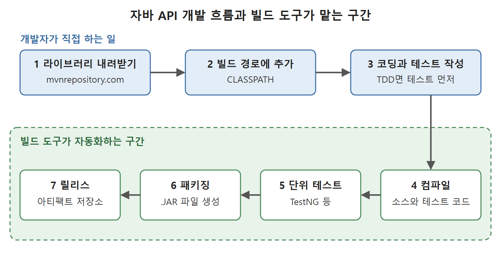

# 자바 API 개발 흐름과 빌드 도구

이 장은 젠킨스로 실제 애플리케이션의 빌드 전 과정을 자동화하기 전에, 자동화할 대상이 무엇인지부터 정리한다. 앞 장까지는 젠킨스에서 잡(작업)을 설정하는 방법을 다뤘고, 이 장부터는 종류별 애플리케이션이 어떤 단계를 거쳐 최종 목적지에 도달하는지를 본다.

이 문서는 그 첫 단계로, 자바 API 프로젝트를 만들 때 개발자가 반복하는 일을 순서대로 살펴보고, 그 일을 대신해 주는 빌드 도구(build tool)가 왜 필요한지 설명한다.

---

## 1. 애플리케이션마다 빌드와 배포 방식이 다르다

API(Application Programming Interface)는 다른 코드가 가져다 쓰도록 만든 재사용 라이브러리를 가리킨다. 이 장에서 다루는 자바 API 프로젝트가 그런 라이브러리다. 애플리케이션 종류가 다르면 결과물의 모양과 도착지도 다르다.

| 애플리케이션 종류 | 결과물 형태 | 도착지 |
|---|---|---|
| 자바 API(재사용 라이브러리) | .JAR 파일 | 아티팩트(빌드 결과물) 저장소 |
| 자바 웹 애플리케이션 | .WAR 파일 | Tomcat 같은 서버 |

표에서 보듯 결과물 형태와 도착지가 다르므로 파이프라인에 넣을 단계도 달라진다. 그래서 젠킨스로 빌드 과정을 자동화하려면 해당 애플리케이션이 거쳐야 할 빌드 라이프사이클(빌드 생명주기) 단계와, 각 단계를 맡아 줄 도구를 먼저 알아야 한다.

이 장에서는 간단한 자바 API 프로젝트를 만들면서 TestNG, Maven 같은 도구와 함께 그 단계를 익힌다. 이 프로젝트는 이후 장들에서 젠킨스 잡으로 릴리스를 자동화하는 데 계속 쓰인다.

## 2. 자바 API 프로젝트의 전형적인 개발 흐름

요리에 비유하면 이렇다. 재료를 사 오고(라이브러리 내려받기), 주방에 늘어놓고(경로에 추가), 조리하고(코딩), 맛을 보고(테스트), 포장하고(패키징), 가게 진열대에 올린다(릴리스). 실제 작업은 프로젝트마다 조금씩 다르지만 큰 틀은 다음과 같다.

### 2.1 서드파티 라이브러리 내려받기

개발자는 JDK(Java Development Kit)에 들어 있는 기본 API 클래스 묶음을 쓴다. 여기에 더해 다른 개발자가 만든 라이브러리가 필요할 때가 있는데, 이를 서드파티(third-party) 라이브러리라고 한다. 이런 라이브러리는 아티팩트 저장소 또는 패키지 레지스트리라 부르는 웹 플랫폼에 모여 있다.

- https://mvnrepository.com/ : 자바 API 개발자가 패키징한 .JAR 파일을 올려 두고, 필요한 사람이 내려받는 중앙 저장소다. 이 책의 자바 개발자는 여기서 라이브러리를 받는다.
- https://www.npmjs.com/ : 자바스크립트로 만든 재사용 노드 패키지를 배포하는 패키지 레지스트리다.

### 2.2 프로젝트 빌드 경로에 추가하기

내려받은 라이브러리는 개발 중인 프로젝트가 참조하는 라이브러리 목록에 넣어야 한다. 자바 API 프로젝트에서는 이를 프로젝트의 CLASSPATH(자바가 클래스를 찾는 경로 목록)에 추가한다고 말한다.

### 2.3 코딩과 단위 테스트 작성

필요한 서드파티 라이브러리와 기본 라이브러리가 빌드 경로에 준비되면 API 함수를 작성한다. 함수 하나(단위)를 다 만들면 단위 테스트 케이스를 쓴다. 테스트 주도 개발(TDD, Test-Driven Development)을 한다면 순서가 거꾸로여서, 기능을 구현하기 전에 테스트 케이스부터 쓴다.

### 2.4 컴파일, 테스트 실행, 패키징, 릴리스

1. 컴파일: API 소스 코드와 단위 테스트 코드를 모두 컴파일한다.
2. 단위 테스트 실행: TestNG, Pytest, NUnit 같은 단위 테스트 도구로 테스트를 돌린다. 어떤 도구를 쓸지는 개발 환경에 따라 다르다.
3. 패키징: 단위 테스트를 마치고 코드를 병합하고 나면 구현물을 라이브러리(.JAR) 파일 하나로 묶는다.
4. 릴리스: 라이브러리 버전이 만들어지면 아티팩트 저장소에 올려 사용자가 내려받아 쓸 수 있게 한다.

| 순서 | 작업 | 이때 쓰는 것 |
|---|---|---|
| 1 | 라이브러리 내려받기 | mvnrepository.com 같은 중앙 저장소 |
| 2 | 빌드 경로에 추가 | CLASSPATH |
| 3 | 코딩과 단위 테스트 작성 | JDK, TDD라면 테스트 먼저 |
| 4 | 소스와 테스트 컴파일 | 컴파일러 |
| 5 | 단위 테스트 실행 | TestNG, Pytest, NUnit 등 |
| 6 | 패키징 | .JAR 파일 생성 |
| 7 | 릴리스 | 아티팩트 저장소 |

이 표는 개발자가 손으로 하면 일곱 번 반복해야 하는 일을 보여 준다. 뒤쪽의 컴파일, 테스트, 패키징, 릴리스가 바로 빌드 도구가 자동화하는 구간이다.

앞쪽 1~3번은 개발자가 직접 하는 일이고, 4~7번인 컴파일, 단위 테스트, 패키징, 릴리스는 빌드 도구가 자동화하는 구간임을 보여 주는 그림이다.

## 3. 빌드 도구가 하는 일

위 흐름을 보면 개발자가 해야 할 일이 많다. 컴파일할 때 필요한 라이브러리, 테스트할 때 필요한 라이브러리, 실행할 때 필요한 라이브러리(런타임 라이브러리)를 각각 내려받아야 하고, 이어서 컴파일, 단위 테스트, 패키징, 배포까지 해야 한다. 이를 매번 손으로 하면 번거롭고 실수하기 쉽다.

그래서 이런 작업을 자동화하는 도구를 쓰는데, 이것을 빌드 도구라고 부른다. 대표적으로 Apache Ant, Maven, Gradle이 있고, 이 책은 그중 Maven을 쓴다.

| 필요한 라이브러리 | 쓰이는 때 |
|---|---|
| 컴파일 시점 라이브러리 | 구현 코드를 컴파일할 때 |
| 테스트 라이브러리 | 구현물을 테스트할 때 |
| 런타임 라이브러리 | 애플리케이션이 실행될 때 |

이 구분은 뒤에서 pom.xml의 scope 설정을 이해하는 바탕이 된다. 라이브러리마다 필요한 시점이 다르기 때문에 Maven이 시점별로 나누어 관리해 준다.

## 4. Maven의 목표

Maven의 주된 목표는 개발자가 개발 작업의 전체 상태를 가장 짧은 시간에 파악하게 해 주는 것이다. 이 책은 Maven을 Eclipse 안에서 먼저 써 보고, 이어서 명령줄(CLI)에서도 쓴다. 다음 문서부터 그 과정을 차례로 따라간다.

 
 
 

[CICD Pipeline Using Jenkins Unleashed](../)
