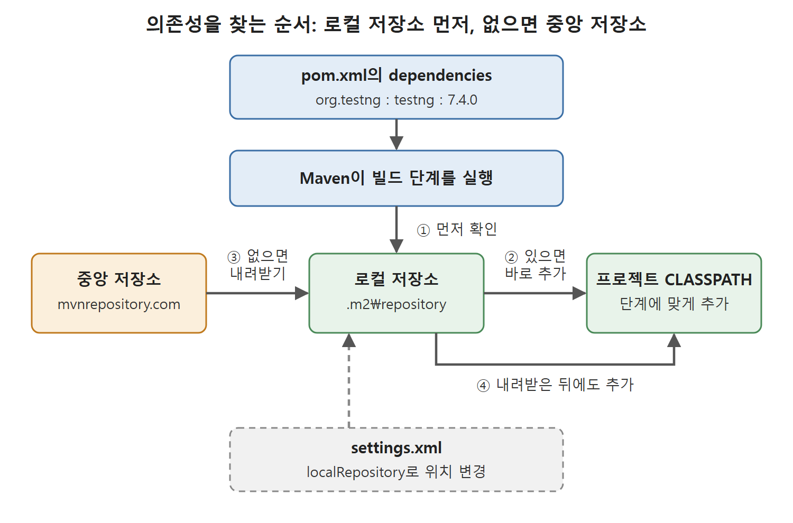

# 프로젝트 구조와 pom.xml

Maven 프로젝트를 만들면 정해진 규칙대로 폴더와 파일이 생긴다. 이 문서는 그 디렉터리 구조, 이 장에서 만든 계산기 API의 코드 파일, 그리고 Maven의 핵심인 pom.xml을 항목별로 풀어 설명한다.

pom.xml은 요리 레시피 카드와 같다. 어떤 재료(라이브러리)가 필요하고, 어떤 순서로(빌드 단계) 어떤 도구(플러그인)를 쓸지 한 장에 적어 둔 것이다.

---

## 1. 디렉터리 구조

프로젝트 디렉터리 이름은 만들 때 ArtifactId에 적은 값이 된다. 안에는 다음 항목이 생긴다.

| 위치 | 역할 |
|---|---|
| src/main/java | 애플리케이션 소스 코드의 기본 위치 |
| src/test/java | 단위 테스트 코드 |
| pom.xml | 프로젝트 정보와 빌드 설정 |

### 1.1 src/main/java

기본 소스 디렉터리이며 자바 패키지 폴더 구조를 이 아래에 만든다. 이 폴더 안에는 GroupId와 ArtifactId로 만들어진 패키지 디렉터리 구조가 생긴다.

원서의 프로젝트(GroupId는 Pranodayd, ArtifactId는 CalculatorAPI)에서는 src/main/java 아래에 Pranodayd 폴더가 생기고, 그 안에 CalculatorAPI 폴더가 있으며, 그 안에 App.java가 있다. App.java는 아키타입이 넣어 주는 데모용 템플릿 파일이라 저자는 삭제했다.

### 1.2 src/test/java

단위 테스트 케이스를 두는 곳이다. 여기도 GroupId와 ArtifactId로 만든 패키지 디렉터리 구조를 가진다. 이 구조 안에는 단위 테스트용 템플릿 자바 파일이 하나 들어 있다. 원서는 그 파일을 Test.java라고 적었다.

## 2. 자바 API 코드 파일

계산기 API에 직접 만든 파일은 다음과 같다.

| 종류 | 위치 | 내용 |
|---|---|---|
| API 소스 코드 | src/main/java 아래 패키지 디렉터리 | Calculator.java. 덧셈, 뺄셈, 곱셈, 나눗셈 같은 기본 산술 연산 |
| 단위 테스트 코드 | src/test/java 아래 패키지 디렉터리 | 산술 함수마다 테스트 케이스 파일 |

테스트 파일의 예로 TestAdditionFunctionality.java는 덧셈 함수의 테스트를, TestSubtractionFunctionality.java는 뺄셈 함수의 테스트를 담는다. 나머지 연산도 같은 방식으로 나눈다.

이 테스트는 자바 환경에서 널리 쓰는 단위 테스트 도구 TestNG로 실행한다. TestNG는 @BeforeClass, @AfterClass, @Test, @BeforeMethod 같은 애너테이션(annotation, 메서드에 붙이는 표지)이 붙은 메서드로 테스트 실행 흐름을 제어하고, 테스트 보고서도 만들어 준다.

## 3. pom.xml의 구성

POM은 Project Object Model의 약자다. pom.xml은 Maven 프로젝트의 심장으로, 프로젝트의 여러 세부 정보를 정의한다. 모든 프로젝트 정보는 project 태그 안에 들어간다.

### 3.1 프로젝트 식별 정보

```xml
<groupId>Pranodayd</groupId>
<artifactId>CalculatorAPI</artifactId>
<version>1.0</version>
```

프로젝트를 만들 때 입력한 세 값이 그대로 들어간다.

### 3.2 properties 섹션

```xml
<properties>
  <project.build.sourceEncoding>UTF-8</project.build.sourceEncoding>
  <maven.compiler.source>1.7</maven.compiler.source>
  <maven.compiler.target>1.7</maven.compiler.target>
</properties>
```

컴파일에 쓸 자바 버전과 .java 파일을 읽을 때 쓸 문자 인코딩(ANSI, UTF8 등)을 정한다. 위 코드에서는 UTF-8과 자바 1.7이다. 원문 추출본에서 UTF-8이 줄바꿈으로 끊겨 있어 하나로 이어 복원했다.

### 3.3 dependencies 섹션

```xml
<dependencies>
  <dependency>
    <groupId>org.testng</groupId>
    <artifactId>testng</artifactId>
    <version>7.4.0</version>
    <scope>test</scope>
  </dependency>
</dependencies>
```

서드파티 라이브러리와, 그 라이브러리가 어느 단계에서 필요한지를 정의한다. 단계는 컴파일, 단위 테스트, 앱 실행 중 하나다.

이 API 프로젝트에는 TestNG만 필요하다. scope가 test이면 단위 테스트를 돌릴 때만 TestNG JAR가 프로젝트 CLASSPATH에 올라가고, 테스트가 끝나면 빠진다. 정리하면 scope는 라이브러리가 생명주기의 어느 단계에서 필요한지를 정해서, 그 단계에 중앙 저장소에서 로컬 저장소로 내려받고 CLASSPATH에 추가하게 만드는 설정이다.

| scope 값 | 의미 |
|---|---|
| test | 단위 테스트를 실행하는 동안에만 CLASSPATH에 포함 |

원서의 예에서 쓰인 scope는 test 하나뿐이므로 표에도 이것만 적는다.

### 3.4 build 섹션과 pluginManagement

build 태그는 애플리케이션의 빌드 생명주기 전체와, 각 단계를 실행할 Maven 플러그인을 정의한다. 아키타입이 만든 기본 build 섹션은 pluginManagement 안에 플러그인 버전을 고정해 둔다. 원서의 주석 설명은 기본값(Maven 기본 버전)을 쓰지 않도록 버전을 잠그는 것이며 부모 pom으로 옮길 수 있다는 뜻이다.

```xml
<build>
  <pluginManagement>
    <plugins>
      <plugin>
        <artifactId>maven-clean-plugin</artifactId>
        <version>3.1.0</version>
      </plugin>
      <plugin>
        <artifactId>maven-compiler-plugin</artifactId>
        <version>3.8.0</version>
      </plugin>
    </plugins>
  </pluginManagement>
</build>
```

위는 핵심 두 개만 줄인 것이다. 원서의 전체 목록은 다음과 같다.

| 플러그인 | 버전 | 담당 |
|---|---|---|
| maven-clean-plugin | 3.1.0 | 이전 빌드 결과 정리 |
| maven-resources-plugin | 3.0.2 | 리소스(의존성) 내려받기 단계 |
| maven-compiler-plugin | 3.8.0 | 소스 컴파일 |
| maven-surefire-plugin | 2.22.1 | 단위 테스트 실행 |
| maven-jar-plugin | 3.0.2 | JAR 파일 생성 |
| maven-install-plugin | 2.5.2 | 로컬 저장소에 설치 |
| maven-deploy-plugin | 2.8.2 | 원격 저장소에 배포 |

담당 열의 resources 플러그인 설명은 원서가 그 단계를 의존성 내려받기로 소개해서, 정확한 역할은 불확실하다. 각 플러그인이 빌드 단계에서 어떻게 쓰이는지는 다음 문서에서 순서대로 설명한다.

## 4. 로컬 저장소

Maven은 로컬 저장소를 하나 두고, 위 섹션들에 적힌 모든 플러그인과 의존성을 거기에 내려받는다. 기본 위치는 사용자 홈 아래의 .m2\repository다. 원서는 이 경로를 ${use.homer}\.m2\repository로 적었는데, 사용자 홈을 뜻하는 변수명이 잘못 적힌 것으로 보인다. 정확한 변수명은 불확실하다.

특정 빌드 단계를 실행할 때 Maven은 필요한 의존성이 로컬 저장소에 있는지 먼저 확인한다.

1. 있으면 그대로 프로젝트 CLASSPATH에 추가한다.
2. 없으면 중앙 저장소에서 로컬 저장소로 내려받은 뒤 CLASSPATH에 추가한다.



Maven이 pom.xml의 의존성을 로컬 저장소에서 먼저 확인하고, 없을 때만 중앙 저장소에서 내려받아 CLASSPATH에 추가하는 순서를 보여 준다. 로컬 저장소의 위치는 settings.xml로 바꿀 수 있다.

내려받을 때는 의존성의 GroupId, ArtifactId, Version에 맞춰 로컬 저장소 안에 디렉터리 구조를 만든다. 이 프로젝트의 TestNG 의존성은 GroupId org.testng, Version 7.4.0이고, 원서는 ArtifactId를 testing이라고 적었으나 pom.xml에서는 testng다. 오타로 보인다. 이 구조 안쪽에 testng-7.4.0.jar 파일이 내려받아진다.

기본 위치는 바꿀 수 있다. 사용자 홈의 .m2 폴더 안에 settings.xml을 만들고 localRepository 태그로 원하는 위치를 적으면 된다. 자세한 내용은 settings.xml 문서에서 다룬다.

<br>
<br>
<br>

[CICD Pipeline Using Jenkins Unleashed](../)
