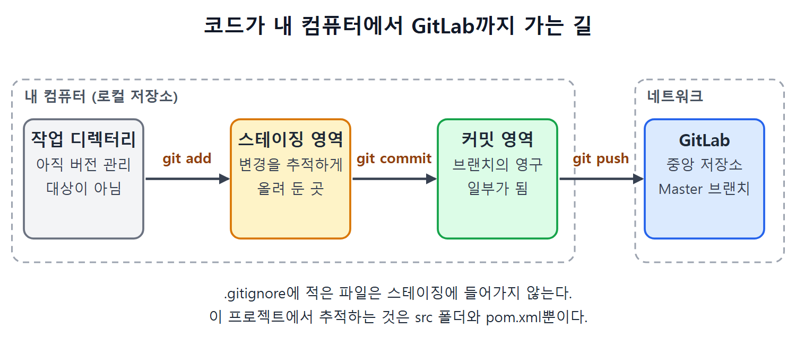

# Git 로컬 저장소와 GitLab 저장소 실습

이 문서는 Java API 프로젝트(CalculatorAPI)를 Git으로 버전 관리하고 GitLab에 올리는 과정을 다섯 단계로 따라간다. 로컬 저장소 만들기, GitLab에 중앙 저장소 만들기, 커밋, 푸시, 기본 브랜치 정리 순서다.

원서는 Windows 명령 프롬프트 기준이다. 아래 명령에서 원서 추출본의 대시 문자가 깨진 곳은 일반 하이픈으로 바로잡아 적었다.

---

## 1단계: 로컬 저장소 만들기

1. 명령 프롬프트를 열고 `cd`로 프로젝트 디렉터리에 들어간다.
2. 빈 로컬 코드 저장소를 만든다.

```
git init
```

저장소가 만들어지면 프로젝트 디렉터리에 `.git` 폴더가 생긴다. 이 폴더는 기본으로 숨김 속성이 켜져 있다. 폴더가 안 보이면 폴더 옵션에서 숨김 파일, 폴더, 드라이브 표시를 선택해야 한다.

`git init`을 실행했을 때 `git`이 내부 또는 외부 명령으로 인식되지 않는다는 오류가 나오면, 명령 프롬프트가 Git을 못 찾는 것이다. 해결 순서는 다음과 같다.

1. 시스템 환경 변수로 들어간다.
2. PATH에 Git을 설치한 폴더 경로를 추가하고 저장한다.
3. 명령 프롬프트를 다시 시작한 뒤 재시도한다.

원서는 명령 프롬프트를 다시 시작하지 않으면 같은 오류가 또 난다고 강조한다. 시스템 환경 변수를 바꾼 뒤에는 해당 소프트웨어를 항상 재시작해야 한다.

---

## 2단계: GitLab에 중앙 저장소 만들기

1. GitLab 계정이 없으면 https://gitlab.com/users/sign_up 에서 가입 양식을 채워 가입한다.
2. https://gitlab.com/users/sign_in 에서 사용자 이름과 비밀번호로 로그인한다. 대시보드가 열린다.
3. New Project 버튼을 누른다.
4. Create New Project 페이지에서 Create Blank Project/Repository 링크를 누른다.
5. Project Name 칸에 프로젝트 이름을 넣고 Visibility Level을 Private으로 둔다.
6. Create Project 버튼을 누른다. 소스 파일이 하나도 없는 빈 프로젝트가 만들어진다.

Visibility Level을 Private으로 두면 허락된 사람만 이 저장소를 볼 수 있다. 그래서 뒤에서 젠킨스가 이 저장소에 접근하려면 자격 증명이 필요하다.

---

## 3단계: 로컬 저장소에 커밋하기

### 브랜치 만들기

브랜치(branch)는 코드의 복사본 갈래다. 복사본에서 작업하면 원본에 영향을 주지 않는다. 빈 저장소에는 브랜치가 없고, `git branch`로 확인할 수 있다. 첫 브랜치는 아래 명령으로 만든다.

```
git checkout -b FirstBranch
```

`FirstBranch`는 원서에서 정한 이름이다.

### .gitignore 만들기

프로젝트 디렉터리에 `.gitignore` 파일을 만들고 아래 내용을 넣는다.

```
.settings
Target
.classpath
.project
```

이 파일에는 Git이 추적하지 않을 디렉터리와 파일 이름을 적는다. 이 프로젝트에서 추적하려는 대상은 `src` 폴더와 `pom.xml`뿐이다. 그래서 나머지는 모두 `.gitignore`에 올린다. 원서 목록에는 `Target`이 대문자로 적혀 있다. Maven의 빌드 출력 폴더는 보통 소문자 `target`이므로 실제로는 대소문자를 확인해야 할 수 있다. 이 부분은 원문 표기를 그대로 옮겼다.

### Git의 세 영역

| 영역 | 의미 |
| --- | --- |
| 작업 디렉터리(Working directory) | 아직 버전 관리 대상이 아닌 코드. Git이 변경을 알지 못한다 |
| 스테이징 영역(Staging area) | Git이 변경을 지켜보고 추적하게 하려면 파일을 이 영역에 추가해야 한다 |
| 커밋 영역(Commit area) | 여기에 넣은 변경은 코드 브랜치의 영구적인 일부가 된다 |

파일은 작업 디렉터리에서 스테이징 영역을 거쳐 커밋 영역으로 가는 순서로 옮겨진다. 스테이징은 "이번에 저장할 것을 장바구니에 담는 단계"라고 보면 된다.



그림은 파일이 `git add`, `git commit`, `git push` 명령을 차례로 거치며 이동하는 모습을 보여 준다. 앞의 세 영역은 내 컴퓨터의 로컬 저장소 안에 있고, 푸시를 해야 네트워크 너머 GitLab의 중앙 저장소로 올라간다.

### 스테이징과 커밋

`git add`를 실행하면 `.gitignore`에 올린 것을 제외한 모든 디렉터리와 파일이 스테이징 영역에 들어간다. 이후 이런 파일을 고치면 Git이 변경을 커밋하라고 알려 주므로 변경을 잃지 않는다.

커밋에 찍힐 사용자 이름과 이메일을 먼저 설정한다.

```
git config --global user.name Pranodayd
git config --global user.email pranoday.dingare@gmail.com
```

그다음 커밋한다. 형식은 `git commit -m <커밋 메시지>`다.

```
git commit -m "First commit in Java API project"
```

원서 추출본에는 옵션이 `--m`으로 보이는 곳이 있다. 일반적인 Git 사용법에 맞춰 `-m`으로 적었다. 원서 화면(Figure 12-5)에서는 `.java` 파일과 `pom.xml`만 브랜치에 커밋된 것을 보여 준다. 나머지는 `.gitignore`에 있어서 스테이징에 들어가지 않았다.

---

## 4단계: GitLab으로 푸시하기

로컬 브랜치를 중앙 저장소로 올리는 명령 형식은 다음과 같다.

```
git push -u <GitLab 저장소 URL> <브랜치 이름>
```

저장소 URL은 GitLab에서 복사한다.

1. GitLab의 코드 저장소 화면에서 Clone 버튼을 누른다.
2. Clone with HTTPS 영역의 Copy URL 버튼을 누른다.
3. 복사한 URL로 푸시 명령을 실행한다.

```
git push -u https://gitlab.com/Pranoday/jenkinsbookcalculatorapi.git FirstBranch
```

실행하면 Git Credentials Manager 창이 뜬다. Git 사용자 이름과 비밀번호를 넣고 OK를 누르면 인증 후 코드가 올라간다. GitLab 저장소 페이지를 새로 고쳐서 코드가 있는지 확인한다.

---

## 5단계: 중앙 저장소에 Master 브랜치 만들기

중앙 저장소의 주 브랜치로 `Master`를 만든다. 개발자 개별 브랜치의 변경을 검토한 뒤 합치는 곳이고, 릴리스도 여기에 합쳐진 코드로 만든다.

1. GitLab에서 New Branch 메뉴를 누른다.
2. Branch Name에 `Master`를 넣고 Create Branch를 누른다. FirstBranch의 코드를 바탕으로 master 브랜치가 생긴다. 이제 브랜치가 두 개다.
3. Settings, Repository 메뉴로 간다.
4. Default Branch 영역의 Expand 버튼을 누르고 드롭다운에서 Master를 고른 뒤 Save Changes를 누른다.
5. Branches 링크로 가서 FirstBranch의 Delete Protected Branch 링크를 누른다.
6. 확인 창에서 입력 칸에 `FirstBranch`를 입력하고 Delete Protected Branch 버튼을 누른다.

| 작업 | GitLab 메뉴 | 목적 |
| --- | --- | --- |
| Master 브랜치 생성 | New Branch | 주 브랜치 확보 |
| 기본 브랜치 변경 | Settings, Repository, Default Branch | Master를 기본으로 지정 |
| FirstBranch 삭제 | Branches, Delete Protected Branch | 브랜치를 Master 하나로 정리 |

결과적으로 브랜치는 Master 하나만 남고, 이것이 기본 브랜치이자 애플리케이션의 주 브랜치다. 기본 브랜치를 바꾸는 이유는 앞으로 Master에 합쳐진 코드에서 릴리스를 만들기 때문이다.

<br>
<br>
<br>

[CICD Pipeline Using Jenkins Unleashed](../)
