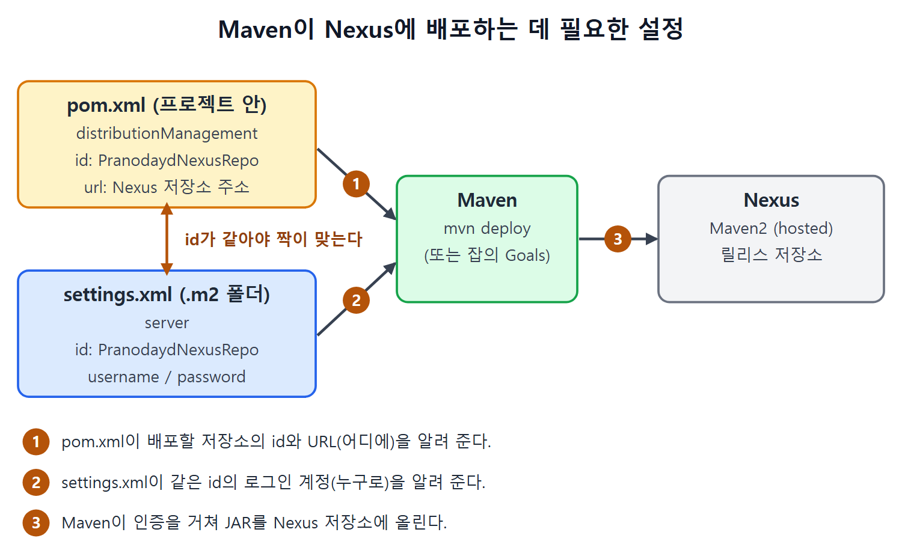

# Maven과 Nexus 연동하고 배포하기

Nexus 저장소를 만들었으니 이제 Maven에게 "결과물을 여기에 올려라"라고 알려 줘야 한다. 이 문서는 pom.xml과 settings.xml에 무엇을 적는지, 그리고 `mvn deploy`로 `CalculatorAPI1.0.jar`를 Nexus에 올리는 과정을 설명한다.

---

## 1. 왜 설정이 필요한가

Maven은 기본적으로 https://repo.maven.apache.org/maven2 를 중앙 저장소로 쓴다. 프로젝트의 아티팩트(`.JAR`)가 배포되는 곳도 기본은 이곳이다. 우리는 새로 만든 Nexus 저장소에 배포하려는 것이므로, Maven에게 이 주소 대신 Nexus 주소를 쓰라고 알려야 한다.

필요한 설정은 둘로 나뉜다.

| 파일 | 위치 | 적는 내용 |
| --- | --- | --- |
| pom.xml | 프로젝트 안 | 배포할 저장소의 ID, 이름, URL |
| settings.xml | `${use.homer}\.m2` (원서 표기 그대로) | 저장소 로그인용 사용자 이름과 비밀번호 |

주소는 프로젝트 파일에, 비밀번호는 사용자 홈 쪽 파일에 따로 둔다. 비밀번호가 프로젝트와 함께 Git에 올라가는 일을 피하는 구조라고 이해하면 쉽다. 이 이유는 원서가 직접 설명한 것이 아니라 두 파일의 역할에서 읽히는 해석이다.

---

## 2. pom.xml에 저장소 URL 넣기

Nexus의 Repositories 목록(Manage Repositories 페이지)에서 만든 저장소 링크를 누르면 URL 칸에서 저장소 URL을 복사할 수 있다. 이 URL을 `pom.xml`의 `<distributionManagement>` 태그 안에 넣는다.

```xml
<distributionManagement>
  <repository>
    <id>PranodaydNexusRepo</id>
    <name>PranodaydNexusRepo</name>
    <url>http://192.168.43.10:8081/repository/JenkinsBookCalculatorAPI_Rel...</url>
  </repository>
</distributionManagement>
```

원서의 코드에는 "Publish the versioned releases here"라는 주석이 붙어 있다. 위 코드는 그 주석을 줄였다. 원서 추출본에서 `<url>` 줄이 `..._Rel`에서 잘려 있다. 앞서 만든 저장소 이름이 `JenkinsBookCalculatorAPI_Release`이므로 URL 끝은 `JenkinsBookCalculatorAPI_Release`일 것으로 보이지만, 이는 추정이다. 실제로는 Nexus에서 복사한 URL을 그대로 쓰면 된다.

---

## 3. settings.xml에 로그인 정보 넣기

Nexus는 익명 접근을 막아 두었다. 그래서 Maven이 배포할 때 쓸 사용자 이름과 비밀번호를 `settings.xml`에 적는다. 파일이 없으면 만들면 된다.

```xml
<servers>
  <server>
    <id>PranodaydNexusRepo</id>
    <username>admin</username>
    <password>admin123</password>
  </server>
</servers>
```

원서에는 "이 id는 pom.xml에 적은 저장소 서버의 id와 같아야 한다"는 주석이 코드 안에 있다. 값 `admin123`은 원서의 예시 비밀번호다. 앞서 설정 마법사에서 새 관리자 비밀번호를 정했으므로, 실제 환경에서는 자기가 정한 비밀번호를 써야 한다.

| 항목 | pom.xml | settings.xml |
| --- | --- | --- |
| 태그 | `<repository>` 안의 `<id>` | `<server>` 안의 `<id>` |
| 원서 값 | PranodaydNexusRepo | PranodaydNexusRepo |
| 규칙 | 두 `<id>`는 같아야 한다 | 두 `<id>`는 같아야 한다 |

Maven은 이 `<id>`를 열쇠로 삼아 "이 저장소에는 이 계정으로 로그인하라"고 짝을 맞춘다. 두 값이 다르면 비밀번호를 찾지 못해 인증에 실패할 것이다. 이 결과는 원서가 말한 규칙에서 이어지는 추론이다.



그림은 pom.xml이 배포할 저장소의 주소를, settings.xml이 같은 id의 로그인 계정을 Maven에게 알려 주는 관계를 보여 준다. 두 정보를 받은 Maven이 인증을 거쳐 Nexus 저장소에 JAR를 올린다.

---

## 4. mvn deploy로 릴리스하기

설정이 끝나면 `CalculatorAPI.jar`를 Nexus에 올릴 준비가 된 것이다.

1. 명령 프롬프트를 열고 `cd`로 Java API 프로젝트 디렉터리로 간다.
2. 아래 명령을 실행한다.

```
mvn deploy
```

`deploy`는 Maven 빌드 생명주기의 마지막 단계라서 앞 단계가 모두 순서대로 실행된다.

| 순서 | 일어나는 일 |
| --- | --- |
| 1 | 필요한 리소스 내려받기 |
| 2 | 소스 코드 컴파일 |
| 3 | 단위 테스트 코드 컴파일 |
| 4 | 단위 테스트 실행 |
| 5 | 클래스 파일을 `CalculatorAPI1.0.jar`로 패키징 |
| 6 | 만들어진 `CalculatorAPI1.0.jar`를 Nexus 저장소에 배포 |

테스트가 실패하면 뒤 단계로 가지 못한다. 그래서 깨진 코드가 릴리스로 나가는 일을 막아 주는 효과가 있다. 이 설명은 생명주기가 순서대로 진행된다는 원서 서술을 바탕으로 한 해석이다.

---

## 5. Nexus에서 릴리스 확인하기

1. Nexus 대시보드로 간다.
2. Repositories 목록(Manage Repositories 페이지)에서 만든 저장소 행의 Browse 링크를 누른다. 대시보드 왼쪽에 있다.
3. Browse Assets and Components 페이지의 목록에서 저장소 항목을 누른다.
4. `CalculatorAPI1.0.jar`가 올라와 있으면 릴리스에 성공한 것이다.

이 수동 릴리스를 젠킨스 잡이 대신 해 주도록 만드는 것이 다음 문서의 내용이다.

<br>
<br>
<br>

[CICD Pipeline Using Jenkins Unleashed](../)
