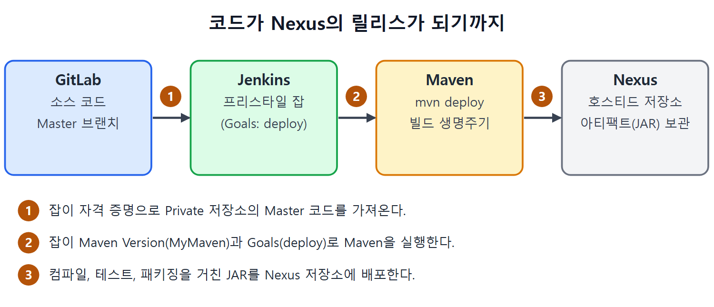

# 버전 관리와 Git 이해하기

젠킨스 잡이 빌드를 하려면 먼저 소스 코드를 어디선가 가져와야 한다. 그 "어디"가 보통 Git으로 관리하는 코드 저장소다. 이 문서는 버전 관리 시스템이 무엇인지, 세 가지 종류가 어떻게 다른지, Git과 GitHub/GitLab이 어떤 관계인지를 정리한다.

비유하자면 버전 관리는 문서 작업의 "저장 이력 노트"다. 파일 이름을 `최종`, `진짜최종`, `진짜최종2`로 바꿔 가며 복사해 두는 대신, 도구가 변경 이력을 알아서 쌓아 준다고 생각하면 된다.

---

## 1. 버전 관리 시스템이 하는 일

버전 관리 시스템(Version Control System)은 코드의 여러 버전을 보관하고 바뀐 내용을 추적하는 도구다. 개발자는 이 도구로 애플리케이션이 어떻게 자라 왔는지 볼 수 있다. 새 함수가 붙은 일, 옛 함수가 사라진 일, 결함을 고치려고 기존 함수를 수정한 일이 모두 이력으로 남는다.

여러 사람이 함께 일할 때도 필요하다. 이때 애플리케이션 코드는 모든 개발자가 접근할 수 있는 한곳에 놓이는데, 이곳을 중앙 저장소(central repository)라고 한다. 중앙 저장소에는 개발과 테스트를 마친 정상 동작 코드가 계속 쌓인다.

협업 환경에서 개발자가 챙길 일은 두 가지다.

- 각자 끝낸 변경 중 테스트까지 통과한 것을 중앙 저장소의 코드에 합친다(병합, merge).
- 내 손에 있는 코드를 중앙 저장소의 최신 변경과 맞춘다.

이 흐름은 뒤에서 GitLab으로 직접 해 본다.

---

## 2. 버전 관리 시스템 세 가지

| 종류 | 코드 저장소 위치 | 특징 | 원서의 예 |
| --- | --- | --- | --- |
| 중앙집중형 | 서버 한 대 | 서버에 계속 연결되어 있어야 버전 관리를 할 수 있다. 네트워크가 없으면 내 컴퓨터에서 이력을 관리할 수 없다 | Tortoise SVN |
| 로컬형 | 내 컴퓨터 | 흔하고 단순하지만, 엉뚱한 파일에 변경을 쓸 가능성이 커서 실수하기 쉽다 | 없음 |
| 분산형 | 내 컴퓨터(로컬 저장소)와 네트워크상의 중앙 저장소 | 네트워크가 끊겨도 버전 관리 기능을 쓸 수 있다 | Git |

표를 읽는 법은 간단하다. 중앙집중형은 "항상 서버에 붙어야 한다"가 약점이고, 로컬형은 "나 혼자라서 실수를 못 거른다"가 약점이다. 분산형은 두 방식의 장점을 합쳐 약점을 줄였다.

분산형에서는 저장소가 두 종류다.

- 로컬 저장소(Local Repository): 개발자마다 자기 컴퓨터에 두는 저장소다. 작업이 진행되는 동안 변경을 추적하고 여러 버전을 보관한다.
- 중앙 저장소(Central Repository): 모든 개발자가 접근하는 네트워크상의 코드 버전이다. 개발자들이 변경을 합쳐 넣는 최종 목적지다.

개발자는 변경이 진행되는 동안에는 자기 컴퓨터에서 이력을 관리한다. 변경을 끝내고 테스트까지 마치면 중앙의 최종 버전에 합치도록 보낸다. 애플리케이션 빌드는 바로 이 중앙 버전에서 만들어진다. 젠킨스가 가져가는 코드도 이 중앙 버전이다.

---

## 3. Git 설치

설치 순서는 짧다.

1. https://git-scm.com/downloads 에서 사용하는 컴퓨터 환경에 맞는 버전을 내려받는다.
2. 설치 마법사를 실행해 설치한다.
3. 설치가 끝나면 Git 설치 경로가 PATH 환경 변수에 들어 있는지 확인한다.

Git에는 명령어 모음으로 이루어진 CLI(명령줄 인터페이스)가 있다. 앞으로 나오는 `git init`, `git add` 같은 명령이 모두 이 CLI의 명령이다. PATH에 경로가 빠져 있으면 명령 프롬프트가 `git`을 찾지 못한다. 이 문제는 다른 문서의 Git 실습에서 다시 다룬다.

---

## 4. Git과 GitHub/GitLab의 관계

많은 사람이 Git과 GitLab/GitHub를 헷갈린다. 원서의 구분은 이렇다.

| 이름 | 정체 | 하는 일 |
| --- | --- | --- |
| Git | 분산 버전 관리 시스템 | 로컬 저장소 만들기, 브랜치(코드 갈래) 만들기, 변경 커밋하기 같은 명령을 제공한다 |
| GitHub / GitLab | 웹에 만들어 두는 중앙 저장소 서비스 | 개발자들이 접근할 수 있는 중앙 저장소를 제공한다 |

Git은 "도구"이고 GitHub/GitLab은 "도구로 만든 코드를 올려 두는 공용 창고"다. 이 장의 실습은 GitLab을 중앙 저장소로 쓴다.

---

## 5. 이 장에서 Git이 맡는 역할

이 장의 큰 그림은 이렇다. 젠킨스가 Git 저장소에서 Java API 프로젝트의 원본 소스를 가져오고, 빌드 도구(Maven)가 모든 빌드 생명주기 단계를 거쳐 아티팩트(빌드 결과물)를 만든다. 그 아티팩트가 최종 목적지인 Nexus 저장소에 올라간다. Git은 이 흐름의 출발점이다.

그림은 이 장 전체의 흐름을 네 칸으로 보여 준다. GitLab의 소스 코드를 젠킨스 잡이 가져와 Maven으로 빌드하고, 만들어진 JAR를 Nexus에 올린다.

 
 
 

[CICD Pipeline Using Jenkins Unleashed](../)
