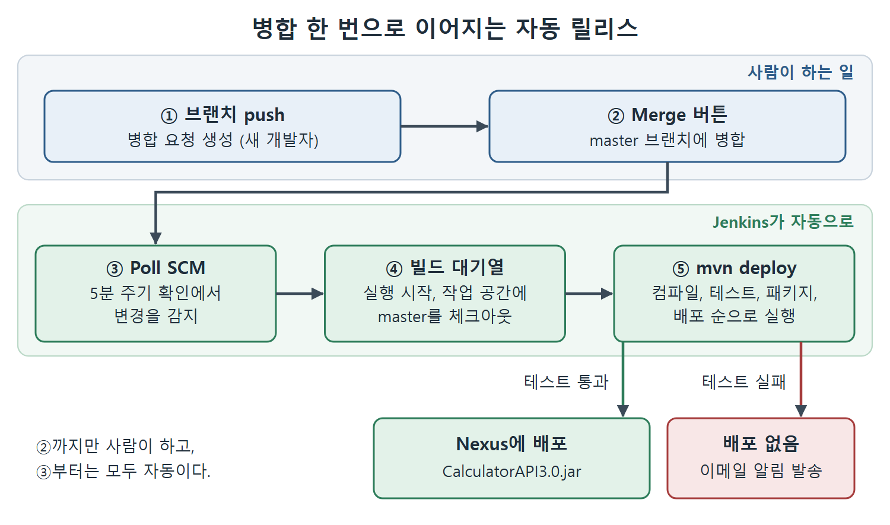

# 병합으로 빌드 트리거하고 실패 알림 보기

준비는 모두 끝났다. 곱셈 기능이 담긴 브랜치가 있고, master를 5분마다 살펴보는 잡이 있고, 메일을 보낼 설정도 있다. 이제 GitLab에서 병합 버튼을 눌러 변경이 master에 들어가게 하면, 잡이 스스로 빌드를 시작하고 3.0 버전 JAR를 Nexus에 올려야 한다.

이 문서는 그 과정을 따라가며 확인할 지점을 정리하고, 잡이 소스 코드를 어디에 내려받아 빌드하는지 설명한다. 마지막으로 일부러 테스트를 깨뜨려서 실패 메일이 오는 것까지 본다.

---

## 1. 병합해서 잡을 깨우기

1. GitLab 저장소 페이지의 왼쪽 메뉴에서 Merge requests를 누른다. Merge Requests 페이지가 열린다.
2. 앞에서 만든 병합 요청 "Multiplication function is added in Calculator API" 링크를 누른다.
3. Merge 버튼을 눌러 MultiplicationFunction 브랜치를 master 브랜치에 합친다.
4. Jenkins 대시보드로 이동한다. Jenkins가 다음 폴링 시간에 저장소를 확인할 때까지 기다린다.
5. 빌드가 Build Queue(빌드 대기열)에 나타나고, 곧 실행이 시작되면 Build Executor Status(빌드 실행기 상태) 영역에 표시된다.

Poll SCM의 주기가 5분이므로 병합 직후에 바로 시작되지 않고 최대 몇 분을 기다릴 수 있다. 원서도 "다음 폴링 시간까지 기다리라"고 안내한다.

## 2. 콘솔 출력으로 확인할 것

빌드의 Console Output(콘솔 출력)을 열어 다음 두 가지를 본다.

| 확인할 위치 | 볼 내용 | 의미 |
| --- | --- | --- |
| 콘솔 로그 맨 위 | SCM 변경 때문에 시작되었다는 문구 | 사람이 누른 빌드가 아니라 자동 트리거로 돈 빌드 |
| 콘솔 로그 아래쪽 | CalculatorAPI3.0.jar 배포 성공 | pom.xml 버전 3.0이 Nexus에 올라감 |

그다음 Nexus 저장소 화면으로 가서 CalculatorAPI의 3.0 버전이 실제로 올라와 있는지 눈으로 확인한다. 이로써 "병합 한 번으로 새 버전이 릴리스되는" 흐름이 완성된다.

## 3. 전체 흐름 정리

| 순서 | 일어나는 일 | 누가 |
| --- | --- | --- |
| 1 | 브랜치 push, 병합 요청 생성 | 새 개발자 |
| 2 | Merge 버튼으로 master에 병합 | 사람 |
| 3 | 5분 주기 확인에서 변경 감지 | Jenkins |
| 4 | 빌드 대기열에 들어가 실행 | Jenkins |
| 5 | `mvn deploy`로 3.0 JAR를 Nexus에 배포 | Jenkins |

표의 2번까지만 사람이 하고 3번부터는 모두 자동이다. 이것이 자동 트리거 잡의 가치다.



그림은 사람이 하는 push와 병합 뒤에 Jenkins가 변경 감지, 빌드 실행, mvn deploy를 자동으로 이어 가고, 테스트 결과에 따라 배포 또는 이메일 알림으로 갈라지는 모습을 보여 준다.

## 4. SCM을 설정한 잡의 실행 방식

SCM이 설정된 잡이 실행되면 Jenkins는 정해진 위치에 작업 공간(workspace)을 만든다. 순서는 이렇다.

1. `$(Jenkins.home)` 위치 아래에 workspace 디렉터리가 만들어진다.
2. 그 안에 잡 이름으로 된 디렉터리가 만들어진다.
3. 설정한 브랜치가 그 디렉터리에 체크아웃(checkout, 코드를 내려받아 작업 폴더로 펼침)된다.

원서의 환경에서는 master 브랜치가 다음 경로에 내려받아졌다.

```
C:\Users\magicuser\.jenkins\workspace\ReleaseCalculatorAPIAutoTrigger
```

이 디렉터리가 이 빌드의 작업 디렉터리(working directory)가 된다. `mvn deploy` 스텝은 여기서 실행되어 Maven의 모든 빌드 단계를 거치고, 만들어진 JAR 파일을 Nexus에 배포한다.

| 구성 | 경로 구조 | 설명 |
| --- | --- | --- |
| Jenkins 홈 | `$(Jenkins.home)` | 원서는 `C:\Users\magicuser\.jenkins` |
| 작업 공간 | `workspace` | 잡마다 폴더를 따로 둔다 |
| 잡 폴더 | `workspace\잡이름` | 체크아웃된 코드가 있는 곳 |

잡마다 폴더가 따로 있으니 서로 다른 잡의 코드가 섞이지 않는다.

## 5. 일부러 실패시켜 이메일 알림 보기

잡은 빌드가 불안정할 때 메일을 보내도록 Send e-mail for every unstable build 옵션을 켜 두었다. 이것이 정말 동작하는지 확인하기 위해 원서는 일부러 실패를 만든다.

1. TestAdditionFunctionality.java에서 덧셈 테스트 하나의 기대 결과를 일부러 틀린 값으로 바꾼다. Addition() 함수에 값 두 개를 보내고 결과를 비교하는 테스트인데, 비교 값이 맞지 않게 된다.
2. 변경을 로컬 저장소의 브랜치에 커밋하고 원격으로 push한다.
3. 병합 요청을 만들어 master에 병합한다. 이 병합이 빌드를 트리거한다.
4. 트리거된 빌드 #6이 테스트 케이스 실패 때문에 실패한다.
5. 실패에 대한 이메일 알림이 도착한다. 메일을 열면 실패한 빌드의 콘솔 출력 로그를 볼 수 있다.

앞 문서에서 설명했듯 `mvn deploy`는 테스트 단계를 지나서 배포하므로, 이 빌드에서는 JAR가 Nexus에 올라가지 않는다. 이 동작은 원서가 직접 언급하지 않은 Maven의 일반 동작에서 이끌어낸 설명이다.

| 상황 | 빌드 결과 | 알림 |
| --- | --- | --- |
| 정상 변경 병합 | 성공, JAR 배포 | 메일 없음 |
| 테스트를 깨뜨린 변경 병합(빌드 #6) | 실패 | 이메일 알림 |

이메일 알림 덕분에 개발자는 Jenkins 화면을 계속 지켜보지 않아도 된다. 빌드가 깨졌을 때만 연락을 받고, 메일의 링크로 곧바로 원인 로그를 확인하면 된다. 정상 빌드에서 메일이 오지 않는다는 부분은 원서가 명시한 것이 아니라 설정 의도에서 보는 해석이다.

<br>
<br>
<br>

[CICD Pipeline Using Jenkins Unleashed](../)
